# 调研总览与索引（AIOS 与多智能体协作）

> **本文件是整个 `doc/` 调研的总入口**。它回答四个问题：我们读了什么（25 篇论文 + 工程文章）、每篇为什么值得读、结论是什么（12 条速查）、不同读者应该按什么顺序读。
>
> **统计**：论文 PDF **25 篇**（共 124 MB，位于 `doc/papers/`）｜中文精读与翻译文档 **9 份**（`doc/01`–`doc/09`）｜同类项目调研 **1 份**（`doc/11`，131 个候选、32 个评分）｜源码阅读指南 **1 份**（`doc/12`，两仓库 37,104 行代码的导读）｜SDK 使用指南 **1 份**（`doc/13`，Cerebrum `ab7e434` 四类 API 与五个源码坑）｜机制综述 **1 份**（`doc/14`，分配—执行—汇总三环节 + 九类角色 + 12 系统对照）｜分解方法 **1 份**（`doc/15`，可并行性五判据 + 五种分解策略 + 三份 Prompt 模板）｜协作模式报告 **1 份**（`doc/16`，11 种模式拆解 + 横向对比 + 选型决策树）｜调度算法与加速原型 **1 份**（`doc/17`，经典/LLM 调度目录 + E1–E4 实验 + CP-RA 算法 + `src/scheduler.py`，9 节点 7.0s→4.50s=1.55×）｜创新方向规划 **1 份**（`doc/18`，8 个候选方向 + 四维打分 + 「3 核心 + 2 加分 + 3 备选」组合 + 里程碑与评委八问）｜工程文章摘要 **4 篇**（`doc/articles/`）｜调研方法与规范 **5 份**（`doc/10-调研方法与规范/`）｜调研窗口 2026-11-17（方法沉淀 2026-11-18、同类项目调研 2026-11-18、源码导读 2026-11-18、机制综述与分解方法 2026-11-20）。
>
> **一句话结论**：AIOS 提供的是"**资源与调度的内核层**"，多智能体协作提供的是"**任务分解与协作的编排层**"；本赛题要求的"≥4 并行子任务 + ≥3 对双向交互 + 依赖约束 + 相对串行提速 ≥20%"，只有把两层叠起来（DAG 编排在应用层、并发与上下文管理在内核层、批处理在推理服务层）才能同时成立。完整设计见 `doc/03`。

---

## 1. 文献全景

```mermaid
flowchart LR
    subgraph CORE["核心基线（已全文翻译）"]
        A1[doc/01 AIOS<br/>LLM Agent OS]
        A2[doc/02 多智能体协作综述]
    end
    subgraph K["内核与并发（doc/04）"]
        K1[LLM as OS 愿景]
        K2[MemGPT 上下文/内存]
        K3[AgentScope 平台]
        K4[Autellix 服务调度]
    end
    subgraph CO["协作框架（doc/05）"]
        C1[AutoGen]
        C2[MetaGPT]
        C3[CAMEL]
        C4[ChatDev]
        C5[AgentVerse]
    end
    subgraph F["失败模式与拓扑（doc/06）"]
        F1[DyLAN 动态组队]
        F2[MAST 失败分类]
        F3[Chain-of-Agents]
    end
    subgraph P["任务分解与并行（doc/07）"]
        P1[Plan-and-Solve]
        P2[ReWOO]
        P3[LLMCompiler]
        P4[TDAG]
        P5[AutoAgents]
    end
    subgraph B["评测与推理加速（doc/08）"]
        B1[AgentBench]
        B2[GAIA]
        B3[SWE-bench]
        B4[vLLM]
        B5[SGLang]
        B6[Parrot]
    end
    CORE --> K --> CO
    CO --> F
    F --> P
    P --> B
    K --> B
```

**为什么是这五组**：赛题要"在 AIOS 上做多智能体协作"，因此文献必须同时覆盖 **OS 内核（怎么管资源）→ 协作框架（怎么分工对话）→ 协作的坑（怎么不失败）→ 并行分解（怎么省时间）→ 评测与服务（怎么证明和省得更快）** 五个环节，缺一环就会在设计或答辩时被问倒。

---

## 2. 论文清单（25 篇）

### 2.1 核心基线（2 篇，已全文翻译）

| # | arXiv | 论文 | 为什么要读 | 文档 |
| --- | --- | --- | --- | --- |
| 1 | [2403.16971](https://arxiv.org/abs/2403.16971) | *AIOS: LLM Agent Operating System*（COLM 2025，Rutgers） | 赛题指定的基础系统：内核七模块、syscall、上下文切换、SDK、2.1× 吞吐实验 | `doc/01` |
| 2 | [2501.06322](https://arxiv.org/abs/2501.06322) | *Multi-Agent Collaboration Mechanisms: A Survey of LLMs* | 赛题指定的综述：协作类型/策略/结构/协调协议的五维分类，判断"什么样的 MAS 值得做" | `doc/02` |

> 两篇的逐节对照（概念、机制、数字、局限）见 `doc/00-附录A-两篇对照导读.md`。

### 2.2 内核与并发服务（4 篇）

| # | arXiv | 论文 | 为什么要读 | 文档 |
| --- | --- | --- | --- | --- |
| 3 | [2312.03815](https://arxiv.org/abs/2312.03815) | *LLM as OS, Agents as Apps: Envisioning AIOS, Agents and the AIOS-Agent Ecosystem*（Rutgers） | AIOS 的"世界观"：为什么要把 LLM 当 CPU、agent 当应用；生态与接口设计的原始构想 | `doc/04` |
| 4 | [2310.08560](https://arxiv.org/abs/2310.08560) | *MemGPT: Towards LLMs as Operating Systems* | 分层内存（主上下文/外部上下文）与中断机制，对应"长任务上下文管理" | `doc/04` |
| 5 | [2402.14034](https://arxiv.org/abs/2402.14034) | *AgentScope: A Flexible yet Robust Multi-Agent Platform* | 消息传递、分布式执行、容错的工程实现，可作为协作层的平台参考 | `doc/04` |
| 6 | [2502.13965](https://arxiv.org/abs/2502.13965) | *Autellix: An Efficient Serving Engine for LLM Agents as General Programs* | agent 感知的服务调度（程序级调度、请求交织），直接关系"并发是不是真并发" | `doc/04` |

### 2.3 多智能体协作框架（5 篇）

| # | arXiv | 论文 | 为什么要读 | 文档 |
| --- | --- | --- | --- | --- |
| 7 | [2308.08155](https://arxiv.org/abs/2308.08155) | *AutoGen: Enabling Next-Gen LLM Applications via Multi-Agent Conversation* | 可编程对话编排的事实标准，group chat 与终止条件 | `doc/05` |
| 8 | [2308.00352](https://arxiv.org/abs/2308.00352) | *MetaGPT: Meta Programming for A Multi-Agent Collaborative Framework*（ICLR 2024） | SOP 流水线 + 共享消息池，最接近"软件工程多角色协作" | `doc/05` |
| 9 | [2303.17760](https://arxiv.org/abs/2303.17760) | *CAMEL: Communicative Agents for "Mind" Exploration of LLM Society*（NeurIPS 2023） | 角色扮演与 inception prompting，双向对话的最小原型 | `doc/05` |
| 10 | [2307.07924](https://arxiv.org/abs/2307.07924) | *ChatDev: Communicative Agents for Software Development*（ACL 2024） | 聊天链 + communicative dehallucination，软件公司流水线 | `doc/05` |
| 11 | [2308.10848](https://arxiv.org/abs/2308.10848) | *AgentVerse: Facilitating Multi-Agent Collaboration and Exploring Emergent Behaviors*（ICLR 2024） | 专家招募与群体协作、涌现行为 | `doc/05` |

### 2.4 失败模式与拓扑选型（3 篇）

| # | arXiv | 论文 | 为什么要读 | 文档 |
| --- | --- | --- | --- | --- |
| 12 | [2310.02170](https://arxiv.org/abs/2310.02170) | *DyLAN: A Dynamic LLM-Powered Agent Network for Task-Oriented Agent Collaboration*（COLM 2024） | 动态组队/剪枝/提前停止：拓扑应该由任务决定而非拍脑袋 | `doc/06` |
| 13 | [2503.13657](https://arxiv.org/abs/2503.13657) | *Why Do Multi-Agent LLM Systems Fail?*（MAST） | 失败分类法与实证：知道怎么失败，才知道怎么设计防失败 | `doc/06` |
| 14 | [2406.02818](https://arxiv.org/abs/2406.02818) | *Chain of Agents: Large Language Models Collaborating on Long-Context Tasks* | 长上下文下的多 agent 链式协作与通信成本 | `doc/06` |

### 2.5 任务分解、规划与并行执行（5 篇）

| # | arXiv | 论文 | 为什么要读 | 文档 |
| --- | --- | --- | --- | --- |
| 15 | [2305.04091](https://arxiv.org/abs/2305.04091) | *Plan-and-Solve Prompting*（ACL 2023） | "先规划后求解"的证据：计划质量决定分解质量 | `doc/07` |
| 16 | [2305.18323](https://arxiv.org/abs/2305.18323) | *ReWOO: Decoupling Reasoning from Observations* | 规划与观测解耦、变量引用，降低 token 与串行等待 | `doc/07` |
| 17 | [2312.04511](https://arxiv.org/abs/2312.04511) | *An LLM Compiler for Parallel Function Calling*（ICML 2024） | 任务 DAG + 编译器式并行执行，是"≥20% 加速"最直接的机制参考 | `doc/07` |
| 18 | [2402.10178](https://arxiv.org/abs/2402.10178) | *TDAG: A Multi-Agent Framework based on Dynamic Task Decomposition and Agent Generation* | 按子任务动态生成 agent，对应"自动分配" | `doc/07` |
| 19 | [2309.17288](https://arxiv.org/abs/2309.17288) | *AutoAgents: A Framework for Automatic Agent Generation* | 自动生成团队与规划，团队规模与角色如何决定 | `doc/07` |

### 2.6 评测基准与端侧推理加速（6 篇）

| # | arXiv | 论文 | 为什么要读 | 文档 |
| --- | --- | --- | --- | --- |
| 20 | [2308.03688](https://arxiv.org/abs/2308.03688) | *AgentBench: Evaluating LLMs as Agents*（ICLR 2024） | 多环境 agent 评测口径 | `doc/08` |
| 21 | [2311.12983](https://arxiv.org/abs/2311.12983) | *GAIA: A Benchmark for General AI Assistants*（ICLR 2024） | 真实助手的难度阶梯与成功率区间 | `doc/08` |
| 22 | [2310.06770](https://arxiv.org/abs/2310.06770) | *SWE-bench: Can Language Models Resolve Real-World GitHub Issues?*（ICLR 2024） | 真实软件任务的正确性如何判定（测试通过率） | `doc/08` |
| 23 | [2309.06180](https://arxiv.org/abs/2309.06180) | *Efficient Memory Management for LLM Serving with PagedAttention*（vLLM，SOSP 2023） | 连续批处理 + 分页 KV cache：并发请求的吞吐基础 | `doc/08` |
| 24 | [2312.07104](https://arxiv.org/abs/2312.07104) | *SGLang: Efficient Execution of Structured Language Model Programs*（NeurIPS 2024） | RadixAttention 前缀共享：同一系统提示/契约下的重复调用加速 | `doc/08` |
| 25 | [2405.19888](https://arxiv.org/abs/2405.19888) | *Parrot: Efficient Serving of LLM-based Applications with Semantic Variable* | 应用语义级调度与 KV 复用，佐证"服务层是并行加速前提" | `doc/08` |

### 2.7 其他重要参考（未下载全文，仅在需要时引用）

- **OWL**：*OWL: Optimized Workforce Learning for General Multi-Agent Assistance in Real-World Task Automation*（[arXiv:2505.23885](https://arxiv.org/abs/2505.23885)，CAMEL-AI），赛题点名的第二个参考实现，其代码已在 `vendor/owl/`，架构分析见 `doc/09`。
- **OS Agents 综述**（[arXiv:2508.04482](https://arxiv.org/abs/2508.04482)，2025）：*OS Agents: A Survey on MLLM-based Agents for General Computing Devices Use*，面向计算机/手机/浏览器 GUI 自动化的综述；本项目不做 GUI 操作，仅作背景。

---

## 3. 文档地图（17 份中文文档 + 方法规范目录）

| 文档 | 定位 | 覆盖 | 主要读者 |
| --- | --- | --- | --- |
| `doc/00-调研总览与索引.md` | 总入口（本文） | 全部文献与结论 | 所有人 |
| `doc/00-附录A-两篇对照导读.md` | 两篇核心论文的对照导读 | AIOS ↔ 综述 | 评委/新队员 |
| `doc/01-AIOS-中文翻译与总结.md` | AIOS 论文全文翻译 + 逐节评注 | 内核七模块、SDK、实验 | 队员必读 |
| `doc/02-多智能体协作机制综述-中文翻译与总结.md` | 综述全文翻译 + 五维分析 | 协作类型/策略/结构/协调 | 队员必读 |
| `doc/03-赛题对标与多智能体系统设计方案.md` | **设计总纲**：要求形式化、选题、架构、DAG、加速、正确性 | 本项目设计 | 评委/队长 |
| `doc/04-智能体操作系统内核与并发服务-精读.md` | 内核层精读 | 4 篇：LLM-as-OS、MemGPT、AgentScope、Autellix | 内核/调度开发 |
| `doc/05-多智能体协作框架-精读.md` | 协作框架精读 | 5 篇：AutoGen、MetaGPT、CAMEL、ChatDev、AgentVerse | 协作层开发 |
| `doc/06-多智能体失败模式与拓扑选型-精读.md` | 失败与拓扑 | 3 篇：DyLAN、MAST、Chain-of-Agents | 质量/风险评估 |
| `doc/07-任务分解规划与并行执行-精读.md` | 分解与并行 | 5 篇：Plan-and-Solve、ReWOO、LLMCompiler、TDAG、AutoAgents | 调度器开发 |
| `doc/08-评测基准与端侧推理加速-精读.md` | 评测与加速 | 6 篇 + 加速比基准协议 | 测试/答辩 |
| `doc/09-AIOS与OWL代码库调研与SDK实践.md` | 代码库落地 | 模块地图、SDK 用法、最小可行架构、风险与工作量 | 实现负责人 |
| `doc/10-调研方法与规范/` | **调研方法论**：怎么找、怎么读、怎么写、怎么验 | 5 份：总览与工作流、检索与相似项目发现、精读与写作、质检清单与模板、案例复盘 | 新队员/后续调研 |
| `doc/11-同类项目调研与创新空位分析.md` | **创新性论证**：131 个候选项目、32 个评分、五层对照、G1–G5 空位 | 同类项目与"我们还能做什么" | 评委/队长/答辩 |
| `doc/12-AIOS与OWL代码阅读指南.md` | **源码导读**：两仓库代码规模统计、三条阅读路线、请求生命周期、10 个坑、自测 12 问 | 怎么读 vendor 源码 | 实现负责人/新队员 |
| `doc/13-AIOS-Agent-SDK使用指南.md` | **SDK 用法**：Cerebrum 安装启动、`llm_chat/memory/storage/tool` 四类 API 签名、Agent 三件套、7B 接法、四角色并行骨架、10 个坑、15 项自测 | 怎么写 Agent 并调内核 | 实现负责人/队员 |
| `doc/14-多智能体系统的任务分配执行与汇总.md` | **机制综述**：分配三路线（静态编制/DAG 规划/运行时派发）、执行四范式（串行对话/黑板/DAG 并行/异步 worker）、汇总五形态、九类角色学、12 系统对照、赛题落地建议 | "别人怎么做"与"我们抄什么、改什么" | 架构/答辩/全员 |
| `doc/15-任务分解为可并行子任务的方法与模板.md` | **分解方法论**：可并行性五判据（D/C/R/P 依赖）、五种分解策略、七步 SOP、三份可复制 Prompt、四类校验、端侧 7B 约束、看板示例 | 怎么把任务拆成 ≥4 个能真并行的子任务 | Planner/调度负责人 |
| `doc/16-多智能体协作模式研究报告.md` | **模式选型**：四维坐标系（类型×结构×策略×协调）、11 种协作模式拆解（顺序链/SOP/双人对偶/黑板/中心编排/分层/辩论/投票/动态 DAG/交接/自组织）、横向对比表、通信契约五元组、选择决策树、MAST 三类失败映射、赛题「五件套」混合模式与「明确不采用」清单 | `doc/02` §5、`doc/05`、`doc/06`、`doc/07`、`doc/14`、`vendor/` 源码 |
| `doc/17-任务调度算法调研与多智能体应用.md` | **调度与加速**：问题形式化与三个下界、经典算法目录（FCFS/SPT/LPT/优先级/EDD/RR/HEFT/关键路径/工作窃取/回填）、LLM 调度特殊性（连续批处理、前缀缓存、引擎外时间 30–50%）、E1–E4 实验与真实线程演示、AIOS 内核映射、CP-RA 算法、`src/scheduler.py` 用法、8 条风险反模式 | 实现调度器、写加速实验、答辩被问「20% 怎么来的」 | 实现负责人/答辩 |
| `doc/18-创新方向探索与选题规划.md` | **创新选题**：8 个候选方向四维打分（创新性/可实现性/可测量性/赛题契合），推荐「调度层 D1 + 内核批窗口 D2 + 协议层 D4 + 事务层 D5 + 基准 D8」组合，含预期收益、落地文件、验证实验、里程碑（26–36 人日）、评委八问预答、不做清单与伪加速自检表 | 确定做什么、怎么讲创新、怎么排期 | 队长/全员/答辩 |
| `doc/articles/` | 工程文章摘要 | Anthropic 两篇 + AIOS/OWL 官方文档要点 | 所有人 |

---

## 4. 工程文章清单（`doc/articles/`）

| 文章 | 来源 | 为什么读 |
| --- | --- | --- |
| *Building Effective Agents* | Anthropic Engineering | 工程界对"何时用工作流、何时用多 agent"的判断标准与反模式 |
| *How we built our multi-agent research system* | Anthropic Engineering | 生产级多 agent 系统的编排、评估与失败处理经验 |
| AIOS 官方 README / docs | github.com/agiresearch/AIOS | 与论文的差异、实际 SDK 接口与部署方式 |
| OWL 官方 README（中/英） | github.com/camel-ai/owl | Workforce 任务-工作者架构、GAIA 实践、可复用组件 |

> 每篇文件头标注来源 URL、标题与抓取日期（2026-11-17），正文为中文结构化摘要；外部文章仅作资料，其观点以论文与代码为准。

---

## 5. 八条阅读路线

**路线 A：评委/指导老师（约 30 分钟）**
`doc/00`（本文）→ `doc/03` §0–§2（要求形式化、选题合理性）→ `doc/03` §5–§6（DAG、加速与测量）→ 现场演示。

**路线 B：新队员（约 3 小时，一周内读完）**
`doc/01`（AIOS 全文）→ `doc/02`（综述全文）→ `doc/03`（设计总纲）→ `doc/05`（协作框架，理解"跟现成框架的区别"）→ `doc/07`（DAG 并行，动手实现调度器）→ `doc/09`（代码落地）。

**路线 C：负责加速/评测的队员（约 1 天）**
`doc/03` §5.6–§6 → `doc/08` 全部（尤其"加速比基准测试方案"）→ `doc/07` 的 LLMCompiler 章节 → `doc/04` 的 Autellix 章节 → 动手写基准脚本。

**路线 D：接手第二批调研的队员（约 1 小时）**
`doc/10-调研方法与规范/00-总览与工作流.md`（七阶段与 DoD）→ `01-检索与相似项目发现规范.md`（六维定义、检索日志、Recall 评估）→ `02-精读与写作规范.md`（七节卡片与数字纪律）→ `03-质检清单与模板.md`（复制模板开工）→ `04-案例复盘-本项目调研.md`（避免重复踩坑）。

**路线 E：准备答辩"凭什么说创新"（约 40 分钟）**
`doc/11` §0（六条硬结论 + G1–G5 空位）→ §3.2 评分表（谁最像我们）→ §4.2/§5（框架与机制对照）→ §6（五个空位的边界与指标）→ `doc/03` §3.4.2（与公开实现的边界话术）→ §7.3 演示证据链。

**路线 F：动手前读源码（半天到一天）**
`doc/12` §0（规模与"哪些不用读"）→ §2 路线 A/B（30 分钟速览 → 半天内核主线）→ §3 请求生命周期 → §4 关键文件清单 → §5 十个坑 → §6 对接顺序 → §7 自测 12 问。

**路线 G：今天就要写出第一个 Agent（约 1 小时）**
`doc/13` §0（一页速览）→ §2（安装启动）→ §3（20 行跑通 `llm_chat`）→ §5（Agent 三件套）→ §6（四角色并行骨架）→ §9（十个坑）→ §11（15 项自测）；遇到内核/并发原理问题回查 `doc/04`、`doc/12`。

**路线 H：设计"分配—执行—汇总"三环节（约 2 小时）**
`doc/14` §0（一页速览 + 六条硬结论）→ §2（分配三路线，对照 camel 依赖门控与 LLMCompiler DAG）→ §3（执行四范式，注意 AIOS 只有请求级并发）→ §4（汇总五形态 + AgentScope verifier 闭环）→ §5（九类角色与最小可用组合）→ §7（赛题落地五条）；设计定稿前回查 `doc/03` §4–§6 与 `doc/11` G1–G5。

**路线 I：把任务拆成可并行子任务（约 1 小时）**
`doc/15` §0（六条硬结论）→ §2（五判据与 D/C/R/P 依赖，重点看「删 P 依赖」前后对比图）→ §4（七步 SOP + 看板示例估时）→ §5（直接复制 Planner Prompt）→ §6（四类校验）；落地时与 `doc/07` 的 LLMCompiler 章节、`doc/14` §2 的分配机制对照。

**路线 J：选协作模式（约 30 分钟）**
`doc/16` §0.2（模式→加速潜力→质量风险表）→ §1.2（四种通信范式↔拓扑）→ §5（选择决策树）→ §7（赛题五件套与「不采用」清单）。若只读一页，读 §0.2 那张表。

**路线 K：做调度与加速实验（约 1 小时）**
`doc/17` §0（八条结论）→ §1（问题形式化与三个下界，先算 CP）→ §4.7（容量×策略矩阵，最重要的证据）→ §5（AIOS 内核为什么必须应用层调度）→ §6（CP-RA 伪代码）→ §7（`src/scheduler.py` 用法）；配 `doc/15` §4 的分解 SOP 与 `doc/03` §6.2 的基准协议。

**路线 L：定选题、讲创新（约 40 分钟）**
`doc/18` §0（八个方向一页表与推荐组合）→ §1（评判口径与「别人做到哪了」）→ §3 中 P0 三项（D1/D4/D5）→ §4（评分映射与交付物）→ §5（里程碑）→ §6.2（评委八问预答）；答辩前用 §7 的伪加速自检表逐条打勾。

---

## 6. 关键结论速查（12 条）

1. **AIOS 的抽象是有效的，但收益来自调度而非"更聪明的模型"**：AIOS 报告最高 2.1× 吞吐提升（Llama-3.1-8b + Reflexion），且任务成功率不降反升；调度层面无 AIOS / FIFO / RR 的总耗时分别为 152.1 / 74.2 / 77.3 秒，p90 等待 11.0 / 5.0 / 4.2 秒（`doc/01` §5）。
2. **"LLM 即 CPU、agent 即应用"的愿景**把资源管理与应用逻辑分离，是理解 AIOS SDK 设计意图的钥匙（`doc/04` 第 1 篇）。
3. **上下文是稀缺资源，必须分层管理**：MemGPT 的主上下文/外部上下文两级内存与中断机制，可直接映射到长任务的"上下文快照 + 恢复"（`doc/04` 第 2 篇）。
4. **现有多智能体框架大多是"对话式串行编排"，不是并行系统**：AutoGen/MetaGPT/ChatDev 的价值在角色分工与流程约束，而"并行"往往停留在论文概念层面（`doc/05`）。
5. **多智能体不是免费午餐**：综述明确警告"设计不当的 MAS 可能不如强提示的单 agent"；MAST 进一步给出三类失败模式与实证占比，"验证不足"是高频失败源（`doc/02`、`doc/06`）。
6. **拓扑应由任务决定**：DyLAN 的动态组队/剪枝/提前停止说明"固定 4 个 agent 聊天"不是最优解，团队规模与连接方式应随子任务调整（`doc/06` 第 1 篇）。
7. **并行加速的关键机制是任务 DAG + 并行执行器**：LLMCompiler 把函数调用编译成依赖图并行调度，报告了显著的延迟下降与成本节省；这是"≥20% 加速"最直接的机制参考（`doc/07` 第 3 篇）。
8. **服务层并发是端侧加速的前提**：vLLM 的连续批处理/PagedAttention、SGLang 的 RadixAttention 前缀共享、Parrot 的语义调度，决定了"多个 agent 同时打 7B 模型"能否真正变快（`doc/08`）。
9. **正确性必须靠独立验证器**：AgentBench/GAIA/SWE-bench 的成功率区间表明，7B 级模型做复杂任务必须靠分工 + 工具约束 + 自动测试，而非单次生成（`doc/08`）。
10. **工程落地有抓手**：AIOS 的模块化内核与 OWL 的 Workforce/Task 模型可以复用，但需要适配层把"DAG 编排"接进 syscall 与 agent runtime（`doc/09`）。
11. **同类项目已很拥挤，创新必须落在"AIOS 应用层调度 + 7B 实测"**：131 个候选里"Agent OS"品牌层（OpenFang/AOS-CE/elizaOS）与通用编排层（LangGraph/camel/agentflow）都已成熟，"依赖门控"（camel `Workforce`）与"依赖边触发"（LangGraph Pregel）不是新东西；但**没有一个把调度做进 AIOS 的请求生命周期、也没有一个给出 7B 端侧串行 vs 并行的墙钟实测**——这正是 G1/G2 的可辩护创新点（`doc/11` §0、§5.2）。
12. **多智能体的能力差异集中在"执行"，不在"分配/汇总"**：能并行的只有 LLMCompiler/agentflow/LangGraph/camel 四家（且仅 LLMCompiler 公开加速数字 1.80×/3.74×），分配普遍是"LLM 判一次 + 规则校验 + 失败兜底"，汇总普遍是"最后一个 agent 写总结"；唯一做成通用组件的是 AgentScope `GoalPipeline` 的 executor↔verifier 闭环（`doc/14`）。

---

## 7. 调研方法与质量控制

- **选文标准**：以赛题点名的 2 篇为核心，向外扩展"内核/协作/失败/并行/评测"五组；每组覆盖"经典奠基 + 近年改进 + 工程落地"三类，共 25 篇，避免只读综述不读一手论文。
- **阅读方式**：全文 PDF 用 `pdftotext -layout` 抽取为纯文本（`build/papertext/`，约 3 MB，git 忽略），逐篇按"摘要→方法→实验→结论"通读关键章节，禁止只读摘要写作。
- **事实纪律**：所有数字、表号、章节号必须能在原文定位；论文未给出的内容显式标注"论文未给出"；不确定的作者/会议信息宁缺毋滥。
- **交叉校验**：同一机制（如上下文切换、并行调度）在两篇以上论文中出现时，精读文档需指出异同；核心数字（如 AIOS 的 2.1×、LLMCompiler 的加速比）在后文引用时需回原文核对。
- **可复现**：下载脚本逻辑见本文件 §8，任何队员可按同一清单复现。
- **有规范**：以上做法已固化为 `doc/10-调研方法与规范/`（工作流、检索、精读写作、质检模板、案例复盘五份），后续新增文献或换人接手时按该套规范执行，不再依赖口头约定。

---

## 8. 下载与复现清单

- **PDF 目录**：`doc/papers/`，命名 `<arXiv id>-<英文短名>.pdf`，共 25 篇、124 MB。
- **纯文本**：`build/papertext/<arXiv id>-<英文短名>.txt`（`pdftotext -layout -enc UTF-8` 生成，git 忽略）。
- **下载方式**：Python `urllib` 访问 `https://arxiv.org/pdf/<id>`（本机 pwsh 直连 HTTPS 失败、python 可用；每篇间隔 3 秒，失败重试）。
- **工程文章**：用 `web_fetch` 抓取后人工整理为中文摘要，存 `doc/articles/`，文件头保留原始 URL 与抓取日期。

| 分组 | 篇数 | 文档 |
| --- | --- | --- |
| 核心基线 | 2 | `doc/01`、`doc/02` |
| 内核与并发服务 | 4 | `doc/04` |
| 多智能体协作框架 | 5 | `doc/05` |
| 失败模式与拓扑 | 3 | `doc/06` |
| 任务分解与并行 | 5 | `doc/07` |
| 评测与推理加速 | 6 | `doc/08` |
| **合计** | **25** | |

---

## 9. 更新记录

| 日期 | 变更 |
| --- | --- |
| 2026-11-17 | 建立文献清单并完成 25 篇论文下载与文本抽取；完成 9 份中文精读/翻译/设计文档（`doc/01`–`doc/09`）与 4 篇工程文章摘要；本索引首版 |
| 2026-11-17 | 完成交付前一致性检查：文档交叉引用全部有效、`doc/00` 引用的 arXiv 编号与 `doc/papers/` 的 25 个 PDF 一一对应（`doc/00` §2.7 两篇为声明未下载）、全部 Markdown 代码块配平、各精读文档关键数字已抽样回原文核对（LLMCompiler 加速比、MAST 失败占比、MetaGPT Pass@1 等） |
| 2026-11-18 | 新增 `doc/10-调研方法与规范/`（5 份：总览与工作流、检索与相似项目发现规范、精读与写作规范、质检清单与模板、案例复盘），把本次 25 篇文献 + 双代码库调研的做法与教训沉淀为可执行规范；本文件同步补充文档地图、路线 D 与方法条目 |
| 2026-11-18 | 新增 `doc/11-同类项目调研与创新空位分析.md`（131 个候选项目 → 32 个评分、五层对照、六机制核实、G1–G5 创新空位与"不要做"清单）；依据两份代码级核实报告（AIOS/OWL/camel/MetaGPT/autogen/agentscope/langgraph/crewAI 等 11 个仓库）把"无人做依赖调度"收窄为"无 AIOS 集成 + 无关键路径优先 + 无 7B 实测"；`doc/03` 增加 §3.4.2 答辩边界话术；本文件补充文档地图、路线 E 与统计 |
| 2026-11-18 | 新增 `doc/12-AIOS与OWL代码阅读指南.md`：统计两仓库代码规模（AIOS 194 个代码文件 / 29,248 代码行，OWL 64 个 / 7,856 代码行，合计 37,104 代码行），给出三条阅读路线、请求生命周期时序图、关键文件清单、10 个源码坑与自测 12 问；统计脚本 `build/vendor_code_stats.py`、`build/key_file_lines.py`；本文件补充文档地图、路线 F |
| 2026-11-18 | 新增 `doc/13-AIOS-Agent-SDK使用指南.md`：基于 Cerebrum 快照 `ab7e434`（PyPI `aios-agent-sdk` 0.0.3，`requires-python >=3.10,<3.12`）核对四类 API 签名与返回值结构（`resp["response"]["response_message"]`、内核返回含 `waiting_times`）、Agent 三件套与 `AgentManager`、Ollama/vLLM 的 7B 接法、四角色并行骨架、10 个带行号的坑与 15 项真机自测清单；本文件补充文档地图、路线 G 与统计 |
| 2026-11-20 | 新增 `doc/14-多智能体系统的任务分配执行与汇总.md`：按"分配—执行—汇总"三环节综述 12 个系统（分配三路线、执行四范式、汇总五形态），归纳九类应用级角色与最小可用组合，给出 12 系统对照表与赛题落地五条建议；代码结论全部带 `vendor/...:行号`（camel `workforce.py:4042`、AgentScope `_goal_pipeline.py:300-375`、MetaGPT `solver.py:35-42`、AIOS `syscall.py:185-186` 等）；本文件补充文档地图、路线 H 与统计 |
| 2026-11-20 | 新增 `doc/15-任务分解为可并行子任务的方法与模板.md`：给出可并行性五判据（数据/控制/资源/输出可合并/语义可切片）与 D/C/R/P 依赖分类，归纳五种分解策略（Plan-and-Solve、ReWOO、LLMCompiler DAG、TDAG 动态重分解、SOP/数据分片）、七步实操 SOP、三份可复制 Prompt（分解器/自检/分片）、四类校验与四个度量，并给出端侧 7B 五条约束与团队任务看板的六节点分解示例（理论 1.71×–2.2×）；本文件补充文档地图、路线 I 与统计 |
| 2026-11-20 | 新增 `doc/16-多智能体协作模式研究报告.md`：以五维框架为骨架，拆解 11 种协作模式（顺序链、角色 SOP、双人对偶、共享黑板、中心编排、分层、辩论、投票集成、动态 DAG、交接、自组织），给出拓扑/并行度/通信成本/可控性横向对比与选择决策树，明确「辩论与自由群聊不适合 7B 端侧」，并把 MAST 三类失败映射到模式取舍；本文件补充文档地图、路线 J 与统计 |
| 2026-11-20 | 新增 `doc/17-任务调度算法调研与多智能体应用.md`：形式化 DAG 调度问题并给出关键路径/资源总量/理论最优三个下界；整理经典算法（FCFS/SPT/LPT/优先级/EDD/RR/HEFT/关键路径/工作窃取/回填）与 LLM 调度特殊性（vLLM 连续批处理、SGLang 前缀缓存、Parrot 引擎外时间 30–50%）；用 `build/sched_sim2.py`（30 seeds，W1–W4）跑 E1–E4、`build/sched_demo_threads.py` 做真实线程演示、`src/scheduler.py` + `src/demo_scheduler.py` 提供可运行原型（9 节点 7.0s→4.50s，1.55×；tool 槽位 1→2 时 1.89×）；核心结论「容量 > 排序，排序优化尾部等待，SPT 在紧配置下会变坏」；本文件补充文档地图、路线 K 与统计 |
| 2026-11-21 | 新增 `doc/18-创新方向探索与选题规划.md`：基于 `doc/` 与 `vendor/` 的源码级事实，给出 8 个候选创新方向（D1 应用层依赖感知调度、D2 自适应批窗口、D3 前缀/角色亲和路由、D4 类型化双向协议、D5 事务化共享工作区、D6 失败护栏、D7 能力路由、D8 MAS-SpeedBench）与四维打分，推荐「3 核心 + 2 加分 + 3 备选」组合；新增 E5 批窗口扫描实验（`build/sched_batch_sweep.py`，1.0s→0.2s 收益 1.022–1.070×）作为 D2 依据；给出 26–36 人日里程碑、评委八问预答、不做清单与伪加速自检表；本文件补充文档地图、路线 L 与统计 |
| 2026-11-21 | doc/18 增补 §5.5「两阶段开发策略：云端写代码 → 端侧拿验收数字」（A/B/C 阶段判据、双配置 `configs/dev-cloud.yaml` 与 `configs/edge-vllm.yaml`、迁移 Parity Checklist、云端三坑、租机预算 ¥100–300、云端数字不得进加速比表格）；doc/13 §7 同步改写为两阶段接法 |
