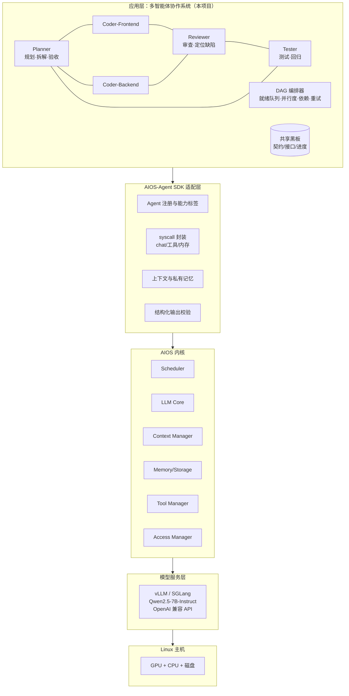
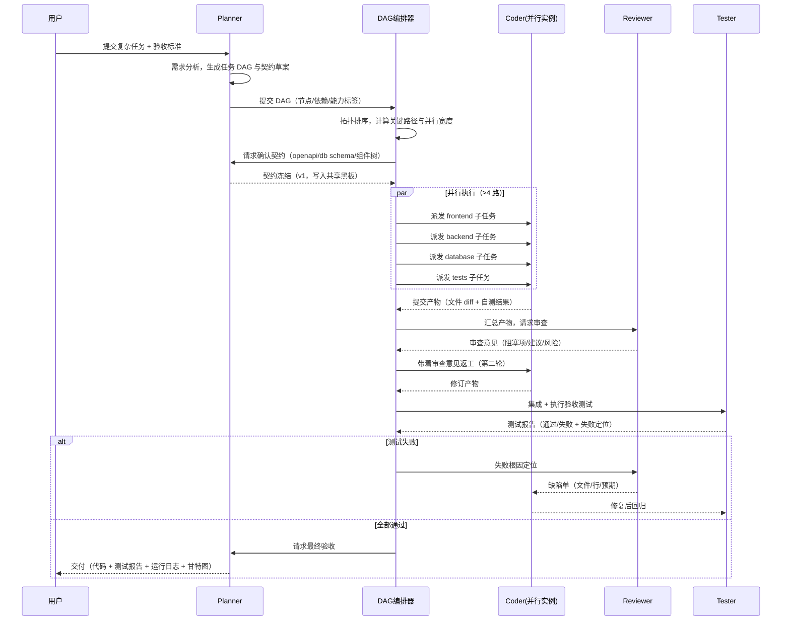
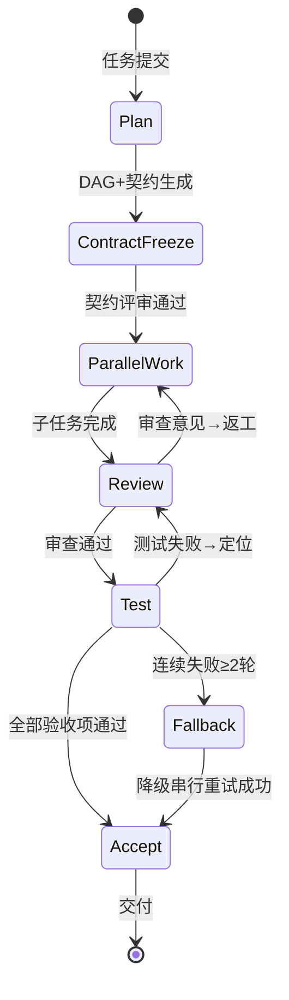

# 赛题对标与多智能体系统设计方案

> **文档定位**：本文是整个 `doc/` 调研的总纲——把赛题的四条硬性要求与评分标准翻译成可验收的工程指标，再结合 `doc/01`（AIOS 论文）、`doc/02`（多智能体协作综述）、`doc/04`–`doc/08`（五组专题精读）、`doc/09`（AIOS/OWL 代码库调研）的结论，给出本项目的系统设计、并发加速路径、正确性保障与答辩要点。
>
> **阅读顺序建议**：评委/指导老师读 §0–§2 即可把握全貌；队员实现时重点读 §3–§7；答辩前读 §1.3 与 §9。
>
> **事实与数字口径**：本文涉及的具体论文数字只在必要处点到为止，完整数据与出处见对应精读文档；代码级 API 与行号见 `doc/09`。

---

## 0. 一页速览：赛题 → 我们的应答

| 赛题要求 | 我们的应答 | 证据 / 对应文档 |
| --- | --- | --- |
| ① 不少于 **4 种可协作智能体** | `Planner`（规划/拆解/验收）、`Coder`（编码，多实例）、`Reviewer`（评审/缺陷定位）、`Tester`（测试生成/执行/回归）四类角色，各有独立系统提示、工具白名单与 I/O Schema | §4.1 角色表、§4.2 Schema、`doc/09` SDK 实现 |
| ② 复杂任务可分解为 **≥4 个可并行子任务**，自动分配 | 任务 DAG：需求→（前端 UI ∥ 后端 API ∥ 数据库 Schema ∥ 测试用例）→集成→验收；调度器按"能力匹配 + 负载 + 关键路径"自动派发 | §2 选题、§5 DAG 与调度 |
| ③ **≥3 对不同类型智能体双向交互** | 规划↔编码（任务下发/进度回报）、编码↔评审（提交/审查意见）、编码↔测试（失败/修复）、规划↔测试（验收标准/回归结论）共 4 对双向通道 | §4.3 交互矩阵与协议 |
| ④ 满足子任务**先后顺序与依赖约束** | 显式依赖边（FS/SS）+ 拓扑排序 + 就绪队列；前置未完成不允许启动；冲突检测与串行化 | §5.1–§5.4、§7 |
| 评分：功能完整性 50% | 任务合理（40）+ 实现与协作流程（60） | §1.2、§2、§3 |
| 评分：应用效果 50% | 并发总时间相对串行减少 **≥20%**（50）+ 正确完成（50） | §6 加速路径与测量、§7 正确性 |

**一句话结论**：本项目的技术路线不是"把 4 个 prompt 串起来"，而是"**在 AIOS 内核之上，用任务 DAG 表达依赖、用多智能体并行兑现加速、用契约与自动化测试保证正确性**"——三者分别对应赛题的第 4、第 2/评分项、第 1/第 3 条要求。

---

## 1. 赛题逐条解构与可验收指标

### 1.1 四条硬性要求的形式化

评委无法直接"检查代码"，只能检查**可演示、可举证**的东西。下表把每条要求翻译成"评委怎么查、我们拿什么证明"。

| 编号 | 赛题原文 | 可检验定义（评委视角） | 本项目设计应答 | 验收证据 |
| --- | --- | --- | --- | --- |
| R1 | 设计多智能体协作系统，包含不少于 4 种**可协作**的智能体 | 角色注册表中 ≥4 个不同类型；同一条任务链中确实被调用；角色间有消息往返（不是一次性 prompt） | Planner / Coder / Reviewer / Tester 四类，Coder 可多实例；角色注册表 + 能力标签 + 工具白名单 | ① 角色注册表（代码 + 文档）② 运行日志中 4 类角色的调用记录与消息轨迹 |
| R2 | 复杂任务可分解为 **≥4 个可并行执行**的子任务，并**自动分配** | DAG 中同一层存在 ≥4 个可同时运行的节点；分配由调度算法产生，而非硬编码 "task1→agent1" | 需求分析后生成 DAG：`ui` ∥ `api` ∥ `db` ∥ `tests`；调度器按能力/负载/关键路径派发 | ① DAG 可视化图 ② 调度日志（`task_id → agent_id, reason`）③ 甘特图证明重叠执行 |
| R3 | **≥3 对不同类型**智能体之间**双向交互** | 至少 3 个"不同类型"角色对，各自出现 ≥2 轮"请求→响应/反馈→修订"；且反馈改变了后续行为 | 4 对：Planner↔Coder、Coder↔Reviewer、Coder↔Tester、Planner↔Tester | 消息轨迹表（from/to/round/摘要/对产出的影响）+ 修订前后 diff |
| R4 | 考虑并满足子任务**先后顺序及依赖关系** | DAG 有向边表达依赖；依赖未满足时任务不执行；演示中可构造违例并说明如何被阻止 | 依赖边 + 拓扑排序 + 就绪队列 + 阻塞原因上报；支持 FS（完成→开始）与 SS（开始→开始） | 调度时间线（开始/结束时间不早于前置结束）+ 依赖违例测试用例 |

> **关键提醒（容易丢分处）**：R2 的"可并行"不等于"我们开了线程"，而是"**存在 ≥4 个互不依赖、可同时推进的子任务**"；R3 的"双向"不等于"两个 agent 都说过话"，而是"**A 的请求得到 B 的响应，且该响应改变了 A 的后续动作**"。这两点必须在演示与文档里显式举证。

### 1.2 评分标准拆解：每一分怎么挣

**功能完整性（50 分）**

| 子项 | 分值 | 评委实际在问什么 | 我们的对策 |
| --- | --- | --- | --- |
| 任务合理性 | 40 | 这个任务真的"单智能体无法完成"吗？场景是否真实、有价值？ | 选全栈软件开发类任务（§2）：上下文规模、技能异构、串行耗时三条都成立；给出单 agent 对照实验 |
| 实现与协作流程 | 60 | 4 种智能体是否真的异构？协作是否有设计而非堆砌？依赖是否被真正调度？ | §3 架构、§4 角色与协议、§5 DAG 调度、§7 失败恢复；用日志与甘特图举证 |

**应用效果（50 分）**

| 子项 | 分值 | 评委实际在问什么 | 我们的对策 |
| --- | --- | --- | --- |
| 并发较串行总时间减少 ≥20% | 50 | 基线公平吗？计时口径可信吗？加速是结构性的还是"运气"？ | §6：同任务、同模型、同硬件的串行基线；wall-clock 计时；≥3 次取中位数；伪加速检查清单 |
| 正确完成任务 | 50 | 并行之后结果还对吗？有无静默错误？ | §7：契约测试 + 单元测试 + E2E 验收；Reviewer 独立审查；失败重试与降级 |

> **策略判断**：正确性 50 分是硬门槛，加速 50 分是达标线（≥20% 即满分，多做无用）。因此工程上应"**先保正确，再用结构性并行把时间压到 80% 以下**"，不要为了加速牺牲正确性。

### 1.3 评委最可能追问的 8 个问题（预答）

1. **"你的任务单智能体真的做不完吗？"** → 三条论据：上下文超出 7B 有效窗口（MemGPT/Chain-of-Agents 证据见 `doc/04`、`doc/06`）；技能异构（规划/编码/审查/测试）单模型难以自我审查（`doc/06` MAST 的"验证不足"是首要失败源）；串行耗时随子任务线性增长（§5.6）。
2. **"4 个智能体是不是只是 4 个 prompt？"** → 展示角色注册表：不同工具白名单、不同上下文（各自私有 memory + 共享黑板）、不同输出 Schema、不同验证器；并展示 Reviewer 驳回 Coder 的真实修订记录。
3. **"并行是真并行还是模拟？"** → 展示调度日志时间戳：同一时间窗内 ≥4 个 syscall/LLM 请求在途；展示端侧服务的并发批处理（vLLM 连续批处理，见 `doc/08`）。
4. **"加速比怎么测的？基线公平吗？"** → 按 §6.2 的基准协议；同一任务、同一模型、同一硬件、同一 prompt 预算；报告 T_serial、T_parallel、加速比与降幅，附原始日志。
5. **"7B 模型能写对代码吗？"** → 不靠模型"一次写对"，靠"契约 + 模板 + 测试驱动 + 审查修复"闭环（§2.4、§7）；给出通过率随迭代轮次上升的曲线。
6. **"依赖关系在哪里体现？"** → DAG 边 + 调度器阻塞日志 + 甘特图（例：`api` 在 `db` 完成前不启动）。
7. **"双向交互如何证明？"** → §4.3 消息轨迹表：每条交互给出 from/to/轮次/触发原因/响应如何改变后续动作（如 Reviewer 意见导致 Coder 第二轮 patch）。
8. **"与 AutoGen/MetaGPT 等现成框架的区别？"** → 现成框架多数是**对话式串行编排**，没有"内核级调度 + 真并行 + 资源隔离"；本项目在 AIOS 内核上做任务级并行（§3.4、`doc/05`、`doc/09`）。

---

## 2. 任务选题：如何挑一个"单智能体做不完、又能在 7B 上做成"的复杂任务

### 2.1 三个候选方案对比

| 维度 | A. 全栈 Web 应用开发（推荐） | B. 数据分析报告流水线 | C. 智能家居/交通仿真 |
| --- | --- | --- | --- |
| 任务示例 | "开发一个团队任务看板系统：用户登录、任务 CRUD、看板拖拽、评论、检索" | "抓取多源数据→清洗→建模→可视化→生成中文分析报告" | "给定城市路网与出行需求，仿真并优化信号配时" |
| 可分解性 | **强**：前端 UI / 后端 API / 数据库 Schema / 测试用例 / 部署配置可并行 | 中：抓取与清洗有依赖，建模与可视化可并行 | 中：仿真与优化强耦合 |
| 并行宽度（R2） | 5 个可并行子任务，天然满足 | 3–4 个 | 2–3 个，且串行依赖重 |
| 依赖清晰度（R4） | **强**：接口契约 → 前后端并行 → 集成 → 端到端测试 | 中 | 弱 |
| 正确性可自动验收 | **强**：pytest + REST 契约测试 + Playwright E2E + 覆盖率 | 弱：报告质量难以自动判定 | 弱：需领域指标 |
| 7B 端侧可行性 | 中（可用模板与测试约束） | 中 | 低（需长链推理与领域知识） |
| 演示效果 | **强**：网页可点、API 可调、测试可跑 | 中 | 弱（不可视） |
| 结论 | **推荐主方案** | 备选 | 不建议 |

### 2.2 为什么"全栈 Web 应用开发"天然满足四条要求

- **R1（≥4 种智能体）**：规划（Planner）、编码（Coder）、审查（Reviewer）、测试（Tester）是软件工程中职责边界最清晰、异构性最强的四类角色，且文献中已被反复验证（MetaGPT 的 SOP、ChatDev 的聊天链，见 `doc/05`）。
- **R2（≥4 并行子任务）**：模块化前端的页面/组件、后端的路由/服务、数据库 schema、测试套件之间是**逻辑独立的代码单元**，可以在同一时间由不同 Coder 实例并行实现；并行证据是文件级与调用级的（不同 agent 同时写不同文件）。
- **R3（≥3 对双向交互）**：软件工程流程天然包含"提需求→确认""提 PR→审查→返工""测试失败→修复""验收→打回"等双向回路，比"辩论式"协作更符合真实工程且更容易举证。
- **R4（依赖约束）**：接口契约（OpenAPI/JSON Schema）是硬前置；数据库 schema 必须先于后端实现；后端 API 必须先于 E2E 测试——依赖边天然存在且可判定。

### 2.3 任务规格示例（可直接写进参赛文档）

**任务陈述**：开发一个"团队任务看板"Web 应用（前后端分离，单机可运行），要求：

1. 用户注册/登录（JWT 鉴权），密码加盐哈希；
2. 任务卡片 CRUD（标题/描述/优先级/截止时间/标签）；
3. 看板视图：待办/进行中/已完成三列，支持拖拽改状态；
4. 评论与 @提及；
5. 关键词检索 + 分页；
6. 提供 `README`、启动脚本与健康检查接口。

**验收标准（可直接变成测试）**：

| 编号 | 验收项 | 判定方式 | 对应子任务 |
| --- | --- | --- | --- |
| AC1 | API 契约与 `openapi.yaml` 一致 | 契约测试（schemathesis/pytest） | `api-contract` |
| AC2 | 核心用例通过（注册/登录/CRUD/检索） | pytest 单元 + 集成测试 | `backend` |
| AC3 | 数据库 schema 与迁移脚本可重建库 | 迁移脚本 + 断言 | `database` |
| AC4 | 页面可完成"登录→建卡→拖拽→评论"完整流程 | Playwright E2E | `frontend`、`e2e` |
| AC5 | 静态检查与格式统一 | ruff/mypy/prettier | `review` |
| AC6 | 一键启动并通过健康检查 | `docker compose up` + `/healthz` | `deploy` |

### 2.4 7B 端侧模型下的降风险设计（决定成败）

端侧 7B/8B 模型不可能一次写出正确的大型项目。我们的策略是"**把生成问题变成受约束的填空题**"：

1. **契约先行**：Planner 先产出 `openapi.yaml`、数据库 DDL、组件树与接口签名，评审通过后冻结为"Coder 不可修改的边界"；
2. **模板化骨架**：仓库预置项目脚手架（FastAPI 路由模板、React 组件模板、pytest 夹具），Coder 只填补函数体与少量文件；
3. **工具白名单 + 写路径隔离**：每个 Coder 实例只能写自己负责的目录（`src/frontend/**` 或 `src/backend/**`），从机制上消除并行写冲突；
4. **结构化输出**：所有 agent 输出 JSON（含 `files`、`diff`、`tests`、`risks` 字段），由编排器校验后再落盘（对应 `doc/09` 的 SDK 适配层）；
5. **测试即验收**：Tester 只认测试结果，不认"模型说完成"；连续 2 轮失败升级到 Reviewer 定位根因；
6. **小步迭代**：每个子任务拆到"一次 LLM 调用能产出一个文件/一个函数"的粒度，降低单次失败损失。

> 依据：`doc/06` 的失败分析指出"验证不足"是最主要的失败来源——所以本设计把**验证器（测试/契约/审查）当作一等公民**，而不是最后补一道人工检查。

---

## 3. 系统总体架构

### 3.1 分层架构



### 3.2 组件职责

| 层 | 组件 | 职责 | 关键设计点 |
| --- | --- | --- | --- |
| 应用层 | DAG 编排器 | 维护任务图、就绪队列、并行度上限；派发子任务；收集结果；处理失败重试 | 与 AIOS scheduler 解耦，只通过 syscall 使用内核能力 |
| 应用层 | 角色智能体（4 类） | 各自完成规划/编码/审查/测试；输出结构化结果 | 私有上下文 + 共享黑板；工具白名单 |
| 应用层 | 共享黑板 | 存放冻结的契约、接口文档、进度与产物索引 | 只追加 + 版本号；避免并行写冲突 |
| SDK 适配层 | Agent Runtime | 统一 agent 生命周期、消息路由、超时与重试 | 参考 OWL `Workforce`/`Task` 的任务-工作者模型（`doc/09`） |
| SDK 适配层 | 结构化输出网关 | 把 LLM 自由文本解析为 JSON Schema，失败即重试/降级 | 小模型场景下尤其关键 |
| 内核层 | AIOS 模块 | 调度、上下文切换、内存/存储、工具、权限 | 论文与代码细节见 `doc/01`、`doc/09` |
| 模型服务层 | vLLM/SGLang | 提供 OpenAI 兼容端点；连续批处理与 KV/前缀缓存 | 并发请求共享同一 7B 模型时的吞吐保障，见 `doc/08` |

### 3.3 一次任务的端到端时序



### 3.4 与 AIOS 内核能力的映射

| 我们的需求 | AIOS 对应机制 | 落地方式（详见 `doc/09`） |
| --- | --- | --- |
| 多个 agent 同时调用 LLM | Scheduler + LLM Core | 每个 agent 的 chat 请求作为 syscall 进入队列；内核按 FIFO/RR 调度 |
| 长任务挂起/恢复 | Context Manager（上下文快照） | 子任务等待依赖时让出 LLM；恢复时用快照减少重复 prompt |
| 跨子任务传递契约与产物 | Memory Manager + Storage Manager | 黑板作为持久化 KV；大产物（代码/日志）落盘，上下文只放索引 |
| 受限工具调用 | Tool Manager + Access Manager | 每个角色只注册其白名单工具；越权调用被拒绝并记录 |
| 并发写冲突 | 由应用层（写路径隔离）保证，内核不负责 | 每个 Coder 只能写自己的目录；黑板只追加 |

> **诚实说明**：AIOS 的"内核调度"主要解决**资源争用与服务效率**；"任务级并行与依赖调度"必须由应用层的 DAG 编排器承担。两者是叠加关系，不是替代关系——这也是本项目相对"直接用 AutoGen 串行对话"的核心增量（见 `doc/05`、`doc/09` 的对比）。

#### 3.4.1 源码核实后的四条硬约束（依据 `doc/09`，务必在设计阶段就接受）

1. **只用 FIFO 调度器**：`rr_scheduler.py:181` 把单个 syscall 传给按列表迭代的 `_execute_batch_syscalls`，LLM 路径必抛 `TypeError`；`runtime/launch.py` 在 `use_context_manager: true` 时才会实例化 RR。⇒ 配置固定 `use_context_manager: false`，上下文快照由应用层自己做。
2. **接受 1s 攒批延迟或显式调小**：`fifo_scheduler.py:70` 的 `batch_interval` 默认 1.0s（注释却写 0.1s）。4 路并发的端到端时间会先被这个窗口吃掉一部分，测量时必须记录该参数；追求低延迟的演示可调到 0.1s，但要同时报告吞吐变化。
3. **SDK 不在 `vendor/AIOS` 里**：AIOS-Agent SDK 是独立仓库 Cerebrum（`requirements.txt` 以 git 方式安装），本机未装，`vendor/AIOS` 也没有 `examples/`。⇒ 环境准备清单里必须包含 SDK 安装与最小连通性验证（`llm_chat` 返回 200）；离线场景准备"直接 HTTP 调 Ollama/vLLM"的备选通道。
4. **内核没有"任务级并发上限"配置**：并发由每个 syscall 自带线程 + 适配器线程池决定，全局不可配。⇒ 并发度必须由应用层 DAG 调度器控制（同时最多 4–8 个子任务在飞），否则评测/重试叠加时会把端侧模型压到排队。

#### 3.4.2 与公开实现的边界（答辩必被问，先备好答案）

`doc/11` 的代码核实表明，**"依赖门控"与"依赖边触发"都不是我们首创**：camel `Workforce` 已有 `dependencies` + `completed_tasks_info` 门控（`workforce.py:4491-4493`），LangGraph Pregel 已有 channel→trigger 的并行触发与 `max_concurrency`（`pregel/_algo.py:470-486`）。**我们的创新点不能表述为"首次实现 DAG 调度"，而应表述为三件事的组合**：

1. **位置**：调度器做在 **AIOS 应用层/SDK 侧**，与 AIOS 的 syscall 生命周期、`batch_interval`（1.0s）、上下文快照直接对齐——现有实现都不在 AIOS 上；
2. **策略**：**关键路径优先 + 依赖计数就绪队列 + 并行宽度受控**（现有实现是"就绪即发"或"轮次驱动"，不看 critical path，也不限制宽度）；
3. **证据**：**7B 端侧、同模型同 prompt 的串行 vs 并行 wall-clock 实测**（现有 10 个仓库 0 个给出该数字，见 `doc/11` §5.5）。

> 一句话话术：「依赖调度是成熟技术；把依赖调度做进 AIOS 的请求生命周期、并用关键路径与并行宽度在 7B 端侧跑出可复现的 20%+ 加速——这是我们的工作。」

---

## 4. 智能体设计与双向交互

### 4.1 角色设计（4 类，可多实例）

| 角色 | 类型 | 核心职责 | 输入 | 输出 | 工具 | 能力触发条件 |
| --- | --- | --- | --- | --- | --- | --- |
| **Planner** | 规划型 | 需求分析、任务分解、契约定义、验收判定 | 用户任务 + 验收标准 | 任务 DAG（JSON）、契约文档、验收报告 | 只读代码、检索、写黑板 | 任务开始、依赖变更、最终验收 |
| **Coder** | 执行型 | 按子任务产出代码/配置/文档 | 子任务描述 + 契约 + 相关文件 | 文件 diff + 自测结果 | 读写指定目录、运行测试 | 依赖就绪即触发；可多实例并行 |
| **Reviewer** | 审查型 | 静态审查、缺陷定位、返工意见 | 产物 diff + 契约 + 测试报告 | 审查意见（阻塞/建议）、缺陷单 | 只读代码、检索、运行 lint | Coder 提交后、测试失败后 |
| **Tester** | 验证型 | 生成/执行测试、回归、覆盖率与报告 | 契约 + 产物 + 验收标准 | 测试报告、失败用例与定位 | 执行测试、读日志、写测试 | 集成后、修复后回归 |

> **为什么这样分**：`doc/05` 显示 MetaGPT（SOP 流水线）与 ChatDev（聊天链）都验证了"规划-编码-审查-测试"分工的有效性；`doc/06` 的 MAST 进一步指出"验证与终止条件设计"是失败高发区，因此 Tester/Reviewer 必须是**独立角色**而非 Coder 的自检。

### 4.2 角色 I/O Schema（示意）

```json
{
  "agent": "Coder",
  "task_id": "backend-api",
  "inputs": {"contract": "openapi.yaml@v1", "files": ["src/backend/routes/*.py"], "acceptance": ["AC1", "AC2"]},
  "constraints": {"allowed_paths": ["src/backend/"], "max_rounds": 3, "timeout_s": 180},
  "output_schema": {
    "status": "done|blocked|failed",
    "files": [{"path": "src/backend/routes/tasks.py", "content": "..."}],
    "self_test": {"cmd": "pytest tests/backend -q", "passed": 12, "failed": 0},
    "risks": ["未实现分页边界"],
    "needs": ["database migration v2"]
  }
}
```

### 4.3 双向交互矩阵（≥3 对，本项目 4 对）

| 交互对 | 方向 | 触发 | 请求内容 | 响应内容 | 对后续行为的影响 | 轮次证据 |
| --- | --- | --- | --- | --- | --- | --- |
| Planner ↔ Coder | 双向 | 子任务派发 / Coder 遇阻 | 任务说明 + 契约 | 进度/阻塞原因/产物 | Planner 调整 DAG（拆细/换 agent/加依赖） | 日志 T-01→T-07 |
| Coder ↔ Reviewer | 双向 | Coder 提交 | 产物 diff + 自测 | 阻塞项/缺陷单/返工要求 | Coder 第二轮修订，Reviewer 复查 | PR 记录 2 轮 |
| Coder ↔ Tester | 双向 | 集成测试失败 | 失败用例 + 日志 | 缺陷定位/复现步骤 | Coder 修复，Tester 回归 | 失败→修复→通过 |
| Planner ↔ Tester | 双向 | 验收标准变更 / 回归结论 | 验收项定义 | 覆盖率与通过率 | Planner 判定通过或打回 | 最终验收单 |

举证方式：**消息轨迹表 + 时间线截图 + 修订前后 diff**。验收时打开日志，任选一对演示 2 轮往返。

### 4.4 协作状态机



---

## 5. 任务分解、DAG 与并发调度

### 5.1 任务图模型

```python
@dataclass
class SubTask:
    id: str                  # "frontend-ui"
    agent_type: str          # "Coder" | "Reviewer" ...
    deps: list[str]          # ["api-contract"]
    dep_type: dict[str, str] # {"api-contract": "FS"}；SS 表示可同时启动
    est_cost: float          # 预估 token 或秒数（用于关键路径）
    allowed_paths: list[str] # 写路径隔离
    acceptance: list[str]    # 关联验收项 AC1..AC6

@dataclass
class TaskDAG:
    nodes: dict[str, SubTask]
    max_parallel: int = 4    # 端侧并发上限（受显存/批处理能力约束）
```

### 5.2 分解策略：LLM 规划 + 规则约束 + 自检

1. **模板约束**：预置任务模板（全栈应用 = 契约→{前端,后端,数据库,测试}→集成→验收），Planner 只允许在模板骨架上增删，不允许自由发挥出不可验收的节点；
2. **自检三问**（Planner 内置校验 prompt）：每个节点是否可独立验收？是否存在 ≥4 个无相互依赖的节点？每条边是否有明确产物作为依赖依据？
3. **人工兜底**：分解结果在 UI 上可视化，队长可一键合并/拆分节点（答辩演示"自动分配 + 人类可干预"）。

### 5.3 调度算法（伪代码）

```text
输入: DAG, max_parallel, 队列 Q=就绪节点(入度0)
while 未完成节点 > 0:
    # 1) 挑选可运行节点：关键路径长的优先，其次预估耗时短的（提高并行填充率）
    ready = [n in Q if 所有 deps 满足(n)]
    ready.sort(key = (关键路径长度, est_cost), desc)
    # 2) 在并行度上限内派发，能力匹配
    for n in ready[:free_slots]:
        agent = match_agent(n.agent_type, 负载最小, 能力标签)
        启动(agent, n)  # 通过 SDK syscall 调用；写路径隔离
    # 3) 等待首个完成事件（不阻塞其他在途任务）
    done = wait_any(running)
    更新 Q: 若 done 成功 → 后继入度-1，入度0者入 Q
            若 done 失败 → 重试(≤2)；仍失败则升级 Reviewer 定位或降级串行
    # 4) 记录时间线（task_id, agent, start, end, deps_satisfied）
```

### 5.4 依赖类型与冲突处理

- **FS（Finish-to-Start）**：最常见，`database` 完成才允许 `backend` 启动；
- **SS（Start-to-Start）**：`frontend` 与 `backend` 可同时启动（都以冻结的契约为前提）；
- **产物级依赖**：接口契约版本是隐式依赖，契约变更必须广播并触发受影响节点重算；
- **写冲突**：目录级隔离 + 黑板只追加；若两个节点必须改同一文件，则强制串行或在 Reviewer 阶段合并。

### 5.5 与 AIOS 调度器的对接

DAG 编排器负责"任务级"并行；AIOS scheduler 负责"请求级"排队。两层协作方式：每个子任务的每次 LLM 调用是一个 syscall，进入内核队列；编排器只关心子任务完成事件，不关心内核内部先执行哪个请求。这样既获得内核的公平性与吞吐优化（`doc/01` 的实验：FIFO/RR 相比不用 AIOS 显著降低总耗时与 p90 等待），又保持应用层逻辑简单。

### 5.6 并行度与加速比的理论上界

**例**：5 个子任务，各耗时 2 单位：

- 串行：`contract(2) → ui(2) → api(2) → db(2) → test(2) = 10`
- 依赖优化后并行：`contract(2) → [ui ∥ api ∥ db ∥ test](2) → 集成验收(2) = 6`
- 加速比 = 10/6 ≈ **1.67×**，时间降低 **40%**，超过 20% 阈值。

**用 Amdahl 定律看上限**：若串行部分占比 `s`，并行部分加速 `n` 倍，则 `S = 1 / (s + (1-s)/n)`。本项目串行部分（契约 + 集成 + 验收）约 40%，并行部分 4 路 → `S = 1/(0.4 + 0.6/4) ≈ 1.82×`。若模型服务端不能真正并发（单请求串行），则并行请求只会排队，加速比趋近 1——**因此端侧推理服务的连续批处理能力是达标前提**（`doc/08` 的 vLLM/SGLang 机制）。

> 实际测量还受"最后完成者决定总时长"（关键路径）影响：并行效率 = 总工作量 / (并行宽度 × 关键路径)。

---

## 6. 20% 加速的达成路径与测量

### 6.1 三条加速来源（按贡献排序）

1. **子任务级并行**（主要）：≥4 个独立子任务同时推进，总时间由"串行和"变为"关键路径"（§5.6）；
2. **服务层批处理与缓存**（次要但真实）：多 agent 并发请求同一 7B 模型时，连续批处理提升吞吐；共享系统提示词与契约可命中前缀/KV 缓存，降低单次延迟（`doc/08`）；
3. **减少重复上下文**（辅助）：契约冻结 + 黑板索引 + 上下文快照，避免每个 agent 重复塞入全量历史（`doc/01`、`doc/04` 的 MemGPT 分层内存思路）。

**反例（不会带来加速）**：把同一串行流程改写成"每个 agent 依次发消息"——总 LLM 调用次数不变甚至更多，只会更慢。这是 `doc/05` 中多数对话式框架的现状，也是我们强调"结构性并行"的原因。

### 6.2 基准测试协议（详见 `doc/08` 的可执行清单）

| 项目 | 规定 |
| --- | --- |
| 任务 | 同一任务、同一验收标准；串行与并发跑同一输入 |
| 模型 | 同一 7B/8B 模型、同一量化、同一 `max_tokens`、同一温度（建议 0） |
| 硬件 | 同一机器、同一服务配置（批次/并发上限一致） |
| 串行基线 | **单 agent 顺序执行全部子任务**（同 prompt 预算、同工具）；不使用多智能体分工，不做并行 |
| 并发方案 | 本系统：DAG 并行 + 4 类 agent |
| 计时口径 | wall-clock：任务提交到验收完成；含 LLM 调用、工具执行、测试；不含模型加载与索引构建 |
| 预热与重复 | 预热 1 次；正式 ≥3 次，报告中位数与均值±标准差 |
| 指标 | T_serial、T_parallel、加速比 `S=T_serial/T_parallel`、降幅 `(T_serial-T_parallel)/T_serial`、p50/p95 单次调用延迟、token 与成本 |
| 附录 | 原始日志、逐子任务时间线、机器配置 |

### 6.3 伪加速检查清单（答辩自证清白）

- [ ] 串行基线没有人为插入等待/重试，没有降低 prompt 预算；
- [ ] 并发与串行的模型服务配置一致，缓存状态一致（都预热或不预热）；
- [ ] 并行没有靠"跳过某些子任务/减少测试"换时间；
- [ ] 正确性在两种模式下都达到验收标准（否则加速无意义）；
- [ ] 报告最差一次的结果，而非只报最好一次。

### 6.4 若达不到 20% 的保底策略

1. 提高并行宽度：把 `frontend` 再拆为页面/组件/状态管理，`backend` 拆为路由/服务/中间件（只要仍满足依赖与验收）；
2. 降低关键路径：契约阶段提前产出接口桩（stub），让前后端在真实实现完成前就能并行开发与联调；
3. 服务层优化：开启 vLLM 连续批处理、前缀缓存，减少排队与重复 prefill；
4. 减少 LLM 往返：模板化骨架 + 结构化输出一次成型，降低重试轮次（重试是串行时间的主要来源）；
5. 最后手段：把"集成验收"中的可并行检查（lint/单测/安全扫描）也并行化。

---

## 7. 正确性保障与失败恢复

### 7.1 四道防线

| 防线 | 谁执行 | 检查什么 | 失败动作 |
| --- | --- | --- | --- |
| 契约校验 | 编排器 + 契约测试 | 产物是否符合冻结的 API/DB/组件契约 | 拒绝合入，打回 Coder |
| 静态审查 | Reviewer | 风格/安全/边界/重复实现/隐藏依赖 | 生成缺陷单，触发返工 |
| 自动化测试 | Tester | 单元/集成/E2E/覆盖率 | 定位失败用例，生成复现步骤 |
| 集成验收 | Planner | AC1–AC6 全通过 + 演示可运行 | 打回或判定完成 |

### 7.2 与 MAST 失败分类的对照（依据 `doc/06`）

| 失败大类 | 典型表现 | 本项目对策 |
| --- | --- | --- |
| 规格与系统设计问题 | 任务定义模糊、角色职责重叠、缺少终止条件 | 模板化 DAG + 角色 I/O Schema + 明确最大轮次/超时 |
| 智能体间错位 | 信息不同步、忽略对方输出、重复劳动 | 共享黑板 + 结构化消息 + 依赖边强制同步 |
| 任务验证与终止 | 过早宣布完成、验证不足 | Tester 独立 + 测试即验收 + 拒绝"模型自述完成" |

### 7.3 降级策略（保证"正确完成"这 50 分）

```text
子任务失败 → 重试(≤2, 换温度/换 prompt 变体)
          → Reviewer 定位根因 → 缩小任务粒度重新派发
          → 仍失败：降级为串行单 agent 执行该子任务
          → 最终兜底：保留已完成部分，报告未完成项（不谎报成功）
```

---

## 8. 风险清单与工作量估算

| 风险 | 影响 | 概率 | 对策 | 预估工作量 |
| --- | --- | --- | --- | --- |
| 7B 模型代码能力不足 | 正确率低、重试多，反而变慢 | 高 | 模板/契约/小步生成/测试驱动；必要时换 8B 代码微调模型 | 5–8 人日 |
| AIOS 内核并发的真实边界：FIFO 每次 `batch_interval` 攒批（默认 1.0s），并发无全局上限配置 | 低延迟场景被攒批窗口吃掉一部分收益 | 高 | 调小 `batch_interval`、应用层限流到 4–8 路、测量时记录该参数（§3.4.1、`doc/09` §4） | 1–2 人日 |
| SDK 与调度器可用性：AIOS-Agent SDK 在独立仓库 Cerebrum（本机未装），RR 调度器 LLM 路径有必崩缺陷 | 环境搭不起来 / 误开 `use_context_manager` 直接失败 | 中 | 环境清单含 SDK 安装与 `llm_chat` 连通性验证；固定 `use_context_manager: false`；预留直连 Ollama/vLLM 的备选通道 | 1–2 人日 |
| 并行写冲突/上下文污染 | 产物互相覆盖、错误难定位 | 中 | 目录隔离 + 黑板只追加 + 上下文快照 | 1–2 人日 |
| 加速比不达标 | 应用效果丢分 | 中 | §6.4 五级保底；提前 2 周做基准 | 3–5 人日 |
| 演示环境不稳定（网络/GPU） | 现场翻车 | 中 | 全离线镜像 + 预生成缓存 + 录屏兜底 | 1–2 人日 |
| 依赖约束表达错误 | 流程乱序、验收失败 | 低 | DAG 校验器（环检测/悬空依赖）+ 违例测试 | 1 人日 |

---

## 9. 演示与答辩脚本（5 分钟）

1. **0:00–0:40** 赛题与任务：一句话说明"为什么单智能体做不完"（上下文/异构技能/串行时间）；
2. **0:40–1:30** 架构图：4 类 agent + DAG 编排器 + AIOS 内核 + 7B 服务；
3. **1:30–3:00** 现场运行：提交任务 → 展示 DAG 与并行甘特图（关键证据：≥4 路重叠）→ 展示 Reviewer 驳回与 Coder 返工的消息轨迹；
4. **3:00–4:00** 结果：测试报告全绿 + 网页可操作；对比串行/并发的总时间与加速比（≥20%）；
5. **4:00–5:00** 深度：AIOS 内核如何起作用（调度/上下文/工具）、失败恢复、与 AutoGen/MetaGPT 的差异、后续工作。

**必备演示材料**：DAG 图、甘特图、消息轨迹表、测试报告、加速比表格、原始日志。

---

## 10. 文献—设计映射与文档索引

| 设计决策 | 支撑文献 | 对应文档 |
| --- | --- | --- |
| 用 OS 内核抽象管理 LLM/工具资源 | AIOS、LLM-as-OS | `doc/01`、`doc/04` |
| 上下文切换、分层内存、长任务挂起 | AIOS Context Manager、MemGPT | `doc/01`、`doc/04` |
| 4 类角色分工与 SOP 流水线 | MetaGPT、ChatDev、CAMEL | `doc/05` |
| 可编程的多 agent 对话与终止条件 | AutoGen、AgentVerse | `doc/05` |
| 协作拓扑选择与失败模式规避 | MAS 综述、DyLAN、MAST | `doc/02`、`doc/06` |
| 任务分解与 DAG 并行执行 | LLMCompiler、ReWOO、TDAG | `doc/07` |
| 并发服务吞吐（连续批处理/前缀缓存） | vLLM、SGLang、Parrot、Autellix | `doc/08`、`doc/04` |
| 正确性评测与加速比测量 | AgentBench、GAIA、SWE-bench | `doc/08` |
| SDK 落地与代码改造 | AIOS / OWL 源码 | `doc/09` |

**全部文档**：`doc/00-调研总览与索引.md`（论文清单与阅读路线）、`doc/01`–`doc/02`（全文翻译）、`doc/03`（本文）、`doc/04`–`doc/08`（专题精读）、`doc/09`（代码库调研）、`doc/articles/`（工程文章摘要）。
