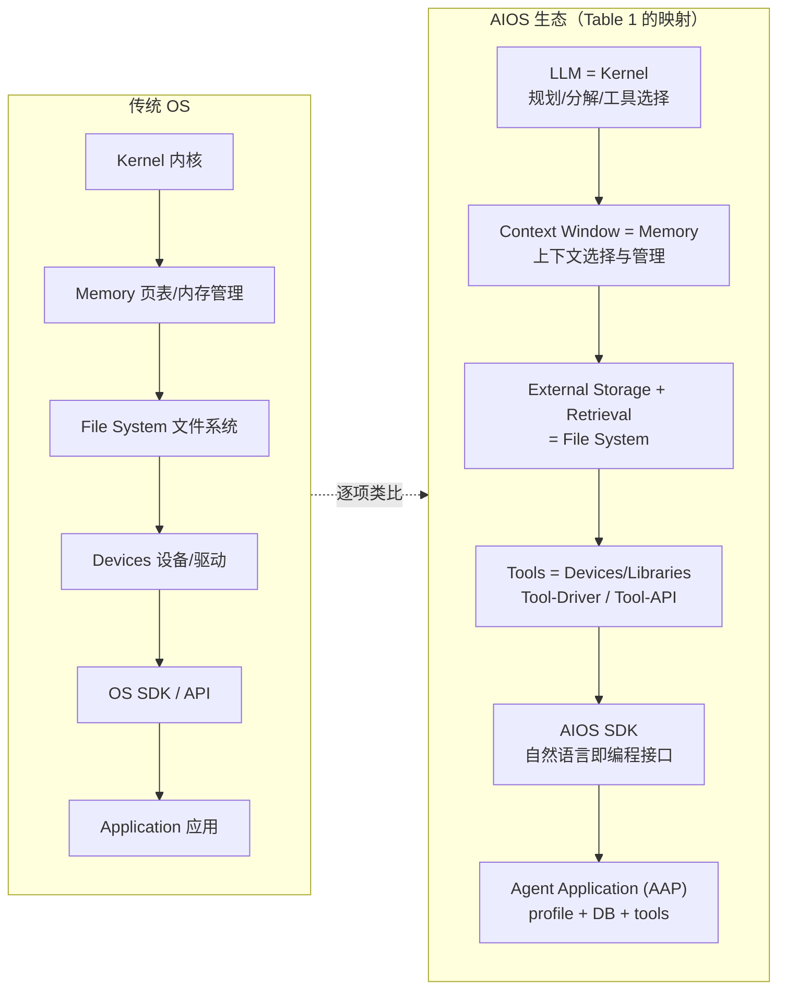
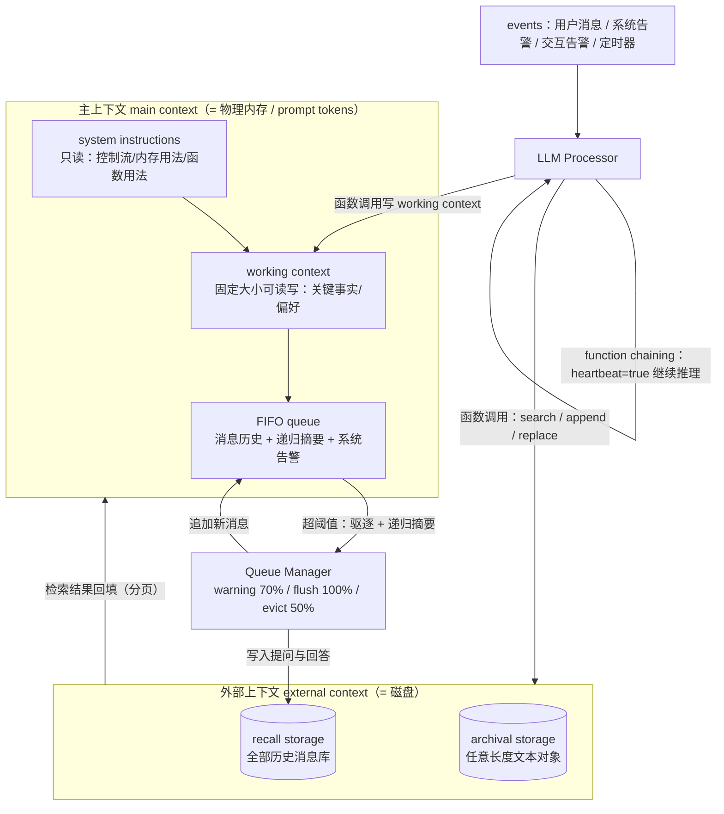
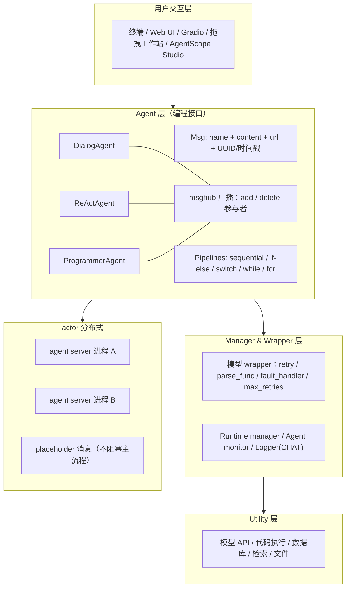
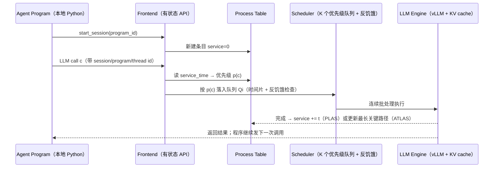

# 智能体操作系统内核与并发服务：四篇精读

> 本文件是赛题材料 `doc/01`（AIOS 论文全文翻译）与 `doc/02`（多智能体协作综述翻译）的**补充**，不复述 AIOS（arXiv:2403.16971）原文；AIOS 仅作为对照基线引用。四篇选文分别回答"为什么 LLM 应被视为内核""上下文管理器内部怎么做""多智能体协作层长什么样""并发执行时怎样把并发变成真加速"。

## 覆盖论文清单

| 编号 | 论文 | 出处 | 一句话定位 |
| --- | --- | --- | --- |
| 1 | LLM as OS, Agents as Apps: Envisioning AIOS, Agents and the AIOS-Agent Ecosystem | arXiv:2312.03815 [cs.OS]，v1 2023-12-06 / v2 2023-12-09，Rutgers University | AIOS 生态的**概念蓝图**：内核=LLM、应用=agent、接口=自然语言、设备=工具 |
| 2 | MemGPT: Towards LLMs as Operating Systems | arXiv:2310.08560v2 [cs.AI]，2024-02-12，UC Berkeley | 用**分层内存 + 中断/事件 + 自导向函数调用**在固定上下文窗口下实现"虚拟上下文" |
| 3 | AgentScope: A Flexible yet Robust Multi-Agent Platform | arXiv:2402.14034v2 [cs.MA]，2024-05-20，阿里巴巴集团 | 以**消息传递**为核心的多智能体平台：语法糖、分级容错、actor 分布式 |
| 4 | Autellix: An Efficient Serving Engine for LLM Agents as General Programs | arXiv:2502.13965v1 [cs.LG]，2025-02-19，UC Berkeley / Google DeepMind / 上海交通大学 | 把 agent 程序当"进程"做**程序级调度**，同延迟下吞吐为 vLLM 的 8–15× |

> 编号更正说明：任务书原列第 1 篇为 arXiv:2405.06682，经核对该编号实为 *Self-Reflection in LLM Agents: Effects on Problem-Solving Performance*（Matthew Renze、Erhan Guven，Johns Hopkins University），全文与 AIOS 无关；本文件按团队确认统一使用 arXiv:2312.03815。

## 本组导览

**为什么是这四篇。** AIOS（2403.16971，见 `doc/01`）已经给出了"内核七模块 + 系统调用 + SDK"的骨架，并报告了最高 2.1× 的吞吐提升（Llama-3.1-8b + Reflexion，见 `doc/01` 第 5.3 节）。但骨架不等于论证：为什么 LLM 可以当内核？内核里的上下文管理器具体怎么换页？内核之上多智能体怎么协作、怎么容错？并发发生时"加速"从哪来、又会在哪里失效？这四篇正好依次补上四个缺口。它们不是同一个层次的论文，而是一条从**概念抽象 → 内存机制 → 平台工程 → 推理服务调度**的下降路径。

**四篇的层次关系。** 2312.03815 是纯概念/立场论文，没有任何实验；它定义"LLM as OS / Agents as Apps / 自然语言即编程接口 / 工具即设备"四个概念，并用一张 OS↔AIOS 映射表把 AIOS 的每个模块对应到经典 OS 部件。MemGPT 是单 agent 的上下文管理机制论文，把"上下文窗口"当主存、"外部存储"当磁盘，用 LLM 主动发起的函数调用完成换入换出。AgentScope 是多智能体应用框架，关心的是开发者怎么写协作流程、怎么容错、怎么把本地编排一键搬上分布式。Autellix 则在最底层——LLM 推理服务——重新定义了调度单位：不再按单个请求调度，而按"程序"（一个 agent 的完整调用 DAG）调度。AIOS 恰好夹在 MemGPT 与 AgentScope 之间：它有内核模块，但既没有 MemGPT 那样细的换页/驱逐策略，也没有 AgentScope 那样完整的编排与容错，更没有 Autellix 的程序级调度。

**主线一句话。** OS 抽象（论文 1）确立边界：agent 是应用、上下文是内存、工具是设备、agent 间通信是 IPC；内存分层（论文 2）解决"上下文是稀缺资源"；平台化（论文 3）解决"多 agent 协作怎么工程化"；并发服务（论文 4）解决"并发请求多了以后为什么反而更慢"。

**与本赛题的关系。** 赛题要的不是"实现一个 OS 内核"，而是用 AIOS-Agent SDK 组织 ≥4 类智能体、≥4 个可并行子任务、≥3 对双向交互、满足依赖约束，并证明并发总时间比串行减少 ≥20%。四篇分别对应：论文 1 提供"我们的系统为什么是一个操作系统意义上的系统"的叙事（功能完整性 50%）；论文 2 提供控制上下文预算、保证正确完成的手段；论文 3 提供消息协议、交互与容错的具体形态（R1/R3/R4）；论文 4 提供"加速来自哪里"的机制与数字（应用效果 50%）。

**一个必须先说清的判断。** 单纯"换成 AIOS 内核"不产生 20% 加速。加速只来自三件事：并行度（把串行链变成关键路径）、缓存复用（共享前缀/契约、KV cache、摘要复用）、减少等待（程序级调度消除队头阻塞、减少重试往返）。内核提供的是**机制**（队列、上下文管理、调度接口），是否真快取决于编排层与推理服务层怎么用这些机制。这也是把 Autellix 放进本组的理由：它给出了三件事里"减少等待 + 缓存复用"最硬的量化证据。

---

## 论文 1：LLM as OS, Agents as Apps（arXiv:2312.03815）

### 1.1 元信息

| 项目 | 内容 |
| --- | --- |
| 标题 | LLM as OS, Agents as Apps: Envisioning AIOS, Agents and the AIOS-Agent Ecosystem |
| 作者与机构 | Yingqiang Ge, Yujie Ren, Wenyue Hua, Shuyuan Xu, Juntao Tan, Yongfeng Zhang*（Rutgers University，Department of Computer Science，New Brunswick） |
| 发表处 | arXiv:2312.03815 [cs.OS]，v1 2023-12-06、v2 2023-12-09；论文未给出正式发表会议/期刊（本稿按 v2） |
| 链接 | https://arxiv.org/abs/2312.03815 |
| 类型 | 愿景/立场论文（vision paper），无实验章节 |

### 1.2 一句话结论

论文主张：LLM 不是普通应用，而是新的计算系统的**内核**；agent 是运行其上的应用（application）；自然语言是新的编程接口；工具是设备与库。AIOS 由此需要"内核 + SDK + 应用生态"三层，而多智能体协作在概念上就是"进程间通信 + 资源调度"。

### 1.3 问题与动机

论文的出发点是：LLM 的能力增长正在从应用层倒逼系统层。作者的类比链条是"批处理 → 分时 → 多任务 → GUI → 云 → 移动/嵌入式"，每一步 OS 形态变化都由新的资源与交互方式驱动；LLM 带来的是"自然语言成为人机与机机接口"，因此可能出现一个"有灵魂的操作系统"（an operating system "with soul"）。论文列出的核心张力有三类：其一，上下文窗口是硬约束（第 3.2 节），长任务无法只靠"扩窗"解决；其二，工具调用需要统一的驱动/接口抽象（第 3.4 节），否则每个应用重复造轮子；其三，多 agent 与生态需要资源管理、通信协议与安全机制（第 6 节），而当时的 agent 框架把 LLM 与工具句柄直接握在应用手里，缺少系统级调度。论文因此不是提出一个系统，而是提出一套**术语与映射**，供后续实现（包括同团队的 AIOS）使用。

### 1.4 核心方法与机制

**（1）四个层次的概念。** 论文摘要给出四个概念：LLM as OS（系统层）、Agents as Applications（应用层）、Natural Language as Programming Interface（用户层）、Tools as Devices/Libraries（硬件/中间件层）。这四层不是并列的，而是"内核—应用—接口—设备"的 OS 式分工。

**（2）OS↔AIOS 映射表（论文 Table 1）。** 这是全文最实用的部分，逐项对应为：Kernel→LLM；Memory→Context Window（当前会话的短期记忆）；Memory Management→Context Selection and Management（上下文的增删改）；File→External Storage（历史会话、用户画像、事实知识的长期存储）；File System→Retrieval-augmentation（检索即"文件系统"）；Devices/Libraries→Hardware/Software Tools；Driver/API→Tool-Driver/Tool-API（以 prompt 形式给出）；OS SDK→AIOS SDK；UI→User Prompt/Instruction（自然语言，也可由点击等非语言指令转换）；Application→Agent Application（AAP）。

**（3）内核能力：规划与自我改进（第 3.1 节）。** 论文把内核职责定义为"规划与分解用户请求、选择性地调用工具、检索、整合历史信息生成回答"。规划分两类：单路径规划（Chain-of-Thought、ReAct、RAFA）与多路径规划（CoT-SC 自洽、Tree of Thoughts 用 BFS/DFS、DFSDT 可回溯、Graph of Thoughts 图结构）。自我改进分两类：从反馈学习（Reflexion、RCI、RLHF、OpenAGI 的 RLTF）与从样例学习（ToolLLaMA 用 DFSDT 构造 16,000+ 真实 API 指令数据；Gorilla 用 GPT-4 造 instruction-API 对做微调）。论文同时承认 LLM 规划能力仍不足，引用了 Valmeekam et al. (2022)、Wei et al. (2022) 的保留意见——这一点很重要：**内核的"智能"部分并不可靠，所以系统必须提供规则/约束兜底**。

**（4）内存、文件、工具三件套（第 3.2–3.4 节）。** 上下文窗口=内存：扩窗成本随注意力二次增长（O(n²)），高效注意力分稀疏、线性、KV 头共享（MQA/GQA）三类来压 KV cache；训练常用"短窗预训练 + 长窗微调"。外部存储=文件：数据格式分自由文本、结构化表格、半结构化图，检索方法对应文件系统元数据索引。工具=设备/库：分软件工具（API、代码解释器、Gorilla、ToolLLM、TaskMatrix.AI）、硬件工具（机器人/具身，SayCan）、自制工具（LLM 生成程序并 self-debug）；Tool-Driver/Tool-API 以 prompt 定义，必须含两要素——**应用场景**（便于判断是否适用）与**调用方法**（输入输出）。

**（5）生态与未来方向（第 4、6 节）。** AAP 由三组件构成：agent profile（写进 prompt 的角色/画像，可含年龄、职业、心理特征、社会关系）、可访问的外部数据库、任务专用工具；第 4.2 节提出"自然语言编程"（Natural Language Programming，NLProg），认为自然语言是继二进制→汇编→高级语言之后的下一层编程接口。第 6 节给出三个 OS 启发的方向，其中与本赛题最相关的是**通信**（6.2）：为 LLM 之间建立结构化通信协议/DSL（类比 Bash 脚本与云上基础设施即代码），标准化传递 context、tasks、goals；进一步用 DSL 或半结构化文法表示 agent 的任务求解计划（基本操作 + 操作序列），并用"LLM as Interpreter"把自然语言计划翻译成 DSL 计划，收益是一致性、可解释、可扩展，挑战是自然语言歧义与标准化张力。资源管理（6.1）则提出内存三招——swapping to external storage、memory sharing（跨 agent 复用上下文与学到的模式）、memory disaggregation（经网络共享内存），并明确把 MemGPT 的分层内存与 interrupts 作为既有证据引用。

### 1.5 实验与关键数据

**论文未给出任何实验。** 全文没有数据集、baseline、准确率、吞吐、延迟等定量结果；第 5 节的应用举例（Generative Agents 的 25 个 agent 沙盒、MetaGPT 的角色分工、BOLAA 的 controller 编排、ChatDev、辩论型系统等）均为文献综述，第 4 节的生态描述为设计设想。图 1–3 只是"OS-APP 生态 vs AIOS-Agent 生态"的类比示意图与演进时间线（Atlas Supervisor 1961 / Windows 1.0 1985 ↔ ChatGPT 2022.12 / OpenAGI 2023.4 等）。**因此本文的任何"性能"说法都不能作为本赛题加速成绩的引用来源**。

### 1.6 局限与批判

1. **只有概念，没有验证。** 四层映射是否成立、LLM 规划能否承担内核职责、NLProg 是否真的可编程，论文都未验证；作者自己也承认 LLM 规划能力不足。
2. **类比过度简化。** 把 context window 直接等同于 memory，忽略了工程上真正决定成本的是 prefill/解码、KV cache、批处理这些机制；第 3.2 节虽提到高效注意力，但没有把"上下文管理的调度问题"展开。
3. **多 agent 协作停留在举例。** 第 5 节列了协作型与对抗型系统，却没有给出协作协议、任务分配、冲突消解、终止条件等机制设计；第 6.2 节的 DSL 只是"应该有一个协议"的方向，没有语法、语义与实现。
4. **资源管理三招缺乏代价分析。** swapping 的检索延迟、memory sharing 的一致性、disaggregation 的网络开销都未量化。
5. **与 AIOS 的关系易被误读。** 本文与 2403.16971 同属 Rutgers 团队，前者是 2023-12 的蓝图，后者是 2024-03 的实现（内核模块 + 调度器 + 上下文管理器 + 实验）；引用时必须区分"愿景"与"实现"，否则会把概念当成已实现的系统。

### 1.7 对本赛题的直接启示

**对应 R1（≥4 类可协作智能体）。** 用 AAP 三组件模板定义每个角色：`profile`（角色、输入输出契约、可用工具白名单）、`外部数据库`（该角色能读写的黑板分区/文件目录）、`专用工具`（代码执行、测试、检索）。这比"写一段 system prompt"更能向评委证明"这是系统里的应用，不是 prompt 拼接"。

**对应 R2（≥4 个可并行子任务自动分配）。** 把 Planner 明确定位为"内核规划器"：其输出不是自然语言计划，而是第 6.2 节所说的"基本操作 + 操作序列"——即任务 DAG。这样"自动分配"有可检查的产物（DAG 的节点、边、资源需求），而不是口头宣称。

**对应 R3（≥3 对双向交互）。** 按"进程间通信"设计消息：`from / to / task_id / type / payload / refs` 必填，`type` 区分 request / response / review / fix / test_result。论文第 6.2 节的 DSL 思路给了正当性：**结构化协议可解释、可验证、可扩展**，正好用来举证双向交互（提需求→确认、提 PR→审查→返工、测试失败→修复）。

**对应 R4（先后顺序与依赖约束）。** 把依赖落在"资源"上：接口契约文件、数据库 schema、可执行测试。FS（Finish-to-Start）对应"契约冻结后才允许编码"，SS（Start-to-Start）对应"前后端可同时启动但都以冻结契约为前提"——这与 `doc/03` 第 5.4 节的依赖类型设计一致。

**对应评分。** 功能完整性（50%）可以用"四层抽象"讲叙事：Orchestrator≈内核、黑板≈共享存储、工具白名单≈设备权限、消息协议≈IPC；任务合理（40 分）讲"为什么单 agent 做不完"（异构角色 + 并行 + 依赖）；实现与流程（60 分）讲 DAG、调度、容错与时间线。应用效果（50%）**不能**引用本文数字，必须引用 Autellix（本文件论文 4）与 `doc/08` 的测量协议，并在答辩中明确"愿景论文只提供框架，不提供加速证据"。

---

## 论文 2：MemGPT（arXiv:2310.08560）

### 2.1 元信息

| 项目 | 内容 |
| --- | --- |
| 标题 | MemGPT: Towards LLMs as Operating Systems |
| 作者与机构 | Charles Packer, Sarah Wooders, Kevin Lin, Vivian Fang, Shishir G. Patil, Ion Stoica, Joseph E. Gonzalez（University of California, Berkeley） |
| 发表处 | arXiv:2310.08560v2 [cs.AI]，2024-02-12；论文未给出正式发表会议/期刊（本稿按 v2） |
| 链接 | https://arxiv.org/abs/2310.08560 |
| 类型 | 系统/机制论文，有实验 |

### 2.2 一句话结论

MemGPT 用"主上下文 + 外部上下文"的分层内存、带阈值的队列驱逐与递归摘要、以及由 LLM 自己发起的函数调用，在固定上下文窗口下造出"虚拟无限上下文"的假象；在 Multi-Session Chat 的深层记忆检索任务上，GPT-4 的准确率从 32.1% 提升到 92.5%。

### 2.3 问题与动机

LLM 只能处理几十条消息或一篇短文就会超出输入上限：论文 Table 1 按"1k token 预置提示 + 平均 50 token/条消息"估算，Llama 2（4k）约 20 条消息、Mistral 7B 与 GPT-4（均 8k）约 140 条、GPT-3.5 Turbo（16k）约 300 条、GPT-4（32k）约 600 条、Claude 2（100k）约 2000 条、GPT-4 Turbo（128k）约 2600 条、Yi-34B-200k（200k）约 4000 条。长对话与长文档两类任务都受此约束。简单的"截断保留最近消息"会丢关键信息；RAG 式检索只能"取回"而不能"管理"，且检索结果本身可能再次撑爆窗口。论文的动机是：让 LLM 像 OS 管理虚拟内存那样**自己管理内存**——把不活跃信息换出到外部存储，需要时再换入。核心类比是 paging：主上下文是物理内存/RAM，外部上下文是磁盘，上下文切换（context switching）就是换页。

### 2.4 核心方法与机制

**（1）两级内存与主上下文三段结构（第 2.1 节）。** 主上下文（main context）就是送进 LLM 的 prompt tokens，分三段：`system instructions`（只读静态区：控制流说明、内存层级用法、函数使用方法）、`working context`（固定大小、可读写的非结构化文本，只能经 MemGPT 函数写入，存用户关键事实、偏好、画像）、`FIFO queue`（滚动消息历史，含 agent 与用户消息、系统消息如"内存压力"告警、函数调用的输入输出；队列首位保存被驱逐消息的**递归摘要**）。外部上下文（external context）分两库：`recall storage`（消息数据库，Queue Manager 写、函数读，保存全部历史消息）与 `archival storage`（任意长度文本对象，函数可读写）。实现用 PostgreSQL + pgvector，HNSW 索引做近似向量检索，目标是亚秒级；检索接口实现分页（pagination），防止一次检索把窗口撑爆。

**（2）Queue Manager 的驱逐策略（第 2.2 节）。** 新消息追加到 FIFO，拼接 prompt tokens 后触发 LLM 推理；输入与输出都写入 recall storage。溢出控制有两道阈值：prompt tokens 超过 `warning token count`（论文举例：上下文窗口的 70%）时，插入系统消息警告即将驱逐（"memory pressure"），给 LLM 机会用函数把重要信息存入 working context 或 archival storage；超过 `flush token count`（举例：100%）时 flush 队列——驱逐指定数量消息（举例：窗口的 50%），用"现有递归摘要 + 被驱逐消息"生成新递归摘要。被驱逐消息不再出现在上下文里，但永久留在 recall storage，可经函数读回。

**（3）Function Executor 与控制流（第 2.3–2.4 节）。** completion tokens 被解析为函数调用；参数校验通过则执行，结果（包括运行时错误，如"主上下文已满"）反馈给 processor，形成"执行—报错—重试"的学习闭环；内存编辑/检索完全自导向（self-directed）。事件（events）触发推理：用户消息、系统消息（容量告警）、用户交互告警（登录、文档上传完成）、**定时事件**（让 MemGPT 可无提示自主运行）。函数链（function chaining）：函数调用带特殊参数 `request heartbeat=true` 时，函数执行完立即把输出加入主上下文并继续调用 processor（用于多步检索）；不带该参数即 yield，等待下一个外部事件。

### 2.5 实验与关键数据

**数据集。** 会话任务扩展 Multi-Session Chat（MSC）：每段对话 5 个 session、每 session 约 12 条消息，新增第 6 个 session 做单轮问答，用来测"深层记忆检索"（Deep Memory Retrieval，DMR）与"对话开场白"两项。文档分析沿用 Liu et al. (2023a) 的 retriever-reader 任务：从 NaturalQuestions-Open 采样 50 题，语料为 2018 年末的 Wikipedia dump；固定上下文 baseline 与 MemGPT 使用同一 retriever，检索用 text-embedding-ada-002 余弦相似度。

**表 2（DMR，Accuracy / ROUGE-L）：** GPT-3.5 Turbo 38.7% / 0.394 → MemGPT 66.9% / 0.629；GPT-4 32.1% / 0.296 → 92.5% / 0.814；GPT-4 Turbo 35.3% / 0.359 → 93.4% / 0.827。

**表 3（对话开场白，SIM-1 / SIM-3 / SIM-H）：** 人类 0.800 / 0.800 / 1.000；GPT-3.5 Turbo 0.830 / 0.812 / 0.817；GPT-4 0.868 / 0.843 / 0.773；GPT-4 Turbo 0.857 / 0.828 / 0.767——MemGPT 生成的开场白与人类相当，部分指标超过人类。

**图 5（文档 QA）：** 横轴为检索文档数 0–200。MemGPT 的准确率不随上下文长度增长而下降；截断式 baseline 随压缩增加而下降；MemGPT + GPT-3.5 因函数调用能力弱明显退化，GPT-4 表现最好。**图 7（嵌套 KV 检索）：** 140 对 UUID（约 8k tokens）、嵌套 0–4 层、30 种顺序配置；GPT-3.5 在 1 层嵌套即降到 0%，GPT-4/GPT-4 Turbo 在 3 层嵌套降到 0%，MemGPT + GPT-4 不受嵌套层数影响，MemGPT + GPT-4 Turbo/GPT-3.5 从 2 层开始掉。结论原文（第 5 节）：像**分层内存管理与中断**这样的 OS 技术，能在上下文受限时释放 LLM 的潜力。

### 2.6 局限与批判

1. **强依赖模型的函数调用能力。** 图 5、图 7 显示 MemGPT + GPT-3.5 明显退化；论文的结论建立在 GPT-4 级模型上，端侧 7B/8B 能否可靠地"自己管内存"没有验证。
2. **额外开销没有定量。** 每次换页/检索都是额外的 LLM 调用与 token 消耗，论文未给出延迟、token 成本、命中率的系统级测量（本文写作严格起见记为"论文未给出"）。
3. **评测偏语义相似。** DMR 用 gold answer 判分、开场白用嵌入相似度、文档 QA 用准确率，均未评估"长程一致性"与"多轮后的事实漂移"。
4. **单 agent、无并发。** 论文不涉及多 agent 共享内存、资源竞争、公平性；映射到多智能体系统时，"谁能写谁的 working context"没有答案。
5. **检索质量是上限。** 图 5 的失败模式说明"检索到了但没用上"仍会发生；embedding 相似度检索对代码、结构化日志这类内容并不理想。

### 2.7 对本赛题的直接启示

**映射到 AIOS 的 context manager。** `doc/01` 描述的 AIOS 上下文管理器做的是快照/恢复（snapshot / restore，把已生成的 token 存下、时间片用尽后恢复）；MemGPT 补上的是另一半：**驱逐策略 + 递归摘要 + 按需检索**。两者组合才是完整的上下文管理：快照负责"不丢已生成状态"，驱逐+摘要负责"窗口装不下时怎么压缩"，检索负责"压缩掉的信息怎么找回来"。

**对本项目的可执行做法。** 给每个 agent 配三段式上下文：`system instructions`（角色、契约摘要、可用工具白名单）、`working context`（本子任务的关键事实：接口签名、DDL、验收标准）、`FIFO`（最近若干轮消息）；外部存三处：黑板（全局事实卡片）、任务日志（recall）、代码库/文档（archival）。关键差异：**端侧 7B 不适合自导向内存管理**，所以把 MemGPT 的 self-directed 改成 **host-directed**——由编排器在节点边界显式执行"摘要、回填、清空"，而不是指望模型自己发函数调用。

**对应 R4 与正确性（应用效果 50% 的"正确完成"）。** 依赖传递用"事实卡片"而不是全量历史：上游节点完成后写 `{contract_version, files, test_result, risks}`，下游只读卡片与必要文件。这样既减少上下文爆炸导致的幻觉，也让"依赖是否满足"可判定——正好对应 R4 的依赖约束举证。

**对应加速（与 `doc/03` 第 6.1 节一致）。** 减少重复上下文是三条加速来源之一（辅助项）：每个 agent 不再反复塞入全量历史，单次调用的 prefill 变短、排队时间变短。但论文没有给出可引用的加速比，**节省多少必须自己实测**（`doc/08` 的协议：同模型、同 prompt 预算、同硬件对照）。

---

## 论文 3：AgentScope（arXiv:2402.14034）

### 3.1 元信息

| 项目 | 内容 |
| --- | --- |
| 标题 | AgentScope: A Flexible yet Robust Multi-Agent Platform |
| 作者与机构 | Dawei Gao, Zitao Li, Xuchen Pan, Weirui Kuang, Zhijian Ma, Bingchen Qian, Fei Wei, Wenhao Zhang, Yuexiang Xie, Daoyuan Chen, Liuyi Yao, Hongyi Peng, Zeyu Zhang, Lin Zhu, Chen Cheng, Hongzhu Shi, Yaliang Li*, Bolin Ding*, Jingren Zhou（Alibaba Group；* 通讯作者） |
| 发表处 | arXiv:2402.14034v2 [cs.MA]，2024-05-20；论文未给出正式发表会议/期刊（本稿按 v2） |
| 链接 | https://arxiv.org/abs/2402.14034 |
| 类型 | 平台/系统论文，以能力展示与应用示例为主，无定量评测章节 |

### 3.2 一句话结论

AgentScope 以"消息交换"为核心抽象，用三层架构 + 语法糖（pipelines / msghub）+ 分级容错 + actor 风格分布式，把多智能体应用从"手写消息传递"提升为"平台工程"，并把这些能力以同一套代码同时支持本地与分布式部署。

### 3.3 问题与动机

论文的动机分四层。第一，多智能体应用比单智能体复杂：角色配置异构、流程可能是固定 SOP 也可能是动态工作流、通信模式有一对一也有广播（讨论组），开发者需要一个"既通用又顺手"的平台。第二，异常是多智能体系统的火药桶：LLM 会幻觉、指令遵循不稳，工具（数据库、搜索引擎）也不可靠，任何错误都可能级联放大；需要"能自动检测并处理 LLM 意外输出"的容错机制。第三，多模态、工具、外部知识需要系统级支持，但当时缺少平台级编程接口。第四，分布式带来额外门槛：工业场景中 agent 往往属于不同组织、跑在不同机器上，开发者要么懂分布式编程，要么把原型困在单机；而集中式协调（易调试但怕中心故障）与去中心化协调（健壮但难开发）、静态图（可优化但要求先知道图）与动态图（灵活但难优化）之间需要取舍。

### 3.4 核心方法与机制

**（1）四个基本概念（第 2.1 节）。** `Message`：消息是信息交换载体，Python dict，必填 `name`（产生消息的 agent 名）与 `content`，可选 `url`（多模态数据的 URL），每条消息自动带 UUID 与时间戳保证可追溯。`Agent`：多智能体应用中的主要行动者，行为抽象为两个接口——`reply`（收消息、产回复）与 `observe`（处理消息但不直接回复）。`Workflow`：agent 执行与消息交换的有序序列，类比 TensorFlow 计算图，但允许非 DAG 结构（循环），用于表达并行执行与依赖。`Service Functions 与 Tools`：service function 是返回 `ServiceResponse` 的功能 API；tool 是"加工过的 service function"——带功能描述与输入参数，因为 LLM 需要描述才能正确调用，且 API key 之类参数模型无法可靠填写。

**（2）三层架构 + 用户交互（第 2.2 节，图 1）。** `Utility 层`：模型 API 调用、代码执行、数据库、检索、文件读写等基础服务，内置自动重试。`Manager & Wrapper 层`：资源与 API 管理、模型包装、响应解析、日志，提供可定制容错接口。`Agent 层`：agent 抽象与工作流编程接口（语法糖）。用户交互包括终端、Web UI、Gradio 界面、拖拽式零代码工作站（图 4）与 AgentScope Studio，可监控 agent 通信、执行时间与费用。

**（3）语法糖（第 3.1 节）。** Pipeline 把顺序、条件、循环的消息传递模式封装为可复用组件：`SequentialPipeline`（以及 if-else、switch、while-loop、for-loop 版本），支持函数式与对象式两种写法。Message hub（`msghub`）是广播机制：声明参与者与初始公告后，hub 内任一 agent 产生的新消息自动分发给其他参与者，可在运行时 `add`/`delete` 成员——这正是"讨论组"式协作的原语。

**（4）分级容错（第 4 节）。** 论文先把错误分四级：`accessibility errors`（模型/网络/数据库临时不可达）、`rule-resolvable errors`（格式错误，如 JSON 少一个右括号）、`model-resolvable errors`（格式对但内容错：参数错、语义错、代码错）、`unresolvable errors`（如 API key 过期）。对应五类机制：基础自动重试（可配最大次数）；规则修复工具（补括号、从字符串抽取 JSON，不额外调用 LLM，省时省钱）；可定制 fault handler（`parse_func`、`fault_handler`、`max_retries` 三个参数）；agent 级容错（用记忆与 message hub 做 self-critique、pairwise critique、human-augmented critique 来查语义错）；日志系统（新增 `CHAT` 级别记录 agent 间对话，WebUI 监控）作为最后兜底。

**（5）actor 风格分布式（第 8 节）。** 采用 actor 模型：actor 收到全部所需消息才计算；每个 agent 对应一个 actor，因此"所需输入就绪即执行"，实现无需静态图的自动并行优化。编程上仍是**单个 Python 函数里的过程式写法**（不是传统 actor 的显式消息编排）。关键机制是 `placeholder` 消息：主进程拿到的是占位符，不阻塞地继续往下走，需要真实值时再取；在 if-else/循环等控制流里必须用真实值时临时阻塞以保持流程连续。支持本地与分布式混合部署（重模型放远端、轻 agent 留本地），并提供 agent server 与统一的 AgentScope Studio 做一键部署与集中监控。

### 3.5 实验与关键数据

**论文未给出定量实验。** 全文没有数据集、baseline、吞吐、延迟、正确率、成本等测量；第 9 节"Signature Applications"只是能力展示：基础对话、带 @提及的群聊、狼人杀（图 2 是一段狼人杀对话史）、分布式对话、多模态交互（图 3）、工具使用、RAG、编程助手、以及用工作流生成配置与 Python 代码的工作站（图 9）。唯一的"表"是 Table 1：内置 agent 模板列表——`UserAgent`（用户代理）、`DialogAgent`（通用对话，角色由 system prompt 设定）、`DictDialogAgent`（字典格式回复）、`ReActAgent`（推理 + 用工具）、`ProgrammerAgent`（写并执行 Python）、`TextToImageAgent`（文生图）、`RpcUserAgent` / `RpcDialogAgent`（分布式版本）。因此，AgentScope 的价值在**工程形态**而非性能数字。

### 3.6 局限与批判

1. **缺少定量评估。** "自动并行优化""迁移开销可忽略""高效"等表述都没有测量支撑（论文未给出）；对学术评审可接受，但作为赛题证据必须自己补测。
2. **容错对语义错误依赖 LLM 自评。** self-critique/pairwise critique 本身就是 LLM 调用，成本与可靠性都受影响；对 7B 端侧模型，"自评"可能不可靠，且增加串行时间。
3. **placeholder 不是完全异步。** 控制流需要真实值时仍会阻塞主进程，对"多个分支真正并行"的收益有上限。
4. **平台不等于内核。** AgentScope 管的是应用层编排，不管理 LLM 推理的显存、批处理、公平调度——这些是 AIOS 内核（以及 Autellix 这类引擎）的职责；两套调度叠加时需要明确分工。
5. **端侧可用性未验证。** 论文以 GPT-4 级模型与云端服务为默认场景；7B/8B 的函数调用、JSON 遵循能力弱，容错与模板要更重。

### 3.7 对本赛题的直接启示

**能否直接当"协作编排层"？——能借形态，不能整包照搬。** 可借的四件事：① 消息 schema（`name/content/url` + 我们的 `from/to/task_id/type` 扩展），这是 R3 双向交互最直接的举证材料；② `reply`/`observe` 双接口，天然支持"广播 + 定向回复"的讨论组式协作；③ pipelines 表达顺序/条件/循环，正好覆盖 R4 的依赖与分支；④ 分级容错，直接对应 7B 模型最常见的失败模式（JSON 格式错→规则修复；语义/逻辑错→Reviewer 复核；API 不可达→重试上限 2 次）。不能照搬的是它的 actor 分布式与内建调度：本项目已有 DAG 编排器 + AIOS 内核调度，两套并行调度会互相打架；正确做法是让 AgentScope 式消息层只做"逻辑协作"，把真正的并发执行交给 AIOS syscall 与推理服务（见论文 4）。

**对应 R1。** 用它的内置模板做角色骨架：规划类可参考 `DialogAgent`，编码类 `ProgrammerAgent`，工具/测试类 `ReActAgent`，用户/验收类 `UserAgent`；再按论文 1 的 AAP 模板补齐 profile、数据库、工具白名单。

**对应 R3（≥3 对双向交互）。** 用 `msghub` + 定向消息实现四对：Planner↔Coder（需求/确认）、Coder↔Reviewer（PR/审查/返工）、Tester↔Coder（失败/修复）、Planner↔Tester（验收/打回）。每对保留消息日志（对应 `CHAT` 日志），答辩时可直接展示双向往返次数与内容。

**对应正确性与答辩证据。** 它的监控思路（通信、执行时间、费用）可以直接做成我们的"逐子任务时间线"（`doc/03` 第 6.3 节的伪加速检查清单需要这些原始记录）。

---

## 论文 4：Autellix（arXiv:2502.13965）

### 4.1 元信息

| 项目 | 内容 |
| --- | --- |
| 标题 | Autellix: An Efficient Serving Engine for LLM Agents as General Programs |
| 作者与机构 | Michael Luo, Xiaoxiang Shi, Colin Cai, Tianjun Zhang, Justin Wong, Yichuan Wang, Chi Wang, Yanping Huang, Zhifeng Chen, Joseph E. Gonzalez, Ion Stoica（1 UC Berkeley；2 Google DeepMind；3 Shanghai Jiao Tong University） |
| 发表处 | arXiv:2502.13965v1 [cs.LG]，2025-02-19；论文未给出正式发表会议/期刊（本稿按 v1） |
| 链接 | https://arxiv.org/abs/2502.13965 |
| 类型 | 系统/调度论文，有完整实验 |

### 4.2 一句话结论

Autellix 把"agent 程序"而非"单个 LLM 请求"当作调度一等公民：用程序级累计服务时间做非预知调度（PLAS/ATLAS）并做局部性感知负载均衡，同等程序级延迟下吞吐最高达 vLLM 的 8–15×。

### 4.3 问题与动机

论文观察：LLM 应用正从静态聊天机器人变成动态的 agentic program——由多个 agent 的 LLM 调用与外部中断（工具、代码、人输入）组成的 DAG，调用模式只在运行时显现、事前不可知（非预知，non-clairvoyant）。现有推理引擎（vLLM 等）只优化单个请求或静态应用：KV cache 复用、CUDA kernel、请求级调度，都**看不见程序级上下文**（同一程序内调用之间的依赖、程序的累计执行时间）。后果是两层队头阻塞（head-of-line blocking, HoL）：调用级，长调用挡住短调用；程序级，调度器反复优先老程序后续调用，饿死新来的短程序。图 2 的 Gantt 图给出精确例子：4 个程序、批大小 2，FCFS 与 MLFQ（预抢占）的总等待均为 18 单位——MLFQ 只解决调用级阻塞、没有程序级信息；PLAS 把短程序提上来后降到 12 单位。此外，程序端到端延迟 = 等待时间 + 执行时间 + 中断时间，图 5 显示负载升高后**等待占大头**，这正是调度要攻的地方。

### 4.4 核心方法与机制

**（1）形式化（第 2 节）。** 单个 agentic program 被建模为动态 DAG：节点是 LLM 调用（由 system prompt 与模型类别定义）与中断（工具/API/代码/人），边是控制流依赖；程序具有动态、非确定、分布式三个性质，因此调度器必须非预知。程序以可变的中间表示（IR）在运行时构建并存入"进程表"（process table）。

**（2）进程表（第 4.2.1 节）。** 每个程序一条记录，字段有：`service time`（单线程程序=已完成调用累计执行时间；多线程程序=已观测到的最长关键路径执行时间）、`waiting time`（用于反饥饿）、`engine id(s)`（用于负载均衡）、`threads metadata`（每个活跃调用对应一个线程的到达/等待/服务时间）、`最近调用到达`、`最近调用完成`（检测长中断/僵尸程序）。

**（3）PLAS（单线程程序）。** 直接最小剩余时间（SRPT/SJF）最优但需要预知，论文改用信息无关的 LAS（Least-Attained-Service）思路并扩展到程序级。第 j 个调用 $c_j$（属于程序 $i$）的优先级为：

$$p(c_j)=\sum_{k<j,\; c_k.id=c_i.id} t_k$$

其中 $t_k$ 是先前调用的运行时间；**优先级数值越大表示越低优先**。因此服务得越少的程序越优先——短程序先完成，长程序后续调用被压低。实现上直接从进程表读该程序累计服务时间，不需要每次求和。

**（4）ATLAS（多线程/DAG 程序）。** 多线程程序的完成时间由 DAG 的**关键路径**决定（图 9：忽略关键路径的调度会使同一 DAG 的 makespan 从 11 单位升到 14 单位）。ATLAS 递归估计关键路径：

$$p(c_j)=\begin{cases}0 & c_j\ \text{是根}\\ \max_{c_k\in P(c_j)}\{p(c_k)+t_k\} & \text{否则}\end{cases}$$

$P(c_j)$ 是同一程序中的父调用集合。工程上不为每个调用建依赖表，而是**每个程序只维护一个标量**——最长已观测关键路径；新调用继承该标量作为初始优先级，调用完成时若自身关键路径更长则更新。由于同一程序所有调用共享同一入口，调度器自然把并行调用"分组"，防止掉队线程拖慢整个程序。

**（5）优先级离散化与反饥饿（第 4.2.2 节）。** 连续优先级会退化成轮转且频繁换页（KV cache 在 CPU/GPU 间搬运）。Autellix 把优先级离散到 K 个队列（$Q_1$ 最高到 $Q_K$ 最低，$Q_1^{lo}=0$、$Q_K^{hi}=\infty$、$Q_{i+1}^{lo}=Q_i^{hi}$），与 MLFQ 不同：新调用**不**一律进最高队列，而是按程序优先级落入对应区间；队列内 FCFS，时间片用完降级。反饥饿不看调用自身等待，而看**程序级**等待/服务比：$W_{total}/T_{total}\ge\beta$ 时把调用提升到 $Q_1$（$W_{total}=W_p+W_c$，$T_{total}=T_p+T_c$），只清零 $W_c$ 与 $T_c$，保证同程序线程一起被提升。

**（6）换页与负载均衡（第 4.2.2、4.3 节）。** 两个优化：多步调度（每 N 个解码步才跑一次调度器，并超额排队已上 GPU 的请求）；换页 kernel（把所有 KV block 聚到一块连续 host buffer，一次 bulk transfer，替代 vLLM 逐块 `cudaMemcpyAsync`）。负载均衡（Algorithm 2）：短请求（≤2048 tokens）发给最闲引擎（输入主要是系统提示，跨程序可共享）；长请求按程序亲和性——已绑定引擎就发同一引擎（保护 KV cache），未绑定则选最闲并记录。依据图 7：**程序内**前缀缓存命中率在所有输入长度下 >90%，**跨程序**随输入长度指数衰减（只共享 system prompt）。

### 4.5 实验与关键数据

**负载（第 6.1 节，图 11）。** 四个真实 agentic workload：① `ShareGPT`（Chatbot，平均 6.66 次调用/程序，最长 80，偏解码：平均 277 decode tokens vs 256 prefill tokens）；② `BFCL`（ReAct 类工具调用，平均 10.75 次调用，最长 70，偏预填：平均 735.06 prefill tokens、34.14 decode tokens）；③ `LATS`（MCTS on HotpotQA，平均 159.7 次调用/程序，平均 467.2 prefill、72.6 decode，多线程并行）；④ `Mixed`（三者等比例混合）。程序到达为泊松过程。

**设置（第 6.2 节）。** 模型：LLaMA-3.1-8B（1 GPU）、LLaMA-3.1-70B（4 GPU）、Falcon-180B（8 GPU）；机器：GCP a2-ultragpu-8g，8×A100-SXM4-80GB（NVLink）、1360GB 主机内存、PCIe 4.0×16、2TB 磁盘。指标：**程序级 token 延迟** = 程序总响应时间 / 生成 token 数（多线程程序用关键路径时间 / 全部线程 token 数）——这是论文对"现有引擎只看请求级 TFTT/TPOT"的修正。Baseline：vLLM v0.6.1（默认 FCFS）、vLLM-opt（chunk-prefill + prefix caching + multi-step scheduling，据论文其性能接近 SGLang/TensorRT）、MLFQ（在 vLLM-opt 上实现抢占）。所有系统批大小一致。

**主结果（第 6.3 节，图 12）。** 单引擎、同 token 延迟下：ShareGPT 与 BFCL 上，Autellix 吞吐最高为 vLLM 的 **8×**、vLLM-opt 的 **2×**、MLFQ 的 **1.5×**；LATS 上分别为 **5× / 2× / 2.5×**；Mixed 上分别为 **15× / 4× / 5.5×**。论文解释：vLLM 缺前缀缓存，同程序累计状态反复重算；MLFQ 在单线程负载靠抢占得 1.5×，但在 LATS 上打断同程序线程、加剧程序级 HoL 而收益变差；ATLAS 统一处理全程序线程，故多线程负载收益更大。

**尾延迟（第 6.3 节，图 13）。** P95/P99 上，8 个场景中 7 个优于 MLFQ 与 vLLM-opt，尾延迟同口径吞吐最高提升 **1.7×**。

**多引擎（第 6.4 节，图 14–15）。** 对比 Round Robin（K8s 默认）与 Least Used 两种负载均衡（调度策略相同）：Autellix 平均与尾延迟更低，吞吐最高 **1.4×**（摘要写 1.5×，正文 Fig. 14 为 1.4×，引用时以正文为准）；规模扩展（图 15）在同 SLO 下最大到达率随副本数**线性增长**。

**消融（第 6.5 节）。** 离线批推理（图 16）：makespan 平均降低 **10–40%**；4000 个程序时 MLFQ 因新请求全进最高优先级队列、活跃请求过多、显存争抢与频繁换页导致 OOM（交换空间 >1.2TB 仍失败）。时间拆解（图 17）：Autellix 主要降低等待与换页时间，调度开销略高于 vLLM-opt 但低于 MLFQ（MLFQ 把多数调用堆在高优先级队列，调度开销大）。与最优策略对比（图 18）：模拟器中优于 FCFS/RR/MLFQ，但与预知最优 SRPT 仍有差距——预知信息价值很大，非预知调度仍有空间。换页 kernel（图 19）：换页次数最多减少 **18×**、换页时间降低 **3–7×**、吞吐比 vLLM 实现的 kernel 高 **1.3×**。

### 4.6 局限与批判

1. **加速比的口径不是"墙钟时间减少 20%"。** 论文报的是"同 token 延迟下的吞吐倍数"（相对 vLLM），不是任务完成时间；迁移到本赛题时必须重新测端到端墙钟时间，不能直接引用 8–15×。
2. **收益依赖多程序并发。** 单程序、低负载下收益小；本赛题若并发宽度不足，程序级调度收益有限——真正加速仍主要来自 DAG 并行。
3. **需要侵入客户端。** 有状态 API 要求 agent 经 Autellix 前端发调用（带 session id），对已有框架需适配。
4. **不看正确性。** 只优化调度，不保证输出正确；失败重试反而拉长程序（论文留给上层）。
5. **硬件与实现绑定。** 换页 kernel 绑定 PCIe/NVLink 与 vLLM 内部结构；端侧单卡 7B 显存小、批量小，换页与多引擎收益需重估。
6. **与预知最优的差距仍在**（图 18），说明非预知调度不是银弹。

### 4.7 对本赛题的直接启示

**这是"20% 加速"最硬的证据链，但要正确迁移。** Autellix 的因果链是：程序级信息 → 消除程序级 HoL → 等待时间下降 → 同延迟下吞吐上升；另有前缀缓存（程序内命中 >90%）减少重算、换页 kernel 降低切换成本。对应到本赛题：① 把每个**子任务**当作一个 program，编排器维护进程表（`est_cost`、关键路径长度、累计等待时间、所属 agent）；② 调度时让"累计服务时间少的子任务"优先，把长任务的后续调用降级——这能防止某个长编码任务把测试与审查饿死；③ 关键路径优先：DAG 中位于关键路径上的调用优先，非关键路径的长任务让路（ATLAS 思想）；④ 前缀复用：全局 system prompt、冻结的接口契约、共享角色说明放在所有调用前缀，配合推理引擎的 prefix caching（`doc/08` 的 vLLM/SGLang 机制）——这是端侧单卡最现实的"服务层加速"；⑤ 测量用"程序级"指标：每个子任务记录等待/执行/中断三段，证明"时间省在等待与重算上"。

**必须写进答辩的一句话。** 单纯换 AIOS 内核不保证 20%：内核给的是队列与调度接口，真正省时间的是并行度（DAG 关键路径）、缓存复用（前缀/KV/摘要）与减少等待（程序级调度 + 减少重试往返）。Autellix 的数字证明"减少等待 + 缓存复用"能带来数量级吞吐差异，但它测的是服务吞吐，不是我们的任务墙钟时间——**我们的 20% 必须用自己同配置的串行/并发对照来证**（`doc/03` 第 6.2 节协议、`doc/08` 清单）。

**对应四条要求。** R1/R3 不受本文影响（本文只管推理层）；R2 可借"程序=调度单位"把分配与调度解耦；R4 的依赖即 DAG 的边，关键路径是依赖约束的时间体现，也是 `doc/03` 第 5.6 节"并行效率 = 总工作量 /（并行宽度 × 关键路径）"的依据。

---

## 跨论文对比

| 维度 | 1. 2312.03815 | 2. MemGPT | 3. AgentScope | 4. Autellix |
| --- | --- | --- | --- | --- |
| 抽象层次 | 概念/生态（OS 映射） | 单 agent 上下文管理 | 多 agent 应用平台 | LLM 推理服务调度 |
| 核心机制 | 四层概念 + Table 1 映射 + 未来方向 | 两级内存 + 队列驱逐/递归摘要 + 函数调用 + 事件 | 消息传递 + pipelines/msghub + 分级容错 + actor 分布式 | 程序级调度 PLAS/ATLAS + 进程表 + 局部性负载均衡 + 换页 kernel |
| 调度粒度 | 无（只提出"内核应调度"） | 消息/上下文块（由 LLM 触发换页） | agent/消息（应用层编排） | 单个 LLM 调用，按 program 分组 |
| 上下文开销 | 只提 swapping/sharing 方向，无量化 | 有驱逐与摘要机制；额外调用/token 开销论文未给出 | 多模态 URL 懒加载；历史随消息累积 | 程序内前缀命中 >90%，跨程序指数衰减（图 7） |
| 可扩展性 | 生态层面（无实现） | 单机、单 agent | actor 多进程/多机，线性扩展未定量 | 多引擎同 SLO 线性扩展（图 15） |
| 实验强度 | 无实验 | 有，两个域多组数字 | 无定量评测，仅应用示例 | 有，4 负载 3 模型多 baseline |
| 对本项目可用性 | 高（叙事/角色建模） | 高（上下文预算与正确性） | 中高（消息协议/容错/日志） | 最高（加速机制与测量口径） |

## 给本赛题的 5 条落地建议

1. **把"子任务"当调度单位，而不是把"agent"当调度单位。** 编排器维护一张进程表：每个子任务记录 `agent_type`、`deps`、`est_cost`、关键路径长度、累计等待时间。就绪队列按"关键路径长优先、累计服务少优先"排序（PLAS/ATLAS 的简化版），长任务的后续调用降级，防止长编码任务饿死测试与审查——这是把 Autellix 的程序级调度迁移到任务级。
2. **做前缀复用，而不是只做并发。** 全局 system prompt、冻结的接口契约、共享角色说明放在所有 agent 调用的前缀；推理服务开连续批处理与前缀缓存（`doc/08`）。论文 4 图 7 表明程序内前缀命中 >90%，这是端侧单卡上最现实的服务层加速来源。
3. **给每个 agent 配"三段式上下文 + 黑板事实卡片"。** system instructions（角色/契约/工具）、working context（本子任务关键事实）、FIFO（最近消息）；外部用黑板、任务日志、代码库。节点间传摘要不传全量历史（MemGPT 思路），但由编排器 host-directed 执行，不指望 7B 自己可靠调用内存函数。
4. **用结构化消息协议 + 分级容错做协作层。** 消息必带 `from/to/task_id/type/refs`；错误分四级（不可达/格式可修/语义可查/不可解），处理顺序是规则修复 → 重试 ≤2 → Reviewer 升级 → 人工兜底（AgentScope 第 4 节）。这套结构同时是 R3 双向交互的举证材料与"正确完成 50 分"的保障。
5. **测量与答辩：把"等待/执行/中断"拆开，用同配置串行对照。** 用 `doc/03` 第 6.2 节协议：同任务、同模型、同量化、同硬件、同 prompt 预算；报告 T_serial、T_parallel、加速比与降幅、p50/p95、每子任务时间线。答辩先讲"加速来自并行度、缓存复用、减少等待"，再讲"AIOS 内核提供了哪些机制"，明确不把内核替换当成加速原因（`doc/03` 第 6.3 节伪加速清单）。

## 与 doc/01、doc/02 的衔接

**与 `doc/01`（AIOS 论文翻译）的衔接。** `doc/01` 已完整翻译 AIOS 的七模块（LLM Core、Scheduler、Context Manager、Memory Manager、Storage Manager、Tool Manager、Access Manager）、syscall 流程与实验（吞吐最高 2.1×，Llama-3.1-8b + Reflexion，见其第 5.3 节）。本文件不重复这些内容，只做三处补充：① 论文 1 解释"为什么这套模块划分成立"（Table 1 映射），是 AIOS 的**概念前身**（同团队 2023-12 蓝图 vs 2024-03 实现）；② 论文 2 补 AIOS Context Manager 缺失的"驱逐/摘要/检索"策略（`doc/01` 里的 context manager 是快照/恢复路线，两者互补）；③ 论文 4 补 AIOS Scheduler 的"程序级"视角——AIOS 调度的是 syscall 请求，Autellix 证明只看单请求会漏掉程序级队头阻塞，这解释了为什么 AIOS 的 2.1× 与 Autellix 的 8–15× 不在同一口径上，引用时不可混用。

**与 `doc/02`（多智能体协作综述翻译）的衔接。** 综述给出协作机制的多个维度（协作类型 / 协作策略 / 通信结构 / 协调与编排），偏"机制分类学"；本文件给的是**系统实现**视角：AgentScope 的 `msghub` 与 actor 分布式可作为综述"通信结构（对等/集中/分布式/分层）"一节的工程实例；MemGPT 的上下文分层可作为综述较少覆盖的"记忆/上下文"维度的补充；Autellix 则把综述里"协调与编排"落到资源层——编排决定"谁做什么"，调度决定"谁先算"，两者必须配合才能拿到并发收益。建议在 `doc/02` 的"开放问题（评估与基准）"处引用本文件第 4 篇：程序级指标（等待/执行/中断三分解）比请求级 TTFB/TPOT 更适合评估多智能体系统的效率。
