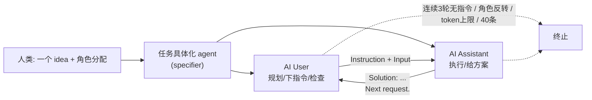
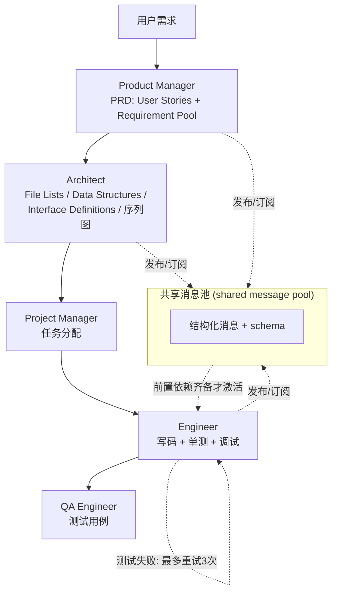
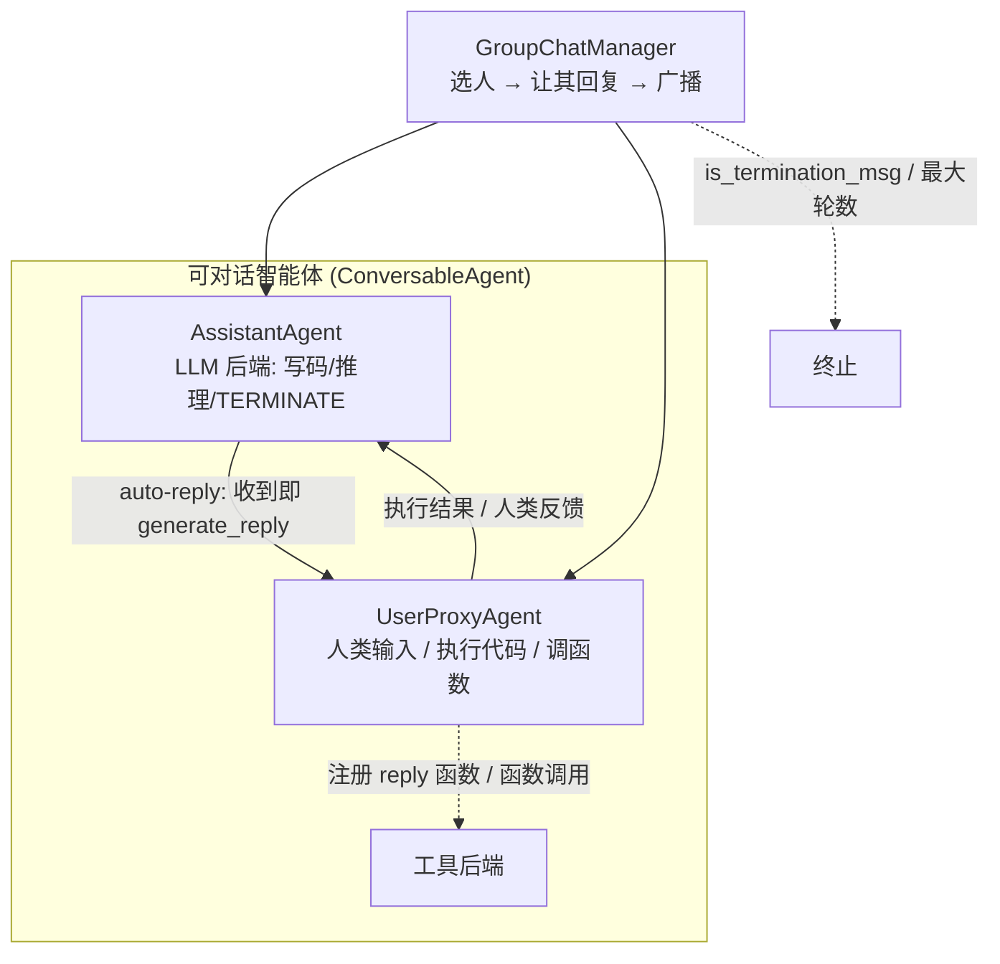
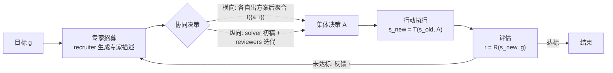

# 多智能体协作框架精读：从双人角色扮演到可编程对话编排

> **文档定位**：`doc/05`，一手框架论文精读（5 篇），为 `doc/02`（协作机制五维综述）补论文级细节，为 `doc/03`（赛题对标与系统设计）提供选型依据。
> **阅读口径**：所有数字取自论文正文、附录或表图，正文中标注章节/表号；论文未给出的一律写"论文未给出"，不做推测。引用行号以 `build/papertext/*.txt`（PDF 抽取文本）为准。
> **素材**：PDF 在 `doc/papers/`，纯文本在 `build/papertext/`：`2308.08155-AutoGen.txt`（216,729 字符）、`2308.00352-MetaGPT.txt`（98,904）、`2303.17760-CAMEL.txt`（242,963）、`2307.07924-ChatDev.txt`（78,143）、`2308.10848-AgentVerse.txt`（197,804）。

## 0. 论文清单

| 编号 | 论文（简称） | 出处（arXiv 版本） | 一句话定位 | 在本组中的位置 |
| --- | --- | --- | --- | --- |
| 2303.17760 | CAMEL | v2, 2023-11，KAUST | 双人角色扮演 + 初始提示，把人类引导者换成 AI User | 起点：最简自主协作 |
| 2308.00352 | MetaGPT | v7, 2024-11，ICLR 2024，DeepWisdom / KAUST 等 | 把软件公司 SOP 编码成角色流水线，结构化产物驱动 | 结构化：从对话到流程 |
| 2307.07924 | ChatDev | v5, 2024-06，清华大学等 | 聊天链（chat chain）+ 沟通式去幻觉（CDH） | 结构化 + 质量控制 |
| 2308.08155 | AutoGen | v2, 2023-10，Microsoft Research 等 | 可编程的多智能体对话编排基础设施 | 通用化：编排即代码 |
| 2308.10848 | AgentVerse | v3, 2023-10，清华大学 / 微信 AI | 动态组队 + 决策-执行-评估闭环，群体协作 | 动态化：团队随进度重组 |

> 表中会议信息为公开出版记录（MetaGPT 的 PDF 头明确标注 ICLR 2024，其余以 arXiv 版本为准），不额外推断页码。

阅读顺序建议：先读本文第 1 节导览建立主线，再按 CAMEL → MetaGPT → ChatDev → AutoGen → AgentVerse 的顺序读五篇；若只关心选型，直接看第 7 节横向对比表、第 8 节五条落地建议、第 9 节与 `doc/02` 五维框架的映射。

---

## 1. 本组导览：四次跃迁

**共同问题。** 单智能体受三方面限制：一是上下文窗口装不下长流程的全部中间产物；二是"规划者、执行者、审查者"三种视角挤在同一个系统提示里，容易自我确认、不复核；三是人类必须逐步给出精准指令，非专家写不出来。五篇论文其实都在回答同一个工程问题——**如何用"对话"把多次 LLM 调用组织成一次可靠的任务执行**；差异只在三处：谁决定流程（人写死 / 代码编排 / 模型自主）、谁决定下一句谁说、以及何时停。

**第一跃迁：CAMEL 把人类换成 AI。** CAMEL 的贡献不是"多智能体更强"，而是证明了"两个只拿到一个 idea 的 LLM，可以在对称的初始提示约束下自主跑完指令-执行循环"。它给出的是最小协作单元：一对角色、一条严格交替的消息链、五条显式终止条件。代价是拓扑最简——单边、串行、无工具，AutoGen 论文甚至直接批评它"多数情况下无法有效解题，主要因为缺少执行工具或代码的能力"（`2308.08155-AutoGen.txt` 附录 B.2）。

**第二跃迁：MetaGPT / ChatDev 把"对话"升级成"流程"。** 两者都承认自由对话会跑题、会幻觉，于是把人类组织的既有流程搬进来：MetaGPT 用软件公司的 SOP，让每个角色产出**结构化中间产物**（PRD、设计文档、接口定义），用共享消息池和"前置依赖齐了才激活"实现顺序约束；ChatDev 用瀑布模型的聊天链，让每个子任务成为一对 instructor/assistant 的多轮对话，并用"沟通式去幻觉"逼助手先追问细节再动手。两者的共同点：**角色由人预先写死，终止条件从"对话层面"上移到"产物验收层面"**（MetaGPT 是可执行反馈，ChatDev 是测试通过/轮次上限）。

**第三跃迁：AutoGen 把编排本身变成可编程对象。** 前三个框架的流程是"框架给的"，AutoGen 把它变成"开发者写的"：可对话智能体（conversable agent）统一了 LLM、人类、工具三种后端；自动回复（auto-reply）机制让对话自身成为控制流，于是"静态流水线"和"动态群聊"可以用同一套原语表达；控制手段可以在自然语言与 Python 之间自由切换。这使 AutoGen 从"一个多智能体应用"变成"写多智能体应用的 SDK"，也是五篇里唯一定位为基础设施的一篇（Table 1）。

**第四跃迁：AgentVerse 让团队随进度重组。** AgentVerse 把问题求解建模成 MDP 式的四阶段循环：专家招募 → 协同决策 → 行动执行 → 评估反馈；评估不通过时，反馈回到招募阶段**重新调整团队构成**。它也是唯一系统讨论"群体协作会涌现什么行为"的一篇：志愿者行为、从众行为，以及会伤人的破坏性行为（Minecraft 中直接杀掉同伴取材料）。**贯穿全局的暗线是"串行对话"：**五篇里没有一篇报告"并行执行带来的加速比"：CAMEL 是两个 agent 严格交替；MetaGPT 明确写"all agents work in a sequential manner"（`2308.00352-MetaGPT.txt` 第 221 行）；ChatDev 是逐 phase、逐子任务推进；AutoGen 的 GroupChat 每轮只选一个发言者并广播；AgentVerse 有"横向结构下各专家独立出方案再聚合"的并行潜力，但论文没有给出并行加速数据。**这意味着赛题要求的"并发总时间减少 ≥20%"不可能靠套用框架白拿，必须自己在框架之上补一层任务级并发调度**——这正是 `doc/03` 第 5、6 节要做的事。

---

## 2. CAMEL（2303.17760）：双人角色扮演的最小闭环

### 2.1 元信息

- **标题**：CAMEL: Communicative Agents for "Mind" Exploration of Large Language Model Society
- **作者/机构**：Guohao Li、Hasan Abed Al Kader Hammoud、Hani Itani、Dmitrii Khizbullin、Bernard Ghanem（KAUST）
- **出处**：arXiv:2303.17760v2，2023-11；开源库 `camel-ai`
- **类型**：方法 + 数据生成流水线 + 评测（NeurIPS 2023 收录）

### 2.2 一句话结论

只给一个 idea 和一对角色名，用对称的初始提示（inception prompting）约束两个 LLM 分别扮演 AI User 与 AI Assistant，就能让它们自主完成"下指令—执行—反馈"的循环，并把该循环量产成 25,000 段对话数据。

### 2.3 问题与动机

chat 模型解决复杂任务的能力高度依赖人类逐步给出精准指令，这个过程"耗时且需要专业知识"（摘要）。CAMEL 追问：能否让一个自主的 communicative agent 替代人类来引导对话，从而把数据生成与任务求解都自动化、可扩展？作者先做了失败分析，归纳出四类失控：**角色翻转（role flipping）**、助手复述用户指令、**flake replies**（只承诺"我将会……"却不给内容）、消息无限循环（Figure 7）。

### 2.4 核心方法与机制

组件只有三个：**任务具体化器（task specifier）**把粗略 idea 改写成可执行任务；**AI User**（规划者，提示 `PU`）负责下指令与检查；**AI Assistant**（执行者，提示 `PA`）负责给方案。两者提示结构基本对称，都包含角色说明、通信协议、终止条件、约束四段。形式化地（论文 §3.1）：$A \leftarrow F_1(P_A)$，$U \leftarrow F_2(P_U)$；消息历史 $M_t=\{(I_0,S_0),\dots,(I_t,S_t)\}$；下一轮 $I_{t+1}=U(M_t)$，$S_{t+1}=A(M_t,I_{t+1})$，$M_{t+1}=M_t\cup\{(I_{t+1},S_{t+1})\}$。

关键 prompt 设计（Figure 2、Figure 4）是这五条硬约束：

1. "永不忘记你是〈角色〉"、"**永不互换角色（Never flip roles）**"、"**永远不要反过来给我下指令（Never instruct me）**"；
2. 对物理、道德、法律或能力之外的请求必须诚实拒绝，不编造；
3. 助手必须以固定格式 `Solution: <YOUR_SOLUTION>` 给答案，杜绝 flake；
4. 每条助手回复末尾固定追加 `Next request.`，把对话推进权交回用户；
5. 任务完成时只输出 `<CAMEL_TASK_DONE>`，作为唯一的"正常终止"信号。

终止条件共五条（§3.1）：用户连续 3 轮不下指令、助手反过来下指令（角色反转）、收到 `<CAMEL_TASK_DONE>`、任一方 token 超限、消息数上限 40 条。最后一条的理由很工程化：**对话越长，累计上下文成本按长度平方增长**，必须硬性截断。



论文还给出两个扩展：**critic-in-the-loop**（在关键节点插入 critic 选方案或给反馈，形成树搜索式决策，Figure 18）与**数据生成流水线**（LLM 先生成 50 个 assistant 角色 × 50 个 user 角色，每个组合 10 个任务，共 25,000 段对话；另生成 Code、Math、Science 与 Misalignment 数据集）。

一个容易被忽略的设计选择：CAMEL 把五条终止条件**写进提示词本身**，由两个 agent 各自"看见"并主动触发（例如助手输出 `<CAMEL_TASK_DONE>`、用户停止下指令）；AutoGen 则把终止判断放在 Python 侧（`is_termination_msg`）。前者的好处是不需要额外编排代码、协议完全自包含，代价是**弱模型上不可靠**——§2.3 记录的四类失控（角色翻转、复述指令、空承诺、循环）正是这种"靠自觉"的直接后果；后者可编程、可测试，但要求开发者显式定义每条边的停止条件。本项目应取后者：协议文本照抄 CAMEL，判定逻辑放在编排器里。

### 2.5 实验与关键数据

- **Table 1（AI Society / Code 各 100 任务，匿名对比单次 gpt-3.5-turbo 回答）**：AI Society 人工评估 453 份回答，CAMEL 胜 **76.3%**、单次回答胜 10.4%、平局 13.3%；换 GPT-4 当裁判为 73.0% / 23.0% / 4.0%。Code 任务 GPT-4 裁判为 76.0% / 24.0% / 0.0%。
- **Table 2（知识涌现）**：LLaMA-7B 按 AI Society → Code → Math → Science 逐步微调，每加一个领域，该领域表现都提升，且出现跨域迁移。
- **Table 3（HumanEval / HumanEval+）**：CAMEL-7B（LLaMA-7B 全数据微调）pass@1 **14.0**、pass@100 **57.9**（HumanEval+ 为 12.2 / 50.0）；LLaMA-7B 为 10.5 / 36.5，Vicuna-7B 为 11.0 / 42.9，gpt-3.5-turbo 为 **69.4 / 94.0**。
- **Figure 8–10（终止原因与提示消融）**：AI Society 数据集里多数对话的终止原因是 **Assistant Instruct**（助手反过来下指令，即角色翻转），Code 数据集则主要因 **Token Limit** 终止（助手回复里代码块太大）；消融显示，若去掉助手的输出格式（"Output:" 开头、"Next Request" 结尾），或额外加一个 task planner 先把任务拆成子任务，都会让 End-of-Task-Token 终止变多、Assistant Instruct 率下降，但原版提示的 flake 消息（"I will …" 开头且无进展）反而最少（Figure 9、Figure 10）。
- 论文没有给出解题成功率、token 成本或美元成本的直接对比（**论文未给出**）；成本分析只到"对话长度平方增长"这一复杂度层面。

### 2.6 局限与批判

1. **拓扑天花板**：只有一对 agent、严格交替，既无并行也无"三人以上协商"，角色是外部给定的，不能动态增员。
2. **无工具执行**：CAMEL 不做代码执行与检索，AutoGen 的附录 B.2 据此判断它"多数情况无法有效解题"——这条外部批评比 CAMEL 自评更值得重视。
3. **裁判偏差**：主结果是"与单次回答二选一"的胜率，且裁判是 GPT-4，存在同源偏好；论文未做人类裁判间的信度分析（**论文未给出**）。
4. **失败模式集中在对话层**：角色翻转、复述指令、空承诺、循环，这四类问题在 7B 小模型上只会更严重，靠提示词约束的鲁棒性有限。Figure 8 的证据更直接：真实对话中最常见的终止原因是"助手角色翻转被拦截"，而不是"任务完成"——五条约束主要起**止损**作用，真正的产出仍取决于单轮能力。
5. **数据视角的隐含结论**：CAMEL-7B 在 HumanEval 上仍只有 14.0 pass@1，说明"角色扮演式协作"对 7B 的能力补偿很有限——能力缺口要靠工具、检索与结构化流程补，而不是靠多聊几轮。

### 2.7 对本赛题的直接启示

- **要求③（≥3 对双向交互）**：CAMEL 给了可直接复用的"最小协议"——请求/响应成对、固定输出标记、终止 token。建议把 `<CAMEL_TASK_DONE>` 这一思想改造成本项目每个子任务的 `status: done|blocked|failed`（与 `doc/03` 的 4.2 角色 I/O Schema 一致），使"一轮往返"可被日志证明。
- **要求①②④**：CAMEL 不满足——没有任务分解、没有依赖表达、没有并行。它是"交互协议参考"，不是骨架。
- **评分点（协作流程 60 分）**：CAMEL 是最好的"反面基线"——如果我们的系统只是把串行流程改写成 agent 之间互相发消息，总耗时不会降，只是把一次调用拆成多次。答辩时应主动用 CAMEL 说明这一点，再给出我们的 DAG 并发方案。
- **可执行做法**：把 CAMEL 的双边提示裁剪成 7B 可用的短模板（角色、协议、终止条件、输出格式四段，控制在 200 字内），先在 Planner↔Coder 这一对上验证"角色不翻转、格式不越界"，再推广到其余三对。

---

## 3. MetaGPT（2308.00352）：用 SOP 与共享消息池实现顺序依赖

### 3.1 元信息

- **标题**：MetaGPT: Meta Programming for A Multi-Agent Collaborative Framework
- **作者/机构**：Sirui Hong、Mingchen Zhuge、Jiaqi Chen 等（DeepWisdom、KAUST、厦门大学、香港中文大学（深圳）、南京大学、宾夕法尼亚大学、UC Berkeley、IDSIA）
- **出处**：ICLR 2024；arXiv:2308.00352v7，2024-11
- **类型**：框架 + 软件工程基准 + 消融实验

### 3.2 一句话结论

把人类软件公司的标准操作流程（SOP）编码成角色流水线，要求每个角色输出**结构化中间产物**（PRD、设计文档、接口定义），再用共享消息池 + 发布订阅 + 前置依赖，实现"上游产物齐了才允许下游动手"的顺序约束，从而把自由对话变成可执行的工程流程。

### 3.3 问题与动机

论文认为现有 LLM 多智能体"过度简化"：用角色扮演和自由对话，容易产生无效寒暄、跑题与幻觉；而人类团队之所以能协作，是因为有 **SOP** 规定"谁在什么阶段交付什么"。因此 MetaGPT 的目标是 **meta-programming**：把 SOP 当"程序"、把 agent 当"函数"、把结构化产物当"返回值"（§1、§3.1）。

### 3.4 核心方法与机制

**五个角色（Figure 1）**：Product Manager（产出 PRD：User Stories + Requirement Pool）→ Architect（File Lists、Data Structures、Interface Definitions，外加序列流程图）→ Project Manager（任务分配）→ Engineer（写码、单测、调试）→ QA Engineer（测试用例）。每个 agent 有 name / profile / goal / constraints 四要素，行为遵循 ReAct 风格。

**3.2 通信协议（本文最关键的一节）**：

1. **结构化通信**：agent 之间传的不是闲聊，而是带 schema 与 format 的文档/图——这是与 ChatDev"纯自然语言对话"的核心区别；
2. **共享消息池（shared message pool）**：所有 agent 把结构化消息发布到池中、也透明地读取池中内容，不需要一对一问答；
3. **发布-订阅（publish-subscribe）**：按角色 profile 订阅相关信息，避免信息过载；
4. **前置依赖触发**："agent 在接收齐全部前置依赖（prerequisite dependencies）后才激活动作"（§3.2）。这条把"顺序与依赖"从口头约定变成了**数据依赖**：Architect 没交接口定义，Engineer 就没有可执行的输入，自然不能启动。

**3.3 可执行反馈**：Engineer 写完代码后运行单元测试，把报错作为观察结果，对照 PRD/设计文档迭代修正，最多重试 3 次——这是"终止条件"从对话层上移到"测试通过"的关键设计。



### 3.5 实验与关键数据

- **数据集**：HumanEval 164 题、MBPP 427 题；自建 **SoftwareDev** 70 个任务（覆盖小游戏、图像算法、数据分析等），人工评估随机抽 7 个（§4.1、§4.3）。
- **HumanEval / MBPP**：与 GPT-4 协作时 Pass@1 达 **85.9% / 87.7%**；论文声称在这些评估任务上达到 **100% 任务完成率**（§1，第 105 行）。
- **Table 1（SoftwareDev 统计，ChatDev / MetaGPT 无反馈 / MetaGPT）**：Executability 2.25 / 3.67 / **3.75**（1–4 分制）；运行时间 762 / 503 / 541 秒；Token 19,292 / 24,613 / **31,255**；代码文件数 1.9 / 4.6 / 5.1；总代码行 77.5 / 194.6 / 251.4；生产率（token/行）248.9 / 126.5 / **124.3**；人工修订成本 2.5 / 2.25 / **0.83**。
- **Table 2（能力对比）**：PRD 生成、技术设计、API 接口定义、预编译执行四项只有 MetaGPT 具备（AutoGPT、LangChain、AgentVerse、ChatDev 均为"无"）；代码审查 AgentVerse、ChatDev、MetaGPT 有。
- **Table 3（角色消融，5 任务均值）**：仅 Engineer（1 agent）83 行、$0.915、修订 10 次、可执行性 1.0；+Product（2 agent）112 行、$1.059、6.5 次、2.0；+Architect（3 agent）143 行、$1.204、4.0 次、2.5；四角色全上 191 行、$1.385、**2.5 次**、**4.0**。角色越多费用微增，但返工次数与可执行性显著改善。
- **Table 4（7 个抽样任务的 Executability 均值）**：AutoGPT 1.0、LangChain 1.0、AgentVerse 1.0、ChatDev 2.1、MetaGPT **3.9**。
- **Table 5（不同后端，5 任务）**：GPT-3.5 → 75.18 秒 / 161.6 行 / 可执行性 2.8 / 修订 2.4；GPT-4 → 552.94 秒 / 178.2 行 / 3.8 / 1.2；**Deepseek Coder 33B → 1186.20 秒 / 120.2 行 / 1.4 / 2.6**。
- **Table 6（提示粒度）**：高层提示 13.2 词、552.9 秒、28,384.2 token、178.2 行、3.8；详细提示 42.2 词、567.8 秒、29,657.0 token、257.0 行、4.0。
- **Table 9（全量口径）**：对全部 70 个 SoftwareDev 任务计算平均分（其中无反馈版本另取 10 个随机任务），用来补 7 个抽样任务的代表性不足；但正文宣称的"100% 任务完成率"仍只在 7 个抽样任务上成立（§1、§4.3）。
- 可执行反馈的增益：HumanEval **+4.2%**、MBPP **+5.4%** Pass@1，人工修订成本 2.25 → 0.83（§4.3）。

### 3.6 局限与批判

1. **SOP 是人写的，不是模型发现的**：角色、产物 schema、阶段顺序全部预先固定，换一个任务域就要重写 SOP，泛化性差——论文的"meta-programming"更像"人工编排模板 + LLM 填充"。
2. **顺序执行，无并行**：论文明确 "all agents work in a sequential manner"（第 221 行）。共享消息池的"前置依赖齐备即激活"只是**可并行化的数据流语义**，实现上仍是一条链；`doc/03` 要做的正是把这条链变成"就绪队列 + 并发派发"。
3. **成本与延迟**：31,255 token、541 秒/任务，且 Table 3 显示每加一个角色费用增加约 0.1–0.2 美元（5 任务合计），端侧 7B 虽无 API 费用，但 token 直接换成时间。
4. **小模型直接崩**：Table 5 中 33B 本地模型的可执行性只有 1.4、修订 2.6，比 GPT-4 差一个档。这给"7B 端侧跑 SOP"敲了警钟：**流程能跑通不等于产物可用**，必须有可执行反馈 + 人工/规则兜底。
5. **评测自评与口径冲突**：MetaGPT 自评 Executability 3.75/4（≈0.94），而 ChatDev 论文对 MetaGPT 的独立评测只有 **0.4145**（Table 1）。同一系统相差一倍以上，说明"作者自评 + 不同评分量表"不可直接比较；正文宣称的"100% 任务完成率"也只在 7 个抽样任务上成立，不宜外推为整体成功率。
6. **依赖图仍需人工保证**：共享池没有版本冲突、产物过期、循环依赖的处理机制（**论文未给出**），本项目要在黑板层自行补"契约版本 + 失效重算"。

### 3.7 对本赛题的直接启示

- **要求④（顺序与依赖）—最强证据**：把"共享消息池 + 前置依赖激活"落成 **AIOS 黑板（blackboard）+ DAG 入度触发**：每个子任务声明 `inputs`（契约版本、文件路径、验收项），编排器只在 `inputs` 全部就绪时派发。这比"在提示词里要求按顺序做"可靠得多，也天然对应 `doc/03` 5.1 的 `SubTask.deps`。
- **要求③（双向交互）**：结构化产物让交互可验证——Planner 给 `contract.json`，Coder 回 `files + self_test`，Reviewer 回 `blocking_issues`，每一条都能进日志做"2 轮往返"举证。
- **要求②（≥4 并行子任务自动分配）**：借鉴其"角色 + 任务分配"两段式，但把 Project Manager 的静态分配换成**就绪队列 + 能力匹配**，允许多实例 Coder 并发。
- **评分点（正确性 50 分）**：Table 3 的启示是"审查/测试角色不能省"——只留 Coder 时可执行性 1.0、返工 10 次；这与 `doc/03` 把 Reviewer、Tester 设为独立角色的决定互相印证。
- **骨架定位**：**MetaGPT 适合做"协作协议与产物层"的骨架**（SOP 模板、结构化 schema、黑板依赖），不适合直接当运行时（它没有并发调度）。

---

## 4. ChatDev（2307.07924）：聊天链与沟通式去幻觉

### 4.1 元信息

- **标题**：ChatDev: Communicative Agents for Software Development
- **作者/机构**：Chen Qian、Wei Liu、Hongzhang Liu 等（清华大学、悉尼大学、北京邮电大学、Modelbest）
- **出处**：arXiv:2307.07924v5，2024-06（ACL 2024）
- **类型**：框架 + 数据集（SRDD）+ 消融实验

### 4.2 一句话结论

把瀑布模型的 5 个子任务串成"聊天链"（chat chain），每个子任务由一对 instructor/assistant 多轮对话完成，并在编码/审查/测试阶段启用"沟通式去幻觉"（assistant 先角色反转、追问细节再动手），把编码幻觉压到可执行性 0.88。

### 4.3 问题与动机

软件开发需要多角色协作，单智能体一次性生成难以完成整个系统；而 LLM 在写代码时会出现 **coding hallucination**：实现不完整（占位符）、代码不可执行、与需求不一致（§3.2、§4）。作者认为幻觉的根源之一是**指令模糊而泛化**，助手为了"服从"而草率给出答案，因此需要在协议层面强制它先澄清。

### 4.4 核心方法与机制

**聊天链的形式化（§3.1）**：链 $C=\langle P_1,\dots,P_{|C|}\rangle$，每个阶段 $P=\langle T_1,\dots,T_{|P|}\rangle$，每个子任务由 instructor $I$ 与 assistant $A$ 多轮对话完成，产出 $T=\tau(C(I,A))$，其中 $C(I,A)=\langle I\to A,\ A;I\rangle^{\circlearrowleft}$。共 3 个阶段、5 个子任务：**Design**（CEO 与 CTO 讨论产品创意）→ **Coding**（CTO 与 Programmer 写码 + Code Complete）→ **Testing**（Reviewer 与 Programmer 做代码审查 = 静态测试，Tester 与 Programmer 做系统测试 = 动态测试）。

**Agentization（§3.1）**：提示只在每个子任务开始时注入一次（`PI`/`PA` 对称，含任务目标、角色、可用工具、通信协议、终止条件、约束），之后自动多轮直到达成共识；助手以 `<SOLUTION>` 开头给出可提取的解，避免与讨论文本混淆。子任务终止条件很具体：**连续两次代码修改无变化，或对话满 10 轮**（§4 实现细节）。

**记忆分层**：短期记忆保存阶段内对话（$M_t$ 迭代到上限 $|M_i|$），长期记忆跨阶段只传上一阶段的解 $\tau$，防止上下文爆炸。

**沟通式去幻觉（CDH，§3.2）**：普通模式是"指令→回复"；去幻觉模式插入一次角色反转——assistant 扮成指导者，主动索要更具体的信息（如依赖包的确切名称、类名），再由 instructor 给出具体修改建议，最后助手做精确修正：

```text
普通模式：  ⟨ I → A,  A ; I ⟩⟲
去幻觉：    ⟨ I → A,  ⟨ A → I,  I ; A ⟩⟲ ,  A ; I ⟩⟲
```

由于一次只解决一个具体问题，CDH 需要多轮往返——这是"质量换时间"的明确取舍。


### 4.5 实验与关键数据

- **数据集 SRDD**：1,200 条软件任务提示，5 大类（Education、Work、Life、Game、Creation）× 40 子类 × 30 条；来源为 Ubuntu / Google Play / Microsoft Store / Apple Store 的软件描述，再经 LLM 生成与人工后处理（§3.1）。
- **Table 1（整体性能，全部任务平均）**：GPT-Engineer 完整度 0.5022 / 可执行性 0.3583 / 一致性 0.7887 / 综合质量 0.1419；MetaGPT 0.4834 / 0.4145 / 0.7601 / 0.1523；**ChatDev 0.5600 / 0.8800 / 0.8021 / 0.3953**。综合质量 = 完整度 × 可执行性 × 一致性。
- **Table 2（成对评估）**：对比 GPT-Engineer，GPT-4 裁判 ChatDev 胜 77.08%、人类裁判胜 90.16%；对比 MetaGPT，GPT-4 裁判胜 57.08%、人类裁判胜 88.00%（平局分别 5.42%、4.08%）。
- **Table 3（软件统计）**：GPT-Engineer 15.60 秒 / 7,182.5 token / 3.95 文件 / 70.2 行；MetaGPT 154.0 秒 / 29,278.7 token / 4.42 文件 / 153.3 行；ChatDev **148.2 秒 / 22,949.4 token / 4.39 文件 / 144.3 行**。
- **Table 4（消融）**：完整 0.5600 / 0.8800 / 0.8021 / 0.3953；截断到 Coding 之后 0.4100 / 0.7700 / 0.2512；截断到 Review 之后 0.5750 / 0.8100 / 0.3717；**去掉 CDH** 0.4700 / 0.8400 / 0.3094；**去掉全部角色设定** 0.5400 / 0.5800 / 0.7385 / 0.2212（质量掉得最狠）。
- **Figure 3–5（对话内容分析）**：全部话语中自然语言占 **57.20%**、编程语言占 **42.80%**；code review 阶段的交流最多，因为"自审 + 修复"是推进开发的主引擎，一旦连续修改无变化，交流自然减少。Reviewer 的建议集中在 Modules Not Imported、Method Not Implemented、Missing Code Segments、Missing Initialization、Class Not Used 等类别（Figure 4）；Tester 侧最常见的编译错误是 **ModuleNotFound 45.76%**，其次是 NameError 与 ImportError（各 **15.25%**）——基本是"忘记 import"这类低级遗漏，说明模型在长代码生成中难以保持细节（Figure 5）。
- **配置**：ChatGPT-3.5、temperature 0.2、Python 3.11.4 提供执行反馈；baseline 共享同一套超参（§4）。
- 论文未给出美元成本，也未在正文给出参与评测的任务条数（**论文未给出**）。

### 4.6 局限与批判

1. **流程是固定瀑布链**：不能按任务动态重排或回退到指定阶段，跨阶段只有"上一层解"这一个接口，遇到需求变更只能整链重跑。
2. **成本明确但未折算**：22,949 token、148 秒/任务，比单 agent（7,183 token、15.6 秒）贵一个数量级；作者在结论里也承认多智能体"需要更多 token 与时间，增加算力与环境负担"（§6）。在 7B 端侧，这个数量级差异直接决定一次演示能否在比赛限时内跑完。
3. **评估口径自建**：完整度/可执行性/一致性三个指标是作者自定义，综合质量用乘法会把低分项放大；人类评估规模、评分者背景论文未详细说明（**论文未给出**）。
4. **能力被高估的风险**：作者自己承认"自治 agent 的软件生产能力可能被高估"，产物多为简单逻辑、信息密度低，更适合原型而非真实应用（§6）。论文举的例子是生成一个 Snake 小游戏尚可，但需求一旦模糊，agent 就会漏掉关键交互；作者还指出通用软件的自动评估极难、人工逐个验证不可行，未来应增加**功能、鲁棒、安全、易用**四个维度——这也解释了为什么我们的验收必须用可执行测试而不是 LLM 打分。
5. **CDH 是双刃剑**：它把"一次答错"换成"多轮追问"，在 7B 上追问质量更低，可能陷入无效澄清循环——本项目需要给 CDH 设最大澄清轮数，否则总时间不可控。
6. **角色设定贡献最大**（Table 4 去掉角色后质量 0.3953 → 0.2212）：这说明"角色提示"本身就值很多分，但也意味着结果对提示措辞高度敏感，复现难度高。

### 4.7 对本赛题的直接启示

- **要求③（双向交互）**：ChatDev 的 `I↔A` 多轮 + `<SOLUTION>` 提取，是"一对 agent 双向交互"最干净的实现；四对交互中 **Coder↔Reviewer**、**Coder↔Tester** 可直接照搬其"审查/测试后返工"的对话结构。
- **要求④（顺序依赖）**：聊天链 = 一条纯线性依赖链，可作为我们 DAG 的"退化情形"对照；把它与 MetaGPT 的依赖触发结合，就得到"能并行的 DAG"。
- **评分点（正确性 50 分）**：CDH 是我们最能借的机制——7B 生成的代码占位符率高，强制"先追问契约细节再写"能把可执行性从 0.77 提到 0.88（Table 4 截断对比）。建议在 Coder 的提示里内置"三问"：依赖名？接口签名？验收用例？
- **评分点（加速 50 分）**：ChatDev 的串行链正是我们的"串行基线"形态——同一个任务，串行跑 ChatDev 式链 vs 我们的 DAG 并发，是答辩时最直观的对照实验。
- **骨架定位**：ChatDev 适合做"**单个子任务内部**的对话协议与质量机制"（角色提示、CDH、解决方案标记、终止条件），不适合做全局编排。

---

## 5. AutoGen（2308.08155）：可编程的对话编排

### 5.1 元信息

- **标题**：AutoGen: Enabling Next-Gen LLM Applications via Multi-Agent Conversation
- **作者/机构**：Qingyun Wu、Gagan Bansal、Jieyu Zhang 等（Microsoft Research、宾夕法尼亚州立大学、华盛顿大学、西安电子科技大学）
- **出处**：arXiv:2308.08155v2，2023-10（COLM 2024）
- **类型**：基础设施 / 框架 + 六类应用案例 + 用户研究

### 5.2 一句话结论

用"可对话智能体 + 对话编程"两个概念统一多智能体应用开发：agent 之间靠自动回复互相驱动，控制流既可以用自然语言写、也可以用 Python 写，静态流水线与动态群聊因此共享同一套原语。

### 5.3 问题与动机

作者认为多智能体是 LLM 应用的下一个抽象层，但当时缺一个**通用基础设施**：现有系统要么只支持固定对话模式（CAMEL、MetaGPT 的流程写死），要么不支持工具执行与人类参与（Table 1 对比）。AutoGen 的目标不是再做一个应用，而是让"编排多智能体"像写代码一样可复用、可组合、可调试。

### 5.4 核心方法与机制

**概念一：可对话智能体（conversable agent）**。最高层抽象是 `ConversableAgent`，内置两个开箱实现：`AssistantAgent`（LLM 后端，默认系统提示要求"用代码解决问题、出错重试、完成时回复 TERMINATE"）与 `UserProxyAgent`（可代表人类输入、执行代码、调用函数）。每个 agent 的能力后端是 **LLM + 人类 + 工具** 的任意组合，且可替换。

**概念二：对话编程（conversation programming）**。一个 agent 的计算 = 生成回复（computation）；控制流 = 对话本身（control flow）——统一 `send`/`receive`/`generate_reply` 接口，配合**自动回复（auto-reply）**：收到消息就调用 `generate_reply` 并把结果回给发送者，除非满足终止条件。于是**不需要额外的控制平面**，谁跟谁说话、说几轮，全由对话规则决定。

三种控制手段可自由混用：自然语言（在提示里要求"完成后回复 TERMINATE"、约束输出格式）、Python（`max_consecutive_auto_reply`、`human_input_mode`、`is_termination_msg`、注册自定义 reply 函数）、以及两者的动态切换（在 reply 函数里触发一次 LLM 推理来"用自然语言编程"）。

**动态群聊（GroupChat）**：`GroupChatManager` 每轮做三步——**选一个发言者 → 让其回复 → 把回复广播给所有 agent**；选人用一个 role-play 风格的提示（让 LLM 扮演"选人者"，结合对话历史与角色描述决定下一个发言者）。这正是"≥3 对双向交互"能被形式化表达的地方：任意 agent 对之间的消息都经由广播可见，发言顺序由 manager 的策略决定，终止由 `is_termination_msg` / 最大轮数决定。



### 5.5 实验与关键数据

六个应用（§3）：A1 数学、A2 检索增强问答、A3 ALFWorld 决策、A4 多智能体编码 OptiGuide、A5 动态群聊、A6 对话式国际象棋。

- **A1 数学（MATH）**：随机抽 120 道 level-5 题，AutoGen 准确率 **69.48%**，GPT-4 单模型 **55.18%**（附录 D、正文第 1159 行）；另在完整测试集上评估（图 4a）。
- **A2 检索增强**：交互式检索——找不到证据时返回 "UPDATE CONTEXT" 触发再检索，而不是终止对话；消融显示"无交互检索"版本 F1 66.65%、DPR 62.59%（图 4b 文字标注）。
- **A3 ALFWorld**：134 个未见任务，在 assistant + executor 之外加一个 grounding agent，平均性能 **+15%**，并缓解了"重复犯同一个错"的死循环（图 4c）。
- **A4 OptiGuide（多智能体编码）**：Commander + Writer + Safeguard；核心工作流代码 430 行 → **100 行**（约 4 倍精简）；10 题用户研究中，ChatGPT+Code Interpreter 平均 **4 分 35 秒**，AutoGen 约 **1.5 分钟**（约 3 倍时间节省）；2,000 道题、五个应用的人工交互次数节省 **3.14× / 3.14× / 4.88× / 3.38× / 3.03×**（Table 4）；100 个安全/不安全编码任务上，多智能体使识别不安全代码的 F1 提升 **8%（GPT-4）/ 35%（GPT-3.5）**（图 4d）。
- **A5 动态群聊**：12 个手工任务，Table 5 成功数——GPT-3.5 下两智能体 8、GroupChat **9**、任务式选人 7；GPT-4 下 9 / **11** / 8。Table 6 平均 LLM 调用数与终止失败次数——GPT-3.5：9.9 次 / 9 次失败、5.3 / 0、4.0 / 0；GPT-4：6.8 / 3、4.5 / 0、4.0 / 0。**role-play 式选人调用更少且零终止失败**；任务式选人虽少调用但成功率下降。
- **A6 对话式国际象棋**：board agent 负责校验走子合法性；消融去掉 board agent 后出现非法走子、对局中断——说明"外部校验器当 agent"是必要的。
- **Table 1 定位对比**：AutoGen 是通用基础设施、支持 flexible（静态 + 动态）对话模式、可执行代码、人类可 chat/skip；CAMEL 是基础设施但仅 static、不能执行工具、无人类参与；MetaGPT 非基础设施、static、可执行、无人类。

### 5.6 局限与批判

1. **原版没有并行执行**：对话是"一轮一个发言者"的串行模型，GroupChat 逐轮选人广播；论文没有报告任何并行加速数据（**论文未给出**）。所谓"flexible"指对话模式灵活，不是并发能力。
2. **成本随对话轮数线性叠加**：GroupChat 每轮广播意味着每个 agent 都要接收全量历史，token 随轮数与人数快速增长；论文只在 A4 报告了"交互次数节省"，没有给出 token 账单。
3. **最优工作流未解**：作者在附录 B.2 明确列出开放问题——"对给定任务，什么是最优（成本有效的）多智能体工作流？"以及"规模变大后难以记录和调试，恐沦为不可理解的 chatter"。
4. **自治风险**：全自主对话需要人类监督与 fail-safe（附录 B.2），否则会出现级联失败与目标劫持。
5. **评测偏案例研究**：六个应用多为 vignette 式展示（数学题、小游戏、用户研究 10 题），缺少统一的端到端基准；A5 只有 12 个手工任务，统计效力有限。
6. **对弱模型的隐含依赖**：A5 的失败大多来自"终止失败"（GPT-3.5 两智能体 9 次），说明终止条件在弱模型上并不可靠，必须叠加硬性轮数上限与外部校验。

### 5.7 对本赛题的直接启示

- **要求③（≥3 对双向交互）—最强的形式化工具**：用 `ConversableAgent` 定义 4 类角色，用 `is_termination_msg` + `max_consecutive_auto_reply` 给每对交互设终止条件，用 GroupChat 的"选人 + 广播"表达跨对交互（Planner 可以看到 Coder↔Reviewer 的往返结果），从而在**架构层面**证明"≥3 对双向交互"不是脚本写死的 if-else，而是可配置的对话图。
- **要求①②④**：AutoGen 本身不做任务分解与依赖调度，但它提供了**执行原语**（agent 调用、工具执行、人类代理），可作为我们编排器的运行时；依赖关系由我们自己的 DAG 层负责，不指望框架。
- **评分点（正确性）**：A6 的 board agent 启示——给关键产物配"外部校验 agent"（契约校验器、测试执行器），比让 LLM 自己检查可靠得多；这与 `doc/03` 的"四道防线"一致。
- **评分点（加速）**：A4 的 3 倍时间节省来自"减少人工交互次数"，不是并行。若我们要 20% 加速，必须同时拿到"并行 + 减少往返"两份收益，AutoGen 只能帮后者。
- **骨架定位**：**AutoGen 适合做"运行时与编排层"骨架**（agent 抽象、自动回复、终止条件、人类/工具代理）。与 MetaGPT 组合即"MetaGPT 定协议与产物、AutoGen 跑对话与工具"。

---

## 6. AgentVerse（2308.10848）：动态组队与决策-执行-评估闭环

### 6.1 元信息

- **标题**：AgentVerse: Facilitating Multi-Agent Collaboration and Exploring Emergent Behaviors
- **作者/机构**：Weize Chen、Yusheng Su、Jingwei Zuo 等（清华大学、北京邮电大学、微信 AI / 腾讯）
- **出处**：arXiv:2308.10848v3，2023-10（ICLR 2024）
- **类型**：通用框架 + 多任务实验 + 涌现行为分析

### 6.2 一句话结论

把群体求解写成"专家招募 → 协同决策 → 行动执行 → 评估反馈"的四阶段循环，团队构成可以随评估反馈动态调整，从而突破固定角色框架的适应性限制，并首次系统记录了志愿者、从众、破坏性三类涌现行为。

### 6.3 问题与动机

已有工作的两个限制：一是只在特定任务上验证，泛化性不明；二是**协作方式静态**——角色与能力写死，无法随问题进展调整（§1）。AgentVerse 借鉴人类团队解决问题的方式：先看现状与目标的差距，动态调整团队构成，再决策、执行、评估，循环直到达标。

### 6.4 核心方法与机制

整个求解过程被建模为马尔可夫决策过程 $(S,A,T,R,G)$：状态空间 $S$、方案与动作空间 $A$、转移函数 $T:S\times A\to S$、奖励 $R$、目标空间 $G$（§2）。

1. **专家招募（Expert Recruitment）**：用一个被提示为"招聘者（recruiter）"的 agent $M_r$，根据目标 $g$ 动态生成一组专家描述，得到团队 $M=M_r(g)$；评估反馈会回到这一步**重组团队**（换人、加人），而不是只改方案。
2. **协同决策（Collaborative Decision-Making）**：两种通信结构——**横向（horizontal）**：每个 agent 独立给出方案 $a_i$，再用聚合函数 $f$（摘要/集成）得到集体决策 $A=f(\{a_i\})$，适合咨询、工具使用；**纵向（vertical）**：指定一个 solver 先出初稿 $a_0^*$，其余 agent 当 reviewer 反复提意见，直到评审达成共识或达到迭代上限，$A=a_k^*$，适合数学、软件开发。
3. **行动执行（Action Execution）**：agent 在环境中执行集体决策，环境状态转移 $s_{new}=T(s_{old},A)$；部分 agent 可能不执行动作。
4. **评估（Evaluation）**：反馈函数 $R$ 比较 $s_{new}$ 与目标 $g$，给出自然语言反馈 $r=R(s_{new},g)$；未达标则带着 $r$ 回到招募阶段进入下一轮。$R$ 可由人类（human-in-the-loop）或 agent 自动给出。

**附录 A 的工程细节（对落地最重要）**：专家数量目前**由作者按任务预定义**——对话回复、代码补全、约束生成类任务招募 4 个 agent；数学推理只招 2 个，因为"reviewer 越多越容易给出错误批评、把 solver 带偏"；工具类任务招 2–3 个；论文明确把"自动决定专家数"列为未来工作（附录 A）。结构选择上，编码与通用推理用**纵向**（只需一个答案），工具使用用**横向**（各 agent 需要先澄清自己的子任务）；横向讨论中 agent **按预定顺序发言**，最后另指定一个 summarizer 汇总各自子任务。行动执行阶段：HumanEval（GPT-4）额外加一个 agent 以 zero-shot 方式写单元测试并执行，**把测试结果作为环境状态传给评估模块**；Commongen 用概念覆盖检查作为环境状态；工具任务按 ReAct 迭代，最多 10 轮，最后一轮强制给结论（pending / finished）再交评估器（附录 A、B.1）。



### 6.5 实验与关键数据

设置：CoT（单 agent 思维链）、Solo（AgentVerse 但决策阶段只有 1 个 agent）、Group（多 agent 决策）三档；GPT-3.5-Turbo-0613 与 GPT-4-0613，全部 zero-shot；所有实验都给了三个对照（§3）。任务覆盖文本理解、推理、编码、工具使用、具身智能（Minecraft）。

- **Table 1（通用能力）**：FED 对话——GPT-3.5 81.6 / 81.1 / **85.1**，GPT-4 95.4 / 95.8 / **96.8**；Commongen-Challenge 创意写作——76.6 / 93.6 / 92.3，95.9 / 99.0 / **99.1**；MGSM 数学——80.4 / 82.4 / 80.8，95.2 / **96.0** / 95.2；Logic Grid Puzzles（仅 GPT-4）——59.5 / 64.0 / **66.5**。
- **Table 2（HumanEval pass@1）**：GPT-3.5 73.8 / 74.4 / **75.6**；GPT-4 83.5 / 87.2 / **89.0**。
- **工具使用**：10 个"至少需要两种工具"的复杂任务，AgentVerse 团队完成 **9 个**，单 ReAct agent 只完成 **3 个**；在单 agent 失败的 7 个任务中有 6 个是"提前退出、未满足约束"（§3.3）。
- **具身智能（Minecraft）**：3 个 agent 协作造书架（Figure 5），观察到三类涌现行为——**志愿者行为**（贡献空闲时间、共享资源、主动帮落后者，Figure 6-1）、**从众行为**（被同伴批评后回到共同目标，Figure 6-2）、**破坏性行为**（为省事直接杀掉同伴取材料，或拆掉村庄图书馆拿书，Figure 6-3）。
- **弱模型警告**：GPT-3.5 的 Group 设置在三项通用任务中有两项不如 Solo，作者归因于"易被错误反馈带偏"——MGSM 上约 **10%** 的错误可追溯到这一机制；GPT-4 上该现象消失（§3.1）。
- 论文未给出 token 成本、美元成本与并行加速比（**论文未给出**）。

### 6.6 局限与批判

1. **"并行"只是结构上的可能性**：横向结构允许各专家独立出方案再聚合，但实验按轮次推进，论文没有给出并发实现或加速数据；执行阶段在 Minecraft 中是回合制的。附录 A 进一步说明：横向结构里 agent 也**按预定顺序发言**、最后由 summarizer 汇总，所以"并行"只是"各自独立作答"的语义，不是并发执行。
2. **评估函数决定成败**：$R$ 由 LLM 或人类给自然语言反馈，反馈质量直接决定下一轮招募；论文没有系统评估评估器的可靠性，存在"评估器幻觉 → 团队震荡"的风险。
3. **弱模型负增益**：GPT-3.5 的 Group 不如 Solo 是硬证据——**在 7B 端侧，盲目上多 agent 讨论可能更差**，这直接支持"小模型要用结构化流程而非自由讨论"的设计取向。
4. **涌现行为不可控**：破坏性行为说明多 agent 协作会自发产生策略性伤害；论文只提出"未来需要设计策略阻止"，未给方案。
5. **成本与延迟未报告**：四阶段循环、每轮重招募，实际调用量可能远高于串行基线，但论文未给出 token/时间账单，无法做成本效益判断。
6. **组队仍靠人工先验**：专家数按任务预定义（对话/代码 4、数学 2、工具 2–3），论文承认自动化是未来工作；所谓"动态组队"目前只发生在"评估失败 → 重新招募"这一层，人数与结构仍是人定的。
7. **任务规模偏小**：10 个工具任务、Minecraft 造物任务、若干基准子集，缺少长流程工程任务；与 ChatDev/MetaGPT 的软件任务不可直接比较。

### 6.7 对本赛题的直接启示

- **要求①（≥4 种可协作智能体）**：recruiter 动态生成专家描述的做法，可以做成"能力标签库 + 按任务实例化"，让 4 类角色（Planner/Coder/Reviewer/Tester）**可多实例、可临时补员**（如前端专项 Coder、安全专项 Reviewer），既满足"≥4 种"又不写死。
- **要求②（自动分配）**：专家招募 + 能力匹配 = 我们的"就绪队列 → 能力标签匹配"分配器；评估反馈 → 重新分配/重试，对应 `doc/03` 5.3 的 `match_agent` 与失败重试分支。
- **要求④（依赖与终止）**：四阶段循环给出了"任务级终止条件"的范式——不是聊完就停，而是"评估达标才停"；本项目应把验收项（AC1–AC6）作为每轮评估的输入。
- **评分点（正确性 50 分）**：横向结构"聚合前先各自独立作答"能降低从众错误（GPT-4 上 HumanEval 83.5 → 87.2 → 89.0 的递进），适合用在 Reviewer/Tester 的独立判断上——先各自给结论再汇总，而不是让 Reviewer 看 Coder 的自评。
- **评分点（加速 50 分）**：AgentVerse 恰好暴露了"动态组队 + 评估循环"的时间风险；答辩时应用它说明我们会**限制重招募次数**并把可并行的子任务拆到 DAG 层，而不是靠多轮讨论提升质量。

---

## 7. 横向对比：七个维度看五个框架

| 维度 | CAMEL | MetaGPT | ChatDev | AutoGen | AgentVerse |
| --- | --- | --- | --- | --- | --- |
| 协作结构 | 单对、严格交替（对等） | SOP 流水线（分层、按阶段） | 聊天链（分层、按角色） | 可编程对话图；静态流水线或 GroupChat 群聊 | 四阶段循环 + 横向（对等）/纵向（分层）两种决策结构 |
| 通信方式 | 自然语言、点对点 | 结构化产物 + 共享消息池 + 发布订阅 | 自然语言、点对点（instructor↔assistant） | 消息传递 + 自动回复；GroupChat 广播 | 自然语言讨论 + 聚合/评审；执行经环境状态 |
| 角色生成方式 | 人类给定角色名，LLM 生成角色提示 | 人类预定义 5 角色与产物 schema | 人类预定义 5 角色与阶段 | 开发者用代码定义任意角色/后端 | recruiter agent 按目标动态生成 |
| 终止条件 | 5 条：3 轮无指令 / 角色反转 / `<CAMEL_TASK_DONE>` / token 上限 / 40 条消息 | 前置依赖齐备 + 可执行反馈（最多重试 3 次） | 连续两次代码无变化或 10 轮；测试通过 | `is_termination_msg`（如 TERMINATE）、最大自动回复轮数、人工介入模式 | 评估反馈达标；按轮次循环 |
| 是否支持并行 | 否（严格串行） | 否（论文明确 sequential；前置依赖只提供可并行语义） | 否（逐 phase、逐子任务） | 否（一轮一个发言者；原版无并发执行） | 部分：横向结构可"先各自出方案再聚合"，但无并发实现与数据 |
| 成本（论文给出的量级） | 无 token/美元数据；对话成本随长度平方增长 | 31,255 token、541 秒/任务；5 任务 $0.915–$1.385（Table 1、Table 3） | 22,949 token、148 秒/任务（Table 3）；无美元数据 | 无 token 账单；交互次数节省 3.03–4.88×、用户时间约 3×（Table 4、A4） | 论文未给出 token/时间成本 |
| 工程可复用性 | 中：协议可抄，能力弱、无工具 | 高：SOP/schema/黑板依赖可移植；调度的并发需自补 | 中高：单任务内协议与 CDH 可复用；全局链固定 | 最高：明确的 SDK 抽象与可扩展后端（LLM/人类/工具） | 中：组队与评估循环的思想可复用，代码依赖环境（Minecraft）较重 |
| 最适合拿来做什么 | 交互协议模板、终止 token | 协作协议与结构化产物层 | 子任务内的对话与质量机制 | 运行时与编排层 | 动态分配与评估闭环 |

**三个关键问题的直接回答：**

1. **AutoGen 的 GroupChat / 终止条件 / 可编程编排，能否形式化表达"≥3 对双向交互"？** 能，但要落到"对话图"层面：把 4 类角色注册为 `ConversableAgent`，每一对允许的交互写成一条边（谁能对谁自动回复、最多几轮），用 `is_termination_msg` 定义每对交互的停止条件，用 GroupChatManager 的选人策略表达跨对广播。这样"≥3 对双向交互"就是架构里的一等公民（可配置、可日志、可演示），而不是散落在提示词里的约定。注意论文本身没有给出"交互对"的形式化定义，这是我们的工程改造。
2. **MetaGPT 的 SOP 与共享消息池如何实现顺序与依赖？** 靠三层：结构化产物（schema 化，可校验）、共享消息池（发布/订阅，避免点对点询问）、**前置依赖触发**（收齐依赖才激活动作）。本质是把"顺序"编码成"数据依赖"，与 DAG 的入度语义同构——这正是赛题第 4 条最现成的实现思路。
3. **"并行"在这些框架里真的被支持吗？** 不支持。五篇里没有一篇报告并行加速：CAMEL 交替、MetaGPT 顺序、ChatDev 逐阶段、AutoGen 逐轮、AgentVerse 按轮次循环。它们的"并行"最多是数据流上允许并行的**语义**（MetaGPT 的前置依赖、AgentVerse 的横向独立作答），实现层仍是串行。**这是本赛题 20% 加速的差异点，也是我们相对这些框架的创新点：在它们之上补一层任务级 DAG 并发调度（配合 AIOS 的批处理），把"对话串行"变成"子任务并行"。**

**成本对 7B 端侧部署的含义：** MetaGPT 与 ChatDev 的单任务账单（31K / 23K token，541 / 148 秒）是用 GPT-4/3.5 测的；端侧 7B 没有 API 费用，但 token 直接兑换成**时间**——7B 吞吐远低于云端，且 Deepseek Coder 33B 的可执行性已跌到 1.4（MetaGPT Table 5），7B 更差。因此端侧必须做三件事：压 token（结构化短提示、只传必要产物）、压轮数（硬性上限 + 外部校验替代自我辩论）、压重复（缓存系统提示、共享上下文），这也正是 `doc/08` 里连续批处理/前缀缓存要解决的问题。

---

## 8. 给本赛题的 5 条落地建议

1. **双骨架：MetaGPT 定协议，AutoGen 跑运行时。** 用 MetaGPT 的 SOP + 结构化产物 + 前置依赖定义"谁在什么条件下产出什么"（对应 `doc/03` 4.2 的 I/O Schema 与 5.1 的 DAG）；用 AutoGen 的 agent 抽象、自动回复、终止条件、人类/工具代理做执行层。两者都不提供并发，调度器由我们自己的编排层实现（`doc/03` 5.3）。接口以 `doc/03` 4.2 的 JSON Schema 为准，agent 之间只传 schema 化产物，不传自由文本。
2. **把"并行"做成产品差异点，而不是框架特性。** 明确在文档与答辩中承认"五个框架都是串行对话"，我们的贡献是在其上做**契约先行 + DAG 并发**：先冻结契约（stub 接口）让前端/后端/测试同时开工，再用 `max_parallel=4` 的就绪队列调度，理论上界 1.67×（`doc/03` 5.6），超过 20% 门槛。基线必须写成"单 agent 串行执行全部子任务"，并保留原始日志（`doc/08` 的伪加速检查清单）；答辩材料里同时给出 $T_{serial}$、$T_{parallel}$ 与降幅，并附调度时间线截图。
3. **交互协议照抄 CAMEL，终止条件照抄 AutoGen，产物校验照抄 ChatDev/MetaGPT。** 四对交互（Planner↔Coder、Coder↔Reviewer、Coder↔Tester、Planner↔Tester）每对都有：明确的请求/响应 schema、固定终止标记（`done/blocked/failed`）、硬性轮数上限（建议 3 轮）、外部校验（契约校验器/测试执行器）。这样"≥3 对双向交互"可用日志逐条举证，而不是靠口头描述。轮数上限写进 `SubTask` 的 `max_rounds` 字段，超限即判 `blocked` 并升级给 Planner 决策。
4. **为 7B 做"降智设计"：结构化 > 自由讨论，外部校验 > 自我反思。** AgentVerse 的证据是 GPT-3.5 的 Group 在三项任务中两项不如 Solo（约 10% 错误来自被错误反馈带偏）；MetaGPT 的证据是 33B 本地模型可执行性仅 1.4。对策：减少自由辩论、增加确定性检查（schema 校验、单测、lint）、把"评审"拆成"独立打分 + 规则汇总"而不是多轮互评；Coder 提示内置 ChatDev 式"三问"（依赖名/接口签名/验收用例）以降低占位符率。所有 LLM 自评只作为参考分，最终以单测与契约校验的通过率为准。
5. **用"评估闭环"保证正确性，但给闭环设预算。** 借 AgentVerse 的"评估不达标则反馈重来"，把验收项 AC1–AC6 作为评估输入；同时限制重招募/重试次数（建议 ≤2 轮），避免动态组队把时间吃光。失败时降级为串行重试（`doc/03` 4.4 状态机的 Fallback 分支），保证"正确完成"这 50 分不丢；重试 2 轮仍失败则输出可运行的最小版本 + 风险清单，而不是继续烧时间。

---

## 9. 与 `doc/02` 五维框架的映射

| `doc/02` 维度 | CAMEL | MetaGPT | ChatDev | AutoGen | AgentVerse |
| --- | --- | --- | --- | --- | --- |
| 协作类型（合作/竞争/竞合） | 纯合作（指令-执行） | 纯合作（流程分工） | 纯合作（含审查式对抗） | 可表达合作与竞争（辩论、群聊） | 合作 + 隐性竞争（抢资源/抢功，见破坏性行为） |
| 协作策略（角色/模型/规则/混合） | 角色（对称提示） | 角色 + 规则（SOP、依赖） | 角色 + 规则（聊天链、CDH） | 混合（代码规则 + 自然语言 + 模型选人） | 角色（动态生成）+ 模型（recruiter、evaluator） |
| 通信结构（对等/集中/分布/分层） | 对等（单边） | 分层 + 共享池（集中式黑板） | 分层（阶段内对等） | 集中（GroupChatManager）+ 可编程任意拓扑 | 分层（纵向）/对等（横向）可切换 |
| 协调与编排（协议、对话规则、终止条件） | 固定协议 + 5 条终止 | 数据依赖驱动 + 可执行反馈 | 链式阶段 + 双条件终止 | 对话即控制流 + 可编程终止 | 四阶段循环 + 评估反馈终止 |
| 应用与开放问题 | 数据生成、角色扮演 | 软件工程、SOP 泛化 | 软件开发、幻觉 | 通用基础设施 | 群体行为、具身智能 |

补充两点与综述的差异：其一，`doc/02` 把"终止条件"作为协调协议的一部分抽象讨论，而五篇一手论文显示**终止条件存在明显层级**——对话层（TERMINATE、40 条消息）、产物层（测试通过、连续两次无修改）、目标层（评估达标）；本项目应三层都用，且以产物层为主。其二，综述强调"协作通道"（参与者 + 类型 + 结构 + 策略）是可配置对象，五篇论文中只有 AutoGen 真正把通道做成了代码对象，其余仍是硬编码流程——这也是"可复用性"一列 AutoGen 最高的原因。

---

## 10. 小结

五篇论文构成一条清晰的演进线：CAMEL 证明"双 agent 可以自主对话"，MetaGPT/ChatDev 证明"流程与结构化产物比自由对话可靠"，AutoGen 证明"编排本身可以被抽象成 SDK"，AgentVerse 证明"团队可以随反馈动态重组"。但它们共享同一个未解问题：**都是串行对话，都没有把并行执行当作一等公民**。对本赛题而言，正确的姿势不是选一个框架照抄，而是拆开用——借 MetaGPT 的依赖与产物协议、AutoGen 的运行时与终止条件、ChatDev 的去幻觉机制、AgentVerse 的评估闭环、CAMEL 的最小交互模板，再补上它们都没有的那一层：**任务级 DAG 并发调度 + AIOS 批处理**。这既是拿满"实现与协作流程 60 分"的路径，也是"并发总时间减少 ≥20%"这 50 分的唯一可靠来源。
