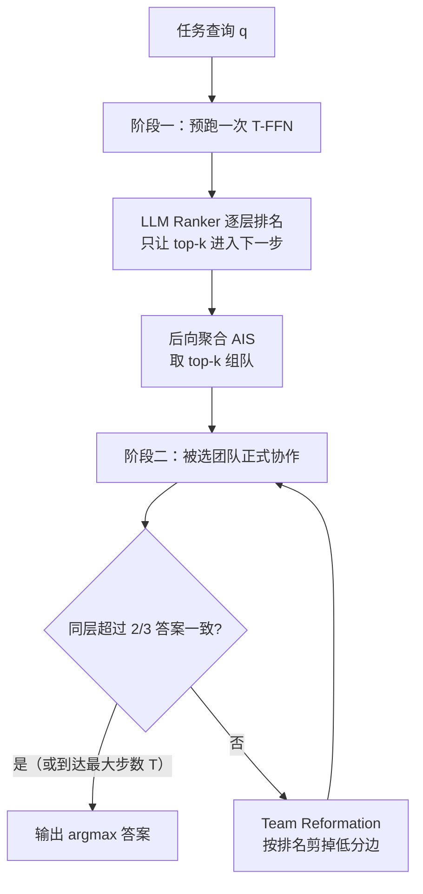
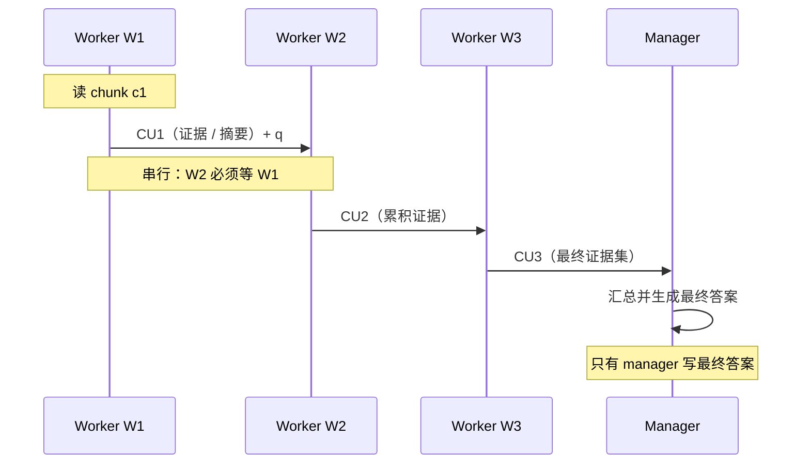

# 06 多智能体失败模式与拓扑选型：DyLAN、MAST、Chain-of-Agents 三篇精读

> **精读定位**：`doc/00` 给出「AIOS + 协作机制」的总图，`doc/02` 综述给出五维分类框架（actors / types / structures / strategies / coordination protocols），本文补上这套框架最缺的一块——**工程证据**：多智能体系统以多大概率失败、失败长什么样、什么拓扑能少失败、协作的通信代价是否值得。三篇构成一条链：MAS 不是免费午餐 → 失败可分类可度量 → 动态拓扑与提前停止是补救 → 长上下文场景 MAS 的收益与通信代价。

## 论文清单

| 序号 | 论文 | 出处 / 版本 | 一句话定位 |
|---|---|---|---|
| **P1** | **DyLAN**: A Dynamic LLM-Powered Agent Network for Task-Oriented Agent Collaboration（arXiv:2310.02170） | COLM 2024；arXiv v2，2024-11-15 | 用「团队性能」而非人工先验决定谁上场、团队多大、何时停止 |
| **P2** | **Why Do Multi-Agent LLM Systems Fail?**（arXiv:2503.13657） | NeurIPS 2025 Datasets & Benchmarks track；arXiv v3，2025-10-26 | MAST：14 个失败模式 / 3 大类，基于 1642 条 trace 的实证分类学 |
| **P3** | **Chain of Agents**: Large Language Models Collaborating on Long-Context Tasks（arXiv:2406.02818） | arXiv v1，2024-06-04；正文标注 "Preprint. Under review." | 长上下文场景下「串行链 + 经理」的协作范式与其通信代价 |
| **P0** | LLM 多智能体协作机制：综述（arXiv:2501.06322） | 见 `doc/02` | 五维框架，本文的对照系与设计语言 |

素材取自 `doc/papers/` 的 PDF 与 `build/papertext/` 纯文本，数字逐一核对到章节 / 表号；论文没有给出的，明确写「论文未给出」。

## 本组导览

三篇论文恰好是本项目最需要的四次「泼冷水」：

1. **MAS 不是免费午餐**（P2）：7 个 SOTA 开源多智能体系统失败率 **41%–86.7%**（§1、Figure 5）。协作带来的不一定是稳定增益，也可能是一个更大的失败面。
2. **失败可分类、可度量**（P2）：14 个失败模式落在三大类——系统设计 **44.2%**、智能体间错位 **32.3%**、任务验证 **23.5%**。「我们的系统为什么错」由此从玄学变成可诊断的问题。
3. **动态拓扑与提前停止是补救**（P1）：团队规模、成员、通信边、停止时机都可由数据决定。DyLAN 在 HumanEval 上 Pass@1 **82.9**（单执行 73.2），API 调用仅 **16.85** 次（AgentVerse 22.5、LATS 48）。
4. **长上下文 MAS 的收益与通信代价**（P3）：CoA 用 8k 窗口在 NarrativeQA 上平均 23.96，超过 200k 窗口的 Claude 3 Opus（6.56），但这是**串行**换来的，且每跳通信都是有损压缩——这直接决定「4 个并行子任务」在什么条件下划算。

只读一节的话：读 P2 的 Figure 1 与本文 §2.5(1)；只关心落地的话：跳 §6。

---

## 一、DyLAN：让「团队」成为可优化的变量

### 1.1 元信息

- **标题**：A Dynamic LLM-Powered Agent Network for Task-Oriented Agent Collaboration
- **作者 / 单位**：Zijun Liu、Yanzhe Zhang、Peng Li、Yang Liu、Diyi Yang（清华大学、Georgia Tech、Stanford 等）
- **发表**：COLM 2024；arXiv:2310.02170v2，2024-11-15
- **任务域**：代码生成（HumanEval）、决策（WebShop）、通用推理（MMLU）、算术推理（MATH）
- **骨干模型**：默认 GPT-3.5-turbo-0301，补充 GPT-4-0613（Appendix B.1、Table 10）

### 1.2 一句话结论

多智能体系统不该由人预先写死「几个 agent、怎么连」，而应先用一次预跑给每个 agent 打贡献分、据此选人组队，解题中再按排名剪枝、按一致度提前停止——**拓扑是搜索结果，不是设计输入**。

### 1.3 问题与动机

论文把现有做法归纳为两个限制（§1）：**固定数量的 agent**（CAMEL、AgentVerse 预先规定角色数与轮数）、**静态通信结构**（链式、树式、全连接一旦写定就不再变）。真实任务的难度与专长分布事先未知：给简单题配 4 个 agent 是浪费，给难题配 2 个是不够；不相关角色的意见还会互相干扰（§4.3 观察到 GR 任务上「专长与意见的不平衡在优化前互相干扰」）。Table 1 的对照很直接：LLM-Blender、LLM Debate、Reflexion、CAMEL、AgentVerse 在「多角色 / 提前停止 / 动态结构 / 团队优化」四列中最多占两三项，**DyLAN 是唯一四项全占**的方法。

### 1.4 核心方法与机制

#### （1）T-FFN：把协作写成「时间前馈网络」

**temporal feed-forward network（T-FFN，时间前馈网络）**（§3.2）：agent 集合 $A=\{a_1,\dots,a_N\}$（LLM agent 或代码解释器等工具）；第 $t$ 层节点 $V_t=\{v_{t,1},\dots,v_{t,N}\}$（每层一个时间步）；边 $E_{t-1,t}\subseteq V_{t-1}\times V_t$ 只连相邻层，但允许连到任意节点对，以表达链、树、全连接；协作图 $G=(V_1,\dots,V_T;E_{1,2},\dots,E_{T-1,T})$，推理写作 $f^{Infer}(q,G)=o$，$o=\arg\max\{M^T\}$（式 6）。消息传递：节点 $v_{t,j}$ 收到邻居集 $U$ 的消息 $M$ 后聚合 $\hat m=f_{mp}(M,v_{t,j})$；对 LLM agent，$f_{mp}$ 是把前驱响应与 query 拼进提示模板，对工具则是过滤它能处理的输入（Definition 5、6）。

关键含义：**层内 agent 天然并行**（只读上一层），**层间天然串行**。「并行还是串行」不是二选一，而是同一张图里两种边的比例问题。

#### （2）两阶段：先选人，再解题

**阶段一 Team Optimization**：用同一套 T-FFN 预跑一次得 $G_A^q$，再算 **Agent Importance Score（AIS，智能体重要性分数）**，取 top-k 组成团队 $\hat A=f^{Optim}(A,G_A^q,q)$，$\hat A\subset A$（式 9）。**阶段二 Task Solving**：被选团队正式协作，过程中可继续 reformation 与提前停止。

#### （3）AIS：无监督的「同事互评」

1. **Propagation**：后一层每个节点给前驱答案打 1–5 分，归一化 $\sum_i w_{t,i,j}=1$（式 10）；
2. **Aggregation**：把后继评分乘以后继自身重要性再求和，
$$I_{t-1,i}=\sum_{(v_{t-1,i},v_{t,j})\in E_{t-1,t}} I_{t,j}\cdot w_{t-1,i,j}\tag{11}$$
3. **Selection**：$I_i=\sum_{t=1}^{T}I_{t,i}$（式 12），取 top-k。

实现只需在节点提示词末尾加「给其他 agent 的答案打 1–5 分，输出 `[[1,5,2,...]]`」（Appendix B.2）；每层 AIS 之和为 1，便于公平比较；打乱前驱响应顺序以消位置偏置。**该指标无监督**——不需要标准答案，可在部署时对每个 query 现算。

#### （4）Reformation 与提前停止

- **Reformation**（§3.3.2）：每步用额外的 **LLM Ranker** 给当前参与者响应排序，只有 top-ranked 能进入下一步，$E_{t,t+1}=V'_t\times V'_{t+1}$（式 7）；实测 $k=2$（论文称这是协作的最小规模，效果 / 效率折中最好）。
- **提前停止**：借 Byzantine Consensus 的 $3p+1$ 结论——容忍 $p$ 个故障 agent，一轮通信至少要 $3p+1$ 个。于是**同层超过 2/3 的 agent 答案一致时终止**；代码等开放任务用 BLEU > 0.9 判一致；另有最大步数 $T$（推理 / 决策 $T=4$，代码 $T=6$）。

### 1.5 实验与关键数据

四个基准，统一以 **API 调用次数**作通信成本代理（§4.2 说明 token 随任务与提示波动太大，不适合做成本指标）：

| 任务（基准） | 最好的单 / 多 agent 基线 | DyLAN | 相对增益 | API 调用（vs 基线） |
|---|---|---|---|---|
| 代码生成 HumanEval（Pass@1，Table 2 左） | LATS 81.1；AgentVerse 75.0 | **82.9** | +9.7（vs 单执行 73.2） | **16.85** vs 22.50 / 48.00 |
| 决策 WebShop（reward，Table 2 右） | BOLAA 66.0；LATS 64.5 | **68.3** | +17.7（vs 直接执行 50.6）；成功率 42.0% | **24.85** vs 32.40 / >400 |
| 通用推理 MMLU（Table 4） | LLM Debate 69.3 | **70.5** | +4.1（vs 单执行 66.4） | **4.39** vs 12.00 |
| 算术推理 MATH（Table 3） | PHP 36.5（Complex CoT） | **37.6** | +3.5 | 6.21 vs 3.67 |

四组最该记住的数据：

1. **团队越大越好是错的**（Figure 3、§4.3）：从 7 个候选里选 2–4 人，**3 人团队**同时超过「未优化的 DyLAN」与「4 人 LLM Debate」，效率分别提升 **52.9% / 67.8%**。这直接回答「要不要凑 4 个智能体」。
2. **选人比堆人值钱**（Table 7）：按学科组队，MMLU 单科最高 **+25.0 个百分点**（college mathematics 40.0→65.0），management 76.2→90.5；而候选池与任务域无关（public relations）时只 +4.5——「选」救不了没有可选项的团队。
3. **提前停止几乎白赚**（Table 6）：去掉（w/o es）准确率只微降（AR 35.7→35.0、GR 70.5→70.1），API 调用却暴涨 **45.0% / 66.2% / 11.3% / 54.2%**（AR / GR / CG / DM）；反过来去掉 reformation（w/o atr）掉的是正确率（CG 82.9→76.2、DM 68.3→66.0）。**reformation 保正确，early stopping 保成本。**
4. **团队优化很省数据**（Table 9）：10% 数据选人，GR 只掉 0.2、CG 只掉 0.6；1% 数据在 CG 上仍比随机选人高 3.7。且跨模型可迁移：GPT-3.5 选出的团队给 GPT-4 用（Table 10：92.1 vs 单执行 88.4，API 15.94）。

成本侧注意：论文只统计**第二阶段**调用（§4.2），预跑成本被排除；Table 5 在三种任务上把候选池 12→8（CG）、8→4（DM）、7→4（GR），性能同步 76.2→82.9、53.0→68.3、69.5→70.5。

两点补充：**MMLU 上的增益最小（+4.1）**，论文未给出专门原因（论文未给出）；**Appendix B.1 的实现细节**是——每个 agent 的记忆只保留前一步响应、每轮只输出一份回答、reformation 保留 $k=2$、代码任务 $T=6$ 而其余任务 $T=4$、一致判据取 BLEU > 0.9。

### 1.6 局限与批判

- **只在闭源 API 模型上验证**：骨干是 GPT-3.5-turbo 与 GPT-4，未来工作才提「探索开源基础模型」。**对 7B 端侧模型，论文未给出任何数据。**
- **AIS 依赖同事互评质量**：打分者与被评者是同类 LLM，团队集体跑偏时低分反而可能是对的。论文的补丁是「复制高分 agent 代替低分」或「引入更强模型」，属工程兜底而非机制保证。
- **记忆压到 1 步**：为避免超长上下文，agent 只保留前驱最新一轮响应（Appendix B.1），牺牲长程一致性——恰是 MAST 的 FM-1.4「丢失对话历史」的温床。
- **一致判据粗糙**：开放任务用 BLEU > 0.9 判一致，论文承认这使提前停止在代码任务上收益变小。
- **未回答「串行该多深」**：$T$ 是超参（4 或 6），未给扫描；「何时该串行」只有定性讨论（前馈结构可并行产出多个方案并快速确认，顺序结构里错误的中间产物会影响最终输出）。
- **规模上限**：候选池 4–12 人、优化后 3–4 人，更大规模未测。

### 1.7 对本赛题的直接启示

1. **「≥4 种智能体」不等于「4 个同时上场」**：DyLAN 的 3 人队强于 4 人队，说明赛题要的是可协作的智能体**种类** ≥4；可让 4 种角色按子任务**按需上场**，把「4」用在角色多样性而非并行宽度上。
2. **自动分配可照抄 AIS**：先让候选 agent 对每个子任务各出一版粗方案、互相打分、按分派活；不需要训练与标准答案，正合比赛现场。
3. **并行 / 串行的切法**：层内并行（同一批子任务同时跑），层间串行（join 后评审 / 汇总）。这天然满足「≥3 对双向交互 + 依赖约束」：双向交互发生在「生产者 → 评审者 → 生产者」的跨层边上。
4. **终止条件是硬需求**：一致度阈值 + 最大步数 + 任务级判据三件套缺一不可（对应 MAST 的 FM-1.5 与 FM-3.1）。
5. **7B 上的风险**：LLM Ranker 在 7B 上排序能力弱，reformation 可能剪错人。折中是**只在阶段一做一次选人**，运行期关掉动态剪枝，把 ranker 换成规则（如「上轮输出未过校验的 agent 降权」）。

---

## 二、MAST：把「多智能体为什么失败」变成可标注的对象

### 2.1 元信息

- **标题**：Why Do Multi-Agent LLM Systems Fail?
- **作者 / 单位**：Mert Cemri、Melissa Z. Pan、Shuyi Yang 等 13 人，UC Berkeley 等
- **发表**：NeurIPS 2025 Datasets & Benchmarks track；arXiv:2503.13657v3，2025-10-26
- **产出物**：MAST-Data（1642 条标注 trace）、MAST-Data-human（21 条人工标注）、**MAST 分类法**（14 模式 / 3 大类）、LLM 标注器；`pip install agentdash` 后可调用 `MASTAnnotator.produce_taxonomy(trace)`（§C）
- **覆盖面**：7 个开源 MAS 框架（ChatDev、MetaGPT、HyperAgent、AppWorld、AG2/MathChat、Magentic-One、OpenManus）× 4 个模型族（GPT-4o、Claude-3.7-Sonnet、Qwen2.5-Coder-32B、CodeLlama-7b）

### 2.2 一句话结论

MAS 的失败不是「模型不够强」的副产品，而是**可归因到系统设计、智能体间错位、任务验证三类结构性缺陷**；1642 条真实 trace 上三类分别占 **44.2% / 32.3% / 23.5%**，而针对性的结构改造最多把成功率抬 15.6 个百分点——大部分失败需要重新设计，而不是打补丁。

### 2.3 问题与动机

立论基于三个观察（§1）：**失败率高且无共识**（7 个 SOTA 开源 MAS 失败率 41%–86.7%，Figure 5）；**根因难验证**（ground truth 难界定，失败可能源于单 agent、通信协议或编排逻辑，现有工具只报「任务失败」不报「哪一步错了」）；**没有标准失败定义**（无法跨系统比较）。

于是作者用 **Grounded Theory（扎根理论）** 从 150 余条 trace（每条平均 >15,000 行文本、6 名专家、每人 >20 小时）自下而上归纳分类法，再用 LLM 规模化到 1642 条。

### 2.4 核心方法与机制

#### （1）失败的定义

**failure = MAS 没有达成预期任务目标**（§1）。这是「结果层」定义，不追究中间步骤对错，因此「过程混乱但结果正确」不算失败——这解释了 Table 7 里「成功 run 也有大量失败模式」。

#### （2）三大类与 14 个模式

按「失败发生在流水线哪个阶段」分三类（Figure 1）：**系统设计问题（System Design Issues）** 主要在 pre-execution，**智能体间错位（Inter-Agent Misalignment）** 主要在 execution，**任务验证（Task Verification）** 主要在 post-execution。

| 类别（占比） | 编号 | 失败模式（首现英文） | 占比 |
|---|---|---|---|
| **FC1 系统设计问题 44.2%** | FM-1.1 | Disobey Task Specification（违反任务规格） | 11.8% |
| | FM-1.2 | Disobey Role Specification（违反角色规格） | 1.50% |
| | FM-1.3 | Step Repetition（步骤重复） | **15.7%** |
| | FM-1.4 | Loss of Conversation History（丢失对话历史） | 2.80% |
| | FM-1.5 | Unaware of Termination Conditions（不认识终止条件） | 12.4% |
| **FC2 智能体间错位 32.3%** | FM-2.1 | Conversation Reset（对话重置） | 2.20% |
| | FM-2.2 | Fail to Ask for Clarification（不请求澄清） | 6.80% |
| | FM-2.3 | Task Derailment（任务脱轨） | 7.40% |
| | FM-2.4 | Information Withholding（信息隐瞒） | 0.80% |
| | FM-2.5 | Ignored Other Agent's Input（忽视他人输入） | 1.90% |
| | FM-2.6 | Reasoning-Action Mismatch（推理-行动不一致） | 13.2% |
| **FC3 任务验证 23.5%** | FM-3.1 | Premature Termination（过早终止） | 6.20% |
| | FM-3.2 | No or Incomplete Verification（无 / 不完整验证） | 8.20% |
| | FM-3.3 | Incorrect Verification（错误验证） | 9.10% |

读表要点：**三类合计恰为 100%，同一类内各模式加总恰等于类占比**——每条失败实例归入一个主类别。故这张表回答「失败里有多少属于哪一类」，而非「多少条 trace 出现过某模式」。

#### （3）标注方法：人工定标 + LLM 规模化

- **人工**：3 名标注员，每轮随机 5 条 trace、共 3 轮 15 条，迭代到一致（**κ = 0.88**）；光解决分歧就花了约 10 小时（§1）——分类法成本常被低估。
- **LLM-as-judge**：OpenAI o1 + few-shot 校准（Table 2）：zero-shot 准确率 0.89 / recall 0.62 / precision 0.68 / F1 0.64 / κ = 0.58；**few-shot 提升到 0.94 / 0.77 / 0.833 / 0.80 / κ = 0.77**。
- **域外验证**：未见过的 OpenManus + Magentic-One、MMLU + GAIA 上 κ = **0.79**（§1）。
- **recall 仅 0.77**：自动标注会漏约 1/4 失败实例，故所有占比都是**下限**。

#### （4）数据集构成

Table 1：7 个框架 × 30 条 = 210 条精标（HE 人工评估完成率 + HA 人工标注 + LA LLM 标注）；ChatDev / MetaGPT × ProgramDev-v2（100 题）配 4 个模型族共 7 个配置 = 700 条；再加 AG2 的 OlympiadBench 206 / GSMPlus 193 / MMLU 168、Magentic-One GAIA 165 条，合计 **1642** 条。ProgramDev 是 30 道编程题（井字棋、象棋、数独等），作者明说是「相对简单，以便隔离失败动态」。

Table 3 还给出 7 个框架的架构归类：MetaGPT 是 **Assembly Line（流水线 / SOP）**；ChatDev 是 **Hierarchical Workflow**（设计 → 编码 → QA 三阶段，每阶段两名 agent 对话，角色含 CEO / CTO / Programmer / Reviewer / Tester）；HyperAgent 与 OpenManus 是 **Hierarchical**（Planner 调度下游执行者，消息带 Context / Request 字段，队列异步执行）；AppWorld 与 Magentic-One 是 **Star Topology**（supervisor 居中，服务 agent 可向 supervisor 请求澄清）；AG2 是 **Agentic Framework**（两人对话式）。这四类架构的失败指纹差异（见 §2.5(2)）是 MAST 最有说服力的地方：**归档方式本身就是失败分布的解释变量**。

```mermaid
flowchart LR
  PRE["Pre-execution"] --> FC1
  subgraph FC1["FC1 系统设计问题 44.2%"]
    A1["1.1 违反任务规格 11.8%"]
    A2["1.2 违反角色规格 1.5%"]
    A3["1.3 步骤重复 15.7%"]
    A4["1.4 丢失对话历史 2.8%"]
    A5["1.5 不认识终止条件 12.4%"]
  end
  FC1 --> EXE["Execution"] --> FC2
  subgraph FC2["FC2 智能体间错位 32.3%"]
    B1["2.1 对话重置 2.2%"]
    B2["2.2 不请求澄清 6.8%"]
    B3["2.3 任务脱轨 7.4%"]
    B4["2.4 信息隐瞒 0.8%"]
    B5["2.5 忽视他人输入 1.9%"]
    B6["2.6 推理-行动不一致 13.2%"]
  end
  FC2 --> POST["Post-execution"] --> FC3
  subgraph FC3["FC3 任务验证 23.5%"]
    C1["3.1 过早终止 6.2%"]
    C2["3.2 无 / 不完整验证 8.2%"]
    C3["3.3 错误验证 9.1%"]
  end
```

### 2.5 实验与关键数据

#### （1）整体画像

- **失败率**：MetaGPT(ProgramDev) 60.0%、ChatDev(ProgramDev) 66.7%、HyperAgent(SWE-Bench Lite) 74.7%、AppWorld(Test-C) 86.7%、AG2(OlympiadBench) 41.0%、Magentic-One(GAIA) 62.0%（Figure 5；图注提醒不同 benchmark 不可直接比较）。
- **类别占比**（Figure 1，全量 1642 条）：FC1 **44.2%**、FC2 **32.3%**、FC3 **23.5%**。另有 Figure 4 口径（每系统前 30 条、共 210 条）：41.8% / 36.9% / 21.3%。**两个口径不可混用。**

#### （2）系统特异画像（§5.1）

**AppWorld 最典型的是 FM-3.1 过早终止**（星形拓扑 + 无预定义 workflow，终止条件本身不明显，supervisor 在信息没收集完时收工）；**OpenManus 偏 FM-1.3 步骤重复**；**HyperAgent 主要是 FM-1.3 + FM-3.3 错误验证**。方法论意义大于数字本身：**同一张分类法在不同架构上呈现不同「指纹」**，「我们的系统会怎么坏」可用架构先验预测。此外 Table 8 给出同一框架（AG2，GPT-4o）在不同 benchmark 上的三类失败率（按 trace 数归一）：GSM 上 FC1 0.53 / FC2 1.33 / FC3 0.37，MMLU 上 1.06 / 1.01 / 0.60，Olympiad 上 1.19 / 1.21 / 0.67——**任务越难，失败率整体越高，三类之间的相对比例也会变**（GSM 上规格类失败明显更少）。所以引用 MAST 的占比必须同时说明系统与 benchmark，不能当作普适常数。

#### （3）模型与框架的对照（§5.2）

同一框架（MetaGPT）内，GPT-4o 比 Claude-3.7-Sonnet 的 FC1 失败少 **39%**；同一 benchmark（ProgramDev）上，MetaGPT 比 ChatDev 的 FC1 / FC2 失败少 **60–68%**，但 FC3 失败多 **1.56 倍**（ChatDev 自带 review / test 阶段，MetaGPT 靠 SOP）。**没有全面赢家，只有权衡。**

#### （4）干预实验：改 prompt 还是改拓扑？（Table 5、Appendix H）

| 系统 / 基准 | baseline | 改进 prompt | 新拓扑 |
|---|---|---|---|
| AG2 / GSM-Plus（GPT-4） | 84.75±1.94 | **89.75±1.44** | 85.50±1.18 |
| AG2 / GSM-Plus（GPT-4o） | 84.25±1.86 | **89.00±1.38** | 88.83±1.51 |
| ChatDev / ProgramDev-v0 | 25.0 | 34.4 | **40.6** |
| ChatDev / HumanEval | 89.6 | 90.3 | **91.5** |

- ChatDev 角色规格干预（只允许上级 agent 结束对话）= **+9.4 个百分点**（25.0→34.4）；
- ChatDev 把 DAG 改成有环图、只有 CTO 确认所有 review 才终止（并设最大迭代上限）= **+15.6 个百分点**（25.0→40.6）；
- 显著性不一致：AG2 上「新拓扑」相对 baseline 在 GPT-4 上不显著（Wilcoxon p=0.4），GPT-4o 上显著（p=0.03）。作者结论是「拓扑类改动比 prompt 类更有效，但仍不够」——**最高只到 40.6% 成功率**，这就是打补丁的天花板。

#### （5）7B 小模型的直接证据（Appendix I、Table 6）

400 条开源模型 trace 上的失败模式出现次数（Qwen2.5-Coder-32B / CodeLlama-7b，ChatDev 与 MetaGPT 各 100 条，按 Table 6 列序）：

| 模式 | Qwen-ChatDev | Qwen-MetaGPT | 7B-ChatDev | 7B-MetaGPT |
|---|---|---|---|---|
| 1.1 违反任务规格 | 35 | 12 | 76 | 94 |
| 1.3 步骤重复 | 96 | 35 | 97 | 99 |
| 1.5 不认识终止 | 94 | 3 | 97 | 76 |
| 2.3 任务脱轨 | 9 | 0 | 76 | 57 |
| 2.6 推理-行动不一致 | 20 | 16 | 93 | 18 |
| 3.2 无 / 不完整验证 | 16 | 51 | 67 | 55 |
| 3.3 错误验证 | 12 | 32 | 69 | 56 |

CodeLlama-7b 的 1.1 / 1.3 / 1.5 / 2.3 / 2.6 全部爆表（76–99 次 / 100 条），Qwen2.5-Coder-32B 明显好得多——**「小模型 + 多智能体」不是把失败率除以 N，而是把每种失败模式都放大**。

#### （6）致命 vs 非致命（Table 7）

FM-1.5 不认识终止、FM-2.4 信息隐瞒**几乎只出现在失败的 run 里**（ChatDev：成功 0% / 失败 10.0%，成功 0% / 失败 5.0%；MetaGPT 同向）→ 一旦触发基本必败，属「致命模式」。FM-3.2 / 3.3 在成功 run 里也常见（ChatDev 成功 10% / 20%，MetaGPT 16.7% / 16.7%）→ 「带病成功」：验证薄弱尚未致命，但暴露系统性弱点。成功 run 也不是「零失败模式」——MAS 的常态是「边犯错边完成」。

#### （7）为什么「验证不足」最要命

事实先摆准：**单模式最高的是 FM-1.3 步骤重复（15.7%）**，不是验证；验证合并计算（FC3 = 23.5%）也只排第三。但验证类失败对**最终成功率**的杠杆最大，四条理由都有数据支撑：

1. **唯一的下游闸门**：FM-3.2 的定义就是「错误未被发现地传播」，其余 13 类失败最终都要靠验证拦截；
2. **成功 run 也带着它**（Table 7）：当前系统的「成功」有相当比例是运气，任务一难就翻转；
3. **小模型上更重**：CodeLlama-7b 的 3.2 / 3.3 是 67 / 69（ChatDev）、55 / 56（MetaGPT）；
4. **加验证收益最大**：ProgramDev-v0 上加「有环 + CTO 终审 + 高层任务目标验证」= +15.6 个百分点，是所有单点干预中最高的（Table 5）。

更准确的说法不是「验证不足最常见」，而是「**验证不足是最普遍被低估、且修复收益最高的失败类型**」。

#### （8）成本与工具化

Appendix K：LLM 标注器标一条 trace 平均 **1.8 美元**（各框架 0.37–4.14，OpenManus 最贵 4.14）。MAST 被做成可 pip 安装的库，意味着**失败诊断本身可进 CI**——可观测性从口号变成工程动作。

#### （9）论文给出的改进策略（Appendix G）

论文把改进分**战术（tactical）**与**结构（structural）**两层。战术层：清晰角色 / 任务定义、鼓励主动对话、自我验证 prompt、设计对话模式与终止条件、模块化简单 agent 优于复杂多任务 agent、交叉验证 / 多解讨论 / 多数投票重采样——但作者明确说「这些看似直接的办法效果并不稳定」，与 case study 的结论一致。结构层：引入独立验证 / verifier agent、标准化通信协议（结构化意图与参数、形式一致性检查，对应 MCP / A2A 一类协议）、用 RL 微调角色（MAPPO / SHPPO / Optima）、输出概率置信度（低于阈值就暂停收集信息，Horvitz 式自适应阈值）、记忆与状态管理（MemGPT、TapeAgents 的可回放日志）。

Table 4 把策略与类别对上：FC1 靠清晰角色 / 任务定义 + 进一步讨论 + 自我验证 + 对话模式设计；FC2 靠交叉验证 + 相互消歧 + 模块化 + 标准化协议；FC3 靠全面验证 + 单测生成 + 为验证重设拓扑。**三类失败需要三套不同手段**，这解释了为什么单点干预最多只到 +15.6 个百分点。

### 2.6 局限与批判

- **观察性研究，不是因果实验**：MAST 说「失败长什么样」，不证明「消除该模式就一定成功」；干预实验只做了两处单点修改，改进后成功率仍只有 40.6%（ChatDev / ProgramDev-v0）。
- **单标签归类**：一条 trace 被迫归入一个主类别，掩盖「多模式同时发生」的组合效应。Appendix E 报告类别间相关性仅 0.17–0.32（以此论证三类独立），但组合效应未建模。
- **标注器 recall 0.77**：系统性漏报，所有占比皆为下限。
- **覆盖面**：只用 7 个开源框架（闭源 Manus 因拿不到完整 trace 被排除）；ProgramDev 明说是「相对简单」的题；无端侧 7B / 8B 部署场景（最小只到 CodeLlama-7b 的 API 调用）。
- **对协作协议的结论偏保守**：Insight 2 认为仅改 context / 通信协议不够，需要更深的「社会推理（theory of mind）」，但未给可操作机制。
- **未给出成本-收益最优配置**：不同拓扑的 token 成本、延迟没有系统测量，只有标注成本。

### 2.7 对本赛题的直接启示

1. **把 MAST 14 项当设计检查表**（可直接抄进 `docs/design-checklist.md`）：设计期查——任务规格是否有可判定验收条件（1.1）、角色边界是否互斥（1.2）、子任务是否有幂等标记（1.3）；运行期查——消息是否结构化（2.x）、每步是否有唯一「继续 / 终止」判定者（1.5、3.1）；收尾期查——是否有独立于生产者的验证者（3.2、3.3）。
2. **如何避免「为凑 4 个智能体而设计出劣质协作」**：MAST 的 1.3（15.7%）+ 1.5（12.4%）+ 2.6（13.2%）= **41.3%** 的失败，是「多轮、多 agent」这一形态本身带来的开销；agent 越多、轮次越长，暴露面越大。赛题的「≥4 种智能体」应理解为**角色种类**，不是**同时在线数**——4 种角色按 DAG 分阶段上场，比 4 个 agent 全程对话更接近论文推荐的结构。
3. **7B 上降低失败率的优先级**（按 Table 6 证据排序）：① 砍轮次与在线 agent 数（压 1.3 / 1.5 / 2.3）；② 自然语言协商换成**结构化消息 + schema 校验**（压 2.x）；③ 验证交给**工具 / 单测 / 断言**而非 LLM 自评（压 3.2 / 3.3，也是 7B 上唯一可靠的验证方式）；④ 用规则而非 LLM 做终止判定。
4. **别指望「换个更强模型」解决**：同一框架内模型换代会改变分布（GPT-4o 比 Claude 少 39% 的 FC1 失败），但不会消除任何一类。

---

## 三、Chain-of-Agents：串行协作是长上下文的「正确解法」，也是它的成本

### 3.1 元信息

- **标题**：Chain of Agents: Large Language Models Collaborating on Long-Context Tasks
- **作者 / 单位**：Yusen Zhang、Ruoxi Sun、Yanfei Chen、Tomas Pfister、Rui Zhang、Sercan Ö. Arik（Penn State、Google Cloud AI Research）
- **发表**：arXiv:2406.02818v1，2024-06-04；正文标注 "Preprint. Under review."
- **任务域**：9 个长上下文数据集（问答 5 / 摘要 3 / 代码补全 1）× 6 个 LLM（PaLM 2 text-bison、text-unicorn；Gemini 1.0 Ultra；Claude 3 Haiku / Sonnet / Opus）

### 3.2 一句话结论

输入远超模型窗口时，**把长文切块、让 worker 逐个读并把「通信单元」传给下一个，最后交给 manager 汇总**（串行链），比 RAG 和直接加长窗口都好——它同时缓解「检索漏证据」与「长窗口注意力失焦」；代价是**串行**：链有多长延迟就有多长，且每跳信息都被有损压缩。

### 3.3 问题与动机

长上下文两条主流路线各有硬伤（§1、Table 1）：**输入缩减（truncation / RAG）** 靠检索挑块，检索不准就漏关键证据（receptive field 不完整）；**窗口扩展（长窗口模型）** 能把全文塞进去，但模型在长上下文里「lost in the middle」，聚焦失败。作者主张**用通信代替窗口**——每段只读一小块（保证聚焦），通过自然语言把「到此为止的证据」传给下一个（保证覆盖全文）。

### 3.4 核心方法与机制

#### （1）两阶段与公式

样本 $(x,y,q)$，$x$ 有 $n$ 个 token，窗口 $k$（$k\ll n$），切成 $l$ 块 $x=\{c_1,\dots,c_l\}$，每块能塞进窗口。

**Worker Agent（分段理解 + 链式通信）**：
$$CU_i=\mathrm{LLM}_{W_i}(I_W,\ CU_{i-1},\ c_i,\ q),\quad i=1,\dots,l\tag{1}$$
$I_W$ 是 worker 指令，$CU_{i-1}$ 是上一个 worker 传来的「通信单元（communication unit）」：问答里是证据，摘要里是前文摘要，代码补全里是函数 / 类名与解释。

**Manager Agent（整合 + 生成）**：
$$\text{Response}=\mathrm{LLM}_M(I_M,\ CU_l,\ q)\tag{2}$$

关键设计：**worker 只负责读，manager 只负责写**。消融显示让最后一个 worker 直接作答（去 manager），MuSiQue 37.09→26.79、NarrativeQA 25.26→20.80（Table 7）。

#### （2）为什么必须是「串行链」

论文造了两个多智能体对照（§4.1）：**Merge**（worker 各自独立读并作答，多数投票）、**Hierarchical**（worker 判断自己那块有没有用，有用的把 $CU_i$ 发给 manager，成树）。结果（Table 6）两者多数数据集不如 CoA，在需要跨块推理的 RepoBench-P 上崩掉（CoA 58.25 vs Hierarchical 27.96 vs Merge 33.66），QMSum 上 Merge 只有 9.42（CoA 16.77）。原因是**并行 worker 之间不通信**：第一跳的答案在 A 手里、第二跳的推理在 B 手里，B 看不到 A，推理链就断了。Figure 1 左的例子很直观：W3 在自己那块没找到信息，直接改写 CU2 并把答案放在 CU3 开头——这要求它读过前文。

#### （3）复杂度

Table 2（Appendix A 证明）：全上下文编码 $O(n^2)$、解码 $O(nr)$；CoA 编码 $O(nk)$、解码 $O(nr)$。因 $k\ll n$，编码从二次降到线性——这是相对「塞满窗口」的理论优势。但**解码成本没变**，调用次数变成 $l+1$（$\lceil n/k\rceil$ 个 worker + 1 个 manager），串行延迟随之线性增长。

### 3.5 实验与关键数据

#### （1）主结果（Table 4，text-bison 8k；其余两模型同趋势）

| 数据集（指标） | Vanilla 8k | RAG 8k | **CoA 8k** |
|---|---|---|---|
| HotpotQA（F1） | 45.57 | 51.91 | **53.62** |
| MuSiQue（F1） | 26.87 | 33.83 | **37.09** |
| NarrativeQA（F1） | 11.96 | 14.20 | **25.26** |
| Qasper（F1） | 26.56 | 27.20 | **37.17** |
| QuALITY（EM） | 61.86 | 55.28 | **65.42** |
| QMSum（ROUGE） | 15.45 | 15.59 | **16.77** |
| GovReport（ROUGE） | 20.60 | 20.83 | **26.11** |
| RepoBench-P（相似度） | 56.30 | 55.63 | **58.25** |

正文举的三个「最大差距」是**绝对百分点**：text-bison 的 NarrativeQA +13.30（11.96→25.26）、text-unicorn 的 MuSiQue +12.82（29.67→42.49）、gemini-ultra 的 QuALITY +22.00（58.60→80.60，对比 Vanilla 32k）。摘要中 "up to 10%" 是相对口径的概括，具体以 Table 4 为准。

#### （2）对阵 200k 窗口的 Claude 3（Table 5）

| 数据集 | Claude 3 Opus Vanilla (200k) | **CoA (8k)** |
|---|---|---|
| NarrativeQA 平均 | 6.56 | **23.96** |
| BookSum 平均 | 14.00 | **17.47** |

提升随模型增强而变大（Haiku / Sonnet / Opus vs Vanilla(200k)：NarrativeQA 11.63 / 11.36 / 17.4；BookSum 1.66 / 2.86 / 3.47）。反直觉结论：**8k 窗口 + 串行链 > 200k 窗口直接读**，模型越强 CoA 相对收益越大；输入越长收益越大，长度 >400k 时相对提升接近 100%（Figure 2）。

#### （3）消融与多路径（Table 7、Table 8）

去 manager：MuSiQue 37.09→26.79，NarrativeQA 25.26→20.80。阅读顺序：右到左、随机置换都不如左到右，但置换在某些样本上更好，于是有多路径——5 路置换 + LLM judge，HotpotQA 53.62→59.17、MuSiQue 37.09→42.37，oracle 上限 75.73 / 60.16，**说明单链远未饱和，但多路径把成本乘 5**。lost-in-the-middle：Vanilla 6.13（±2.17），CoA 收窄到 4.89（±1.91）（§5.3）。

#### （4）通信成本与「worker 数-性能」拐点：论文给了什么、没给什么

必须说明：**论文没有 worker 数量-性能曲线，也没有实测延迟 / 费用表**。可支撑的定量事实只有三类：**复杂度**（编码 $O(n^2)\to O(nk)$，解码不变，Table 2）；**worker 数**（Table 3 平均 agent 数：HotpotQA 2.35、MuSiQue 2.88、NarrativeQA 12.45、Qasper 1.12、QuALITY 1.31、QMSum 2.57、GovReport 2.03、BookSum 18.63、RepoBench-P 1.69，即 worker 数 ≈ ⌈n/k⌉，与输入长度成正比）；**窗口扫描**（Appendix D、Figure 6：Haiku 在 NarrativeQA 上 4k→8k→16k 上升，16k 后基本平台在 20 左右）。

由此可做的（**推论，非论文结论**）：「worker 数」与「每跳保真度」是一对反向变量——窗口越小 worker 越多、串行跳数越多、每跳压缩损失累积越多；窗口越大 worker 越少、越接近长窗口失焦。Figure 6 的平台点（16k）说明拐点在「每块已长到模型开始失焦」之前。对本项目：**并行子任务数不是越多越好，串行依赖跳数才是延迟主因**。再补一个可引用的对照：gemini-1.0-ultra 的窗口为 32k，CoA 仍把 QuALITY 从 58.60 提到 80.60（+22.00）；Haiku 的窗口扫描（Appendix D、Figure 6）显示 4k→8k→16k 性能持续上升、16k 之后基本稳定在 20 左右——「窗口变大」的边际收益会耗尽，CoA 的收益来自「每块都足够聚焦」而非「块越大越好」。论文未给出 32k 以上的扫描，因此不能断言窗口越大越差，只能说不存在单调收益。

### 3.6 局限与批判

- **串行 = 延迟线性增长**：$l+1$ 次调用必须排队，论文完全没讨论墙钟时间；这与本赛题「并发比串行快 ≥20%」正面冲突——**CoA 不是并发方案，它是串行方案的优化**。
- **通信有损**：每跳只传一个 $CU$，其质量决定全链上限；论文承认「当前 LLM 的对齐目标是人类规范，不是 agent 间通信的最优形式」，也没探索辩论等更复杂通信（Limitations）。
- **成本未量化**：无 token 数、无美元成本、无延迟，只有复杂度与调用次数的间接推断。
- **模型全是闭源 API**（PaLM 2 / Gemini / Claude 3），**无 7B / 端侧实验**。
- **数据集偏检索式**：9 个中 5 个 QA、1 个代码补全，对「多子任务 + 工具调用」没有覆盖。
- **窗口扫描只在一个数据集上做**（NarrativeQA、Haiku），外推需谨慎。

### 3.7 对本赛题的直接启示

1. **并行不是万能，依赖必须串行传状态**：Table 6 是最硬的证据——Merge / Hierarchical 这类「各自读、最后投票」的并行结构在跨块推理时腰斩。赛题的 4 个并行子任务**只能并行「彼此不依赖」的部分**，有数据依赖的必须走「生产者 → 消费者」的串行边。
2. **「≥20% 提速」要靠并行分支，不能靠链**：CoA 的串行链只会更慢。正确组合是 **DAG：并行分支做独立子任务，join 后走一条短链整合**（整合链长度 = 依赖深度）。
3. **通信单元要设计成结构化摘要**：$CU$ 不是原始对话，而是「证据 / 摘要 / 函数签名」这类为下游定制的压缩表示。7B 上下文更小，更应传「结论 + 出处 + 未决问题」而非全文。
4. **manager 不能省**：去 manager 掉 10+ 分。赛题需要一个「汇总 / 裁决」角色（可为 4 种智能体之一），只做整合不做生产。
5. **链长度设硬上限**（如 ≤6 跳），超过就切分任务或降级。

---

## 四、与 doc/02 综述的衔接：五维框架下的再解释

`doc/02` 用 **actors / types / structures / strategies / coordination protocols** 五维统摄 200 余篇文献，并给出关键判断：「设计不良的 MAS 会被强提示单智能体反超」（[128] 的实证，见 `doc/02` §5.2.2、§5.6、§11 亮点 2）。三篇精读正好把这个判断从「定性警告」变成「定量证据链」。

### 4.1 三篇在五维框架里的坐标

| 维度 | DyLAN（P1） | MAST（P2） | CoA（P3） |
|---|---|---|---|
| **Actors 参与者** | 异构 agent + 工具（代码解释器），候选池 4–12 人 | 7 个框架的既有角色体系（CEO / CTO / Reviewer、supervisor、Planner 等） | 同构 worker × $l$ + 1 个 manager，职责分离 |
| **Types 类型** | 合作（互评 + 评审），无显式竞争 | 合作失败为主（FC2 全是合作失调），竞争未纳入 | 合作（链式传递），无竞争 |
| **Structures 结构** | **动态分散式**（T-FFN，层内并行、层间前馈），边随排名剪枝 | 描述性：Assembly Line / Hierarchical / Star / Agentic 四类（Table 3），并证明**结构决定失败指纹** | **串行链**（顺序结构），与树 / 并行结构对照 |
| **Strategies 策略** | 基于模型（LLM Ranker 打分）+ 基于角色（候选预设） | 分类而非选择；Appendix G 给出战术 / 结构两类改进策略 | 基于角色（worker / manager）+ 基于规则（切块、顺序） |
| **Coordination 协调** | **动态编排**：reformation + 2/3 一致提前停止 + 最大步数 | 静态编排为主，失败集中在终止与验证（1.5、3.1） | **静态编排**：固定左到右、固定两阶段 |

三篇恰好填满综述 §5.4「结构」与 §5.5「编排」两极：**CoA = 静态顺序链的极致**，**DyLAN = 动态图编排的极致**，**MAST = 两者失败面的横截面**。`doc/02` §11 的工程启发「默认从顺序链 + 单裁判起步，只有在任务宽度 / 深度未知时才引入动态 DAG」由此得到支持，也补上边界条件：**顺序链适合「深度依赖 + 长输入」，动态 DAG 适合「宽度未知 + 候选异构」，而两者都会在验证这一环失守**。

### 4.2 综述没覆盖的工程视角：失败率、成本、可观测性

`doc/02` §7.2 明确列出评估缺口（指标过窄、缺根因分析、场景不可比、缺标准协议），§11 局限第 5 条也承认「对成本模型、延迟等工程指标的定量讨论较少」，但止步于「指出缺口」，没给数字。三篇补的正是这三个维度：

| 工程视角 | `doc/02` 的状态 | 三篇补上的内容 |
|---|---|---|
| **失败率** | 只有 [128] 一个反例，无系统性数字 | P2：41%–86.7%（Figure 5）、三类占比 44.2 / 32.3 / 23.5（Figure 1）；P1：相对基线的增益与效率；P3：并行结构在跨块推理上崩坏（Table 6） |
| **成本** | 只提「通信与协调开销」「可扩展性是关键约束」（§5.6 经验 5） | P1：API 调用作成本代理（16.85 vs 20–48；提前停止省 11.3%–66.2%）；P3：$O(n^2)\to O(nk)$、调用次数 $l+1$、多路径 ×5；P2：标注 1.8 美元 / trace（Appendix K） |
| **可观测性** | §7.2 提「需要细粒度归因」，无方法 | P2：MAST 做成可 pip 安装的标注器，失败归因可进 CI；P1：AIS 提供逐 agent 贡献分，可作运行期指标；P3：$CU$ 本身即「highly interpretable」的中间产物 |

换句话说：**综述给了坐标系，MAST 给了刻度，DyLAN 给了调节旋钮，CoA 给了代价函数**。设计文档因此可以写「我们预期哪些 MAST 模式、用什么指标监控、成本上限多少」，而不只是「我们用了多智能体」。具体地，`doc/02` §5.6 的六条经验可这样落到本组证据上：**协作通道设计**对应 MAST 的 FC2；**集体领域知识**对应 DyLAN 的候选池与选人；**自适应角色**对应 reformation；**策略选择**对应「拓扑当超参数」；**可扩展性 / 成本**对应 API 调用数与 $l+1$ 跳；**伦理**本组三篇均未涉及（论文未给出）。

### 4.3 三篇之间的张力

1. **动态 vs 静态**：DyLAN 证明动态剪枝提升正确率（Table 6：去掉 reformation，CG 82.9→76.2）；但 MAST 的 FM-2.1「对话重置」、FM-1.4「丢失历史」恰是动态结构自己引入的失败。**动态不是免费的正确率，它用结构复杂度换任务适配度。**
2. **并行 vs 串行**：DyLAN 的层内并行 + 层间前馈是「有通信的并行」；CoA 的对照证明「无通信的并行」在依赖任务上必败。两者不矛盾：**并行只在无依赖的子任务上成立**。
3. **拓扑是超参数**：DyLAN 的团队规模（3 > 4）、CoA 的窗口 / 链长、MAST 的拓扑干预（+15.6pp 但仍只有 40.6%）共同说明——**拓扑要选、要测，不能拍脑袋；但选对拓扑也只能挽回一部分**。

---

## 五、横向对比表

| 论文 | 核心问题 | 方法 | 关键指标（数值 / 表号） | 结论强度 | 对本项目可用性 |
|---|---|---|---|---|---|
| **DyLAN**（COLM 2024） | 团队该多大、谁上场、何时停？ | T-FFN + AIS 选人 + reformation + 2/3 一致提前停止 | HumanEval 82.9（+9.7）、WebShop 68.3（+17.7）、MMLU 70.5（+4.1）、MATH 37.6（+3.5）；3 人队 > 4 人队；提前停止省 11.3–66.2% API（Table 2–6、Figure 3） | **中高**：4 基准 + 多基线 + 消融完整；仅闭源模型、单轮任务、成本只算第二阶段 | ★★★★☆ 选人 / 终止机制可直接借；ranker 在 7B 上换规则 |
| **MAST**（NeurIPS 2025 D&B） | MAS 为什么失败？ | 扎根理论 → 14 模式 / 3 类；人工标注 κ=0.88 + o1 few-shot κ=0.77（域外 0.79） | 1642 条 trace、7 框架、4 模型族；失败率 41–86.7%；44.2 / 32.3 / 23.5；干预最高 +15.6pp；7B 各模式 76–99 / 100（Figure 1/5、Table 5/6/7） | **高**：样本量、IAA、干预实验俱全；观察性、单标签、recall 0.77 | ★★★★★ 直接当自检清单与答辩论据；`agentdash` 做诊断 |
| **CoA**（arXiv 2024） | 长上下文怎么协作？ | 切块 + 串行 worker 链 + manager 汇总 | 9 数据集 6 模型超 RAG / Vanilla；8k 窗口胜 200k（NarrativeQA 23.96 vs 6.56）；编码 $O(n^2)\to O(nk)$；并行 Merge / Hierarchical 在 RepoBench-P 崩到 27.96 / 33.66（Table 2/4/5/6） | **中高**：9 数据集 + 2 个多 agent 基线 + 消融；无延迟 / 成本实测、无开源小模型、串行 | ★★★☆☆ 结构与通信单元设计可借；串行不适合赛题提速项 |
| **综述**（`doc/02`，2501.06322） | 协作机制如何分类？ | 五维框架 | 200+ 文献；[128] 反例；§7.2 评估缺口 | **中**：框架性强、证据并置、缺定量 | ★★★★★ 设计语言与答辩框架 |

---

## 六、给本赛题的 5 条落地建议

对应赛题四条要求（≥4 种智能体 / ≥4 并行子任务自动分配 / ≥3 对双向交互 / 依赖约束）与评分（完整性 50% + 应用效果 50%，其中提速 ≥20% 与正确完成各占一半）：

**建议 1：拓扑选「DAG + 双阶段」，不要全并行或全串行。** 参考 DyLAN 的「层内并行、层间前馈」：4 个并行子任务放同一层（互不依赖），依赖边只加在真正的数据依赖上；join 后走**短**整合链（≤3 跳），不要做成 CoA 式全串行。证据：CoA Table 6 证明无通信的并行在依赖任务上崩（RepoBench-P 27.96 vs 58.25）；而 ≥20% 提速只能来自并行分支——**并行宽度由任务宽度决定，不由「4」决定**。答辩可写：「supervisor + 4 worker 的 DAG，层内并行、层间汇聚；依赖边 k 条，串行深度 d。」

**建议 2：终止条件写成「三件套」，终止权唯一。** ① 任务级判据（可判定的验收条件，对应 FM-1.1 的可判定化）；② 一致度阈值（DyLAN 的 >2/3 一致，7B 上放宽为「≥2 个独立验证者通过」）；③ 硬上限（最大轮数 / 步数 / token，对应 FM-1.5 与 FM-3.1）。关键：**只有一个角色有权宣布终止**（MAST 的 ChatDev 干预 +9.4pp）；多 agent 都能终止 = 提前终止风险最大化（FM-3.1，6.2%）。证据：DyLAN Table 6，提前停止几乎不掉准确率却省 11.3%–66.2% API；FM-1.5 占 12.4% 且几乎只在失败 run 出现（Table 7）。

**建议 3：失败自检用 MAST 14 项 + 外部工具验证，不用 LLM 自评。** 把 14 个模式做成运行期断言（结构化消息 schema、步骤幂等标记、角色边界检查、终止判定检查）；每步产出用**可执行验证**（单测、断言、编译、schema 校验）。证据：MAST Table 7，3.2 / 3.3 在成功 run 里照样出现；Table 5，加验证 / 改拓扑 = +15.6pp（单点干预最高）；7B 上 3.2 / 3.3 出现 55–69 次 / 100 条，LLM 自评不可信。Appendix G 的具体建议：模块化的简单 agent 优于复杂多任务 agent；标准化通信协议 + 形式一致性检查（MCP / A2A 类）是最值得投入的结构性改造。

**建议 4：为「降级到单 agent」写显式开关。** 触发条件（任一）：连续 2 步无进展 / 验证连续失败 / 子任务宽度 = 1 / 7B 模型自评分低于阈值。降级形态：单 agent + 强提示（few-shot + 结构化 CoT + 工具）。这正是 `doc/02` 警告的「强提示单 agent 反超劣质 MAS」的镜像用法——**MAS 的收益必须被度量证明，否则退回单 agent 是更优工程决策**。证据：MAST 失败率 41–86.7% 说明「MAS 默认可用」不成立；DyLAN 的 AIS 可当降级触发器；CoA「去 manager 掉 10+ 分」说明降级要连同职责一起降。

**建议 5：成本写成硬上限，并用「串行基线 vs 并发」双曲线报告。** 上限：总调用 ≤ 串行基线 2×（DyLAN 16.85 vs 20–48 说明协作不必更贵）；单任务墙钟 ≤ 串行基线 0.8×（对应 ≥20% 提速）；每 agent 最大轮次 ≤ 4（DyLAN 的 $T=4$）。报告：横轴任务规模、纵轴墙钟 / 调用数，两条线（串行 vs 并发）——评分「应用效果 50%」最直接的证据形式；再附 MAST 失败率自检结果作为「正确完成」证据。证据：DyLAN 的成本代理思路（API calls，§4.2 说明为何不用 token）；CoA 的 $l+1$ 调用与 $O(nk)$ 复杂度；MAST 的 1.8 美元 / trace 提示「验证也要算钱」。

### 落地验收指标（建议直接写进设计文档）

| 赛题要求 / 评分项 | 建议验收指标 | 依据 |
|---|---|---|
| ①≥4 种可协作智能体 | 4 种角色各有独立职责边界与输入 / 输出 schema；角色间依赖边 ≥3 条 | MAST 1.2 / 2.x 检查表 |
| ②≥4 并行子任务 + 自动分配 | 在同一任务集上跑 3 次以上，自动分配结果稳定；并行层宽度 ≥3 | DyLAN §3.4、Table 5 |
| ③≥3 对双向交互 | 至少 3 对「生产者 ⇄ 评审者」的往返记录，且每对都有结构化消息 | MAST FC2 的检查项 |
| ④先后顺序与依赖约束 | 依赖图无环（或显式标注环 + 最大迭代上限）；串行深度 d 在文档中给出 | MAST 的 ChatDev 拓扑干预 |
| 应用效果：提速 ≥20% | 同一任务串行 / 并发各跑 5 次取均值，报告墙钟比与调用数比；并发侧墙钟 ≤ 串行 0.8× | DyLAN §4.2 的成本代理 |
| 应用效果：正确完成 | 任务验收通过率 ≥ 目标值；用 MAST 自检报告失败模式分布（预期以 1.3 / 1.5 / 3.2 为主） | MAST Figure 1、Table 7 |

---

## 七、与 doc/02 的映射（速查）

| `doc/02` 的维度 / 结论 | 本组三篇的对应证据 | 操作含义 |
|---|---|---|
| §5.2 类型：合作 / 竞争 / 竞合 | P1 纯合作互评；P3 纯合作链式；P2 的 FC2 全是合作失调 | 只需合作型；评审可视为「建设性竞争」，但要防 FM-2.5 |
| §5.3 策略：规则 / 角色 / 模型 | P2 Appendix G：角色层改造（+9.4pp）< 结构层改造（+15.6pp） | 角色 prompt 精细化是必要不充分；预算投到拓扑与验证 |
| §5.4 结构：集中 / 分散 / 分层 | P1 动态分散式（T-FFN）；P3 顺序链；P2 Table 3 四类架构各有失败指纹 | 选「分层 + 层内并行」；用 MAST 指纹预判自己架构的病 |
| §5.5 协调：静态 / 动态、终止条件 | P1 动态编排；P2 FM-1.5 / 3.1 证明终止是失败重灾区 | 终止条件第一等公民；静态骨架 + 局部动态 |
| §5.6 经验 1：协作通道不佳会被强提示单 agent 反超 | P2 41–86.7% 失败率；P3 并行结构崩坏；P1 3 人队 > 4 人队 | 保留降级开关，用数据证明 MAS 净收益 |
| §5.6 经验 5：可扩展性 / 成本是关键约束 | P1 API 16.85 vs 48；P3 $l+1$ 与多路径 ×5；P2 1.8 美元 | 成本上限写进设计文档；答辩给双曲线 |
| §7.2 评估缺口：指标窄、缺根因 | P2 的 MAST 就是根因分类学 + 可 pip 工具 | 用 MAST 做失败诊断，作为「正确完成」证据链 |
| §11 局限 5：缺成本 / 延迟定量 | P1 / P3 补了成本代理与复杂度，但**都没给端侧 7B 数据** | 空白点：自测 7B 失败率与延迟，反而是加分项 |

---

## 附：数字出处索引

- **DyLAN**：Table 1（方法对照）、2（CG / DM）、3（AR）、4（GR）、5（团队规模演示）、6（消融 es / atr）、7（学科选人）、9（数据效率）、10（GPT-4）；§3.2 / §3.3.2 / §3.4；§4.3（3 人队）；Appendix B.1、D。
- **MAST**：Figure 1（14 模式与占比）、4（210 条口径）、5（失败率）、Table 1（配置）、2（标注器）、5（干预）、6（开源模型）、7（成功 vs 失败）、8（benchmark）；Appendix A（定义）、G（改进策略）、I（开源模型计数）、K（标注成本）；§5.1–5.3。
- **CoA**：式 (1)(2)、Algorithm 1、Table 1（方法对照）、2（复杂度）、3（平均 agent 数）、4（主结果）、5（Claude 3）、6（多 agent 对照）、7（消融）、8（多路径）、Appendix A（复杂度证明）、D（窗口扫描）、Limitations。
- **综述 `doc/02`**：§5.2.2 / §5.6（[128] 反例）、§5.6 五维对照表、§7.2（评估缺口）、§11（亮点 / 局限 / 工程启发）。

> **论文未给出项**：DyLAN 无开源 / 7B 实验、无延迟测量；MAST 无因果实验、无端侧部署、无成本-收益最优配置；CoA 无实测延迟 / 费用、无 worker 数扫描（仅窗口扫描）、无开源小模型。
