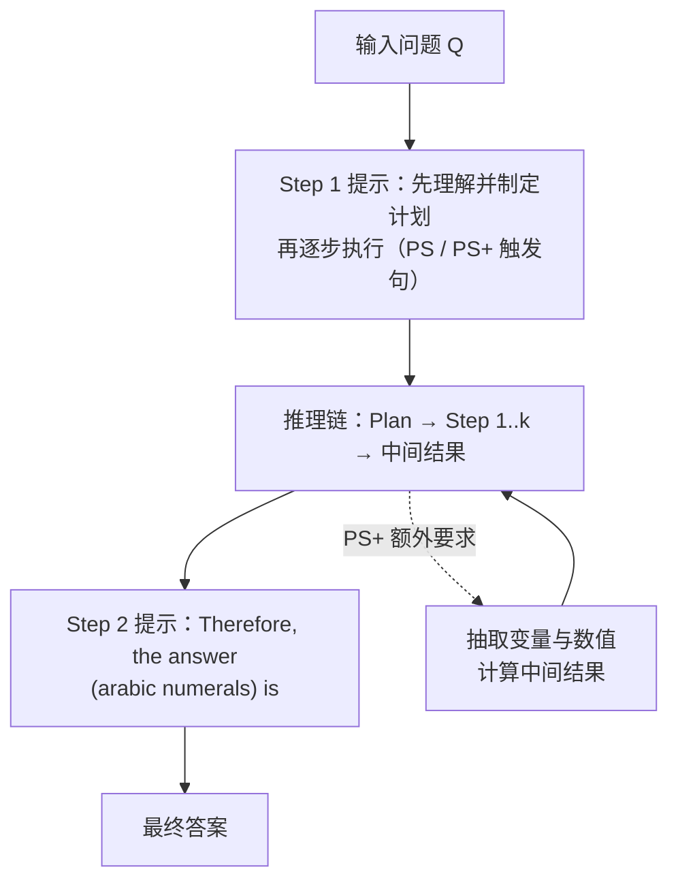
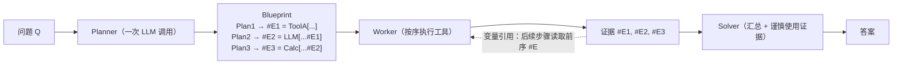
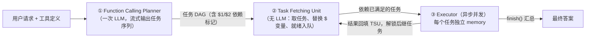
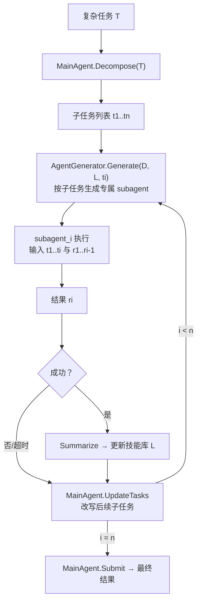
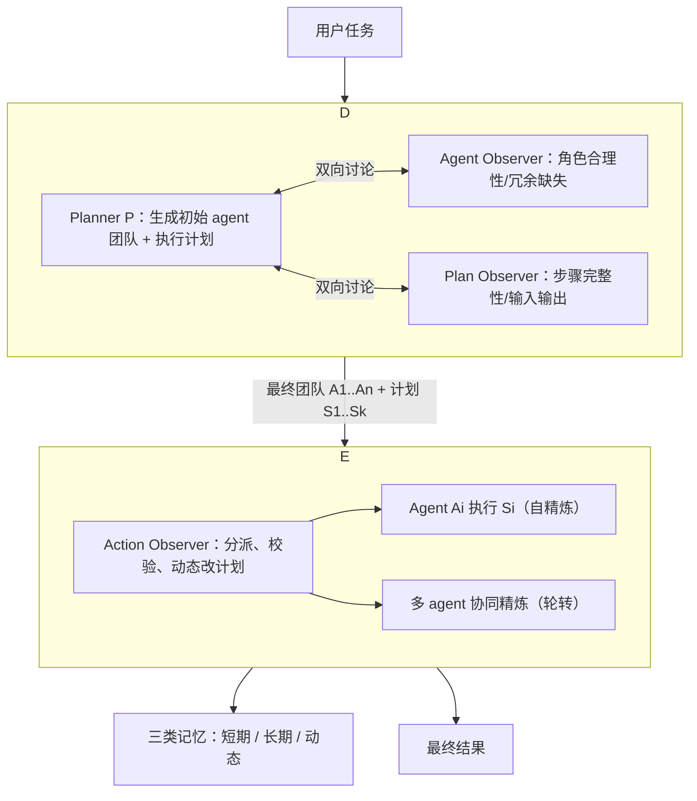
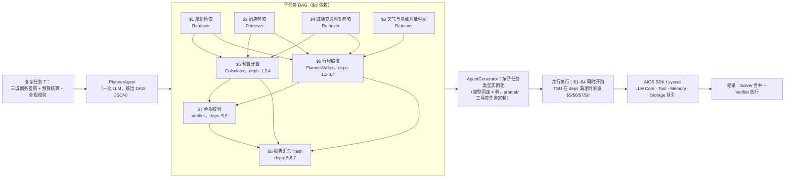

# 07 任务分解规划与并行执行：从提示层分解到编译器式 DAG 并行

> 本组精读五篇论文，回答同一个工程问题：**把一个复杂任务拆成若干可并行的子任务，在依赖约束下尽量并行地跑完，并且保证结果正确。** 这正是本赛题第②条（任务可分解为 ≥4 个可并行子任务并自动分配）与第④条（满足先后顺序与依赖约束）的理论与实现来源，也直接决定评分中"应用效果 50%"里的并发加速指标能否达标。

## 0. 论文清单与本组导览

| # | 论文 | arXiv / 时间 | 一作单位 | 在主线中的位置 | 对本赛题的关键词 |
|---|------|--------------|----------|----------------|------------------|
| 1 | Plan-and-Solve Prompting | 2305.04091 / 2023-05 | 新加坡管理大学 | 提示层：先规划后求解 | 分解质量、缺步骤错误、零样本触发句 |
| 2 | ReWOO | 2305.18323 / 2023-05 | 北卡罗来纳州立大学等 | 解耦规划与观测，变量引用 | `#E` 证据变量、token 二次增长→线性 |
| 3 | An LLM Compiler for Parallel Function Calling | 2312.04511v3 / 2024-06 | UC Berkeley 等 | 编译器式：任务 DAG + 流式调度 | Planner–TSU–Executor、`$1/$2`、3.74× 延迟 |
| 4 | TDAG | 2402.10178 / 2024-02 | 厦门大学、上海 AI Lab | 动态分解 + 按子任务生成 agent | 自动分配、级联失败、技能库 |
| 5 | AutoAgents | 2309.17288v3 / 2024-04 | 北京大学等 | 自动生成 agent 团队与计划 | 观察者角色、计划校验、自精炼 |

### 本组主线：一条"分解能力逐级外化"的演进链

这五篇不是并列的五个技巧，而是一条清晰的演进链，每一环都在把上一环留在**自然语言里**的东西变成**可执行的结构**：

1. **提示层分解（Plan-and-Solve）**：只在 prompt 里要求模型"先制定计划再执行"。计划是自然语言文本，不进任何执行器，但它证明了"显式规划"本身就能把缺步骤错误压下去。
2. **解耦规划与观测（ReWOO）**：把计划一次性生成成 blueprint，用 `#E1/#E2` 变量引用前序证据，工具执行只负责填值。计划第一次有了**数据流**（谁是谁的输入），并且因为不再把历史观测反复塞回 prompt，token 从二次增长降为线性。
3. **编译器式 DAG 并行（LLMCompiler）**：把 blueprint 升级为**有向无环图 (Directed Acyclic Graph, DAG)**，节点是函数调用、边是 `$id` 依赖；再由一个不调用 LLM 的取指单元把"依赖已满足"的节点源源不断送进执行器并发执行。计划至此变成**可调度的中间表示**。
4. **动态生成 agent 团队（TDAG / AutoAgents）**：分解不再只产出"步骤"，而是产出"谁来干"——按子任务现场生成专属子代理（TDAG），或经 Planner 与两个 Observer 多轮讨论后合成团队与计划（AutoAgents）。这一步对应赛题的"自动分配"。

一句话概括：**Plan-and-Solve 解决"想不全"，ReWOO 解决"反复喂上下文"，LLMCompiler 解决"串行等待"，TDAG/AutoAgents 解决"人肉指定谁来做"。**

### 并行为什么能省时间

设串行执行总时间 `T_serial = Σ_i (T_plan + T_exec,i)`（每步都要先想再做）。并行执行把这条链上的等待折叠为关键路径：

`T_parallel = T_plan + max_k T_exec,k + T_join`

只要执行阶段能真正重叠，理论上限就是论文 LLMCompiler 附录 E.1 给出的 `γ_max ≈ Σ T_E / max T_E`，即**并行宽度 N**；这就是赛题"总时间减少 ≥20%"（等价加速比 ≥1.25×）在机制上完全可达的原因——LLMCompiler 在 Movie Recommendation 上实测 3.74×，在 LLaMA-2 70B 上也有 2.82×。

### 什么条件下省不了（本组最重要的负面结论）

同一篇论文给出了下界 `γ_min ≈ Σ T_P^R / Σ T_P^C ≈ 1`：**当规划开销主导时，并行几乎不带来收益。** 具体有六个"省不了"的条件，后文每篇都会对应验证：

1. **Planner 开销占比过高**。LLMCompiler 自陈 Planner 已占总延迟一半以上，WebShop 上因 planner 开销反而比 ReAct 更慢（10.72s vs 5.98s），只换来成功率提升。
2. **存在"掉队者"（straggler）**。最慢一次检索平均 1.13s，约为全部任务均值 0.61s 的 2 倍，`max` 项由它决定。
3. **依赖链本身就是长链**。关键路径不变时，加宽并行度无效；ReWOO 的纯顺序执行就是极端例子。
4. **"LLM 核"数量有限**。端侧单卡 7B/8B 上，4 个子智能体若都在做 ReAct 多轮推理，实际是在抢同一个推理核，并行退化为排队——这是本赛题比论文更严峻的约束（论文的并行主要发生在检索/工具调用层，不是在 LLM 推理层）。
5. **协调与重新规划的开销**。AutoAgents 起草阶段最多 3 轮讨论、执行阶段最多 5 轮迭代，这些 token 与延迟是纯开销。
6. **正确性返工**。TDAG 的级联任务失败（Cascading Task Failure, CTF）在固定计划方法中占比可达 34.78%，返工一次就把并行省下的时间全吃掉。

---

## 1. Plan-and-Solve Prompting：先规划后求解，分解质量的起点

### 1.1 元信息

- 论文：Plan-and-Solve Prompting: Improving Zero-Shot Chain-of-Thought Reasoning by Large Language Models
- arXiv：2305.04091（2023-05）；作者：Lei Wang、Wanyu Xu、Yihuai Lan、Zhiqiang Hu、Yunshi Lan、Roy Ka-Wei Lee、Ee-Peng Lim（新加坡管理大学等）
- 实验模型：GPT-3 `text-davinci-003`（175B），temperature = 0，10 个数据集
- 关键词：零样本提示（zero-shot prompting）、计划—执行两段式

### 1.2 一句话结论

把 Zero-shot-CoT 的触发句 `"Let's think step by step"` 换成"**先理解问题并制定计划，再按计划逐步求解**"，无需任何训练，就在 10 个数据集上把零样本平均准确率从 70.4 提到 **76.7**，逼近甚至局部超过人工 few-shot CoT（77.6）。

### 1.3 问题与动机

作者分析了 Zero-shot-CoT 在 GSM8K 上的 100 个错误样本，归纳出三类（Fig.1、Table 6）：

- 计算错误（calculation）：7%
- **漏步骤（missing step）：12%**
- 语义误解（semantic misunderstanding）：27%

三类错误合计只占 46/100（7+12+27），但这 46 个样本已经足够定位病灶：**"漏步骤"的本质是模型没有先在全局上想清楚要分几步，直接顺着局部往下算**，典型表现是只用一步就跳到结论、或在多步算术中丢掉中间量。于是作者提出：**把"制定计划"显式写进提示词**，让"想清楚有几步"成为生成的第一步；并进一步在 PS+ 中追加"抽取相关变量及其数值""计算中间结果（注意计算与常识）"两句，分别针对计算错误与推理质量。

值得注意的是，这个诊断把一个"能力问题"转化成了"**顺序问题**"——先规划再执行，而不是边算边想。这个思路的全部后续（ReWOO 的 blueprint、LLMCompiler 的 DAG）都建立在这一步上：把"计划"从隐式的生成顺序里拿出来，变成显式的、可以先于执行存在的东西。

### 1.4 核心方法与机制

方法是纯提示工程，两步式（two-stage prompting）：

1. **生成推理过程**：把下面这段触发句拼在问题后，贪心解码出完整推理链。
   - PS：`"Let's first understand the problem and devise a plan to solve the problem. Then, let's carry out the plan and solve the problem step by step."`
   - PS+：在 PS 基础上追加 `"extract relevant variables and their corresponding numerals"` 与 `"calculate intermediate results (pay attention to calculation and commonsense)"`。
2. **抽取答案**：再用 `"Therefore, the answer (arabic numerals) is"` 作为第二段提示，从推理链中抽出最终答案。



机制上的关键点是：**"计划"没有被单独输出和保存**，它只是推理链的开头几句话。论文统计 100 个 PS 预测中 **90 个确实包含 plan**，说明提示确实改变了生成行为；但它没有计划校验、没有回退、也没有把计划变成可执行结构——这正是后续四篇要补的洞。

### 1.5 实验与关键数据

模型为 `text-davinci-003`，10 个数据集分三类（6 数学、2 常识、2 符号）。

**零样本主结果（Table 2 平均值，%）**：Zero-shot-CoT 70.4、PoT 73.5、PS 72.9、**PS+ 76.7**、few-shot Manual-CoT 77.6、Auto-CoT 75.9。即 PS+ 比 Zero-shot-CoT 高 **6.3 个百分点**，与人工 few-shot 仅差 0.9。

**PS+ 分数据集（Table 2）**：MultiArith 91.8、GSM8K 59.3、AddSub 92.2、AQuA 46.0、SingleEq 94.7、SVAMP 75.7。相对 Zero-shot-CoT，除 GSM8K 只 +2.9% 外，其余均 ≥ +5%。

**常识与符号任务**：CSQA 65.2→71.9、StrategyQA 63.8→65.4（Table 3）；Last Letters 65.2→75.2（人工 few-shot 70.6）、Coin Flip 96.8→99.6（人工 100.0）（Table 4）。

**消融（Table 5，GSM8K / SVAMP）**：只保留 `"Let's think step by step"` 56.4/69.9；只要求抽变量 50.5/69.5；只要求算中间量 54.8/70.8；纯 PS 58.2/72.0；PS+ 59.3/75.7。结论是**"先规划"贡献了主要增益**，另两句是增量。

**自洽性（Self-Consistency, SC；N=10, T=0.7）**：PS+ 在 GSM8K 达 73.7、SVAMP 达 84.4（无 SC 时 58.7/75.7）；Zero-shot-CoT+SC 为 70.7/81.7。

**错误分布（Table 6，GSM8K 的 100 个错误样本）**：Zero-shot-CoT 为计算 7% / 漏步骤 12% / 语义误解 27%，PS 为 7% / 10% / 26%，**PS+ 为 5% / 7% / 27%**。这组数字比平均分更能说明机制：PS+ 把"漏步骤"从 12% 压到 7%（接近腰斩）、计算错误从 7% 压到 5%，而**语义误解始终在 26%–27% 不动**——也就是说，提示层分解只能修复"规划与算术"类缺陷，对"根本没读懂题意"的错误无能为力。这条边界对本赛题很重要：分解与并行解决的是"结构与调度"，不是"理解"，理解类错误要靠检索/工具/校验去兜底。

另一个容易被忽略的细节：PS 是**纯零样本**方法，没有用任何示例，却在 10 个数据集中的多数上超过 few-shot Auto-CoT（75.9）。这说明"先规划"不是一个需要大量示例才能学会的技能，而更像是一个**解码顺序的先验**；对端侧 7B 而言，这意味着提示词改造的性价比远高于堆示例（示例会挤占本就紧张的上下文）。

### 1.6 局限与批判

1. **只在 175B 模型上验证**（第 7 节自述），没有 7B/8B 端侧结果，也没有跨模型规模曲线；对本赛题而言这是最致命的空白——小模型能否稳定遵循"先规划"的指令，论文未给出。
2. **计划质量不可控**：计划完全由一次贪心解码产生，无重试、无校验、无回退；计划错了就一路错到底。
3. **提示词是手工设计的**，不同任务要改写触发句，泛化性靠作者在 10 个数据集上的经验覆盖，论文未给出自动搜索方法。
4. **不涉及多智能体、不涉及并行、不涉及工具**：它只是"分解"这一动作的最小可行证明，距离可调度还差一整层工程。
5. 评测口径是答案准确率，没有延迟、token、成本数据（论文未给出），因此无法直接用于加速比论证。

### 1.7 对本赛题的直接启示

- **规划器 prompt 直接可借用**：在 AIOS-Agent SDK 里写 `PlannerAgent` 时，系统提示词第一段就用 PS+ 的三句式（制定计划 → 抽变量/约束 → 逐条计算）；这是零成本、零依赖的第一步改进。
- **把"计划"从自然语言升级为结构**：Plan-and-Solve 的计划只是推理链开头，我们要让它输出 JSON/DAG（`{id, agent_type, tool, args, deps}`），否则无法并行、无法表达先后顺序——这是本组后续四篇的公共前提。
- **用"缺步骤"作为分解质量的度量**：赛题要求 ≥4 个可并行子任务，可以借用 PS 的思路先做一次"独立分解"再统计子任务覆盖率，把"漏掉必须步骤"作为离线评测指标。
- **端侧 7B 的风险提示**：PS+ 的增益高度依赖指令遵循能力；7B 上很可能退化为"复述计划但不执行"，因此必须配合结构化输出约束（JSON schema / 语法约束解码）与少量 few-shot 示例，而不能只抄触发句。
- **别把触发句当分解器**：PS 的"计划"只存在于生成文本里，既不持久化也不可校验；在 AIOS 里应当把这一步实现为"PlannerAgent 的一次 LLM 调用 + JSON 解析 + 校验失败重试"，PS+ 的三句只负责让这次调用"先想全局"，不负责产出具结构。

---

## 2. ReWOO：把规划与观测解耦，`#E` 变量是依赖表达的雏形

### 2.1 元信息

- 论文：ReWOO: Decoupling Reasoning from Observations for Efficient Augmented Language Models
- arXiv：2305.18323（2023-05）；作者：Binfeng Xu、Zhiyuan Peng、Bowen Lei、Subhabrata Mukherjee、Yuchen Liu、Dongkuan Xu（北卡罗来纳州立大学等）
- 实验模型：`gpt-3.5-turbo` 为主；另有 Alpaca-7B 微调的 Planner 实验
- 关键词：可预见推理（foreseeable reasoning）、blueprint、证据变量 `#E`

### 2.2 一句话结论

把"推理"与"观测"拆开：Planner 一次性生成带 `#E1..#Ek` 变量引用的 blueprint，Worker 按序调用工具把变量填成真实证据，Solver 汇总作答；在 6 个公开基准上平均**减少 64% 的 token、绝对准确率 +4.4%**，且 7B 的 Planner 在零样本下可匹配 25 倍大的 GPT-3.5。

### 2.3 问题与动机

ReAct 式"思考—行动—观测"交错（observation-dependent reasoning）每一步都要把 **context + few-shot 示例 + 全部历史 Thought/Action/Observation** 重新拼进 prompt。作者写出输入 token 的规模（Eq.1）：

`#Token_I^TAO = kΘ(Q) + kΘ(C) + kΘ(S) + Σ_{j=1}^{k-1}(k-j)Θ(T_j + A_j + O_j)`

其中 Q 为问题、C 为上下文/示例、S 为工具说明，k 为步数。注意最后一项的 `(k-j)` 因子：**历史观测被重复计入后续每一步，token 随步数呈二次增长**。这既贵，又让长上下文挤占有效推理空间。

作者的主张是：很多任务（如多跳问答）的中间步骤其实是**可预见的**（foreseeable）——"先查 A，再查 B，再算 A/B"不需要看到 A 的结果就能规划出来。既然能预见，就应当先规划完再执行。

### 2.4 核心方法与机制

三段式流水线：

1. **Planner**：一次性生成 blueprint，形式是连续的元组 `(Plan, #E)`，其中 `#E_s` 是特殊证据变量，后续指令可以引用 `#E1`、`#E2`…。这一阶段**看不到任何工具返回**。
2. **Worker**：按顺序执行每条工具调用，把 `#E_i` 填成真实证据。Worker 不需要 LLM 推理（工具节点），或只需按其说明做一次 LLM 调用（LLM 节点）。
3. **Solver**：拿到"计划 + 全部证据"后统一作答；提示词明确要求 `"Use them with caution since long evidence might contain irrelevant information."`（谨慎使用，长证据可能含无关信息）。这句不只是防御，实验表明它本身提升性能。



论文给出的 token 规模（Eq.2）：

`#Token_I^ReWOO = Θ(C_planner + S + Q) + Θ(C_solver + Q + Σ(P_j + E_j)) ≈ 2Θ(Q) + 2Θ(C) + Θ(S) + ΣΘ(P_j + E_j)`

即**从二次增长降为线性**，且不再随步数重复携带历史。注意 Eq.2 里没有 `k` 的二次项，这是全部节省的来源。

Planner 的提示词模板（Appendix B）值得逐字借鉴：

- 任务描述：`"For the following task, make plans that can solve the problem step by step. For each plan, indicate which external tool together with tool input to retrieve evidence. You can store the evidence into a variable #E that can be called by later tools. (Plan, #E1, Plan, #E2, Plan, ...)"`
- 工具清单：Google / Wikipedia / WolframAlpha / Calculator / LLM / SearchSOTU，每个工具给出输入说明。
- few-shot 示例（代数题）：`Plan: ... #E1 = WolframAlpha[...]`；`Plan: ... #E2 = LLM[What is x, given #E1]`；`Plan: ... #E3 = Calculator[(2*#E2-10)-8]`。
- 收尾约束：`"Begin! Describe your plans with rich details. Each Plan should be followed by only one #E."`

关键工程含义：**`#E` 变量就是数据依赖边**。`#E2 = LLM[..., given #E1]` 明确表示节点 2 依赖节点 1；但由于 ReWOO 的 Worker 是顺序吐出的，这条依赖边只被用来"取值"，没有被用来"调度"——这正是 LLMCompiler 接手的地方。

另一个工程含义常被忽略：blueprint 是**纯文本、可序列化、可存档**的。这意味着 Planner 的产物可以落盘成 `plan.json`（每条 `{plan, e_id, tool, args}`），既能在失败后逐条重试，也能让评测者离线检查"计划是否合理"，而不必重跑整个 agent。对比赛答辩来说，这份计划文件本身就是"任务分解能力"的直接证据。

### 2.5 实验与关键数据

主模型 `gpt-3.5-turbo`，基线 Direct、CoT、ReAct（Table 2，acc % / 输入 token / 成本 $/1k 查询）：

| 数据集 | ReAct | ReWOO |
|--------|-------|-------|
| HotpotQA | 40.8 / 9795.1 tok / $19.59 | **42.4 / 1986.2 tok / $3.97** |
| TriviaQA | 59.4 / 4212.9 / $8.43 | **66.6 / 1340.9 / $2.68** |
| GSM8K | 62.0 / 1874.3 | **62.4 / 1089.3** |
| StrategyQA | 64.6 / 1686.3 | **66.6 / 1287.1** |
| PhysicsQA | 64.1 / 2163.3 | **66.0 / 1225.7** |
| SportsUnderstanding | 58.6 / 1720.0 | **61.3 / 854.2** |
| SOTUQA（自建 curated） | 64.8 / 1840.3 | **70.2 / 1048.8** |

论文原句：6 个公开基准上平均**减少 64% token、绝对准确率 +4.4%**；SOTUQA 上**绝对准确率 +8%、token 少 43%**。TriviaQA 是准确率提升最大的公开集（+7.2），HotpotQA 的 token 降幅最夸张（9795→1986，约 1/5）。

为避免"省 token 是因为少做事"的质疑，Table 2 同时报告了 Direct 与 CoT 两个更省 token 的基线，可以交叉验证：HotpotQA 上 Direct 37.8 acc / 55.5 tok、CoT 41.6 / 481.9、ReAct 40.8 / 9795.1、ReWOO 42.4 / 1986.2；TriviaQA 上 Direct 80.6 / 43.4、CoT 78.6 / 199.2、ReAct 59.4 / 4212.9、ReWOO 66.6 / 1340.9；GSM8K 上 Direct 26.8、CoT 67.4 / 495.6、ReWOO 62.4 / 1089.3。三个现象值得记住：

1. **ReWOO 的准确率并不总是最高**：TriviaQA 上 Direct（80.6）比 ReWOO（66.6）高 14 个点，GSM8K 上 CoT（67.4）比 ReWOO（62.4）高 5 个点。多步工具编排在"单跳即可答"的任务上是净损失——这提醒我们，并非所有子任务都值得走 agent 流程。
2. **ReAct 的 token 爆炸是结构性的**：TriviaQA 上 ReAct 用了 4212.9 token 却只有 59.4 准确率，比 Direct 的 43.4 token 还低 21 个点——长历史把简单任务反而做坏了。
3. **ReWOO 的性价比区间**：在需要 2–5 跳、且每跳都要外部证据的 HotpotQA 上收益最大（token 1/5、准确率 +1.6）；在单跳任务上应当直接短路到 Direct/CoT。

**7B Planner 实验（第 4 节）**：用 4000 条 `(Plan, #E)` blueprint 对 Alpaca-7B 做 LoRA 微调（单张 RTX 4090），零样本下在三个任务上匹配 25 倍大的 GPT-3.5。对端侧 7B/8B 的赛题环境，这是最直接的可复制证据：**小模型不必承担完整 agent 推理，只承担"制定 blueprint"这一窄任务，就能获得接近大模型的多跳规划能力。**

### 2.6 局限与批判

1. **本质仍是串行**：blueprint 全部预生成，但 Worker 一条一条执行，总时间仍近似 `Σ T_exec`。ReWOO 只省 token，不省墙上时间——它没有做并行调度。
2. **"可预见性"假设很强**：第 4 节自述，环境上下文很少的任务（AlfWorld 的 `"put some vase in safe"`）无法纯靠可预见推理，Planner 必须枚举所有可能计划，推理步数退化为 observation-dependent 的最坏复杂度（甚至更差）。
3. **plan 一旦错就全错**，且没有在线纠错机制；Solver 有时证据全对却结论错。
4. **工具越多越差**：Fig.5 显示逐步加入无关工具时准确率下降——Planner 面对长工具清单会选错工具。这对赛题"多种工具 + 多智能体"是明确警告。
5. 论文的"未来工作"恰好就是本组主题：把 LLM/工具/子模型节点接成 DAG，用图算法与并发执行优化。

### 2.7 对本赛题的直接启示

- **`#E` 变量是本赛题"依赖表达"的最小可用方案**：子任务输出统一命名为 `#E1..#En`，后续子任务的输入参数里出现 `#Ei` 即表示依赖 `i`，DAG 由参数扫描自动构建，无需额外让模型画图。这比让 7B 模型直接输出合法 Graphviz/JSON 边列表更稳。
- **三段式天然对应三种 agent 角色**：Planner（纯 LLM，一次调用）、Worker（工具型，可并行）、Solver（汇总校验）。赛题要求的 ≥4 种可协作智能体可以直接按"Planner / 检索 / 计算 / 校验（Solver）"切分，三种类型已有论文背书。
- **端侧收益最大**：7B/8B 上下文窗口与 prefill 成本都吃紧，token 从二次降到线性意味着**同样的 4 个子任务能在更短上下文里完成**，这既省时间也降低 OOM 风险，是比"并行"更早见效的优化。
- **把 ReWOO 的 blueprint 当作"串行基线"的天然实现**：同一份 blueprint，`Worker` 串行跑就是基线，按 DAG 并行跑就是实验组——两条路径共享 Planner 与 Solver，加速比归因干净（详见文末第 5 条建议）。

---

## 3. An LLM Compiler for Parallel Function Calling：任务 DAG 与三段流水线（本组最关键）

### 3.1 元信息

- 论文：An LLM Compiler for Parallel Function Calling
- arXiv：2312.04511v3（2024-06 修订）；作者：Sehoon Kim、Suhong Moon、Ryan Tabrizi、Nicholas Lee、Michael W. Mahoney、Kurt Keutzer、Amir Gholami（UC Berkeley、ICSI、LBNL）
- 实验模型：`gpt-3.5-turbo-1106`、`gpt-4-turbo`、`gpt-4-0613`、LLaMA-2 70B
- 关键词：函数调用规划器（function calling planner）、任务取指单元（Task Fetching Unit, TSU）、执行器（Executor）、`$id` 依赖标记

### 3.2 一句话结论

让 LLM 只做一次"编译"：把用户请求编译成**带 `$1/$2` 依赖标记的任务 DAG**，再由一个**不含 LLM** 的取指单元流式解析、把依赖已满足的任务派发给并发执行器；在 HotpotQA / Movie Recommendation 上分别取得 **1.80× / 3.74× 延迟加速、3.37× / 6.73× 成本下降**，同时准确率不降反升。

### 3.3 问题与动机

ReAct 式 agent 按"想一步、调一次工具、看一眼结果"推进，两个失败模式被作者明确点名：**重复生成先前已发出的函数调用**（LLaMA-2 上约 20% 的样例出现）、**基于不完整的中间结果过早停止**（early stopping）。更根本的问题是**串行**：一次只能有一个函数在飞，`N` 个独立检索也要排队。

同期 OpenAI 发布的并行函数调用（parallel function calling）能一次返回多个独立调用，但它需要**多轮 LLM 调用**（初始搜索一轮、后续 math 一轮、最终 math 一轮），且无法表达"后一步依赖前一步**具体输出**"的细粒度依赖。LLMCompiler 的定位是：**用一次规划换整张依赖图，用图换并行，用流式取指换掉规划等待。**

### 3.4 核心方法与机制

三段流水线（Fig.2）：



**① Planner（Sec 3.1）。** 输入是用户请求 + 工具定义 + 可选 in-context 示例，输出是一串**带变量引用**的任务：

```
$1 = search(Microsoft Market Cap)      # 无依赖，可立即执行
$2 = search(Apple Market Cap)          # 无依赖，与 $1 并行
$3 = math($1 / $2)                     # 依赖 $1 与 $2
$4 = llm($3)                           # 依赖 $3
finish($4)
```

Planner 提示词的硬规则（Appendix H）值得原样落到实现里：

- 动作的输入可以是常量，**也可以是前序任务的输出**，写法为 `$id`；
- **任务 ID 严格递增**（保证输出即拓扑序，TSU 可单向扫描）；
- 计划要**最大化可并行性**（原文 `"Ensure the plan maximizes parallelizability"`）；
- 不要写注释、不要多余文字；**必须以 `finish()` 结尾**（收集合并结果，或触发 replan）。

一个关键的工程细节：Planner 的示例（exemplars）里**只有 plan、没有 observation**，因此 prompt 比 ReAct 短得多。这既解释了成本优势，也说明"规划"是一项可以脱离执行单独学习的窄任务（与 ReWOO 的 7B Planner 实验互相印证）。

**② Task Fetching Unit（Sec 3.2）。** 类比 CPU 的**指令取指单元**，它不调用 LLM，只做三件事：流式读 Planner 的输出、把 `$id` 占位符替换为已完成任务的实际返回值、把"输入已齐备"的任务放入执行队列。因为它按"依赖满足"而非"书写顺序"派发，`$2` 可以在 `$1` 还没返回时就开始跑。

**③ Executor（Sec 3.3）。** 异步并发执行，每个任务有**专属 memory**（避免并行任务互相污染上下文）；任务完成后结果回传 TSU，TSU 用该结果替换后继任务里的 `$id` 并唤醒它们。`finish()` 是收敛点，负责合并。

**流式规划（Sec 4.2）**：Planner 一边生成任务一边把已完成的部分交给 TSU，任务不必等整张图生成完就能启动，效果类比指令流水线。Table C.1 显示 streaming 一致提升：ParallelQA 上达 1.3×（math 工具执行慢，正好把规划延迟藏在执行后面），HotpotQA 从 4.00s 到 3.95s（1.01×，因为该任务规划快、收益小）。

**并行度的退化条件（Sec E.1）** 是本组最值得抄下来的一段。作者给出延迟模型：

- ReAct：`T_R = Σ_{i=1..N} [T_P^R(P_i) + T_E(E_i)]`（每一步"想 + 做"都串行）
- LLMCompiler：`T_C = Σ_i T_P^C(P_i) + max_k T_E(E_k)`（规划串行，执行取最大值）
- 流式：`T_C^S = Σ_i T_P^C(P_i) + T_E(E_N)`，且 `T_C^S ≤ T_C`
- 加速比 `γ = T_R / T_C`；上界 `γ_max ≈ Σ T_E / max T_E = N`；下界 `γ_min ≈ Σ T_P^R / Σ T_P^C ≈ 1`

原文结论直译：**"要用 LLMCompiler 取得显著延迟收益，关键在 (i) 降低规划器开销，(ii) 尽量减少掉队者。"** 实测 Planner 已占 Table 1 总延迟一半以上；最慢的一次 search 平均 1.13s，约为全部任务均值（0.61s）的 2 倍，`max` 项由它决定。Fig.E.5 把 ParallelQA 按最大并行任务数 2–5 分组：ReAct 的延迟随任务数**线性增长**，LLMCompiler 几乎**平坦**、只因 Planner 开销略微上抬——这是弱扩展性（weak scaling）的直接证据。

### 3.5 实验与关键数据

**并行基准（Table 1）**，格式为 准确率 % / 延迟 s / 加速比：

| 任务 | ReAct† | OpenAI 并行函数调用 | LLMCompiler |
|------|--------|---------------------|-------------|
| HotpotQA（GPT） | 62.47 / 7.12 / 1.00× | 62.05 / 4.42 / 1.61× | **62.00 / 3.95 / 1.80×** |
| Movie Rec.（GPT） | 72.47 / 20.47 / 1.00× | 77.00 / 7.42 / 2.76× | **77.13 / 5.47 / 3.74×** |
| ParallelQA（GPT-4-turbo） | 89.09 / 35.90 / 1.00× | 87.32 / 19.29 / 1.86× | **89.38 / 16.69 / 2.15×** |
| HotpotQA（LLaMA-2 70B） | 54.40 / 13.44 / 1.00× | — | **57.83 / 9.58 / 1.40×** |
| Movie Rec.（LLaMA-2 70B） | 70.60 / 33.37 / 1.00× | — | **77.80 / 11.83 / 2.82×** |
| ParallelQA（LLaMA-2 70B） | 59.59 / 15.47 / 1.00× | — | **68.14 / 26.20 / 2.27×** |

结论有三点：① 加速比随并行宽度上升（Movie Rec. 是 8 路并行，故 3.74×；HotpotQA 只有 2 路，故 1.80×）；② **准确率不降**，论文称最高比 ReAct 提升 7–8%（Appendix A）；③ 换成 LLaMA-2 70B 后加速比与准确率都下降（1.40×/2.82×/2.27×），说明**规划器质量直接决定 DAG 质量**，弱模型的 DAG 更保守（并行度更低）。

**成本（Table 2，输入/输出 token 与 $/1k 查询）**：HotpotQA 上 ReAct 2900/120、5.00 美元 → LLMCompiler 1300/80、**1.47 美元（3.37×）**；Movie Rec. 上 20000/230、20.46 → 2800/115、**3.04（6.73×）**；ParallelQA 上 46000/470、480 → 9200/340、**103（4.65×）**。省钱的机制是**一次 LLM 调用规划全部任务**：OpenAI 并行调用在 ParallelQA 上需要 3 次 LLM 调用（初始搜索、后续 math、最终 math），LLMCompiler 只需 1 次。

**推理密集任务（Table 3，WebShop）**：gpt-3.5-turbo 下 ReAct 成功率 19.8 / 得分 54.2 / 5.98s；LATS 38.0 / 75.9 / 1066s；LLMCompiler 44.0 / 72.8 / 10.72s（N=50）、48.2 / 74.2 / 10.48s（N=500）。此时 LLMCompiler **比 ReAct 慢**（10.72s vs 5.98s），因为规划开销没有可并行的执行来摊薄；但成功率相对 ReAct 提升 28.4%（gpt-3.5）与 20.4%（gpt-4），且比 LATS 快 101×、比 LASER 快 2.69×。这张表是"并行不是万能"的最好证据。

**Game of 24（ToT 基线）**：ToT 74.00 / 241.2s → LLMCompiler 75.33 / **83.6s（2.89×）**；LLaMA-2 上 2.01×。该任务用 replanning，每轮只规划一步（thought proposer / state evaluator / top-k select 三个工具），说明**动态分支场景下"编译"退化为"逐步重编译"，加速比也随之下降**。

### 3.6 局限与批判

1. **规划开销是硬上限**：Planner 占总延迟一半以上，`γ_min ≈ 1` 的下界意味着最坏情况下并行毫无收益（WebShop 已实测为负收益）。
2. **掉队者（straggler）主导 `max` 项**：一条慢检索就能抵消大部分并行收益，需要超时、重试、降级或冗余执行（论文未实现这些，只是指出）。
3. **要求用户提供工具定义与示例**（总结节自述），且工具清单越长 Planner 越容易选错（ReWOO 的 Fig.5 有同样发现）。
4. **静态 DAG 无法表达运行时才知道的分支**：只有 `finish()` 能触发 replan，而 replan 等于重新编译整图，开销大；Game of 24 因此只能用"每步一编译"的退化模式。
5. **并行发生在工具/检索层，不在 LLM 推理层**：TSU 派发的是函数调用，`math`、`search`、`llm` 节点本身的 LLM 推理仍是串行资源。这一点对本赛题（端侧单卡 7B/8B）是决定性的——**不能把论文的 3.74× 直接搬到"4 个 agent 同时 ReAct"上**。

### 3.7 对本赛题的直接启示（把机制映射到 AIOS）

1. **DAG 构造**：让 PlannerAgent 一次输出 JSON 任务表，字段固定为 `{id, agent, tool, args, deps}`，`args` 里用 `$id` 引用前序输出；ID 递增以简化拓扑排序。校验器只做四件事：ID 唯一递增、`deps` 无环、每个 `deps` 指向已存在的更小 ID、必须以 `finish` 收尾。
2. **并行调度**：实现一个不调用 LLM 的 `TaskFetchingUnit`（约百行 Python）：维护 `pending/running/done` 三张表，扫描 `deps ⊆ done` 的任务即 `submit` 到线程池；线程池大小 = 端侧"LLM 核"数 + 工具并发额度（见第 3 节导览"省不了"第 4 条）。
3. **依赖退化路径要提前设计**：`max` 由最慢子任务决定，因此对检索/DB 子任务设超时与降级（超时返回"未取到证据"），否则一个掉队者会把 4 路并行拉回串行。
4. **准确率兜底**：并行不降低正确性是 LLMCompiler 的核心卖点，靠的是"每任务独立 memory + finish 统一合并"。我们要给每个子智能体独立上下文，由 Solver/校验智能体统一合并与冲突消解，不能让并行子任务共享一个可变对话历史。
5. **映射到 AIOS 系统调用**：每个子任务在 AIOS 侧表达为一组 syscall（`execute_llm_syscall` / `execute_tool_syscall` / `execute_memory_syscall` / `execute_storage_syscall`），由 SDK 的 `send_request` 提交；DAG 的"就绪"判定在**应用层**完成，因为 doc/01 明确指出 AIOS 调度器"只看请求到达顺序/时间片，不理解请求的依赖关系"，依赖分析被列为它的未来工作。换言之：**我们的 DAG 调度器是 AIOS 之上的一层"语义调度器"，AIOS 负责核内资源裁决与上下文切换。**

---

## 4. TDAG：动态任务分解 + 按子任务生成 agent

### 4.1 元信息

- 论文：TDAG: A Multi-Agent Framework based on Dynamic Task Decomposition and Agent Generation
- arXiv：2402.10178（2024-02）；作者：Yaoxiang Wang、Zhiyong Wu、Junfeng Yao、Jinsong Su（厦门大学、上海人工智能实验室）
- 实验模型：`gpt-3.5-turbo-16k`；自建基准 ItineraryBench（364 个测试样本）
- 关键词：动态任务分解、agent 生成、增量技能库、级联任务失败

### 4.2 一句话结论

主智能体把复杂任务分解为子任务序列，**每个子任务现场生成一个专属子代理**去执行，并根据前序结果动态改写后续子任务；在 ItineraryBench 上平均分 **49.08**，显著高于 ReAct 43.02、P&S 43.68、P&E 42.85、ADAPT 44.74，且把级联任务失败率从 ReAct 的 32.61% 压到 **4.35%**。

### 4.3 问题与动机

现有"计划—执行"式 agent（如 P&E）有两个结构性缺陷（第 1 节）：

- **子任务一旦分解就被冻结**：早期子任务失败会沿链路传播，导致整任务失败（error propagation）；
- **子代理是硬编码的**（hard-coded subagents）：角色固定、无法适配多样化的真实任务。

作者的主张是：分解应当**动态**（随前序结果改写后续子任务），角色应当**按需生成**（每个子任务一个专属子代理），并为此配套一个能评价"部分完成"的细粒度基准——因为传统二值成功率无法区分"全错"和"做了 70%"。

### 4.4 核心方法与机制

**动态分解（Sec 4.1）**，三个公式就是全部骨架：

- 分解：`(t1, t2, ..., tn) = MainAgent(T)`
- 执行：`ri = SubAgenti(t1, ..., ti, r1, ..., ri−1)`（子代理能看到全部前序子任务与前序结果）
- 更新：`t'_i = Update(ti, r1, ..., ri−1)`（根据前序结果改写第 i 个子任务）

**agent 生成（Sec 4.2）**，两个子机制：

- **工具文档生成**：原始工具文档常有冗余与歧义，先用 LLM 重写、澄清、补全，再交给子代理，避免误导。
- **增量技能库（incremental skill library）**：子代理完成子任务后总结过程，写成 `{Name, Detail, Solution}` 三元组存入技能库；下次遇到相似子任务，用一个小型 SentenceBERT 检索最相关技能注入提示。另有一个专职"技能修改"代理维护库的质量。与 Voyager 的差别在于：这里的环境无法直接验证技能正确性，技能只能靠持续迭代逼近。

主流程见 Algorithm 1：`Decompose → for each ti: Generate(D, L, ti) → Execute(t1..ti, r1..ri−1) → 若成功则 UpdateSkillLibrary → UpdateTasks(t_list, ri) → Submit`。



**基准 ItineraryBench（Sec 3）** 本身也值得学：15 个城市、83 个景点、846 条市内与 3903 条城际交通线路，构造 364 个测试样本；分三类任务（Type 1 城际、Type 2 市内、Type 3 混合）；评分分三层且**逐层递进**——Level 1 可执行性 60 分（`s1 = w1 × A1/B1`）、Level 2 约束满足 20 分（`s2 = w2 × A2/B2`）、Level 3 时间与成本效率 20 分（`s3 = w3 × (1 − (s−a)/(b−a))`，`[a,b]` 由 50 条合法行程的均值 ± 标准差确定）。这种"可执行性优先、再约束、再效率"的分层，正是赛题"正确完成"的可操作化定义。

### 4.5 实验与关键数据

**主结果（Table 2，ItineraryBench 平均分）**：ReAct 43.02、P&S 43.68、P&E 42.85、ADAPT 44.74、**TDAG 49.08**；消融：去掉 agent 生成 46.69（−2.39）、去掉动态分解 46.23（−2.85）。值得注意的反常结果：**P&E 42.85 反而低于 ReAct 43.02**，作者归因于固定任务分配缺乏灵活性——初始子任务不如预期时无法改计划，后续子任务直接不可执行。

从差值看，TDAG 比最强的 ADAPT 高 4.34 分，而两个消融各掉 2.4–2.9 分，说明"动态分解"与"按需生成 agent"是**两个各自独立、量级相当**的增益，不是同一个机制的两面；这一点对我们很关键——赛题的"自动分配"如果只做静态映射（固定角色查表），拿到的只是其中一半收益。另外要注意口径：ItineraryBench 是作者自建基准，49.08 这个绝对分不能与其他论文的分数横向比较，只能在同一张表内看相对差距。

**错误分析（Table 3，占同类错误总数的百分比）**：级联任务失败 CTF——ReAct 32.61、P&S 8.70、P&E 34.78、ADAPT 19.57、**TDAG 4.35**。四类错误为 CTF（级联失败）、CKE（常识错误）、EIM（外部信息错位/幻觉）、CNC（约束不满足）。CTF 的 8 倍差距是"动态更新"机制最硬的证据。

**跨基准泛化（Table 4，%）**：WebShop 上 TDAG 奖励分 **64.5**、成功率 **45.0**（ReAct 42.1/29.0，ADAPT 60.0/44.0）；TextCraft 上成功率 **73.5**（ReAct 19.0，ADAPT 52.0）。说明"按子任务生成 agent"不只对旅游领域有效。

### 4.6 局限与批判

1. **完全串行**：Algorithm 1 是 `for ti in t_list` 的线性循环，没有任何并行；依赖关系只隐含在"i 依赖 1..i−1"这一条全序链上，无法表达"t2 与 t3 可并行、t4 依赖二者"的 DAG。这是它距离本赛题要求最远的一点。
2. **每个子任务都要生成一次 agent**，是额外的 LLM 调用与延迟；论文未给出 token 与延迟数据（**论文未给出**），因此无法评估这套机制在端侧的可行性。
3. **依赖单一强模型**：全部实验基于 `gpt-3.5-turbo-16k`，7B/8B 上"生成 agent 的系统提示词"很可能质量不足。
4. **动态改写可能抖动**：`Update` 由主智能体自由生成，缺少收敛性保证；错误改写会引入新的子任务，理论上可无限膨胀（论文给出的约束只是迭代上限，见 Algorithm 1 隐含的循环边界）。
5. **技能库正确性无法验证**（作者自述），坏技能会污染后续任务。
6. 基准只有旅游一个领域（虽有 WebShop/TextCraft 泛化实验），任务结构相对规整。

### 4.7 对本赛题的直接启示

- **"自动分配"的实现范式**：赛题要求子任务"自动分配"，TDAG 给出的答案是**两步**——先由主智能体分解，再为每个子任务生成/选择 agent（`AgentGenerator.Generate(D, L, ti)`）。落到 AIOS 上，可以固定 4 种 agent **类型**（Planner / Retriever / Calculator / Verifier），但每个实例的**系统提示词、工具集、输入输出契约**按子任务动态生成——既满足"≥4 种可协作智能体"的硬性要求，又保留动态分配的灵活性。
- **用 CTF 作为正确性指标**：赛题评分里"正确完成"可以细化为"子任务成功率 × 无级联失败"，后者直接用 TDAG 的定义统计，并在答辩里引用 32.61% → 4.35% 的对比说明动态更新的价值。
- **把线性链升级为 DAG**：TDAG 的 `t1..tn` 全序是我们必须改掉的部分；改造方式见第 3 篇的 `$id` 方案——`SubAgenti` 的输入从"全部前序"缩小为"其 `deps` 指向的前序结果"，这样才能并行。
- **分层评分可直接借用**：可执行性 → 约束满足 → 效率三层，正好对应赛题"正确完成 + 加速"的双目标，且天然支持部分完成计分（避免"一个子任务失败就 0 分"）。
- **技能库可省**：端侧 demo 不值得引入 SentenceBERT 检索；把技能库换成"静态少样本示例 + 成功案例回写日志"即可，重点放在 DAG 并行。

---

## 5. AutoAgents：自动生成 agent 团队与执行计划

### 5.1 元信息

- 论文：AutoAgents: A Framework for Automatic Agent Generation
- arXiv：2309.17288v3（2024-04 修订）；作者：Guangyao Chen、Siwei Dong、Yu Shu、Ge Zhang、Jaward Sesay、Börje Karlsson、Jie Fu、Yemin Shi（北京大学、香港科技大学、北京智源、滑铁卢大学）
- 实验模型：`gpt-4-0613`，temperature = 0；起草阶段最多 3 轮讨论，执行阶段最多 5 轮迭代
- 关键词：起草阶段（Drafting Stage）、观察者（Observer）、自精炼/协同精炼、三类记忆

### 5.2 一句话结论

用两个阶段自动"组队 + 排计划"：**起草阶段**由 Planner 与 Agent Observer、Plan Observer 多轮双向讨论，产出定制 agent 团队与执行计划；**执行阶段**由 Action Observer 协调、各 agent 自精炼与协同精炼；在 Trivia Creative Writing 上比标准提示提升 **+9.9%（N=5）/ +10.8%（N=10）**，在开放式问答上对 ChatGPT 的胜率 96.3%（FairEval）。

### 5.3 问题与动机

主流多智能体框架（AutoGPT、MetaGPT、AutoGen、Camel 等，见 Table 1）的 agent 角色是**手工指定**的，需要人类先验地知道"这个任务需要哪些专家"；即使有自动生成（SSP、AgentVerse），也缺少对生成质量与计划合理性的校验，容易生成冗余或缺失的角色。AutoAgents 的洞察是：**任务与角色之间存在耦合**——角色决定计划的上限，计划反过来暴露角色的缺口，所以两者应当**交替、双向地**细化，而不是单向生成。同时，单 agent 的输出质量也需要自评与改进（self-refinement），跨领域知识需要多 agent 交换（collaborative refinement）。

### 5.4 核心方法与机制

**起草阶段（Sec 3.1）**：三个预定义角色——Planner `P`、Agent Observer `O_agent`、Plan Observer `O_plan`。Planner 先给出初始团队与计划，然后进入双向循环：`O_agent` 检查每个 agent 是否满足四元组 `A = {P, D, T, S}`（提示词/profile-goal-constraints、描述、工具集、执行建议），评估与任务的匹配度，指出冗余或缺失角色；`O_plan` 检查每个步骤 `Si` 是否都有负责的 agent、输入输出是否明确、步骤是否充分，反馈给 Planner 改写。**n 轮后得到最终团队与计划**。

**执行阶段（Sec 3.2）**：新增预定义 Action Observer `O_action` 作为"队长"，按计划把任务分派给对应 agent，校验每步产出，并在异常时动态调整计划；循环直到达成共识或达到迭代上限。每个 agent 的动作建模为 `a_t = l_t ∪ p_t ∪ o_t`（思考、计划、执行输出），支持**自精炼**（单个 agent 自评改写）与**协同精炼**（多 agent 按固定轮转顺序交换意见）。

**三类记忆（Sec 3.2）**：短期记忆（单次动作内的中间思路与结果）、长期记忆（跨动作的历史轨迹与关键反馈）、动态记忆（Action Observer 从长期记忆中为当前动作抽取的相关片段）。这是对"上下文有限的 LLM 如何承载多 agent 协作历史"的直接回答。



**执行流程（Algorithm 1）**：初始化 Planner 与两个 Observer → 循环"Observer 反馈 / Planner 改写"至无反馈或达上限 → 初始化 Action Observer 与长期记忆 → `for Sk in 计划`：生成动态记忆 → 分派给 `{Ai..Aj}` → 内层循环自精炼/协同精炼 → 结果写入长期记忆 → 最终返回。

### 5.5 实验与关键数据

**开放式问答（Table 2，胜率）**：对 ChatGPT，FairEval 96.3%、HumanEval 75%；对 Vicuna-13B 同为 96.3%/75%；**对 GPT-4 仍有 76.3%/62.5%**。也就是说，多 agent 协作的增益大到可以压过单模型的能力差距（对 GPT-4 仍赢三分之二以上），这个数字在"端侧 7B 用多智能体补能力"的叙事里非常有用。

**Trivia Creative Writing（Table 3，100 实例/N，共 1000 道 trivia 题）**：N=5 时 Standard 74.6、CoT 67.1（−10.0%）、SPP-Profile 79.1（+5.9%）、SPP 79.9（+7.1%）、**AutoAgents 82.0（+9.9%）**；N=10 时 Standard 77.0、CoT 68.5、SPP-Profile 83.0、SPP 84.7、**AutoAgents 85.3（+10.8%）**。注意 CoT 在此任务上**为负收益**（−10%/−11.1%），说明"让模型自己一步步想"不等于"分解协作"——这支持了本赛题"用多智能体而非单 agent 长思维链"的路线。

**消融（Table 4，20 个实例，N=5）**：AutoAgents 90.0；去掉 observers 87.0（−3）；去掉自精炼 87.0（−3）；去掉协同精炼 88.0（−2）；去掉动态记忆 89.0（−1）；标准提示 74.6。四个部件各自贡献 1–3 个百分点，其中**观察者讨论**与**自精炼**最重要。

### 5.6 局限与批判

1. **重依赖 GPT-4**：作者自述"对较早的 LLM 适应性差"（第 6 节）。端侧 7B/8B 能否撑起"讨论—改计划—校验"的多轮流程，论文**未给出**任何小模型数据。
2. **完全串行**：协同精炼是"fixed order of turn-taking"（固定顺序轮转），Action Observer 也是按计划步骤顺序分派；**没有任何并行执行**，多轮讨论还会线性放大延迟与 token（论文未报告成本/延迟数字）。
3. **开销不可控**：起草 3 轮 + 执行 5 轮 × n 个 agent，一次任务的 LLM 调用次数可能是单 agent 的十几倍；在端侧单卡上这直接转化为等待时间。
4. **角色差异主要靠 prompt 与工具**（作者自述），并非真正的模型/能力异构；所谓"专家"更像是同一模型的提示词切片。
5. 评测以胜率与字符串匹配为主，缺乏对"计划是否真的被执行"的机制性验证。

### 5.7 对本赛题的直接启示

- **"双向交互"的现成范式**：赛题要求 ≥3 对智能体的**双向**交互。AutoAgents 的 `Planner ↔ Agent Observer`、`Planner ↔ Plan Observer` 就是两对天然的双向通道；再加一对 `Verifier ↔ Worker`（校验不合格则打回重做），三对即可满足要求，而且讨论轮数上限（3 轮）可直接作为实现参数。
- **把"观察者"降级为轻量校验器**：端侧不需要完整的讨论式 Observer，可以做成**规则 + 单次 LLM 校验**（例如：每个子任务必须有 agent、输入字段必须能由前序输出填满、时间/预算约束必须显式出现），既保留机制，又把开销压到一次调用。
- **agent 四元组可直接复用**：`{P, D, T, S}` 是"自动生成 agent"的最小契约；赛题要求的 ≥4 种智能体可以固定 4 个模板，把 `T`（工具集）与 `S`（执行建议）按子任务实例化——**类型固定、实例动态**，兼顾可评审性与自动分配。
- **记忆分层对端侧尤其必要**：7B/8B 上下文小，三类记忆里最该保留的是"长期记忆的结果摘要"与"动态记忆的当前片段"，短期记忆随任务结束丢弃；这与 AIOS 的 Memory Manager（`add_memory` / `retrieve_memory`）天然对齐。
- **不要照抄多轮讨论**：在答辩与实现中明确"讨论轮数 ≤ 2、只对关键决策（选哪个工具、是否需要新增子任务）触发"，否则加速比会被讨论成本吃掉。

---

## 6. 横向对比与落地建议

### 6.1 横向对比表

| 维度 | Plan-and-Solve | ReWOO | LLMCompiler | TDAG | AutoAgents |
|------|----------------|-------|-------------|------|------------|
| 分解粒度 | 推理步骤（自然语言） | 工具调用节点 | 函数调用节点（DAG 顶点） | 子任务（自然语言） | 计划步骤 + 角色 |
| 并行能力 | 无 | 无（Worker 顺序） | **强**（依赖就绪即并发） | 无（线性循环） | 无（固定轮转） |
| 依赖表达 | 无（隐含顺序） | `#E` 变量引用 | **`$id` 显式依赖边** | 全序 `t1..tn` | 计划内步骤顺序 |
| 额外开销 | 极低（仅提示词） | 低–中（一次规划） | 中（Planner 占总延迟 >50%） | 中–高（每子任务生成 agent） | 高（3+5 轮讨论） |
| 实现复杂度 | 低 | 中 | 中–高（三组件 + 流式） | 高（生成器 + 技能库） | 高（四类角色 + 记忆） |
| 对本项目适用性 | 中（只借 prompt） | 高（blueprint 结构） | **最高（直接照搬调度）** | 中（借"自动分配"） | 中（借"双向校验"） |

一句话选型：**用 LLMCompiler 的 DAG 与调度骨架，用 ReWOO 的 `$id/#E` 做依赖语法与 token 优化，用 TDAG 的"按子任务生成 agent"实现自动分配，用 AutoAgents 的观察者做正确性校验，用 Plan-and-Solve 的触发句写 Planner 提示词。**

### 6.2 复杂任务 → 子任务 DAG → 智能体分配 → 并行执行（示意）

以"为一家公司规划跨三城的商务差旅并核算预算"为例（任务类型与 TDAG 的 ItineraryBench Type 3 同构）：



关键点：**$1–$4 是 4 个真正可并行的子任务**（满足赛题"≥4 个可并行子任务"），$5/$6 是 join（依赖 3–4 条边），$7 是校验闸门，$8 是唯一收敛点。这个形状同时满足"≥3 对双向交互"（$5↔$7 预算打回、$6↔$7 合规打回、$1↔$5 证据补查）。

### 6.3 给本赛题的 5 条落地建议

**建议 1：先定义并冻结"串行基线"，再谈加速。**
串行基线必须与实验组**共享除并发度以外的一切**：同一个 Planner、同一份 DAG JSON、同一套 agent 实现与工具、同一模型与硬件、temperature 固定。实现上只留一个开关 `max_workers=1`（按拓扑序逐个执行）与 `max_workers=N`（按就绪队列并发）。测量口径是**端到端墙上时间**：从 `send_request` 发出到 `finish` 返回，用统一打点记录 `T_plan`、每个节点 `T_exec,i`、`T_join`；重复 ≥20 次，报告中位数与 p90，而不是单次最快值。这样加速比 `S = T_serial / T_parallel` 的归因才是干净的。

**建议 2：用 Amdahl 公式先算清楚 20% 从哪来，再决定并行度。**
`S = (T_plan + Σ T_exec,i) / (T_plan + max T_exec,i + T_join)`。若规划占 15%、4 个子任务各占 20%（执行共 80%），完美并行时 `S = 100 / (15+20) = 2.86`，远超 1.25 的达标线；若规划占 50%、执行共 50% 且 4 路并行，`S = 100 / (50+12.5) = 1.60`，仍达标但余量只剩 28%。因此**首要优化是让 Planner 只调用一次**（ReWOO/LLMCompiler 的做法），而不是把"每个子任务都先 ReAct 想一遍"当作并行负载——那只会把并发堆在同一个 LLM 核上排队，加速比趋近 1。

**建议 3：正确性用"三层闸门"保证，而不是靠模型自觉。**
① 编译期：DAG 校验器（无环、ID 递增、deps 存在、finish 唯一）拒绝非法计划并要求重规划；② 运行期：每节点独立上下文 + 超时/重试/幂等；③ 收敛期：Verifier agent 按 TDAG 的三层评分（可执行性 → 约束 → 效率）放行，统计级联失败率 CTF。这样即使并行执行顺序与串行不同，最终结果也必须一致——这本身就是可写进答辩的"正确完成"证据。

**建议 4：把并行度压在工具/IO 上，而不是 LLM 推理上。**
端侧单卡 7B/8B 的"LLM 核"通常只有 1–2 个并发实例，4 个 agent 同时做多轮 ReAct 必然排队。合理配置是：4 个检索/DB/Python 子任务真并行（等待网络与磁盘），LLM 调用尽量合并为批或串行，Planner 与 Solver 各一次。若必须多 agent 同时推理，则依赖 AIOS 的 RR 调度与 LLM 上下文切换（doc/01 实测切换后输出一致性 BLEU = BERT = 1.0）来保证公平与正确，但要知道 RR 会付出约 3 秒的切换开销（同规模下 FIFO 74.2s vs RR 77.3s），所以**批处理优先、抢占兜底**。

**建议 5：测加速比时同时报告"三个数"，避免被质疑口径。**
① 墙钟加速比 `S_wall`（主指标，达标线 1.25×）；② 关键路径压缩比（`Σ T_exec / max T_exec`，说明并行结构本身好不好）；③ 正确率与 CTF（说明没有为了快而牺牲正确性）。再补一张"并行宽度 1/2/3/4 下的延迟曲线"——按 LLMCompiler Fig.E.5 的做法，串行应随任务数线性增长、并行应趋于平坦，这张图比单个加速比数字更有说服力。

### 6.4 与 doc/01（AIOS）调度器的对接说明

doc/01 给出的可复用机制与本文的映射关系如下：

| 我们的组件 | AIOS 对应物（doc/01） | 对接方式与注意事项 |
|------------|----------------------|--------------------|
| PlannerAgent 输出 DAG | `Query` 分解为多条 syscall | Planner 只调一次 LLM（`execute_llm_syscall`），把 DAG JSON 作为计划产物，不直接下发 |
| 子任务就绪判定 | 无对应物（**AIOS 调度器不理解依赖**，doc/01 列为未来工作） | 在应用层实现 `DAGScheduler`/TSU：`deps ⊆ done` 才 `send_request`；这是我们必须自己补的一层"语义调度" |
| 每个子任务的 LLM/工具/记忆/存储动作 | 四类 syscall：`execute_llm_syscall`、`execute_tool_syscall`、`execute_memory_syscall`、`execute_storage_syscall` | 每个子任务线程内按序发 syscall；`SysCall` 继承 `Thread` 且先 `event.wait()` 等派发，天然可并发 |
| 并发粒度 | 调度器集中持有 LLM/Memory/Storage/Tool 四条队列 | 我们的并行度最终受这四条队列的服务能力约束；工具侧还有"实时实例计数 + 上限"，同一有状态工具并发会被跳过顺延，故并行子任务应尽量用不同/无状态工具 |
| 长任务不阻塞其他 agent | LLM 上下文切换（快照/恢复，以 `pid` 为键） | 让 Planner 或某个推理子任务可被抢占；正确性有 BLEU=BERT=1.0 背书 |
| 结果合并与校验 | Access Manager（权限旁路，不参与调度） | 权限校验必须同步前置，不要排进队列；Verifier 的放行属于应用层逻辑 |
| 端到端计时 | `send_request` / `Response` 往返 | 计时点在 SDK 层，保证串行/并行口径一致 |

一句话总结对接原则：**AIOS 负责"核内资源裁决"（谁先占 LLM 核、如何快照恢复、工具冲突如何顺延），我们负责"图级依赖裁决"（哪个节点现在可以跑）。** 前者已经由 doc/01 验证（吞吐最高 2.1×、调度消融 152.1s → 74.2s），后者是本组五篇论文要解决的问题；两者叠加，才构成赛题要求的"任务可分解、可并行、有依赖、可自动分配"的完整链路。

### 6.5 与赛题四条要求的对应

| 赛题要求 | 本组给出的实现路径 |
|----------|--------------------|
| ① ≥4 种可协作智能体 | PlannerAgent（规划）、RetrieverAgent（检索）、CalculatorAgent（计算/工具）、VerifierAgent（校验/合并），类型固定、实例按子任务生成（TDAG + AutoAgents） |
| ② ≥4 个可并行子任务 + 自动分配 | Planner 一次生成 DAG，前 4 个节点无依赖即并行；AgentGenerator 按节点类型/工具需求选型（TDAG 的 `Generate(D, L, ti)`） |
| ③ ≥3 对双向交互 | Planner↔AgentObserver、Worker↔Verifier、Calculator↔Verifier 三对"请求—反馈—重做"闭环（AutoAgents 的双向讨论 + TDAG 的动态改写） |
| ④ 先后顺序与依赖约束 | `$id` / `#E` 依赖标记 + DAG 校验器 + TSU 就绪派发（LLMCompiler / ReWOO）；串行模式按拓扑序执行作为基线 |

