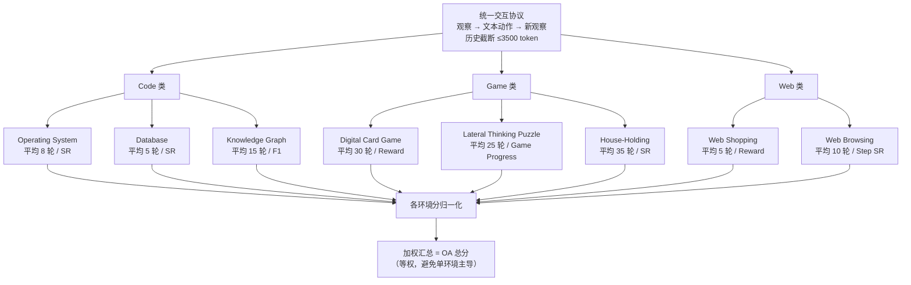
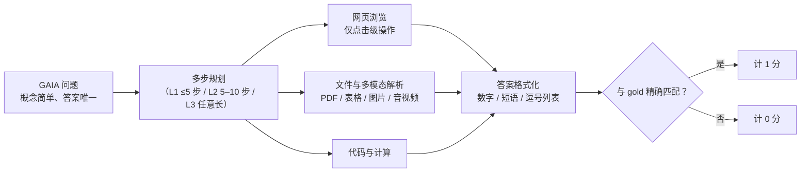
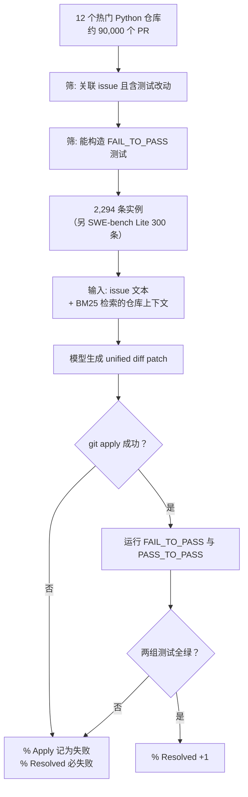
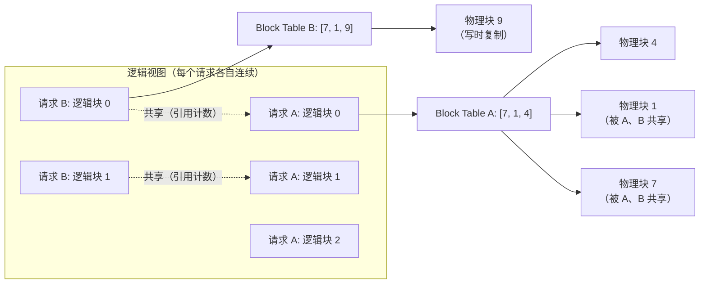
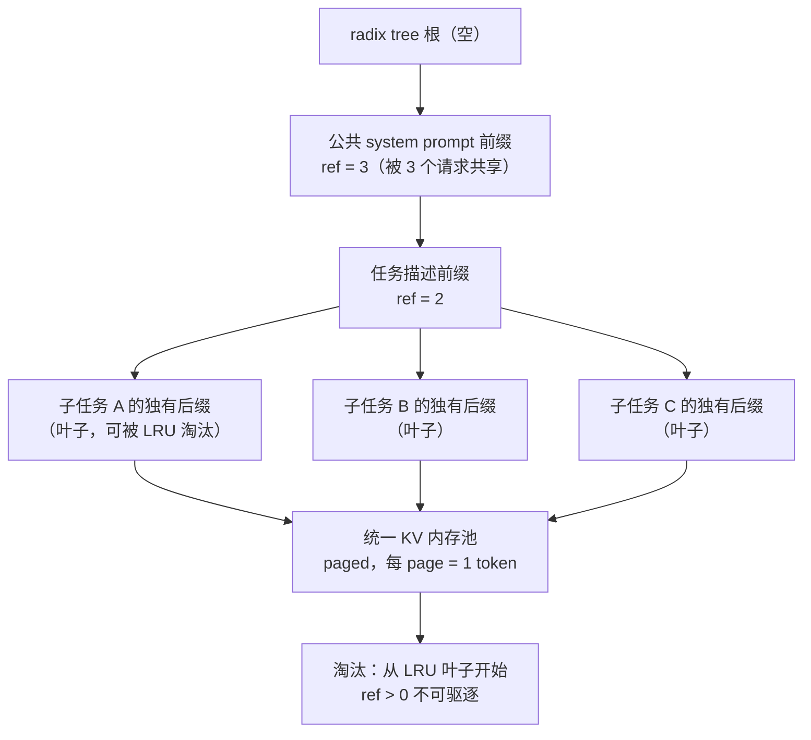
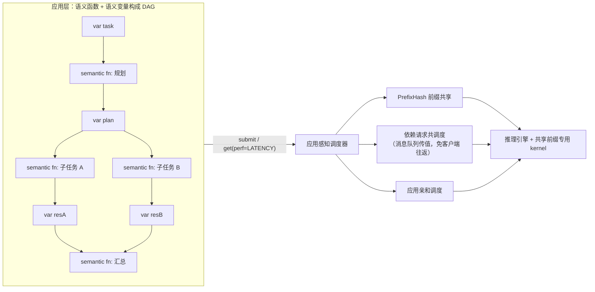

# 08 评测基准与端侧推理加速：六篇论文精读

> **本文件的用途**：为赛题《智能体操作系统中的多智能体协作技术》提供两块可直接引用的论据——(1) 「为什么 7B/8B 端侧模型做复杂任务必须靠多智能体分工 + 工具约束」的**评测侧证据**；(2) 「为什么并发加速能兑现、加速比该怎么测才算数」的**服务层证据与测试方案**。全部数字取自论文正文、表格或图，逐处标注章节号/表号/图号；论文没有给出的，明确写「论文未给出」，不做任何外推式编造。原文纯文本位于 `build/papertext/`（PDF 抽取文本存在少量编码乱码，不影响数值）。
>
> 阅读建议：先读「本组导览」建立主线，再按顺序读 1–3（评测）与 4–6（服务层），最后直接使用文末 **A. 横向对比表** 与 **B. 本项目加速比基准测试方案**（B 节可原样搬进测试报告与答辩 PPT）。

---

## 论文清单

| # | arXiv | 论文 | 发表 | 类型 | 本文件角色 |
|---|-------|------|------|------|-----------|
| 1 | 2308.03688 | AgentBench: Evaluating LLMs as Agents | ICLR 2024（清华等） | 多环境 agent 评测基准 | 证明「通用能力 ≠ agent 能力」，给出开源模型的能力区间 |
| 2 | 2311.12983 | GAIA: a Benchmark for General AI Assistants | arXiv 2023（Meta AI / HuggingFace / AutoGPT 等） | 真实世界助理任务基准 | 给「人类 92% vs 最强系统 15%」这一最具冲击力的难度锚点 |
| 3 | 2310.06770 | SWE-bench: Can Language Models Resolve Real-World GitHub Issues? | ICLR 2024（Princeton） | 仓库级软件工程基准 | 给出「真实任务成功率 1.96%」与「可验证子任务」的设计范式 |
| 4 | 2309.06180 | Efficient Memory Management for LLM Serving with PagedAttention（vLLM） | SOSP 2023（UC Berkeley） | 推理服务系统 | 并发吞吐提升的**第一性来源**：KV cache 不再浪费 |
| 5 | 2312.07104 | SGLang: Efficient Execution of Structured Language Model Programs | arXiv 2023（Stanford / UC Berkeley，LMSYS） | 推理服务系统 | 多智能体共享前缀的**命中率证据**（52.4%–74.1%） |
| 6 | 2405.19888 | Parrot: Efficient Serving of LLM-based Applications with Semantic Variable | arXiv 2024（上海交大 + 微软亚洲研究院） | 应用级调度系统 | 最接近本赛题的可比实验：多 agent 负载端到端最高 11.7× |

---

## 本组导览：一条从「能力怎么评」到「时间怎么省」的论证链

**第一段：agent 能力怎么评（第 1 篇）。** 传统 benchmark（MMLU 一类）测的是「知识 + 单轮回答」，而 agent 的能力发生在**多轮交互 + 环境反馈**里。AgentBench 把它标准化为 8 个可交互环境、29 个模型：GPT-4 的加权总分（OA）为 4.01，19 个开源模型（≤70B）均值仅 0.51（Table 3、Figure 1b），差一个数量级。结论是「通用分数高」并不蕴含「会当 agent」，评测必须放进环境。

**第二段：真实任务的难度与成功率（第 2、3 篇）。** 换成真实任务后成功率断崖式下跌。GAIA 里人类 92%，当时最强的 GPT-4 + 插件只有 15%，最难的 Level 3 在 Table 4 中各类系统**全部为 0**。SWE-bench 中最好的 Claude 2（BM25 检索、13k 上下文）只解决 **1.96%**（Table 2、Table 5）。这构成本赛题最硬的立论：**7B/8B 端侧单 agent 硬解复杂任务的成功率不会高于上述下沿；必须用「任务分解 + 角色分工 + 工具约束 + 机器可验证的判据」把成功率拉回来**——正好对应赛题 ②④ 与评分项「正确完成任务」。

**第三段：为什么必须谈服务层（第 4、5、6 篇）。** 20% 加速比不是写个 `async` 就能拿到的：多 agent 并发调用同一个 7B 模型时，瓶颈在推理引擎的**批处理能力**。vLLM 证明旧系统把大量 KV cache 显存耗在预留与碎片上（Figure 2：Orca(Max) 有效 KV 仅 8.9%，vLLM 为 96.3%），修好后同延迟吞吐 2–4×（摘要）。SGLang 证明跨调用的公共前缀可缓存复用，真实生产命中率 52.4%–74.1%（§6.5）。Parrot 证明把应用级 DAG 与依赖交给服务层，多 agent 负载端到端最高 11.7×（§6.2）。因此「并发」必须同时落实到 **batch、前缀共享、应用级调度** 三件事上。

# 1. AgentBench（2308.03688）

## 1.1 元信息

- **标题**：AgentBench: Evaluating LLMs as Agents
- **发表**：ICLR 2024（会议论文，正文标注 "Published as a conference paper at ICLR 2024"）
- **机构**：清华大学 THUDM 等（作者含 Xiao Liu、Hao Yu、Hanchen Zhang、Yifan Xu、Xuanyu Lei、Hanyu Lai、Yu Gu、Hangliang Ding、Kaiwen Men、Kejuan Yang、Shudan Zhang、Xiang Deng、Aohan Zeng、Zhengxiao Du、Chenhui Zhang、Sheng Shen、Tianjun Zhang、Yu Su、Huan Sun、Minlie Huang、Yuxiao Dong、Jie Tang）
- **arXiv**：2308.03688
- **定位**：第一个「多环境、纯文本可交互、面向 LLM-as-Agent」的系统性评测基准；8 个环境、29 个模型。
- **本文件引用版本**：`build/papertext/2308.03688-AgentBench.txt`（212,351 字符）

## 1.2 一句话结论

把「LLM 当 agent」这件事放进 8 个可交互环境里统一评测后，**通用能力排名不能预测 agent 能力排名**：GPT-4 的 OA 为 4.01，而 19 个开源模型（≤70B）的均值仅 0.51，差距约一个数量级；失败主因不是知识不足，而是长期推理、决策与指令跟随不足（Table 3、Figure 1b、Table 6）。

## 1.3 问题与动机

论文在 §1 指出现有 agent 评测的三类缺陷，这三条几乎逐条对应「为什么我们要自拟任务而不能只跑现成 benchmark」：

1. **动作空间封闭且离散**：历史上常用的文本游戏（Jericho、TextWorld 一类）只有有限的动词命令集，且主要测常识 grounding，不反映真实使用场景。
2. **仿真器过重、过于多模态**：具身 agent 用的游戏/GUI/室内场景仿真器复杂，且要求多模态输入，**无法用于当时大量纯文本 LLM 的紧急评测**。
3. **单一环境、无法给全景**：多数基准只覆盖一个场景，无法回答「这个模型作为通用 agent 到底行不行」。

因此论文的目标是造一个**统一接口、多环境、纯文本可操作、真实场景驱动**的基准，同时给出可复现的评测工具链（unified evaluation toolkit）。

## 1.4 核心方法与机制

**八个环境、三类 grounding**（§1、Figure 4；其中 5 个为本文件首次提出）：

- **Code 类**：Operating System（在 bash 环境里完成用户指令）、Database（写 SQL 完成查询）、Knowledge Graph（在知识图谱上做多跳问答）。
- **Game 类**：Digital Card Game（卡牌对战）、Lateral Thinking Puzzle（海龟汤式横向思维谜题）、House-Holding（家务规划，改编自 ALFWorld）。
- **Web 类**：Web Shopping（网页购物，改编自 WebShop）、Web Browsing（网页浏览问答，改编自 Mind2Web）。

**统一交互协议**：每个环境都实现 `初始化 → 观察（observation）→ 文本动作/命令（action）→ 环境返回新观察` 的循环；agent 侧只有一个 LLM 与一段系统提示，**不允许工具外挂、不允许人工干预**。多轮对话历史在构造提示时被截断到 **≤3500 token**（按 `ceil(len/6)` 粗略估计 token 数，§4.1），这是为了保证不同模型的输入可比。

**评分（OA）**：每个环境先按自身指标算分（成功率 SR、F1、Reward、Game Progress、Step SR），再加权汇总为 Overall Score。Table 2 的注明确说明 `Weight` 列是「该任务在所有模型上的平均分」，因此 OA 实质上是**把 8 个环境拉成等权**的加权平均，避免某个环境因总分基数大而主导排名——这一点对我们要「自拟评分表」很有借鉴价值。



图注：环境规模与指标取自 Table 2；交互轮数从 5 轮到 35 轮不等，说明「轮数多寡」本身就是难度维度。

## 1.5 实验与关键数据

**被测模型（Table 1）**：29 个，其中 10 个商用 API（gpt-4、gpt-3.5-turbo、text-davinci-002/003、claude-3 opus、claude-2、claude、claude-instant、chat-bison-001、glm-4），19 个开源（**仅收 ≤70B**：llama2-70b/13b/7b、codellama-34b/13b/7b、vicuna-33b/13b/7b、guanaco-65b/33b、wizardlm-30b/13b、openchat-13b、koala-13b、dolly-12b、oasst-12b、chatglm-6b、codegeex2-6b）。**注意：开源侧包含 7B 级模型，正是我们端侧 7B/8B 的同类**。

**数据规模（Table 2）**：Dev 269 条、Test 1,014 条；表内 `#Dev`/`#Test` 写成「查询条数 / 预计总交互轮数」，例如 Operating System 为 144/1200、Knowledge Graph 为 150/2250、House-Holding 为 50/1750。总推理调用量：Dev 约 3k 次、Test 约 11k 次，论文称「与 MMLU 所需调用量相当」（§4.1）。

**主结果（Table 3，OA 与分环境分）**：

| 模型 | OA | OS | DB | KG | Card | Lateral | House | Shopping | Browsing |
|---|---|---|---|---|---|---|---|---|---|
| gpt-4 (0613) | **4.01** | 42.4 | 32.0 | 58.8 | 74.5 | 16.6 | 78.0 | 61.1 | 29.0 |
| claude-3 (opus) | 3.11 | — | — | — | — | — | — | — | — |
| glm-4 | 2.89 | — | — | — | — | — | — | — | — |
| claude-2 | 2.49 | — | — | — | — | — | — | — | 0.0 |
| claude | 2.44 | — | — | — | — | — | — | — | — |
| gpt-3.5-turbo | 2.32 | — | — | — | — | — | — | — | — |
| llama-2-70b | 0.78 | — | — | 8.0 | 0.0 | — | 2.0 | 5.6 | — |
| codellama-34b | 0.96 | — | — | — | — | — | — | — | — |
| vicuna-13b | 0.93 | — | — | — | — | — | — | — | — |
| llama-2-13b | 0.77 | — | — | — | — | — | — | — | — |
| vicuna-33b | 0.73 | — | — | — | — | — | — | — | — |
| guanaco-65b | 0.54 | — | — | — | — | — | — | — | — |
| dolly-12b | 0.14 | — | — | — | — | — | — | — | — |
| chatglm-6b | 0.11 | — | — | — | — | — | — | — | — |
| oasst-12b | 0.03 | — | — | — | — | — | — | — | — |

（表中「—」表示该表对应单元格在论文 Table 3 中未强调/未列出；本文件不补造数字。）

**关键对比**：商用 API 均值 **2.32** vs 开源模型均值 **0.51**（Figure 1b）。最强的 70B 开源模型 llama-2-70b 也只有 0.78，仅为 GPT-4 的约 1/5；6B 级的 chatglm-6b 为 0.11、oasst-12b 为 0.03——**这一区间与我们要用的 7B/8B 端侧模型能力档位最接近**。

**失败归因（Table 6，百分比为各类失败的占比）**：

| 失败类型 | 商用模型 | 开源模型 |
|---|---|---|
| 完成任务（Completed） | 61.5% | 39.1% |
| 上下文超限（Context Limit） | 3.0% | 0.0% |
| 格式非法（Invalid Format） | 6.0% | 10.4% |
| 动作非法（Invalid Action） | 4.6% | 13.6% |
| 任务超时（Task Limit） | 24.9% | 36.9% |

解读：开源模型「任务超时」占 36.9%、「动作非法」占 13.6%，两者合计超过一半。这不是「不会推理」，而是**不会在给定轮数内收敛、不会输出合法动作**。论文 §5.2 的结论是：主因是长期推理、决策、指令跟随能力不足；此外「代码训练」对 agent 表现的影响是 ambivalent（双面的）——CodeLlama 系列在 Code 类环境有明显优势，但在 Game/Web 类并不总是更好。

## 1.6 局限与批判

1. **单 agent、无协作维度**：只测「一个 LLM + 一个环境」，没有多 agent 分工/交互的评测维度；赛题要求的 ≥3 对双向交互、≥4 并行子任务无法度量——**只能借它的能力档位结论，不能借它的分数**。
2. **指标不含时间与成本**：只看任务是否完成（SR/F1/Reward），不报延迟、token 成本、并发度，论文未给出任何 wall-clock 数据（这正是我们要补的）。
3. **7B 级模型分数未在 Table 3 正文列出**：Table 1 有 llama2-7b、vicuna-7b、codellama-7b、codegeex2-6b，但逐项 OA **论文未给出**，只能以开源均值 0.51 与 6B 模型的 0.11 作为下沿参照。
4. **静态封闭与权重设计可议**：8 个环境均为离线数据集驱动，Web 类也是仿真而非真实网页；OA 的 Weight 取「全模型平均分」，等价于 8 环境等权，**难环境与易环境贡献相同**——自拟评分表应显式按难度/耗时加权。

## 1.7 对本赛题的直接启示

- **【立论基石】** 「开源均值 0.51 vs GPT-4 4.01」「6B 模型 0.11」直接论证：端侧 7B/8B 单 agent 在复杂任务上不具备可用成功率，**必须靠分工把任务切到 7B 也能做对的粒度**——这是赛题条款 ①（≥4 种可协作 agent）最硬的必要性论证。
- **【条款②：子任务可并行】** 8 个环境平均交互 5–35 轮，说明复杂任务天然是长序列。分解时应给**每个子任务设轮数上限（如 ≤5 轮）**，把长序列压成「多个短序列并行」：既缩短单 agent 推理链提升成功率，又天然产生可并发负载。
- **【条款④：顺序与依赖】** Table 6 中开源模型 36.9% 的失败是「任务超时」。对策是把**轮数预算**写进编排器：每个子 agent 有明确步数上限与超时降级路径（返回部分结果交 Reviewer 修正），而不是在循环里空转；同时避免串行基线被失败任务拖长。
- **【评分项：正确完成任务】** 抄它的「环境内可判定指标」：每个子任务必须有机器可判定的验收条件（文件存在且内容匹配、退出码为 0、JSON schema 通过），禁止用 LLM 自评「我完成了」。
- **【工程细节】** 其历史截断策略（≤3500 token、`ceil(len/6)` 估 token）可借为并发上下文预算：N 路并发的总 prompt token ≈ N × 单 agent 预算，直接决定显存与吞吐，是 B 节控制变量的依据。

# 2. GAIA（2311.12983）

## 2.1 元信息

- **标题**：GAIA: a Benchmark for General AI Assistants
- **发表**：arXiv 2023（预印本；作者来自 Meta AI、Hugging Face、AutoGPT 等）
- **arXiv**：2311.12983
- **定位**：466 道「对人类概念上简单、但对 AI 极难」的真实世界助理任务；强调**答案唯一、可自动判定、需要真实世界访问与多模态**。
- **本文件引用版本**：`build/papertext/2311.12983-GAIA.txt`（97,322 字符）

## 2.2 一句话结论

当任务从「考试题」换成「助理的日常活儿」时，人类能做对 **92%**，而当时最强的 GPT-4 + 插件只有 **15%**，最难的 Level 3 上所有被测系统**均为 0**（摘要、Table 4）——差距不在知识，而在**多步规划、工具使用、多模态读取与真实世界访问**。

## 2.3 问题与动机

论文 §1 的动机非常直接：LLM 已被包装成「通用助理」，但**没有基准去度量助理真正的本职工作**。已有的 NLP 基准（问答、摘要、考试）测的是「在给定文本上答题」，而助理的真实工作是：自己去找信息、读不同格式的文件、调用工具、组合多步推理、最后给出一个**格式严格、唯一正确**的答案。

GAIA 的设计哲学（§2、§3.4）是三条：
1. **概念简单、答案唯一**：题目对人是「查一下就知道」的难度，但需要多步；答案必须能精确匹配，便于自动评测。
2. **真实世界**：题目基于真实网页/文档（Wikipedia、Papers With Code、arXiv 等），或直接附件（PDF、表格、图片、音频、视频）。
3. **抗污染**：公开 dev 集 166 题，**私有 test 集 300 题**保留答案只用于 leaderboard，防止题目泄漏进训练数据。

## 2.4 核心方法与机制

**三级难度（§3.3）**——这是本文件对我们最有价值的部分，因为它给出了「子任务粒度」的官方定义：

- **Level 1**：一般不需要工具，或**最多 1 个工具**，且**不超过 5 步**。
- **Level 2**：步数更多，**大约 5–10 步**，且需要**组合不同工具**。
- **Level 3**：为「近乎完美的通用助理」准备，需要**任意长的动作序列、任意数量的工具、访问真实世界**。

题量分布：Level 1 / 2 / 3 分别为 **146 / 245 / 75**（合计 466）。

**答案格式**：严格限定为 number（数字）、少量单词、或逗号分隔的列表；评测用精确匹配（对数字做规范化）。这个设计使评测**零人工、零 LLM-as-judge 偏差**。

**动作约束**：网页交互只允许「点击」级别的操作（§3.3 明确说不要求上传文件、发评论、订会议等写操作），以避免污染真实网站，也为可复现性让路。

**造题与验证流程（§3.4）**：人工造题 → 由**两名新的标注者独立作答** → 若原标注者与两名新标注者答案一致则通过；不一致则修正或删除。**68% 的题原样有效**（Level 1 75%、Level 2 68%、Level 3 仅 47%），其余需修正或剔除。造一道题（含验证与修复）约需 **2 小时**标注时间。



图注：难度分级的判据是「标注者造题时所用的步数与工具数」，不是任务主题；这与我们把「子任务 = 一个 agent 一次可完成的工作单元」的切分原则一致。

## 2.5 实验与关键数据

**主结果（Table 4，附录 D.1，单位为 % 正确率，按 L1 / L2 / L3 分列）**：

| 系统 | Level 1 | Level 2 | Level 3 |
|---|---|---|---|
| GPT-4 | 9.1 ± 2.5 | 2.6 ± 0.6 | 0 |
| GPT-4 Turbo | 13.0 ± 2.1 | 5.5 ± 1.4 | 0 |
| AutoGPT（GPT-4 后端） | 14.4 | 0.4 | 0 |
| GPT-4 + plugins | **30.3** | **9.7** | 0 |
| 搜索引擎（baseline） | 7.4 | 0 | 0 |
| 人类 | **93.9** | **91.8** | **87.3** |

摘要给出的整体数字是：人类 **92%**，GPT-4 + 插件 **15%**。

**耗时（§4，平均每题分钟数，L1 / L2 / L3）**：GPT-4 为 0.19 / 0.15 / N.A.；GPT-4 + plugins 为 0.65 / 0.53；AutoGPT（GPT-4）为 7.6 / 11.7；人类为 6.8 / 10.5 / 17.7。这组数字有两层含义：(a) 自动化系统比人**快一个数量级**，说明「时间」不是当前 agent 的短板，「做对」才是；(b) AutoGPT 式「自主循环」比 GPT-4+plugins 慢得多且更不准——**没有约束的自主性会同时牺牲正确率和时间**，这对我们用「工具约束 + 显式编排」是正面支持。

**验证数据（§3.4）**：623 道新题被两名新标注者独立作答；68% 原样有效；人类聚合分 92%（L1 94 / L2 92 / L3 87）。平均造题成本 2 小时/题（论文未给出总标注人时）。

## 2.6 局限与批判

1. **私有测试集不可本地复现**：300 题 test 答案不公开，只能在答辩中引用其公开数字作为难度锚点；dev 166 题可下载，但论文未给出 dev 上的完整分数表（Table 4 未区分 dev/test）。
2. **只判最终答案、不判过程**：蒙对与推理正确同分，也测不出协作质量；要评「多智能体协作」必须补过程指标（子任务完成率、交互轮次、依赖满足率）。
3. **无时间/成本指标**：人类与系统耗时只是描述性统计，未纳入评分也无 token 成本——这正说明赛题把 50% 分数压在「并发时间减少 ≥20%」上是基准之外的新要求，必须自建方案（B 节）。
4. **仅英文、网页会变、L3 的 0 分有时代性**：数据集限英文（§6），依赖可长期存活的英文网页；论文承认证据可能被更新失效，靠选稳定来源 + 指定版本缓解（启示：外部资源须锁定版本或本地化）；L3 的 0 分是 2023 年底最强系统的实测值，不外推为永久不可能，但足以支撑「端侧 7B 单 agent 难硬解 L3」。

## 2.7 对本赛题的直接启示

- **【立论基石】** 「人类 92% vs 最强系统 15%，L3 全 0」配合 AgentBench 的「开源均值 0.51」，可完整论证：任务越接近真实助理工作，端侧小模型单 agent 的成功率越不可接受，分工是必需品而非优化项。
- **【条款①：自拟复杂任务】** 抄它的难度分级：把每个子任务按「步数 + 工具数」标为 L1/L2/L3，并保证 **80% 以上子任务落在 L1（≤5 步、≤1 工具）**——这是 7B 能做对的粒度，也是「任务分解」的可操作判据，而不是凭感觉切。
- **【条款②：并行性】** L2/L3 之难在于步数多、工具组合复杂；反之「步数少、工具单一」的子任务可并行。分解时应刻意制造**彼此不共享中间结果**的子任务，使并发是真并发。
- **【评分项：正确完成任务】** 抄它的「答案唯一 + 精确匹配」：每个子任务定义严格输出契约（JSON schema / 固定格式 / 数值容差），由编排器做机器校验，绝不用 LLM 自评。
- **【工程约束与反例】** 工具动作收敛到白名单（读文件 / 写文件 / 受限命令 / HTTP API 四类），可提升 7B 的动作合法率（AgentBench：开源模型动作非法 13.6%）；AutoGPT 式无约束自主循环比有插件约束慢得多且更差（L2：11.7 分钟 vs 0.53 分钟，0.4% vs 9.7%）——**编排器必须是显式 DAG**。

# 3. SWE-bench（2310.06770）

## 3.1 元信息

- **标题**：SWE-bench: Can Language Models Resolve Real-World GitHub Issues?
- **发表**：ICLR 2024（Princeton University）
- **作者**：Carlos E. Jimenez、John Yang、Alexander Wettig、Shunyu Yao、Kexin Pei、Ofir Press、Karthik Narasimhan
- **arXiv**：2310.06770
- **定位**：用**真实 GitHub issue + 真实仓库快照 + 真实测试**评价模型的仓库级修 bug 能力；2,294 条实例、12 个 Python 仓库。
- **本文件引用版本**：`build/papertext/2310.06770-SWE-bench.txt`（184,940 字符）

## 3.2 一句话结论

把「写代码」从「函数题」换成「在真实仓库里按 issue 修 bug，并让原本失败的测试通过」之后，**当时最好模型的解决率只有 1.96%**（Claude 2，BM25 检索、13k 上下文，Table 2）；提高上下文长度并不能救（50k 上下文反而降到 1.22%），瓶颈是**定位问题代码 + 生成语义正确的跨文件修改**，而不是「写得像补丁」——SWE-Llama 的 patch 能被应用的比例高达 51.74%，但解决率仅 0.70%（Table 5）。

## 3.3 问题与动机

论文 §1 指出：此前代码基准（HumanEval、MBPP 及后续）几乎都是**自包含的函数级题**——给一段 docstring 写函数体，十几行就结束，既不需要读仓库、也不需要跑测试。但真实软件工程是：读 issue → 在大仓库里定位相关文件 → 跨文件修改 → 让回归测试全绿。这两件事的能力要求完全不同（后者需要长上下文理解、检索、编辑与验证的闭环）。

因此需要一个**从真实开发历史中自动挖掘、且判据客观**的基准：issue 与 PR 是天然配对，测试是天然判据。

## 3.4 核心方法与机制

**构建流水线（§2）**：从 12 个热门 Python 仓库抓取 PR，逐步筛选——必须关联 issue（PR 的文本提到 "closes/fixes/resolves" 等关键词）、必须**修改测试文件**（这样才能构造「修复前失败、修复后通过」的测试）、issue 描述必须足够具体；最终从 **90,000 个 PR** 收敛到 **2,294 条实例**。12 个仓库及实例数为：django 850、sympy 386、scikit-learn 229、matplotlib 184、sphinx 187、pytest 119、xarray 110、astropy 95、pylint 57、requests 44、seaborn 22、flask 11。另发布 **SWE-bench Lite**（300 条、11 个仓库）便于低成本评测。

**任务定义（§3）**：输入 = issue 文本 + 仓库在该 PR 之前的代码快照；输出 = 一个 patch（unified diff）。评测时把 patch 应用到仓库，然后跑两组测试：

- **FAIL_TO_PASS**：修复前失败、修复后必须通过的测试（证明真的修好了）；
- **PASS_TO_PASS**：修复前就通过、修复后必须仍然通过的测试（证明没有破坏其他功能）。

**两个指标**：`% Resolved`（两组测试全过）与 `% Apply`（patch 能被 `git apply` 干净应用）。两者之差直接暴露「格式对了但语义错了」的问题。

**上下文策略（§4）**：三种——(a) 不给上下文（只给 issue）；(b) **BM25 稀疏检索**，取 top-k 相关文件/片段拼进提示；(c) **oracle** 设置：直接把 gold patch 涉及的**文件路径告诉模型**，作为检索上界。上下文预算分别取 13k / 27k / 50k token 等档位。

**微调基座（§5）**：发布 SWE-Llama 7b/13b，基于 CodeLlama-Python，用 LoRA 只训练 attention 子层；训练数据是来自**另外 37 个仓库**的 19,000 个 issue-PR 对（与评测的 12 个仓库**不相交**，避免泄漏），剔除超过 30k token 的序列后有效数据约 10,000 条。



图注：评测是「双重门槛」——先能应用（格式），再能通过测试（语义）。这个结构直接对应我们赛题里「子任务必须先通过格式校验、再通过内容校验」的编排设计。

## 3.5 实验与关键数据

**实例规模（Table 1，均值 / 最大值）**：issue 文本平均 **195.1 词**（最长 4,477）；代码库非测试文件 **3,010 个**（最多 5,890）；非测试代码行数 **438K**（最多 886K）；gold patch 平均改 **32.8 行**（最多 5,888）、**1.7 个文件**（最多 31）、**3 个函数**（最多 36）；FAIL_TO_PASS 测试平均 **9.1 个**（最多 1,633），总测试平均 **120.8 个**（最多 9,459）。

这组数字是我们论证「为什么必须分解」的关键：**平均一个任务要改 1.7 个文件、32.8 行，而且要在 3,010 个文件里找到它们**——对 7B 端侧模型，这已经超出单次上下文可有效处理的量级。

**主结果（Table 2、Table 5，% Resolved）**：

| 模型 | 13k 上下文 | 27k 上下文 | 50k 上下文 | BM25（正文） |
|---|---|---|---|---|
| Claude 2 | **1.96** | 1.87 | 1.22 | 1.96（13k）/ 1.97（Table 5） |
| SWE-Llama 7b | 0.70 | 0.31 | 0.00 | 0.70 |
| SWE-Llama 13b | 0.70 | 0.48 | 0.00 | 0.70 |

**Table 5（BM25 检索，SWE-bench / Lite 的 %Resolved 与 %Apply）**：Claude 3 Opus 3.79 / 46.56（Lite 4.33 / 51.67）；Claude 2 1.97 / 43.07（Lite 3.00 / 33.00）；ChatGPT-3.5 0.17 / 26.33（Lite 0.33 / 10.00）；GPT-4-turbo 1.31 / 26.90（Lite 2.67 / 29.67）；SWE-Llama 7b 0.70 / **51.74**（Lite 1.33 / 38.00）；SWE-Llama 13b 0.70 / 53.62（Lite 1.00 / 38.00）。

**两个反直觉结论（这两条对我们最有用）**：

1. **上下文越长，解决率越低**（§4："models perform best on the shortest context window"）。Claude 2 从 13k 的 1.96% 降到 50k 的 1.22%，SWE-Llama 直接归零。原因是长上下文里**无关代码稀释了注意力**，模型无法定位。
2. **「能应用」与「能修对」严重脱节**：SWE-Llama 7b 的 %Apply 高达 51.74%，%Resolved 只有 0.70%。也就是说**一半以上的输出格式完全正确、就是改错了地方或改错了逻辑**。这说明「格式约束」是容易解决的（靠 schema/模板/校验），「语义正确」才是真瓶颈（要靠分工、验证与回滚）。

**检索是硬瓶颈（Table 3、Table 4）**：BM25 对 oracle 文件（gold patch 涉及的文件）的覆盖率随上下文预算提升——13k / 27k / 50k 时，Avg 召回 29.58 / 44.41 / 51.06，All（全部 oracle 文件都召回）26.09 / 39.83 / 45.90，Any（至少召回一个）34.77 / 51.27 / 58.38。**即使在 50k 预算下，也有约一半实例没能召回全部 oracle 文件**——检索失败，后面再强也白搭。

上下文预算的覆盖率（Table 4）：ChatGPT-3.5 的 16,385 token 能覆盖 **58.1%** 实例的完整上下文；GPT-4 的 32,768 覆盖 **84.1%**；Claude 2 的 100,000 覆盖 **96.4%**；SWE-Llama 在 ≥100,000 时覆盖 ≥94.8%。注意：「能装下」和「能用好」是两件事——Table 2 与 Table 4 放在一起看，正是「装得下但用不好」的直接证据。

## 3.6 局限与批判

1. **只覆盖 Python 与 12 个仓库**：结论对其他语言、其他工程文化的迁移性未经检验。
2. **测试即判据，可能不完备**：patch 可通过 FAIL_TO_PASS 却引入未被测试覆盖的 bug，测试本身也可能脆弱（依赖环境/版本）；论文 §6 讨论了「测试是否足够」但未给出量化。
3. **无多智能体、无时间/成本**：整个基准是「单模型一次生成 patch」，不涉及分工、review、迭代修复；也未报告推理时间、token 成本或并发度（**论文未给出**），不能直接支撑我们的 20% 时间指标。
4. **%Apply 判定偏宽、BM25 是弱检索器**：`git apply` 成功不代表语义正确（51.74% vs 0.70%）；BM25 只是基线，1.96% 更像「检索 + 长上下文」双重失败的下界，提高检索的收益未被充分挖掘。

## 3.7 对本赛题的直接启示

- **【评分项「正确完成任务」，最重要】** 把「完成」定义成**可执行判据**：每个子任务配一个「修复前失败、完成后必须通过」的正向校验脚本，以及一个「不破坏其他输出」的回归校验（即 FAIL_TO_PASS / PASS_TO_PASS 的双门槛）。这是正确性拿满 50 分的工程基础。
- **【条款②：子任务可并行】** 任务颗粒度（平均 1.7 个文件、32.8 行、3 个函数）说明「一个 agent 一个文件/函数」是可并行的自然切分；并行子任务的文件/模块应不重叠，依赖通过接口约定而非共享中间状态传递。
- **【条款④：顺序与依赖】** %Apply 51.74% 与 %Resolved 0.70% 的巨大落差说明「一次生成就正确」不可指望，编排必须内建 **Reviewer 兜底 + 有限重试**（Coder↔Reviewer 是 ≥3 对双向交互里最自然的一对），并设重试上限（小模型极易超时）。
- **【上下文工程】** 「上下文越长解决率越低」（13k 的 1.96% → 50k 的 1.22%）支持「短上下文 + 精确注入」：每个子 agent 只拿相关片段，既提高正确率，又减少 prompt token → 减少 prefill → 提升并发吞吐，与 SGLang 前缀缓存收益叠加。
- **【口径自律】** 严格区分 %Resolved 与 %Apply，**不要把「patch 能应用」说成「修好了」**——评委很可能读过这篇论文。

# 4. vLLM / PagedAttention（2309.06180）

## 4.1 元信息

- **标题**：Efficient Memory Management for LLM Serving with PagedAttention
- **发表**：SOSP 2023（UC Berkeley；作者 Woosuk Kwon、Zhuohan Li、Siyuan Zhuang、Ying Sheng、Lianmin Zheng、Cody Hao Yu、Joseph E. Gonzalez、Hao Zhang、Ion Stoica）
- **arXiv**：2309.06180
- **定位**：把操作系统的**虚拟内存分页**思想搬到 KV cache 管理上，使显存浪费接近零，从而在同延迟下把吞吐提高 2–4×。
- **本文件引用版本**：`build/papertext/2309.06180-vLLM-PagedAttention.txt`（154,727 字符）

## 4.2 一句话结论

LLM 服务的真实瓶颈不是算力而是**显存里 KV cache 的浪费**——旧系统把 60%–90% 的 KV 显存耗在预留与碎片上（Figure 2：Orca(Max) 的有效 KV 仅 **8.9%**）；把 KV 切成固定大小 block、用 block table 做逻辑到物理的映射后，vLLM 的 KV 有效利用率达 **96.3%**，同延迟下吞吐 **2–4×** 于 FasterTransformer 与 Orca（摘要），在 ShareGPT 上相对 Orca(Oracle) 为 **1.7×–2.7×**、相对 Orca(Max) 为 **2.7×–8×**（§6.2）。

## 4.3 问题与动机

论文 §2 把问题讲得很干净：自回归生成时，每个请求的 KV cache **大小未知**（输出长度事先不知道）、**动态增长**（每生成一个 token 就长一点）、**生命周期与请求绑定**。旧系统（FasterTransformer、Orca）按「请求最大可能长度」**预分配一整块连续显存**，于是产生三类浪费（Figure 3）：

1. **预留（reserved）**：为将来可能生成的 token 提前占位，请求结束了还没用上；
2. **内部碎片（internal fragmentation）**：按 2 的幂或固定粒度分配，实际用量小于分配量；
3. **外部碎片（external fragmentation）**：连续内存分配器（如 buddy allocator）留下的无法利用的空洞。

Figure 2 的实测（§6.2 实验）：Orca(Max) 的有效 KV 只占 **8.9%**，预留浪费 **57.3%**、内部碎片 **20.4%**、外部碎片 **13.3%**；Orca(Pow2) 有效 13.6%、预留 41.6%、内部 26.8%、外部 17.9%；即便用 Orca(Oracle)（已知输出长度、完美预分配）也只有 25.2% 有效。**vLLM 为 96.3%**。

第二层动机是**共享**：并行采样（一次请求生成多个候选）、beam search、以及「多个请求共享同一段系统提示词」这三种场景下，KV cache 在逻辑上是重复的，但旧系统把每个序列放在各自连续空间里，**物理上无法共享**。§2 明确：13B 模型在 A100 上，参数占 65% 显存，KV cache 可占 30% 以上——所以 KV 管理直接决定能同时跑几个请求。

## 4.4 核心方法与机制

**PagedAttention（§4.1）**：

- 把每个序列的 KV cache 切成 **block**，每块存**固定数量 token** 的 K/V（默认 **16** 个 token，§4.2）。
- **block 不必连续**：物理上可以散落在显存任意位置，靠 **block table**（逻辑块号 → 物理块号）在 attention 计算时做翻译。
- attention kernel 按 block table 逐个 gather K/V 并计算，因此**对上层模型完全透明**，不损失精度（论文强调 "without affecting the model accuracy at all"）。

**内存管理（§4.2）**：维护一个全局物理块池；请求按需申请块（**按需分配，而非预留**）；块用尽时按 **FCFS** 调度并**抢占（preemption）**——被抢占的请求要么把 KV **换出到 CPU 内存（swap）**，要么直接丢弃并在恢复时**重算（recompute）**；论文讨论了两种策略的取舍（swap 在小 block 下开销大，recompute 适合长 prompt 短输出）。

**共享与写时复制（§4.3）**：block table 里可以有多个逻辑块指向同一物理块（引用计数），用于：**并行采样**（同一 prompt 的多个候选共享 prompt 的 KV）、**beam search**（共享公共前缀）、**跨请求共享前缀**（如相同的系统提示词）。当某个序列要往共享块里写新 token 时，触发 **copy-on-write**：复制该块再写。

**调度（§4.4）**：vLLM 的调度器按「所有请求都处理完」为目标做批内调度，每次迭代把尽可能多的请求塞进一个 batch（这正是吞吐的来源）；同时支持 beam search / parallel sampling 这类「一个请求含多个序列」的解码算法。



图注：block table 是 PagedAttention 的核心数据结构；逻辑块 0/1 被两个请求共享，物理块 9 是 B 写入时 copy-on-write 出来的新块。此图对应论文 Figure 6 的 block table 翻译机制。

## 4.5 实验与关键数据

**实验设置（§6.1）**：模型 OPT-13B/OPT-66B/LLaMA-13B，硬件 A100 40GB/80GB；工作负载 ShareGPT（真实对话，输入/输出长度方差大）、Alpaca（合成，长度固定）、WMT16 en-de（翻译，输入长输出短）；基线 FasterTransformer（FT，业界最快、但只支持单请求）与 Orca（当时最强的连续批处理系统），Orca 又分 Max（按最大长度预留）、Pow2（按 2 的幂分配）、Oracle（已知输出长度，理论上界）三种实现。

**吞吐（§6.2）**：

- ShareGPT 上，同延迟约束下 vLLM 的请求率是 **Orca(Oracle) 的 1.7×–2.7×**、**Orca(Max) 的 2.7×–8×**；
- 同延迟下可并发的请求数：vLLM 是 Orca(Oracle) 的 **2.2×**、Orca(Max) 的 **4.3×**（OPT-13B）；
- 相对 FasterTransformer，最高 **22×** 的请求率（因为 FT 完全不做连续批处理）。

**共享前缀（§6.4，LLaMA-13B，WMT16 en-de）**：1-shot 前缀（80 token）时吞吐为 Orca(Oracle) 的 **1.67×**；5-shot 前缀（341 token）时达 **3.58×**。**这是本文件对我们最有用的一个数字**：共享前缀越长，收益越大——因为它同时省了「重复的 prefill 计算」和「重复的 KV 显存」。

**多轮对话（§6.5）**：1024 token 的历史上下文作为共享前缀时，可持续请求率是三种 Orca 配置的 **2×**。

**并行采样 / beam search（§6.3，OPT-13B + Alpaca）**：内存共享带来的节省为 **6.1%–9.8%**（parallel sampling）与 **37.6%–55.2%**（beam search）；在 ShareGPT 上为 **16.2%–30.5%** 与 **44.3%–66.3%**。beam width=6 时，相对 Orca(Oracle) 的提升从 basic sampling 的 1.3× 升到 **2.3×**。

**开销（§4.1、§6.4）**：PagedAttention kernel 比 FasterTransformer 的 attention **慢 20%–26%**——注意这只是 attention 算子本身，端到端仍大幅领先，因为省下的显存换来了更大的 batch。block size 的消融：ShareGPT 上 16–128 差别不大，Alpaca 上 16/32 最佳，默认 16。

## 4.6 局限与批判

1. **收益依赖「有并发可批」**：所有提升都来自「同一时刻多个请求塞进一个 batch」；若负载严格串行（一个请求结束才发下一个），PagedAttention 只能省显存，**端到端时间几乎不变**。故并发方案必须保证请求同时到达（见 B 节）。
2. **不解决前缀复用**：物理块可以被共享，但**谁来决定共享哪段前缀**要应用层指定；跨请求的自动前缀匹配与调度是 SGLang（第 5 篇）的工作。
3. **不管应用级调度**：请求之间的依赖 vLLM 完全不知道，客户端只能串行等待——这正是「30%–50% 延迟在引擎之外」的来源，由 Parrot（第 6 篇）解决。
4. **硬件与场景外推风险**：实验是 A100 40/80GB 的数据中心负载，**端侧 7B/8B（8–24GB 或统一内存）论文未给出实验**；显存越小，KV 浪费的相对代价越高（收益可能更大）但 batch 上限越低（可能 batch=1，收益消失），两边都可能，必须实测。另「同延迟下吞吐」不等于「总 wall-clock」，需把「批越大 → 单请求延迟越高」纳入考虑。

## 4.7 对本赛题的直接启示

- **【20% 时间下降的物理基础】** 并发省时间不是「并行执行指令」，而是**同样的显存装下更多请求 → 更大的 batch → 单位时间吞吐更高**；串行时 GPU 大量时间耗在内存带宽与 kernel 启动上。答辩时应这样表述，而不是说「用了多线程」。
- **【直接支撑阈值】** 20% 的时间下降只需 **1.25×** 吞吐（1/0.8）；vLLM 相对 Orca(Oracle) 的下沿已有 1.7×，相对弱基线 2.7×–8×。**只要并发能形成有效 batch，20% 是保守目标，30%–50% 才是合理预期**。
- **【条款②：≥4 并行子任务】** 「≥4 路并发」正好落在能形成有效 batch 的区间（batch=4 远好于 batch=1），不必追求 32/64 路；报告须给出**并发度 k 与实测吞吐倍数**。
- **【共享前缀 = 免费加速】** §6.4 的 1.67×（80 token 前缀）与 3.58×（341 token 前缀）说明：多 agent 共享 system prompt 本身就是加速来源；这段前缀通常 500–2000 token，属高收益区间，必须**逐字固定**（不放时间戳、随机 ID、动态路径）。
- **【风险提示】** 端侧显存小，batch 可能被压到 1–2，加速比会远低于论文数字；B 节必须含「实测 batch 上限」与 k=1,2,4,8 扫描。

# 5. SGLang / RadixAttention（2312.07104）

## 5.1 元信息

- **标题**：SGLang: Efficient Execution of Structured Language Model Programs
- **发表**：arXiv 2023（Stanford University / UC Berkeley，LMSYS 团队；作者 Lianmin Zheng、Liangsheng Yin、Zhiqiang Xie、Chuyue Sun、Jeff Huang、Cody Hao Yu、Shiyi Cao、Christos Kozyrakis、Ion Stoica、Joseph E. Gonzalez、Clark Barrett、Ying Sheng）
- **arXiv**：2312.07104
- **定位**：面向「LM Program」（多次 LLM 调用 + 控制流 + 结构化输入输出）的前端语言 + 运行时；核心系统贡献是 **RadixAttention**（用 radix tree 做跨调用 KV cache 复用）。
- **本文件引用版本**：`build/papertext/2312.07104-SGLang-RadixAttention.txt`（100,652 字符）

## 5.2 一句话结论

真实 LLM 应用是「一个程序里调很多次模型」，而**这些调用之间共享大量前缀**（系统提示词、few-shot 示例、多轮历史、同一份文档）；把这些前缀的 KV cache 用 **radix tree** 管起来自动复用后，SGLang 在多种工作负载上吞吐最高 **6.4×**、延迟最多降低 **3.7×**（摘要），并且在 Chatbot Arena 的真实生产流量上测到 **52.4%–74.1%** 的缓存命中率（§6.5）——**这是「前缀共享」在真实负载上确实能兑现的直接证据**。

## 5.3 问题与动机

论文 §1 的观察：LLM 应用的形态已经变成「程序」——多次调用、有循环与分支、要求结构化输出（JSON、正则约束）。现有系统的两个缺口：

1. **缺少表达与优化这类程序的前端**：用户手写 prompt 拼接、手动管理并行与依赖，容易出错也难以优化；结构化输出（如强制 JSON）靠 prompt 祈祷，命中率低。
2. **运行时无法跨调用复用 KV cache**：vLLM 提供了「物理块共享」的机制，但**没有自动识别哪些调用共享前缀**；在 agent/多轮/多示例场景下，每次调用都要把相同的前缀**重新 prefill 一遍**，浪费算力与显存带宽。

论文 §2 的动机实验（Figure 2/3 一类的分析）核心论点是：在 ReAct agent、generative agents、Tree-of-Thought、多轮 chat、few-shot 这些负载里，**前缀重复是常态而非例外**；重复 prefill 是主要浪费。

## 5.4 核心方法与机制

**RadixAttention（§4.2）**：

- 用一棵 **radix tree（基数树/压缩前缀树）** 维护「token 序列 → KV cache 张量」的映射：树的每条边对应一段 token 序列，节点持有该段对应的 KV cache。
- KV cache **按 paged 布局存储，但每个 page 只放 1 个 token**（与 vLLM 的 16-token block 不同，粒度更细，便于任意前缀切分）。
- **不预分配固定 cache 池**：缓存与运行中的请求**共用同一个内存池**。当等待队列变长时，系统可以驱逐全部缓存来换更大的 batch——这是一个重要的设计取舍：**缓存是「有空闲显存时才享受的福利」，不与吞吐硬争显存**。
- **淘汰策略**：LRU，且**优先淘汰叶子节点**（先删叶子才能保住公共祖先——祖先被多个请求共享，删了伤害大）；节点带**引用计数**，`ref > 0`（正在被运行中请求使用）的节点不可驱逐。
- **cache-aware scheduling（§4.3）**：等待队列按「与前缀树的匹配程度」排序，让共享前缀的请求**连续被调度**，减少缓存抖动（cache thrashing）；论文称该调度平均达到**最优命中率的 96%**。
- **前端配合**：程序里的 `fork`/并行分支会带 **fork hint**，前端提前把已知前缀送进树，避免重复计算。

**结构化输出（§5）**：用**压缩的有限状态机（compressed FSM）** 把 JSON schema / 正则编译成解码约束，在解码时按状态机屏蔽非法 token；论文报告这使 JSON 解码吞吐提升 **1.6×**（相比逐 token 校验的实现）。



图注：树的分叉点就是「可复用的最长公共前缀」；子任务的差异部分挂在叶子，互不影响。这正是「同一系统提示词 + 不同子任务」的多智能体负载的理想结构。

## 5.5 实验与关键数据

**实验设置（§6.1）**：模型 Llama-2 7B/13B/70B、Mixtral-8x7B、LLaVA（多模态）；硬件 **A10G 24GB / A100 80GB**（注意：A10G 24GB 已经接近端侧/单卡工作站档位，比 vLLM 的纯 A100 更贴近我们）。工作负载覆盖：MMLU 5-shot、HellaSwag 20-shot、ReAct agent、generative agents、Tree-of-Thought、Skeleton-of-Thought、LLM Judge（branch-solve-merge）、JSON decoding、短/长多轮 chat、DSPy RAG、多模态。基线为 **vLLM、Guidance、LMQL**。

**主结果（摘要、§6.2）**：相对这些基线，吞吐最高 **6.4×**、延迟最多降低 **3.7×**。

**生产环境命中率（§6.5，这是最关键的数据）**：在 Chatbot Arena 上跑一个月、每个模型一个 worker 的真实流量：

- **LLaVA-Next-34B 的 RadixAttention 缓存命中率 52.4%**；
- **Vicuna-33B 的缓存命中率 74.1%**。

命中来源被明确归因为三类：**公共 system message、复用的示例图片、多轮对话历史**。Vicuna-33B 的首 token 延迟（TTFT）平均降低 **1.7×**。这组数据的分量在于：它不是合成负载，而是**真实用户流量**，说明「前缀共享」的收益不是实验室造出来的。

**多模态（Table 2）**：LLaVA-v1.5-7B 从 0.18 提升到 **1.15 image/s（6.4×）**；LLaVA-NeXT-34B 从 0.02 提升到 **0.10 frame/s（5×）**。7B 模型上拿到 6.4×——这直接支持「小模型 + 前缀共享」的组合。

**无复用时的开销（§6.4）**：100 个完全无共享的请求，总耗时 74.3 s，其中 RadixAttention 的数据结构管理开销仅 **0.2 s（<0.3%）**。这条数据非常重要：它说明**即使前缀共享一次都没命中，代价也可以忽略**——我们可以在方案里「默认开启前缀缓存」而不必担心拖慢串行基线。

**结构化输出（§5.4、§6.3）**：compressed FSM 使 JSON 解码吞吐 **+1.6×**；对 API 模型（few-shot + speculative execution）可把输入 token 成本降低约 **3×**。

## 5.6 局限与批判

1. **收益完全取决于前缀重复度**：若各 agent 的 prompt 没有公共前缀，命中率为 0，只有 <0.3% 的管理开销，相对 vLLM 几无优势。
2. **52.4%/74.1% 来自 Chatbot Arena**（长 system prompt + 多轮历史的聊天负载），不能直接搬到我们的负载；公共前缀占比取决于 prompt 设计，**必须自估并实测**（B 节给公式）。
3. **缓存与吞吐争显存**：等待请求多时系统会驱逐全部缓存换 batch，即**并发度越高、前缀收益越小**，与 batch 收益方向相反，需实测找平衡点。
4. **端侧数据缺失 + 细粒度元数据开销**：每 page 只放 1 token，在数万 token 时树节点与页表会膨胀，**论文未给出端侧小显存下的元数据开销**；实验模型最小 7B 但硬件为 A10G/A100，**无 CPU/统一内存/低端 GPU 数据**。

## 5.7 对本赛题的直接启示

- **【20% 的第二条腿】** vLLM 靠大 batch 省时间，SGLang 靠「不重复算前缀」省时间，**两者正交、可以叠加**；即使端侧 batch 上不去，前缀缓存仍能省下可观的 prefill 时间。
- **【可直接量化的估算】** 设公共前缀 token 数为 P、每个子任务独有为 U、子任务数为 k：无缓存 prefill ≈ k(P+U)，有缓存 ≈ P+kU，命中率上界 = (k−1)P / (k(P+U))。例 P=800、U=600、k=4 → 省 2,400 token，占 5,600 的 **42.9%**。此公式可直接写进报告，并用实测命中率校验。
- **【Prompt 工程 = 性能工程】** ① 公共前缀逐字一致且放在最前；② 不放时间戳、随机 ID、绝对路径、动态工具清单；③ 子任务差异全部放尾部；④ 多轮历史只追加不修改（一改前缀树就分叉）。
- **【条款③的张力】** 双向交互让 A 的输出进入 B 的上下文，**前缀复用率会下降**；应让 B 只接收 A 的结构化摘要（固定格式、短），既缩短上下文又保住前缀稳定性。
- **【风险】** 高并发会驱逐缓存，并发度不是越高越好；B 节的并发度扫描必须同时报告**命中率**与**总时间**，找到 k 的甜点。

# 6. Parrot / Semantic Variable（2405.19888）

## 6.1 元信息

- **标题**：Parrot: Efficient Serving of LLM-based Applications with Semantic Variable
- **发表**：arXiv 2024（上海交通大学 + 微软亚洲研究院；作者 Chaofan Lin、Zhenhua Han、Chengruidong Zhang、Yuqing Yang、Fan Yang、Chen Chen、Lili Qiu）
- **arXiv**：2405.19888
- **定位**：把「应用级信息」（调用之间的依赖 DAG、端到端性能目标、可复用的语义变量）暴露给推理服务层，让调度器按**应用的**目标而不是**单个请求的**目标做决策。
- **本文件引用版本**：`build/papertext/2405.19888-Parrot-Semantic-Variable.txt`（152,479 字符）

## 6.2 一句话结论

LLM 应用（尤其是多 agent 应用）的端到端时间里有 **30%–50%** 花在推理引擎**之外**（最坏超过 70%，§1），根因是请求级 API 丢掉了应用级信息；把依赖关系、性能目标与前缀共享显式交给服务层后，Parrot 在**多 agent 的 MetaGPT 负载上端到端延迟最高降低 11.7×**（§6.2），其中仅「性能目标推导」一项就贡献 **2.35×**。

## 6.3 问题与动机

论文 §1 列出四个具体病症，几乎逐条命中「多智能体系统为什么串行慢」：

1. **应用信息丢失**：应用只能一个请求一个请求地调 API，服务层看到的是彼此无关的请求，**不知道 B 的输入来自 A 的输出**。于是 A 完成后要经过「引擎 → 客户端 → 网络 → 客户端 → 引擎」的往返才能启动 B，这段开销在长链路里累积成主要延迟。
2. **连续依赖请求的延迟有 30%–50% 在引擎之外，最坏 >70%**（§1 的测量）。
3. **调度目标错位**：请求级调度器只优化单请求延迟或总吞吐，无法理解「这个请求在关键路径上，那个可以等」。
4. **提示高度冗余**：多 agent 应用的 prompt 里大量重复段落。Table 1 的实测：**MetaGPT 14 次调用、17k token、重复段落占 72%；AutoGen 17 次调用、57k token、重复占 99%；Chat Search 重复占 94%**（Long Doc Analytics 仅 3%，说明不是所有应用都冗余）。

Table 1 还给出各类应用的调用数与 token 规模：Long Doc Analytics 2–40 次调用 / 3.5k–80k token；Chat Search 2–10 次 / 5k token；MetaGPT 14 次 / 17k；AutoGen 17 次 / 57k。

## 6.4 核心方法与机制

**Semantic Variable（语义变量，§3）**：把「语义函数」（semantic function，一次 LLM 调用）的输入输出参数化成一个**有名字的变量**（如 `var summary`）。应用提交的是「函数 + 变量」而不是裸 prompt，服务层因此能解析出**数据流图（DAG）**：谁生产这个变量、谁消费它。

- **`submit` / `get` 异步分离**：`submit` 只提交调用、立刻返回一个句柄；`get` 才阻塞取值。这样应用可以先把整批调用都提交，再统一取结果——**这是并发的入口**。
- **性能目标标注**：`get(var, perf=LATENCY)` 表示「这个变量的端到端延迟是我关心的」。服务层沿 DAG **反向传播**这个目标，推导出**每个请求的调度偏好**（例如 map 阶段追吞吐、reduce 阶段追延迟）。论文报告该机制单独贡献 **2.35×** 端到端加速。
- **PrefixHash 前缀共享（§4）**：在每个语义变量的**切分点**计算前缀哈希，从而在**跨应用**范围内检测相同前缀（包括动态生成的内容），复用其 KV cache。相比 vLLM 的「显式共享」，这是自动的。
- **DAG 分析（§4）**：`GetProducer` / `GetConsumers` 遍历图，得到依赖关系，用于调度决策。
- **依赖请求共调度**：有依赖的请求由服务层**直接通过消息队列传值**，不再绕回客户端，从而消掉网络往返。
- **应用亲和调度（application affinity）**：把同一应用的请求尽量调度到同一引擎/同一时间窗，以提高前缀命中率与批处理机会。
- **专用 attention kernel**：对共享前缀只计算一次 attention，避免「共享了显存但没省计算」。



图注：DAG 中的并行分支（子任务 A、B）正是本赛题要求的「≥4 个可并行子任务」；`perf=LATENCY` 标注让调度器知道整条链的终点在哪，从而优先保证关键路径。

## 6.5 实验与关键数据

**实验设置（§6）**：硬件 A100 与 4×A6000；模型 LLaMA-13B、LLaMA-7B；基线是 **LangChain + FastChat**（后端可换 Transformers 或 vLLM），并**人为注入 200–300 ms 网络延迟**来模拟公网——这一点很重要：**它把「引擎外的往返开销」显式计入基线**，否则对比不公平。为了让不同系统的输出长度可比，用 GPT-4 预先记录回复长度，再让 LLaMA 按该长度生成。

**多 agent 负载（§6.2，MetaGPT）**：应用由 Architect + 多个 Coder + 多个 Reviewer 组成，**3 轮 review-revise 循环**。结果：

- 相对「延迟中心（latency-centric）」基线，端到端延迟最高降低 **11.7×**；
- 其中**性能目标推导**贡献 **2.35×**；
- **专用 attention kernel** 在 16 个文件的负载上再贡献 **1.2×**（相对 vLLM PagedAttention）；
- **若关掉应用亲和调度，加速比只剩 3×**——说明「把同一应用的请求聚在一起」是多 agent 场景的关键，而不是可选项。

**Bing Copilot 类负载（§6.3）**：6000 token 系统提示词、64 个请求、输出 180–800 token。相对「无共享」基线提升 **1.8×–2.4×**（batch=8 与 16）；相对「vLLM + 静态前缀」提升 **1.58× / 1.84×**；batch=32 时达到 **40 ms/output-token**。

**多 GPTs 负载（§6.4）**：4×A6000 上跑 4 个 LLaMA-7B 引擎。可持续请求率是「无共享」基线的 **12×**；关闭应用亲和调度后只剩 **3×**；专用 kernel 再贡献 **2.4×**。

**链式摘要（§6.5）**：端到端延迟降低 **1.38× / 1.88×**。混合负载下，在同等延迟约束下 Parrot 的吞吐显著更高。

**一个用于设定延迟阈值的细节**：论文观察到 vLLM 的 TPOT（每输出 token 时间）在 batch capacity 超过 **6144** 后明显上升，因此 Parrot 以 **40 ms/token** 作为「延迟敏感」的判定阈值。

## 6.6 局限与批判

1. **需要改写应用（SDK 侵入）**：要把 prompt 改成 semantic function、把参数抽成语义变量才能受益；对赛题而言**我们自己就是应用作者，这个成本为零**，反而是我们的优势。
2. **依赖 DAG 可静态分析**：对固定多 agent 流水线（MetaGPT 式）效果好；对**动态 ReAct 循环**只能部分支持（图在执行中才展开）。我们的编排若是「固定 DAG + 有限重试」契合度高。
3. **基线口径必须说明**：11.7× 是相对「延迟中心基线」的最好值，且基线注入了 200–300 ms 网络延迟；若对手基线是同进程、无网络往返的串行实现，去往返的收益会小很多。硬件为 A100/A6000，**端侧无实验数据**（论文未给出）。
4. **未验证正确性 + 命中率依赖应用结构**：只对齐了输出长度、未验证优化前后质量是否一致；MetaGPT 72%、AutoGen 99% 的重复率是这两个框架的特性，我们自拟任务若 prompt 设计不佳，重复率会低得多。

## 6.7 对本赛题的直接启示

- **【最直接的可比证据】** Parrot 的 MetaGPT 实验（Architect + Coder + Reviewer、3 轮 review-revise、LLaMA-13B）与本赛题结构几乎同构，11.7× 说明「多 agent + 应用级调度」的加速空间远大于 20% 的阈值。
- **【条款②：自动分配】** `submit`/`get` 分离 + DAG 解析，本质就是「编排器把任务分给 agent，并把依赖图交给调度层」。架构应显式维护一张 DAG（每个节点的输入变量、输出变量、所属 agent），这张图既是分配依据，也是「≥4 并行子任务」的可视化证据。
- **【条款④：顺序与依赖】** 「依赖请求共调度 + 消息队列传值」给出实现路径：**不要让 agent 之间用文件/HTTP 互传大结果**（引入往返与序列化开销），由编排器持有中间结果并注入下游 prompt，既省时间又让前缀更稳定。
- **【加速来源要分开报】** 引擎内 batch 化、前缀复用、去客户端往返三类分开报告，比只报一个总加速比更可信，也便于评委判断没有作弊。
- **【陷阱警示】** 关掉应用亲和调度后从 11.7× 掉到 3×——**并发不只是同时发请求，还要让它们落在同一引擎/同一时间窗**；用多进程各自连服务可能根本形不成 batch，B 节把这一条列为必检项。

# A. 横向对比表

| 论文 | 评测/优化对象 | 规模 | 核心指标 | 关键结论（含数字） | 结论强度 | 对本项目可用性 |
|---|---|---|---|---|---|---|
| **AgentBench** (2308.03688) | 29 个 LLM 作为单 agent | 8 环境 / 1,014 测试条 / Dev 269；约 11k 次推理调用 | 各环境 SR/F1/Reward → 加权 OA | GPT-4 OA=4.01；19 个开源（≤70B）均值 0.51；驱动因素为长期推理与指令跟随 | **高**（多环境、多模型、开源可复现） | ★★★★★ 用于论证「7B 单 agent 不可行、必须分工」；不能直接用其分数评我们的系统 |
| **GAIA** (2311.12983) | 通用助理系统（含插件、AutoGPT） | 466 题（dev 166 / test 300）；L1/L2/L3 = 146/245/75 | 精确匹配正确率 | 人类 92%，GPT-4+插件 15%，**L3 全系统为 0**；L1/L2/L3 人类 93.9/91.8/87.3 | **高**（判据客观、含人类基线） | ★★★★☆ 提供难度锚点与「子任务粒度」分级方法；test 集不可本地复现 |
| **SWE-bench** (2310.06770) | 单模型仓库级修 bug | 2,294 实例 / 12 仓库 / 90k PR 过滤而来；Lite 300 | %Resolved（FAIL_TO_PASS + PASS_TO_PASS）、%Apply | 最好 1.96%（Claude 2, 13k）；上下文越长越差（50k→1.22%）；%Apply 51.74% vs %Resolved 0.70% | **高**（真实仓库 + 真实测试） | ★★★★★ 提供「可执行验收判据」的范式；用于论证必须分解与 Review 兜底 |
| **vLLM** (2309.06180) | LLM 推理引擎（KV cache 管理） | OPT-13B/66B、LLaMA-13B；A100 40/80GB；ShareGPT/Alpaca/WMT | 同延迟下吞吐（请求率）、KV 有效率 | KV 有效率 8.9%→**96.3%**；同延迟吞吐 **2–4×**；相对 Orca(Oracle) 1.7×–2.7×；共享前缀 1.67×/3.58× | **很高**（工业界事实标准，机制与数据均可复现） | ★★★★★ 是「20% 时间下降」的物理基础；但端侧小显存需实测 batch 上限 |
| **SGLang** (2312.07104) | LM Program 运行时（前缀复用） | Llama-2 7B–70B、Mixtral、LLaVA；A10G 24GB / A100 | 吞吐、延迟、缓存命中率 | 吞吐最高 **6.4×**、延迟降 3.7×；生产命中率 **52.4%/74.1%**；无命中开销 <0.3% | **很高**（含真实生产流量数据） | ★★★★★ 「同一 system prompt + 不同子任务」正是其最佳场景；命中率需按我们的 prompt 估算 |
| **Parrot** (2405.19888) | LLM 应用级调度（语义变量/DAG） | LLaMA-7B/13B；A100、4×A6000；MetaGPT/AutoGen/多 GPTs | 端到端延迟、可持续请求率 | MetaGPT 多 agent **11.7×**；目标推导 2.35×；去亲和调度仅剩 3×；Bing Copilot 类 1.8×–2.4× | **中高**（基线含注入网络延迟，需说明口径） | ★★★★☆ 与本赛题结构最同构的加速证据；其「需改写应用」的成本在我们这里为零 |

---

# B. 本项目加速比基准测试方案（可直接照做）

> 本节目标：让「与多智能体串行完成相比，并发完成总时间减少 ≥20%」这句话变成**可复现、可审计、经得起追问**的实验结论。所有条目均写成可执行步骤与检查项，可直接搬进测试报告与答辩 PPT。

## B.0 先定义清楚三个量

| 符号 | 含义 | 单位 |
|---|---|---|
| `T_serial` | **串行基线**：同一任务、同一模型、同一硬件、单 agent 顺序执行全部子任务的总 wall-clock 时间 | s |
| `T_parallel` | **并发方案**：同一任务、同一模型、同一硬件、多 agent 按 DAG 并发执行的总 wall-clock 时间 | s |
| `T_load` | 模型加载/预热时间（**不计入**上述两者） | s |

派生指标：

- 加速比 `Speedup = T_serial / T_parallel`（无量纲，>1 表示变快）；
- 总时间降低百分比 `Reduction = (T_serial − T_parallel) / T_serial × 100%`；
- **达标条件：`Reduction ≥ 20%`，等价于 `Speedup ≥ 1.25`**。

## B.1 串行基线（`T_serial`）的精确定义

必须满足以下**全部**条件，否则基线不成立：

1. **同一任务**：同一份任务描述、同一组子任务、同一套工具与文件初始状态（用同一份快照/`git checkout` 复位）。
2. **同一模型**：同一权重、同一量化格式（如都是 Q4_K_M 或都是 FP16）、同一推理后端与同一版本。
3. **同一硬件**：同一台机器、同一张卡、同一显存/内存配置；**独占**（无其他进程占用 GPU）。
4. **单 agent 顺序执行**：**一个** agent 按依赖顺序逐个完成全部子任务；不允许「伪串行」（例如四个 agent 各自跑但用 `await` 排队——那已经是并发方案）。
5. **不允许人为插入等待**：不得为了拉长基线而加 `sleep`、不得刻意用更差的 prompt、不得关闭串行也能用的优化（如 KV 前缀缓存若串行时同样可命中，就必须开启，见 B.7）。
6. **必须真的做完任务**：串行基线若任务失败，记录失败并**排除该样本**或单独报告（不能把「跑挂了」的时间算进基线）。

> 建议同时记录一份 **`T_serial_ideal`（理想串行）**：串行执行但**不包含任何等待/重试**的净时间，用于解释 `T_serial` 与 `T_parallel` 的差额来源。若 `T_serial` 里重试占比过高，说明任务设计有问题，应先修任务而不是庆祝加速比。

## B.2 并发方案（`T_parallel`）的精确定义

1. **同一任务、同一模型、同一硬件**（与 B.1 逐条对齐）。
2. **按 DAG 真并发**：无依赖的子任务**同时提交**给同一推理服务实例（同一 endpoint、同一进程），不得每个 agent 起一个独立服务进程（否则形不成 batch，见 Parrot「关掉亲和调度只剩 3×」的教训）。
3. **依赖通过编排器传递**：上游结果由编排器直接注入下游 prompt，**不要**经过客户端 ↔ 服务端的多次往返（对齐 Parrot 的「共调度」）。
4. **公共前缀逐字一致**：所有 agent 的 system prompt、任务描述、工具 schema 完全相同且放在最前；子任务差异只放尾部（对齐 SGLang 的前缀共享条件）。
5. **并发度 `k` 必须扫描**：至少测 `k = 1, 2, 4, 8`（受硬件限制可截断），报告每个 `k` 下的 `T_parallel`、加速比与缓存命中率，**找出甜点**（`k` 过大时 SGLang 类系统会驱逐缓存、vLLM 类系统会拉高单请求延迟）。
6. **正确性必须与串行一致**：并发方案必须通过与串行**相同的验收判据**（见 B.6），否则加速无意义。

## B.3 计时口径（这是最容易被质疑的地方）

**计时范围：wall-clock，从「任务开始」到「任务结束」。**

| 计入 | 不计入 |
|---|---|
| 全部 LLM 调用（含排队、prefill、decode、重试） | 模型加载/权重预热（`T_load`） |
| 全部工具执行（文件读写、命令执行、HTTP 调用） | 环境安装、依赖编译 |
| agent 之间的通信与编排开销 | 人工操作时间 |
| 失败重试的时间（**必须计入**，否则掩盖真实成本） | 日志写盘、监控上报（若可忽略需说明） |

实现要求：

- **用单调时钟**（Python `time.perf_counter()` / `perf_counter_ns()`），不要用 `time.time()`（会受系统校时影响）。
- **计时点写在编排器的最外层**：`t0` = 收到任务请求之前一行，`t1` = 最后一个子任务结果落盘之后一行。禁止把计时埋在单个 agent 内部再相加——那会漏掉编排开销。
- **同时采集分段计时**：`t_llm_total`、`t_tool_total`、`t_orchestration`、`t_retry`，四者之和应 ≈ `T`（允许 <5% 误差，用于自证口径无误）。这张分段表在答辩时极有说服力：它直接展示「时间花在哪、并发省了哪一块」。
- **p50/p95 延迟**：对每个 LLM 调用记录耗时，报告 p50/p95；总时间报均值 ± 标准差。p95 用来说明「并发没有把尾延迟拖垮」。

## B.4 预热与重复

1. **预热**：正式计时前，**至少完整跑 1 次任务**（含模型加载、CUDA graph 捕获、KV 缓存池分配、文件系统缓存填充）。这次结果**丢弃**。
2. **重复**：串行与并发**各跑 ≥3 次**，交替进行（S,P,S,P,S,P…）以抵消机器状态漂移（温度、后台任务）。
3. **报告**：主指标报**中位数**（抗离群）**并附均值 ± 标准差**；同时给出 min/max 与全部原始值（放附录）。
4. **离群处理**：若某次运行的耗时偏离中位数 >30%，必须查明原因（显存不足换页、系统更新、杀毒扫描）并记录；**不得静默删除**。
5. **样本量**：任务数 ≥3 个（建议 5 个），每个任务按上述重复；最终报告「逐任务加速比 + 总体加速比（按总时间加权，不是各任务加速比的算术平均）」。

## B.5 控制变量清单（逐项打勾）

| 变量 | 要求 | 检查方式 |
|---|---|---|
| 温度 temperature | 固定（建议 0 或 0.1），两方案相同 | 检查启动参数/请求体 |
| `max_tokens` | 固定，两方案相同 | 请求体 |
| top_p / top_k | 固定，两方案相同 | 请求体 |
| prompt 文本 | 公共部分**逐字相同**；子任务部分仅在切分方式上不同 | diff 两次运行的完整 prompt 日志 |
| 模型与量化 | 同一文件、同一 hash | `sha256sum` |
| 推理后端与版本 | 同一版本（vLLM/SGLang/llama.cpp 的 commit 号） | 启动日志 |
| 缓存状态 | 两方案**同等对待**：要么都冷启，要么都预热到稳定（推荐：都预热，且报告冷/热两组） | 记录缓存命中率 |
| 网络 | 本机回环或同一局域网；若跨机，固定并记录 RTT | `ping` / 注入延迟需说明 |
| 硬件 | 同一机器、独占、固定功耗模式（关闭节能降频） | `nvidia-smi` 采样 + 电源计划 |
| 并发度 | 并发方案固定 `k` 并扫描；串行 `k=1` | 代码常量 |
| 文件初始状态 | 每次运行前复位（`git checkout` / 拷贝快照） | 校验脚本 |
| 输出质量 | 两方案都过同一验收判据 | B.6 |

## B.6 报告模板（直接填表）

**表 1：总时间与加速比**

| 任务 | `T_serial` 中位数 (s) | `T_parallel` 中位数 (s) | Speedup | Reduction | 是否达标(≥20%) |
|---|---|---|---|---|---|
| 任务 A | | | | | |
| 任务 B | | | | | |
| 任务 C | | | | | |
| **加权总体** | | | | | |

**表 2：分段耗时（证明时间花在哪）**

| 指标 | 串行 | 并发(k=4) | 变化 |
|---|---|---|---|
| `t_llm_total` (s) | | | |
| `t_tool_total` (s) | | | |
| `t_orchestration` (s) | | | |
| `t_retry` (s) | | | |
| 分母校验：四项和 / T | | | |

**表 3：延迟与成本**

| 指标 | 串行 | 并发 | 说明 |
|---|---|---|---|
| LLM 调用次数 | | | 并发方案可能因重试而更多 |
| 输入 token 总数 | | | 应接近；差异需解释 |
| 输出 token 总数 | | | 应接近；差异需解释 |
| 单调用延迟 p50 / p95 (s) | | | p95 用于证明尾延迟未恶化 |
| 显存峰值 (GB) | | | 并发可能更高 |
| 缓存命中率 (%) | — | | SGLang/vLLM 前缀命中率 |
| 成本（token 数 × 单价，或电费） | | | 若用本地模型，按 GPU 功耗 × 时间估算 |

**表 4：正确性（与加速同等重要）**

| 任务 | 串行是否通过 | 并发是否通过 | 子任务通过率 | 交互轮次 | 依赖满足率 |
|---|---|---|---|---|---|
| 任务 A | | | | | |

> 验收判据必须**机器可判定**（对齐 SWE-bench 的 FAIL_TO_PASS/PASS_TO_PASS 与 GAIA 的精确匹配）：文件存在且内容匹配、命令退出码 0、JSON schema 校验通过、关键字段精确相等。**禁止用「让 LLM 判断是否完成」作为主判据。**

## B.7 如何避免「伪加速」（6 种作弊模式与对策）

| # | 伪加速模式 | 为什么是作弊 | 对策 |
|---|---|---|---|
| 1 | **串行基线人为加等待**（`sleep`、故意串行发请求、故意用更慢的客户端） | 把基线做慢，Reduction 自然变大 | 串行与并发使用**同一客户端、同一调用方式**，只差「是否等待上一个完成」；代码走同一份封装 |
| 2 | **缓存预热不公平**（并发侧热缓存、串行侧冷启动） | 把「缓存收益」冒充「并发收益」 | 两方案同等预热；另测「都冷启」一组，把缓存贡献单独报告 |
| 3 | **并行时上下文变短/偷工减料**（少给子任务信息、少检索、少输出） | 时间降了但质量降了，属偷工 | 对比两方案的**输入 token、输出 token、检索片段数**；差异 >10% 必须解释；输出质量必须过同一判据 |
| 4 | **偷换任务**（并发跑的是简化版任务） | 不是同一个任务 | 任务定义、子任务清单、验收脚本**同一份文件**，Git commit 一致 |
| 5 | **只报最好一次**（挑有利的 run） | 统计作弊 | ≥3 次全报，主指标用中位数，原始值进附录 |
| 6 | **硬件/模型不一致**（并发用更好的卡或更小量化） | 比的是硬件不是架构 | B.5 控制变量清单逐项留证（hash、`nvidia-smi` 截图、启动日志） |

**额外两条反常识提醒**：

- **「并行一定更快」是错的**：若 `T_serial` 里 LLM 时间占比很低（如大部分时间在等外部工具/网络），并发收益会被 Amdahl 定律锁死（见 B.8）。必须先用分段计时确认 LLM 占比。
- **「加速比越高越好」也是错的**：若并发导致输出质量下降（长上下文被截断、子任务信息缺失），正确性分会归零。**评分里正确性与加速各占 50 分，先保正确再谈加速。**

## B.8 20% 阈值的敏感性分析（答辩必备）

**第一步：Amdahl 上界。** 设串行总时间中「可并行化部分」占比为 `p`，并行时该部分的**有效加速**为 `s`（`s ≤ k`，受 batching 效率、依赖链、工具串行段限制），则

```
Speedup = 1 / ( (1 − p) + p / s )
Reduction = 1 − 1 / Speedup
```

**第二步：三个来源分别代入实测值。**
- 引擎 batch 化（vLLM）：`s_batch` 取实测吞吐倍数，论文区间 1.7×–2.7×（相对强基线）、2.7×–8×（相对弱基线）；
- 前缀复用（SGLang/Parrot）：把 `p` 中的 prefill 部分按命中率削减，命中率按 B.7 的公式实测；
- 去往返（Parrot）：把 `t_orchestration` 里的网络往返削减。

**第三步：敏感性表（用 `s` 与 `p` 的网格，直接抄进 PPT）。**

| 可并行占比 `p` \ 有效加速 `s` | s=1.5 | s=2.0 | s=3.0 | s=4.0 |
|---|---|---|---|---|
| p=0.6 | 1.18（15.0%） | 1.25（20.0%） | 1.36（26.7%） | 1.43（30.0%） |
| p=0.7 | 1.24（19.1%） | 1.33（25.0%） | 1.50（33.3%） | 1.62（38.2%） |
| p=0.8 | 1.29（22.6%） | 1.43（30.0%） | 1.67（40.0%） | 1.88（46.7%） |
| p=0.9 | 1.35（26.1%） | 1.54（35.0%） | 1.91（47.6%） | 2.31（56.7%） |
| p=1.0 | 1.50（33.3%） | 2.00（50.0%） | 3.00（66.7%） | 4.00（75.0%） |

（表中为 Speedup，括号内为 Reduction。）

**读表结论（可直接引用）**：

1. 达到 20% 只需 `Speedup ≥ 1.25`，这是**非常低**的门槛：即使 `p=0.6` 且有效加速只有 2×，也刚好达标；`p=0.7` 时 1.5× 就够。
2. vLLM 的实测下沿（相对强基线 1.7×）在 `p=0.7` 时给 1.4×（≈29% 降低），**有余量**；若我们的基线更弱（真实场景更可能），`s` 可达 2.7×–8×，Reduction 轻松 35%–60%。
3. **真正的风险不是「达不到 20%」，而是 `p` 太小**（LLM 时间占比低）或 **`s` 被依赖链锁死**（关键路径上仍有串行等待）。所以：
   - 若 LLM 时间占比 <50%，**先优化任务设计**（把工具调用也并发化、把检索并行化），而不是加更多 agent；
   - 依赖链长度决定 `T_parallel` 的下界：`T_parallel ≥ T_critical_path + 编排开销`。设计 DAG 时要让关键路径**尽量短**（把耗时最长的子任务提前、把串行段压缩），这比增加并行分支更有效。
4. **20% 阈值的置信区间**：若 3 次运行的相对标准差为 `σ/T`，则建议目标值设为 `20% + 2σ/T`（例如 `σ/T=5%` → 目标 30%），以确保统计上稳定达标。报告里必须给出这个 margin。

## B.9 执行检查清单（打印出来逐项打勾）

**准备阶段**

- [ ] 任务定义文件、子任务清单、验收脚本三份文件已冻结（记录 git commit）
- [ ] 串行与并发方案使用**同一份**模型文件（记录 sha256）、同一推理后端版本（记录 commit）
- [ ] 硬件独占确认：`nvidia-smi` 无其他进程、功耗模式固定、关闭自动更新/杀毒扫描
- [ ] 文件初始状态快照已备份，每次运行前复位脚本可用
- [ ] 计时脚本用 `perf_counter_ns`，计时点在编排器最外层
- [ ] 分段计时（LLM/工具/编排/重试）已埋点，四项之和校验通过

**预热阶段**

- [ ] 模型加载、KV 池分配、CUDA graph 捕获完成（各方案各 1 次，结果丢弃）
- [ ] 冷/热缓存两组方案都已定义并各跑 1 次

**正式运行**

- [ ] 交替执行 S,P,S,P,S,P（每方案 ≥3 次）
- [ ] 每次运行记录：总时间、分段耗时、token 数、p50/p95、显存峰值、缓存命中率
- [ ] 每次运行跑验收脚本，记录通过/失败与子任务通过率
- [ ] 并发度扫描 k=1,2,4,8 全部完成
- [ ] 离群运行已查明原因并记录（未静默删除）

**报告阶段**

- [ ] 表 1–4 全部填完，附原始数据
- [ ] 加速比用「总时间加权」，不是各任务加速比的平均
- [ ] 明确写出 `T_serial` / `T_parallel` 的计时边界（含什么、不含什么）
- [ ] 明确写出基线定义（是否注入网络延迟、串行是否单 agent）
- [ ] 给出 20% 阈值的 margin 与敏感性表
- [ ] 给出「未达标项及原因」——诚实报告比全部达标更可信
- [ ] 所有引用论文数字标注来源（本文件第 1–6 节）

**写作约束声明**：数值均取自 6 篇论文正文/表格/图并标注章节表号；论文未给出的（端侧实验、7B 在 AgentBench Table 3 的逐项分、GAIA dev 完整分、SWE-bench 时间成本、SGLang 端侧元数据开销）一律标注「论文未给出」；B 节为方法设计，实测数字需按 B.1–B.9 实测填入。

