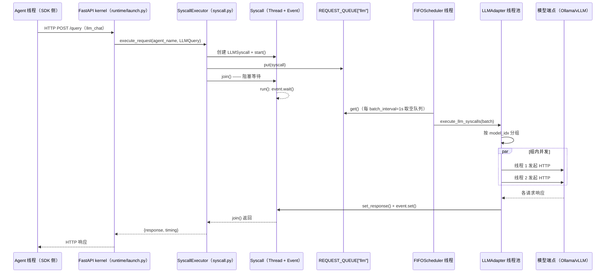
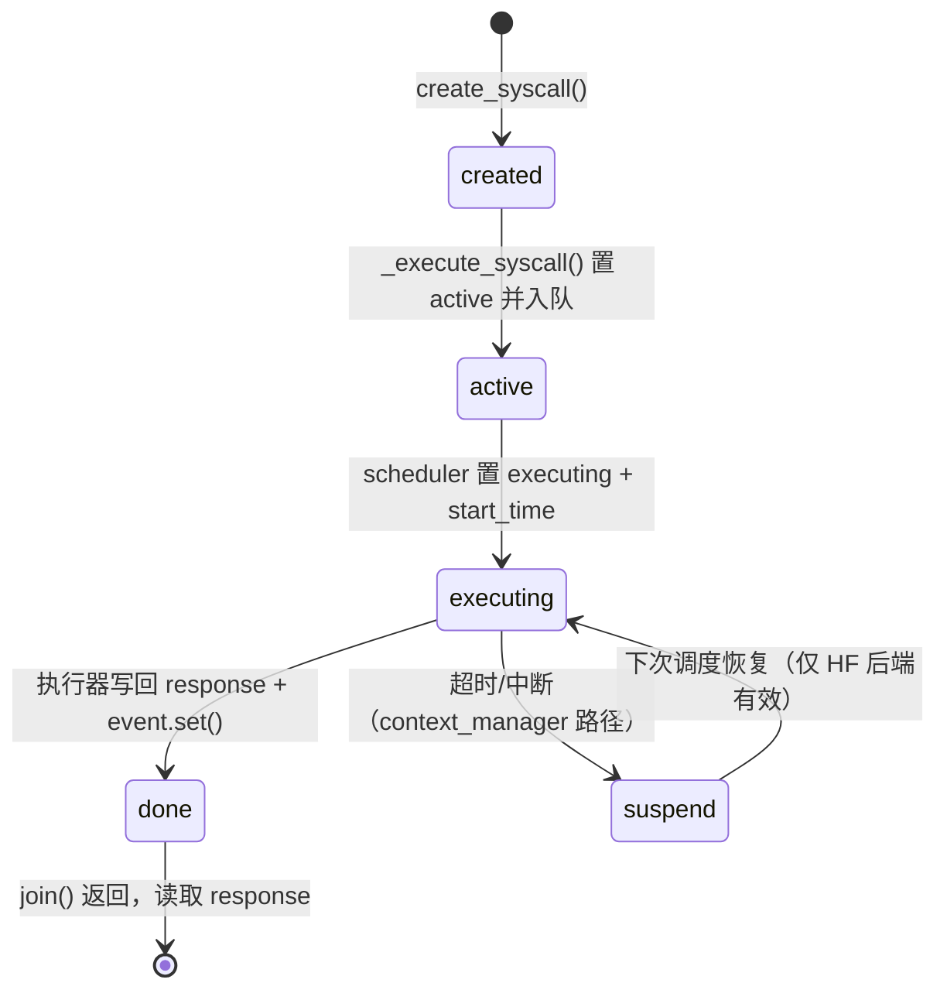
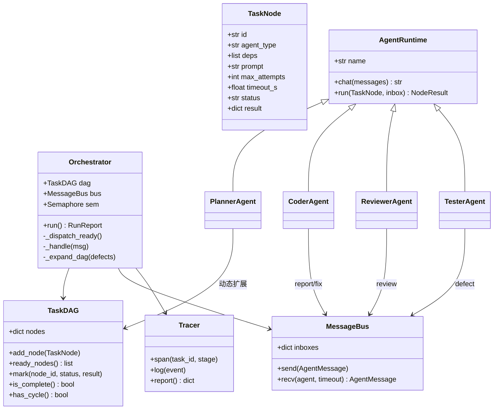
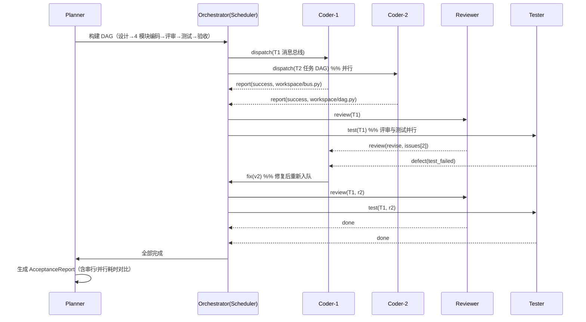

# AIOS 与 OWL 代码库调研与 SDK 实践

> 面向 2026 全国大学生计算机系统能力大赛·操作系统设计赛（中西部与华南区域赛）功能挑战赛道《智能体操作系统中的多智能体协作技术》。本报告面向"4 类智能体 + ≥4 个可并行子任务 + DAG 依赖 + 双向交互"的赛题实现，所有结论均以仓库内真实源码为依据。

| 项目 | 内容 |
|---|---|
| 代码基线 | `vendor/AIOS`（子树合并提交 `f46ce7c…`，上游 `agiresearch/AIOS`）；`vendor/owl`（合并提交 `1794e8a…`，squash 自上游 `5dbabd3`） |
| 调研日期 | 2026-11-17 |
| 调研方法 | 目录遍历 + `grep` 定位 + 逐文件阅读 + `git log` 溯源 + Python 依赖可用性验证 |
| 外部资料 | 两篇 Anthropic Engineering 文章（存档于 `doc/articles/`），仅作二手参考 |
| 过程性笔记 | `build/notes/codebase/`（非交付物） |

## 1. 调研目标、方法与结论边界

本调研要回答四个直接决定赛题方案的问题：**① AIOS 内核到底提供了什么、缺什么；② AIOS-Agent SDK（Cerebrum）该怎么调用；③ 调度器能否真正并行、能否支撑"≥4 并行子任务 + 提速 ≥20%"；④ OWL 有哪些可复用的多智能体设计。** 方法上以源码为准：先列出顶层目录与文件行数，再对 `scheduler`、`llm_core`、`syscall`、`context` 四个关键模块逐函数阅读，最后用官方测试与脚本反推 SDK 的真实调用签名。

有三条**结论边界**必须先说明，否则后续设计会建立在错误假设上：

1. **`vendor/AIOS` 没有 `examples/` 目录。** 赛前材料中"从 examples 找官方示例"的预期不成立。本仓库只有 `aios/`、`aios-rs/`、`docs/`、`install/`、`runtime/`、`scripts/`、`tests/` 七个功能目录。
2. **SDK 不在本仓库。** `README.md` 明确 AIOS 只是 kernel，**AIOS-Agent SDK 是另一个仓库 Cerebrum**（`github.com/agiresearch/Cerebrum`），`requirements.txt` 以 `git+https://github.com/agiresearch/Cerebrum.git` 方式安装。本机未安装该依赖（`import cerebrum` 抛 `ModuleNotFoundError`），因此本报告的 SDK API 均来自仓库内 **import 点、官方脚本与测试** 的反推，凡无法从源码直接证实的签名一律标注"未核实"。
3. **`aios-rs/` 不可作为实现基础。** 其 README 自述为 "early experimental scaffold … NOT feature-parity"，只有 `NoopScheduler`、`EchoLLM` 级别的占位实现。

## 2. 仓库总览

### 2.1 vendor/AIOS 顶层目录与本项目相关性

| 目录 / 文件 | 主要内容 | 与本项目相关性 |
|---|---|---|
| `aios/` | 内核实现：`scheduler/`、`llm_core/`、`syscall/`、`context/`、`memory/`、`storage/`、`tool/`、`hooks/`、`config/`、`terminal/`、`utils/` | **高**：系统调用与调度语义的来源 |
| `runtime/` | `launch.py`（FastAPI 内核服务）、`launch_kernel.sh`、`run_terminal.py` | **高**：HTTP 接口与启动方式 |
| `scripts/` | `launch_vllm.sh`、`launch_sglang.sh`、`run_agent.sh`、`run_terminal.py`、`list_agents.py`、`run_litellm.py` | **高**：模型服务与 SDK 用法线索 |
| `tests/` | `modules/llm/{ollama,openai}/test_single.py`、`test_concurrent.py`、`modules/memory/*`、`storage`、`tool` | **高**：唯一可运行的 API 用法与并发验证样例 |
| `docs/` | `CONTRIBUTE.md`、`SHARED_MEMORY_SYSTEM.md`、`memory-providers.md`、`assets/` | 低：无 SDK tutorial |
| `install/` | `install.sh`：安装到 `~/.aios-1` 并生成 `aios` CLI | 低：面向发行包 |
| `aios-rs/` | Rust 版内核骨架（`context`/`llm`/`memory`/`scheduler`/`storage`/`tool`） | 低：实验性，非 feature parity |
| `README.md`、`requirements.txt`、`requirements-cuda.txt`、`.env.example`、`Dockerfile` | 安装、模型后端、部署模式说明 | 中：环境配置依据 |

`requirements.txt` 共 41 行，关键依赖为 `litellm`、`openai`、`fastapi`、`uvicorn`、`transformers`、`accelerate`、`chromadb`、`qdrant-client`、`fastembed`、`mem0ai>=2.0.0`、`zep-cloud==2.0.0`、`mcp`，以及上文提到的 Cerebrum git 依赖。这一依赖清单说明 AIOS 把"模型接入"外包给 LiteLLM/OpenAI SDK，把"agent 抽象"外包给 Cerebrum，自身专注内核。

### 2.2 vendor/owl 顶层目录与本项目相关性

| 目录 / 文件 | 主要内容 | 与本项目相关性 |
|---|---|---|
| `owl/utils/enhanced_role_playing.py`（530 行） | `OwlRolePlaying`、`OwlGAIARolePlaying`、`run_society` | **高**：双角色协作协议范本 |
| `owl/utils/gaia.py`（366 行） | `GAIABenchmark`：GAIA 下载、加载、评测 | 中：评测思路 |
| `owl/utils/document_toolkit.py`（262 行） | `DocumentProcessingToolkit`：PDF/Word/图片解析 | 中：工具封装范式 |
| `owl/webapp*.py`（1089-1127 行） | Gradio WebUI | 低 |
| `examples/` | `run.py`、`run_vllm.py`、`run_claude.py`、`run_qwen.py` 等 | **高**：Workforce 真实 API 用法 |
| `community_usecase/`、`assets/`、`licenses/`、`.container/` | 社区案例、素材、容器脚本 | 低 |
| `pyproject.toml`、`requirements.txt`、`README*.md` | 依赖与说明 | **高**：确认 Workforce 来源 |

`pyproject.toml` 的关键事实：依赖 `camel-ai[owl]==0.2.84`，Python `>=3.10,<3.13`。也就是说 **OWL 仓库本身不包含 Workforce、Task、Agent、Toolkit 的实现**，这些全部来自 CAMEL 包；OWL 的增量只有双角色增强、GAIA 适配、文档工具与 WebUI。这一点决定了"直接复用 OWL 的 Workforce"实际上等于"引入 camel-ai 0.2.84 全家桶"，依赖较重。

### 2.3 两个仓库在赛题中的定位

把它们放在同一张图里看：**AIOS 是"内核/服务层"（提供 LLM 系统调用、内存、存储、工具与调度），OWL 是"应用层参考实现"（提供 coordinator + worker 的协作范式）**，两者之间缺少的一层——**任务 DAG 编排、并行度控制、超时重试、双向消息总线**——正是本赛题要求我们实现的核心。Cerebrum 只提供 agent 的封装与 SDK，不提供 DAG 调度。因此本项目的技术路线应当是：**用 AIOS kernel 做 LLM/内存/存储后端，用 Cerebrum 的 `llm_chat` 一类 API 作为最小调用面，在应用层自建 DAG 编排器**，OWL/CAMEL 只作为设计参考与快速原型备选。

### 2.4 版本、许可与维护状态

两个仓库都以 `git subtree` 方式整体并入，`vendor/` 内保留原仓库历史（`git log` 可见 squash 合并提交）。AIOS 的 `README.md` 自述版本为 v0.2.2，许可证见仓库根 `LICENSE`；本调研只读源码、不做修改，因此基线是"合并当时的快照"，不随上游更新。OWL 的 `pyproject.toml` 声明 version 0.0.1、`camel-ai[owl]==0.2.84` 钉死依赖版本，`licenses/` 目录单独存放第三方许可。对赛题而言这带来两个直接约束：① 复现时必须固定 Python 版本（AIOS 3.10-3.11，OWL 3.10-3.12）与依赖版本，否则 `camel-ai` 或 `llama_index` 的 API 漂移会让示例直接跑不通；② 上游 README 与代码可能不同步（例如 `install/install.sh` 里的 `runtime.kernel`、OWL README 提到的 `run_mini.py` 在仓库中并不存在），**一切以仓库源码为准，文档只作线索**。

## 3. AIOS 内核模块地图

### 3.1 模块总表

| 模块 | 关键文件（行数） | 职责 | 关键类 / 函数（文件:行号） |
|---|---|---|---|
| `scheduler` | `base.py`、`fifo_scheduler.py`（313）、`rr_scheduler.py`（294） | 4 类系统调用的处理线程、批处理与并发 | `BaseScheduler:base.py:16`、`FIFOScheduler:fifo_scheduler.py:33`、`RRScheduler:rr_scheduler.py:32` |
| `llm_core` | `adapter.py`（1089）、`routing.py`、`local.py` | 多后端 LLM 适配、按模型分组并发执行 | `LLMConfig:adapter.py:33`、`LLMAdapter:adapter.py:60`、`execute_llm_syscalls:adapter.py:433`、`_process_batch_for_model:adapter.py:625`、`execute_llm_syscall:adapter.py:676` |
| `context` | `base.py`、`simple_context.py`（430） | 流式生成与"时间片中断 / context 保存" | `SimpleContextManager:simple_context.py:16`、`generate_with_time_limit_hf:163`、`generate_response_with_interruption:288` |
| `syscall` | `__init__.py`（339）、`syscall.py`（829）、`llm.py`、`memory.py`、`storage.py`、`tool.py` | 系统调用对象、执行器、参数打包与阻塞等待 | `Syscall:__init__.py:6`、`SyscallExecutor:syscall.py:37`、`_execute_syscall:syscall.py:82`、`execute_request:syscall.py:705`、`create_syscall_executor:syscall.py:835` |
| `memory` | `manager.py`（411）、`providers/*`、`write_barrier.py`、`context_injector.py`、`conversation_extractor.py` | 记忆提供方、写屏障、上下文注入、对话抽取 | `MemoryManager:manager.py:24`、`MemoryWriteBarrier:write_barrier.py:47`、`ContextInjector:context_injector.py:23`、`ConversationExtractor:conversation_extractor.py:18` |
| `storage` | `storage.py`、`filesystem/lsfs.py`（388）、`filesystem/vector_db.py` | 语义文件系统（版本化 + 向量检索） | `StorageManager:storage.py:11`、`LSFS:lsfs.py:34`、`ChromaDB:vector_db.py:10`、`QdrantDB:vector_db.py:184` |
| `tool` | `manager.py`、`mcp_server.py`、`virtual_env/*` | MCP 工具子进程、工具调用分发 | `ToolManager:tool/manager.py:15`、`address_request:tool/manager.py:79` |
| `hooks` | `modules/{llm,memory,storage,tool,agent}.py`、`stores/queue.py`、`types/*` | 组件装配（工厂）与请求队列 | `useFactory:modules/agent.py:18`、`REQUEST_QUEUE:stores/queue.py`（未编号） |
| `config` | `config.yaml.example`、`config_manager.py` | 全局配置单例 | `ConfigManager:config_manager.py:5` |
| `terminal` | `intent_router.py` | 终端意图分类（chat / file） | `Intent:13`、`IntentRouter:30`、`build_llm_classify_fn` |
| `utils` | `logger.py`、`compressor.py` | 日志与压缩 | `BaseLogger:13`、`SchedulerLogger:45`、`AgentLogger:64`、`LLMKernelLogger:83` |

### 3.2 模块调用关系

```mermaid
flowchart TD
    SDK["Cerebrum SDK<br/>llm_chat / mount / ..."] -->|HTTP POST /query| API["runtime/launch.py<br/>FastAPI kernel"]
    SDK -->|HTTP POST /agents/submit| Factory["hooks/modules/agent.py<br/>useFactory + AgentManager"]
    API --> SC["syscall/syscall.py<br/>SyscallExecutor.execute_request"]
    Factory -->|ThreadPoolExecutor| SC
    SC -->|创建 LLMSyscall| SQ["syscall/__init__.py<br/>Syscall(Thread) + Event"]
    SQ -->|入队 REQUEST_QUEUE['llm']| Q["hooks/stores/queue.py"]
    Q --> SCH["scheduler/fifo_scheduler.py<br/>process_llm_requests"]
    SCH -->|batch_interval 攒批| LLM["llm_core/adapter.py<br/>execute_llm_syscalls"]
    LLM -->|按 model_idx 分组| POOL["ThreadPoolExecutor<br/>LLMGroupWorker / LLMWorker"]
    POOL --> BE["后端: OpenAI 兼容 / LiteLLM / HfLocal"]
    BE -->|event.set()| SQ
    SQ -->|join 返回| SC
    SC --> MEM["memory/manager.py"]
    SC --> ST["storage/storage.py"]
    SC --> TOOL["tool/manager.py<br/>MCP 子进程"]
```

这张图的核心是**一条"同步阻塞 + 事件唤醒"的链路**：SDK 的每次 `llm_chat` 都是一次 HTTP 请求，内核把它包装成 `Syscall` 线程丢进队列后 `join()` 等待，调度器在另一个线程里攒批、并发执行，完成后 `event.set()` 唤醒调用线程。理解这条链路，就能理解 AIOS 并发的真实边界（详见第 4 节）。

### 3.3 scheduler：四线程 + 批处理

`BaseScheduler`（`aios/scheduler/base.py:16`）在 `__init__`（`:38`）里保存 `llm`、`memory_manager`、`storage_manager`、`tool_manager` 四个执行器与四个 `get_*_syscall` 取队列函数；`start_processing_threads`（`:89`）为每个 processor 起一个 `Thread` 存入 `self.processing_threads`；四个抽象方法 `process_llm_requests`（`:124`）、`process_memory_requests`、`process_storage_requests`、`process_tool_requests` 分别对应四条队列。FIFO 的 `start()`（`fifo_scheduler.py:316` 附近）就是把这四个 processor 交给基类起线程。

`FIFOScheduler`（`fifo_scheduler.py:33`）的关键参数是 `batch_interval: float = 1.0`（`:70`，注意注释里写的是 `Defaults to 0.1`，代码与注释不一致）。`process_llm_requests`（`:206`）是一个 `while self.active` 循环：先 `time.sleep(self.batch_interval)`（`:221`）攒够一个时间窗，再把队列里所有 LLM syscall 取出成 batch，交给 `self.llm.execute_llm_syscalls(batch)`。单条 syscall 的执行在 `_execute_syscall`（`:100`）：置 `executing`、写 `start_time`、调用执行器、写回 `response`，最后 `syscall.event.set()`（`:137`）并置 `done`。

`RRScheduler`（`rr_scheduler.py:32`）本意是时间片轮转：`__init__(*args, time_slice: float = 1, **kwargs)`（`:48`）同时创建 `SimpleContextManager`，`_execute_batch_syscalls`（`:116`）会先 `syscall.set_time_limit(self.time_slice)`（`:137`）。但**它的 LLM 路径存在一个确定的功能缺陷**：`process_llm_requests`（`:164`）里 `llm_syscall = self.get_llm_syscall()` 取出的是**单个 Syscall 对象**，却直接传给 `_execute_batch_syscalls`（`:181`），而后者在第 130 行做 `if not batch`、第 134 行做 `for syscall in batch:`——`Syscall` 继承自 `Thread`，不是可迭代对象，因此 RR 的 LLM 批处理路径会抛 `TypeError`。结论：**RR 调度器在本版本不可用于 LLM 调用；要实现"时间片抢占"必须自行改造。**

### 3.4 llm_core：真正的并发发生在适配器里

`LLMAdapter`（`llm_core/adapter.py:60`）的 `__init__`（`:92`）接收 `llm_configs`、`use_context_manager`、`routing_strategy` 等参数；`:112` 在 `use_context_manager=True` 时创建 `SimpleContextManager()`。`_initialize_single_llm`（`:220`）按 `backend` 分流：`"huggingface"`/`"hflocal"` 走 `HfLocalBackend`；`"vllm"`/`"sglang"` 走 `OpenAI(base_url=config.hostname, api_key=...)`（`:249-252` 附近）；其余（含 `ollama`）走 LiteLLM 的 `"backend/name"` 字符串。这解释了为什么配置里 Ollama 只需写 `hostname: http://localhost:11434`。

真正的并行在 `execute_llm_syscalls`（`:433`）中：先对每个 syscall 的 `query.llms` 做可用性检查（`:471-518`，对不可用的 Ollama 模型会尝试 `_dynamic_register_ollama_model` 动态注册）；再用路由器 `self.router.get_model_idxs(...)`（`:522`）把请求映射到模型，`grouped_tasks` 按 `model_idx` 分组（`:524-531`）；随后用**外层线程池** `ThreadPoolExecutor(max_workers=max_group_workers, thread_name_prefix="LLMGroupWorker")`（`:553`）为每个模型组提交 `_process_batch_for_model`；每个模型组内部再用**内层线程池** `ThreadPoolExecutor(max_workers=len(tasks_with_indices), thread_name_prefix=f"LLMWorker_M{model_idx}")`（`:644`）逐条执行 `execute_llm_syscall`。每个 syscall 完成后置 `done` 并 `event.set()`（`:579`）。**这是真并发**：同一批内的多个 LLM 调用会以多线程方式同时发起 HTTP 请求；不同模型组之间也并发。

### 3.5 syscall、context、memory/storage/tool/config/hooks 的职责

`syscall/__init__.py` 的 `Syscall(Thread)`（`:6`）是整个内核的"进程控制块"：字段包括 `agent_name`、`query`、`event=Event()`、`pid`、`aid`、`status`、`response`、`time_limit`、`created_time`/`start_time`/`end_time`、`source`/`target`/`priority`；它的 `run()`（`:297`）只有一句话——`self.event.wait()`（`:311`）。`syscall/syscall.py` 的 `SyscallExecutor`（`:37`）负责把 query 变成具体的 `LLMSyscall`/`MemorySyscall`/`StorageSyscall`/`ToolSyscall`（`syscall/{llm,memory,storage,tool}.py` 各自 3-6 行，只是标类型），把 syscall 放进对应队列，然后 `syscall.start(); syscall.join()`——**调用方在此同步阻塞**；若返回后 `status != "done"`，则记录时序指标并重建 syscall 重试（`:190-206`）。`create_syscall_executor()`（`:835`）返回三元组 `(execute_request, SyscallWrapper, executor)`，其中 `SyscallWrapper` 暴露 `llm`/`storage`/`memory`/`tool` 四个执行器，`:861` 保留别名 `useSysCall`。

`context/simple_context.py` 的 `SimpleContextManager`（`:16`）是"context switch"的实现处：`generate_with_time_limit_hf`（`:163`）在本地 HF 后端逐 token 生成，超时未完成时把 `{generated_tokens, past_key_values, start_idx, input_length}` 存入 `context_dict[str(pid)]`（`:276-281` 附近），下次取回继续；`generate_response_with_interruption`（`:288`）对远程 API 则是流式接收 + 检查 `time_limit`，超时就 `break`。**前者是真挂起/恢复（保留 KV cache），后者只是"截断 + 记住已生成文本"，并没有真正的继续生成逻辑**（详见 5.2）。

此外，`MemoryManager`（`memory/manager.py:24`）以 `ProviderFactory` 选择 `in-house`/`mem0`/`zep` 三类提供方，并用 `MemoryWriteBarrier`（`write_barrier.py:47`）保证"写后读"一致性；`ContextInjector`（`context_injector.py:23`）与 `ConversationExtractor`（`conversation_extractor.py:18`）在 LLM 调用前后做记忆注入与抽取。`StorageManager`（`storage/storage.py:11`）把请求转给 `LSFS`（`filesystem/lsfs.py:34`）语义文件系统（watchdog 监听 + Chroma/Qdrant 向量库，`vector_db.py:10`/`:184`）。`ToolManager`（`tool/manager.py:15`）在 `__init__` 里用 `subprocess.Popen([sys.executable, mcp_server_script_path])` 拉起 MCP 服务子进程，`address_request`（`:79`）遍历 `syscall.query.tool_calls`，用 `tool_conflict_map` 加锁去重后调用 `AutoTool.from_preloaded(...)`。`ConfigManager`（`config/config_manager.py:5`）是单例，`get_scheduler_config()`（`:232`）只返回 `config["scheduler"]`，而该段在 `config.yaml.example` 里**只有 `log_mode`**——这直接说明 AIOS 没有对外暴露调度并发参数。

### 3.6 内存与存储：共享语义、写屏障与向量检索

`MemoryManager`（`memory/manager.py:24`）在 `__init__`（`:52`）里做三件事：选择 provider（显式参数 > `config.yaml` 的 `memory.provider` > 默认 `in-house`）、通过 `ProviderFactory.create`（`providers/factory.py:16`）实例化、创建 `MemoryWriteBarrier`（`write_barrier.py:47`）写屏障。三类 provider 的定位不同：`InHouseProvider`（`providers/in_house.py:20`）是本地实现（`MemoryNote` + `SimpleEmbeddingRetriever`/`ChromaRetriever`/`QdrantRetriever`，见 `retrievers.py:16`/`:68`/`:134`）；`Mem0Provider`（`providers/mem0.py:30`）对接 mem0 托管/自托管服务，配置里可指定 ollama 的 `nomic-embed-text` 作为 embedder、chroma 作为 vector store；`ZepProvider`（`providers/zep.py:28`）对接 Zep Cloud。配置默认 `auto_extract: false`、`auto_inject: false`，即不自动抽取/注入，需显式调用；一旦开启，`relevance_threshold`（默认 0.5）、`max_injected_memories`（默认 5）、`max_memory_tokens`（默认 1500）共同控制注入预算。

写屏障解决的是"多 agent 并发读写同一份记忆时的可见性"问题：`syscall.py:129-169` 在 **acceptance 阶段** 对写类操作（`add_memory`、`add_agentic_memory`）执行 `mm.barrier.acquire(uid)`，对读类操作（`retrieve_memory`、`retrieve_memory_raw`）执行 `mm.barrier.snapshot(uid)`，从而保证"某 agent 刚写入的记忆，另一 agent 在后续读取时可见"，而不会读到半写状态。`tests/modules/memory/` 下大量以 `*_user_id_*`、`*_cross_user_*`、`*_isolation_*` 命名的测试（如 `test_mem0_cross_user_isolation.py`、`test_context_injector_access_matrix.py`）说明官方在多用户/多 agent 记忆隔离上投入很重——这正是多智能体协作最容易出隐私/串味问题的地方，赛题若做"共享评审历史"，应显式设计 namespace 而不是共用默认用户。

`StorageManager`（`storage/storage.py:11`）把请求转给语义文件系统 `LSFS`（`storage/filesystem/lsfs.py:34`）：`LSFS.__init__(root_dir, use_vector_db=True, max_versions=20)`（`:35`）为每个文件保留最多 20 个版本，`FileChangeHandler`（`:18`）用 watchdog 监听目录变化并增量建索引，`address_request`（`:189`）按操作类型分派，向量后端可选 Chroma（`vector_db.py:10`）或 Qdrant（`vector_db.py:184`）。README 提到 rollback 依赖 redis，说明版本回滚是可选增强而非默认能力。对赛题而言，最实用的用法是：**把 `workspace/` 作为产物目录，代码产物落盘、评审记录写内存/存储，便于演示"产物可追溯"**；不必为了用 LSFS 而把简单文件读写复杂化。

### 3.7 hooks 与配置装配

`aios/hooks/` 是内核的"依赖注入层"，把"用什么 LLM、什么内存、什么存储、什么工具"从硬编码变成工厂装配：`hooks/modules/llm.py` 的 `useCore` 返回 `LLMAdapter`，`useLLMRequestQueue` 创建全局队列；`modules/memory.py`、`storage.py`、`tool.py` 结构完全同构；`modules/agent.py:18` 的 `useFactory` 创建 agent 线程池。`hooks/stores/queue.py` 用全局字典 `REQUEST_QUEUE: dict[str, Queue]` 保存四条队列，`getMessage` 的实现是 `q.get(block=True, timeout=0.1)`——**这意味着调度器取队列是"阻塞式、100ms 粒度"的，与 `batch_interval` 叠加后构成 LLM 请求的实际最小延迟**。

`hooks/types/*.py` 用 pydantic 定义各组件参数，例如 `hooks/types/agent.py:11` 的 `max_workers: int = 500`（默认值很大，`launch.py:281` 实际传 64）、`hooks/types/llm.py:16` 的 `use_context_manager: bool = False`。`runtime/launch.py` 的初始化顺序是 `initialize_llm_cores`（`:167`）→ `initialize_storage_manager`（`:193`）→ `initialize_memory_manager`（`:207`）→ `initialize_tool_manager`（`:219`）→ `initialize_scheduler`（`:237`）→ `initialize_agent_factory`（`:281`）→ `initialize_components`（`:297`）。赛题如果只把 AIOS 当"LLM 服务 + 存储服务"，完全可以只用前两个初始化，跳过 agent factory 与 tool manager，减少启动失败面。

另外有一个**文档与代码不一致**的细节值得记录：`install/install.sh` 生成的 `aios start` 命令执行 `nohup uvicorn runtime.kernel:app --reload`，但仓库内并不存在 `runtime/kernel.py`，真正的 FastAPI 应用在 `runtime/launch.py`。用安装脚本或照抄其命令会导致启动失败，应直接使用 README 的 `uvicorn runtime.launch:app`。

### 3.8 一次 LLM 请求在代码里的完整路径

把"SDK 一次 `llm_chat`"到"内核算完返回"的路径逐跳列出，是判断改造点最有用的地图（箭头方向即调用方向，行号均已核对）：

1. SDK 侧：`cerebrum.llm.apis.llm_chat(...)` 组装 `LLMQuery`（`cerebrum.utils.communication.Query` 的子类，见 `aios/syscall/__init__.py:4` 的导入），通过 HTTP 发往内核。
2. 内核入口：`runtime/launch.py:728` 的 `handle_query` 接收请求，`convert_query_data`（`:129`）把 dict 还原成 `LLMQuery`。
3. 执行器：`aios/syscall/syscall.py:705` 的 `SyscallExecutor.execute_request` 按 `action_type` 分派；`chat` 走 `context_injector.inject` → `execute_llm_syscall` → `conversation_extractor.extract_async`（异步抽取，不阻塞响应）。
4. 系统调用对象：`execute_llm_syscall` 内部构造 `LLMSyscall`（`aios/syscall/llm.py:3`，继承 `Syscall(Thread)`），`_execute_syscall`（`syscall.py:82`）把状态置为 `active`、记录 `created_time`、写入 `source`。
5. 入队：`_execute_syscall` 调 `global_llm_req_queue_add_message`（`hooks/stores/queue.py`）把 syscall 放进全局队列。
6. 调度：`FIFOScheduler.process_llm_requests`（`fifo_scheduler.py:206`）在 `while self.active` 循环里 `time.sleep(batch_interval)`（`:221`）后 drain 队列，整批交给适配器。
7. 适配器：`LLMAdapter.execute_llm_syscalls`（`adapter.py:433`）做可用性检查、按 `model_idx` 分组（`:524-531`），外层线程池（`:553`）每个模型一个线程，内层线程池（`:644`）每个请求一个线程，真正发出 HTTP。
8. 回填：每个 syscall 完成时 `set_status` → `set_response` → `event.set()`（`fifo_scheduler.py:137` / `adapter.py:569-579`）。
9. 唤醒：客户端侧 `Syscall.join()`（`syscall.py:185-186`）因 `event` 被 set 而返回，读取 `get_response()`，整个 HTTP 调用才结束。

这条链上有三个"可插拔点"值得记：**队列**（第 5 步，可换成带优先级的队列实现依赖优先）、**分组策略**（第 7 步，`router.get_model_idxs` 可自定义把 Planner 路由到大模型、Coder 路由到小模型）、**event/状态**（第 8 步，可在此加计时与 trace）。其余部分改动成本高、收益低，不建议动。

需要标注不确定性的地方：第 1 步与第 9 步之间 HTTP 响应体的确切封装（`LLMResponse` 如何序列化成 `{"response": ...}`）依赖 Cerebrum 源码，本仓库不可见，标注**未核实**；但官方测试按 `resp["response"]["response_message"]` 取值，说明至少这层结构是稳定的。

### 3.9 内核启动成本与失败模式

`initialize_components`（`runtime/launch.py:297`）会把全部子系统建起来：LLM 适配器要为每个配置的模型建客户端（HuggingFace 后端还会加载权重）、内存管理器要初始化 provider 与向量库、工具管理器要拉起 MCP 子进程、调度器要起四个常驻线程。这意味着**启动慢、启动失败点多**，且失败往往是"部分初始化成功"，表现为某些请求 500 而不是进程挂掉。把已知失败点列成表，能在联调时快速定位：

| 现象 | 可能原因 | 排查位置 |
|---|---|---|
| `/core/status` 一直未初始化 | 某个模型 backend 字符串写错 / API key 缺失 | `adapter.py:220-285` 的 `_initialize_single_llm`，失败会被跳过 |
| 请求返回 `status_code=500` | 请求里指定的模型名不在 `available_llm_names` | `adapter.py:510-515` 的可用性检查 |
| Ollama 请求 404 / 模型不存在 | 模型名与 `ollama list` 不一致（如 `qwen2.5:7b` vs `qwen2.5:7b-instruct`） | `config.yaml` 的 `llm_name` |
| 启动即崩溃 | `use_context_manager: true` → 选中 RR 调度器 | `launch.py:237`，改回 false |
| 工具调用报错 | MCP 子进程未起来 / 脚本路径错 | `tool/manager.py:26-50` 的 `_start_mcp_server` |

一个实用技巧：先用"最小配置"（只配一个 Ollama 模型、关掉内存与工具）把内核跑起来，再逐项打开，这样每个失败点都能单独暴露。启动成功后也应先做一次"内核直连"的 curl/脚本验证，再进入 SDK 层，否则很容易把 SDK 的协议问题误判成内核问题。

## 4. 调度器与并发能力评估：能不能支撑"≥4 并行子任务 + 提速 ≥20%"

### 4.1 一次 LLM 调用的完整时序



### 4.2 并发上限到底由谁决定

| 配置 / 机制 | 是否存在 | 证据 | 对并发的实际影响 |
|---|---|---|---|
| `scheduler.batch_interval` | 代码有，yaml 无 | `fifo_scheduler.py:70`（默认 1.0s） | 固定 1s 攒批延迟；批越大吞吐越高但首字节越慢 |
| `scheduler` 并发上限 | **不存在** | `config_manager.py:232`、`config.yaml.example` 的 `scheduler` 段仅 `log_mode` | 无法通过配置限制 kernel 内并发 |
| `agent_factory.max_workers` | 存在（默认 500，launch 传 64） | `hooks/types/agent.py:11`、`runtime/launch.py:281`、`hooks/modules/agent.py:18` | 限制的是"同时运行的 agent 数"，不是"同时发出的 LLM 请求数" |
| 批内模型组并发 | 存在 | `adapter.py:546`、`:553` | 不同模型组并行 |
| 组内请求并发 | 存在 | `adapter.py:641-644` | 同组请求每条一个线程，真并发 HTTP |
| `use_context_manager` | 存在（布尔） | `runtime/launch.py:237-268`、`adapter.py:112` | 开启后切换到 RR 调度器，而 RR 的 LLM 路径有缺陷（见 4.4） |

### 4.3 并发收益的定量推演

在 batch 内并行的模型下，设一批有 N 条 LLM 请求、单请求平均延迟为 L、批窗口为 B，则近似有：

- **串行**：`T_serial ≈ N × L`
- **AIOS 批处理**：`T_parallel ≈ B + max(L_i) ≈ 1.0 + L`
- 理想加速比（不计 1s 窗口抖动）`S ≈ N·L / (1 + L)`。

以 7B 模型、Ollama 单请求 1.5-3s 估算，N=4 时 `S ≈ 2.4-2.6`；N=4 且把 `batch_interval` 调到 0.1s 时 `S ≈ 3.1-3.4`。**理论上足以满足"提速 ≥20%"**。但要注意三点：① 以上为源码推演估算，不是实测值，必须在目标机器上跑基线；② 提速的分母是"每次都完整串行往返 HTTP"的基线，若串行实现本身复用了连接、开销很低，加速比会下降；③ 只有**同一时间窗内到达**的请求才享受批内并发，如果编排器是"发一个等一个"，AIOS 的批处理完全帮不上忙——**因此并行度必须由应用层 DAG 编排器先做出来**。

### 4.4 两个必须绕开的坑

**坑一：`use_context_manager: true` 会让 LLM 调用崩溃。** `runtime/launch.py:237-268` 的判断逻辑是：`use_context_manager` 为真则实例化 `RRScheduler`，否则 `FIFOScheduler`。而 3.3 已指出 RR 的 `process_llm_requests`（`rr_scheduler.py:164`）把单个 syscall 传给按列表迭代的 `_execute_batch_syscalls`（`:181`），第 134 行的 `for syscall in batch:` 会抛 `TypeError`。因此**赛题环境应保持 `use_context_manager: false`（默认值），走 FIFO 调度器**；若确需时间片/上下文保存能力，应自行在应用层实现，而不是打开这个开关。

**坑二：本地 Ollama 模型名必须在配置中声明，否则首次调用会动态注册失败。** `adapter.py:484-507` 对"不在 `available_llm_names` 中且 backend 为 ollama"的模型会调用 `_dynamic_register_ollama_model` 尝试注册，再复查可用性；若仍不可用则直接给该 syscall 返回 `status_code=500` 的错误响应。因此模型名（如 `qwen2.5:7b`）必须与 `config.yaml` 的 `llms.models[].name` 或本地 Ollama 的 `ollama list` 完全一致，任何拼写差异都会表现为"LLM 调用失败"而非明确的配置错误。

### 4.5 结论

AIOS 内核的并发是**真实的、请求级的**：同一批内的多个 LLM 调用会以多线程并发发出，足以作为"≥4 并行子任务"的执行底座。但它**不提供任务级调度、不提供并发上限配置、不提供 DAG 依赖感知**，且 RR 调度器在 LLM 路径上不可用。因此赛题方案的正确分工是：**AIOS kernel 负责单次 LLM 调用与存储/记忆；编排器负责 DAG、并发信号量、依赖等待、重试与汇聚。**

### 4.6 建议的实测方案（答辩前必须做）

推演不能替代实测。建议按以下顺序做三组实验，每组跑 3 次取中位数，且先 warmup：① **单请求延迟** L：串行发 1 条请求 5 次，记录 P50；② **串行 4 子任务** T_serial：串行跑 4 条不同 prompt，记录总时长；③ **并发 4 子任务** T_parallel：4 线程同时发，记录总时长。加速比 S = T_serial / T_parallel，并用 4.3 的模型 S ≈ N·L/(L+d) 反推批延迟 d 是否与 `batch_interval=1.0s` 吻合。若 S 明显低于 1.2，优先检查三件事：模型服务是否单并发（Ollama 默认并发度较低，需在服务端调 `OLLAMA_NUM_PARALLEL`，该行为未在本仓库验证）、`config.yaml` 里是否误开了 `use_context_manager`、以及是否每次请求都新建连接（SDK 每次 `llm_chat` 都是一次新 HTTP 请求，连接复用依赖底层实现）。这三项任一命中，都会让"并行"退化成排队。

另外要警惕**测量口径**：串行基线若包含模型冷启动或首次编译，会被严重高估，加速比虚高；正确做法是先 warmup 一次、丢弃首轮，再开始计时。答辩材料里应同时给出绝对耗时（秒）与加速比，并说明测量方法，这比只报一个漂亮的百分比更可信。

## 5. 系统调用语义与 context switch 真实度

### 5.1 Syscall 的状态机

`Syscall` 的状态字段是字符串，语义上可归纳为下图（状态值散落在 `syscall.py` 与两个 scheduler 的赋值语句中，未集中定义，属"隐式状态机"）：



### 5.2 "挂起 / 恢复"到底恢复什么

`Syscall.run()` 只是 `event.wait()`（`syscall/__init__.py:311`），真正的"挂起"发生在 **LLM 流式生成**过程中，由 `SimpleContextManager` 管理：

| 后端类型 | 保存内容 | 能否真正续写 | 证据 |
|---|---|---|---|
| HuggingFace 本地（`HfLocalBackend`） | `generated_tokens`、`past_key_values`、`start_idx`、`input_length` 存入 `context_dict[str(pid)]` | **能**：下次从 KV cache 继续逐 token 生成 | `simple_context.py:163-285`，保存点约 `:276-281` |
| OpenAI 兼容（vLLM/SGLang/Ollama） | 已生成的**字符串** | **不能**：恢复时只是取回文本，没有继续生成的代码路径 | `simple_context.py:288-407` |
| LiteLLM（Ollama 的默认路径） | 同上（流式截断） | **不能** | 同上 |

结论非常关键：**AIOS 文献意义上的"context switch / 抢占"只在本地 HF 后端成立**。对于赛题必然使用的 7B/8B 远程服务（vLLM/Ollama），所谓 time slice 只是"到点停止接收、把半截文本存起来"，既不能真正续写，也不能中断已经发出的阻塞 HTTP 请求。因此：

1. 不要指望通过 AIOS 的 time slice 实现"公平调度"或"抢占式多任务"；
2. agent 侧的并行必须靠**应用层并发发起多个 `llm_chat`**（多线程或 asyncio.to_thread），由 kernel 的批处理接住；
3. 超时控制必须自己做：在编排器里给每个子任务设 wall-clock 超时，超时后标记失败并进入重试/降级，而不是等 kernel 的 `time_limit`。

### 5.3 对赛题的直接含义

赛题要求"任务可分解为 ≥4 个可并行子任务并自动分配"。AIOS 提供的是"单次调用级别的并发"，**任务级并行 = 应用层 DAG 调度器 × kernel 请求级并发**。这与 Anthropic 多智能体研究系统的经验一致：真正的并行收益来自"同时派出多个 subagent"，而不是底层框架的线程池；框架只决定单个请求多快返回。

### 5.4 Syscall 计时字段与可观测性

`Syscall` 对象自带 `created_time`、`start_time`、`end_time` 与 `status`（`aios/syscall/__init__.py:26-61`），`_execute_syscall` 在完成后把它们连同 `waiting_time`（start−created）与 `turnaround_time`（end−created）打包返回（`syscall.py:190-206` 区域）；若状态不是 `done`，执行器会记录本次计时并重新构造 syscall 重试。这意味着**内核层面已经能给出"排队时间 vs 执行时间"的拆分**，对答辩很有用：可以证明"4 路并行的总耗时接近单请求延迟，而不是 4 倍排队"，从而说明并发不是假的。

但要注意两点：① 这些计时只在 syscall 成功返回的路径上稳定，失败/重试路径的字段可能不完整；② 计时是进程内 wall-clock，含 HTTP 序列化与客户端等待，做对比实验时应统一口径（都取同一层级的计时）。建议在应用层再埋一层：每个子任务记录 `queued_at / started_at / finished_at / attempts / tokens`，输出 `metrics.json`，这比依赖框架字段更可控，也方便画甘特图。

## 6. AIOS-Agent SDK（Cerebrum）用法与最小可运行骨架

### 6.1 安装

`requirements.txt` 中以 `git+https://github.com/agiresearch/Cerebrum.git` 安装；README 也给出"手动 clone + `pip install -e .`"的方式。安装后 `import cerebrum` 成功，才可以使用 `cerebrum.llm.apis`、`cerebrum.storage.apis`、`cerebrum.manager.agent` 等模块。本机当前**未安装**（`ModuleNotFoundError: No module named 'cerebrum'`），这也是本项目环境搭建阶段的第一优先级任务。

### 6.2 最小可运行骨架（基于官方测试与脚本的真实调用）

以下骨架的每一行 API 都能在仓库内找到出处：`tests/modules/llm/ollama/test_single.py`（`llm_chat` / `llm_chat_with_json_output` 的完整参数与返回结构）、`scripts/run_terminal.py`（`llm_operate_file`、`mount`、返回值解析）、`tests/modules/llm/ollama/test_concurrent.py`（并发调用方式）。

```python
# ============ 1) kernel 侧（Linux + Python 3.10/3.11） ============
# 配置 aios/config/config.yaml：llms.models 中声明本地模型
#   - name: qwen2.5:7b
#     backend: ollama
#     hostname: http://localhost:11434
# 启动：bash runtime/launch_kernel.sh
#   或：python3.11 -m uvicorn runtime.launch:app --host 0.0.0.0 --port 8000

# ============ 2) agent 侧（SDK） ============
from cerebrum.llm.apis import llm_chat, llm_chat_with_json_output
from cerebrum.utils.communication import aios_kernel_url

resp = llm_chat(
    agent_name="planner",                       # 逻辑 agent 名，内核按名记账
    messages=[{"role": "user", "content": "把任务拆成 4 个可并行子任务"}],
    base_url=aios_kernel_url,                   # 默认指向本地 kernel
    llms=[{"name": "qwen2.5:7b", "backend": "ollama"}],  # 可省略：用 config 默认
)
text = resp["response"].get("response_message", "")   # 官方测试的取值方式
assert resp["status_code"] == 200

# 结构化输出（JSON Schema）
schema = {"type": "json_schema",
          "json_schema": {"name": "plan", "schema": {
              "type": "object",
              "properties": {"subtasks": {"type": "array", "items": {"type": "string"}}},
              "required": ["subtasks"]}}}
resp2 = llm_chat_with_json_output(
    agent_name="planner", messages=[...],
    base_url=aios_kernel_url, response_format=schema,
)
```

并发调用在官方测试中的写法就是 **Python 多线程 + 每线程一次 `llm_chat`**（`test_concurrent.py` 用 4 个 `threading.Thread`，断言每个响应 `status_code == 200`、`finished is True`）。这从侧面确认：**AIOS 的并发模型是"客户端并发请求 + 内核批处理"**，而不是"提交一个任务图让内核调度"。

#### 6.2.1 用官方方式验证并发与计时

下面这段脚本可直接用来测"4 路并发 vs 串行"的 wall-clock 差异（API 与返回结构同 `test_concurrent.py`），也是第 8.8 节加速比测量的客户端原型：

```python
import threading, time
from cerebrum.llm.apis import llm_chat
from cerebrum.utils.communication import aios_kernel_url

QUESTIONS = ["模块 A 的接口应该怎样设计？", "为模块 B 写三条边界测试。",
             "消息总线的并发风险有哪些？", "如何验证 DAG 无环？"]

def worker(q, out, idx):
    t0 = time.perf_counter()
    resp = llm_chat(agent_name=f"agent_{idx}",
                    messages=[{"role": "user", "content": q}],
                    base_url=aios_kernel_url,
                    llms=[{"name": "qwen2.5:7b", "backend": "ollama"}])
    out[idx] = (resp.get("status_code"), time.perf_counter() - t0)

def run(parallel: bool):
    out = [None] * len(QUESTIONS)
    t0 = time.perf_counter()
    if parallel:
        ts = [threading.Thread(target=worker, args=(q, out, i))
              for i, q in enumerate(QUESTIONS)]
        for t in ts: t.start()
        for t in ts: t.join()
    else:
        for i, q in enumerate(QUESTIONS):
            worker(q, out, i)
    print("parallel" if parallel else "serial",
          "wall=%.2fs" % (time.perf_counter() - t0), out)

run(False)   # 串行基线
run(True)    # 并发（内核批处理 + 线程池）
```

注意：一定要先 warmup 一次（首请求含模型加载与连接建立），否则串行基线会被冷启动严重高估，导致加速比虚高。

### 6.3 自定义 agent 的两条路径

**路径 A（SDK 原生，依赖 agent hub）：** 通过 `cerebrum.manager.agent.AgentManager` 下载/加载 `.agent` 包，再由 `useFactory` 的线程池运行。`aios/hooks/modules/agent.py:18` 的 `useFactory` 创建 `ThreadPoolExecutor(max_workers=params.max_workers)` 与 `AgentManager('https://app.aios.foundation')`；`run_agent` 内部依次 `manager.download_agent(author, name)` → `manager.load_agent(...)` → `agent_class(agent_name)` → `agent.run(task)`；kernel 的 `POST /agents/submit`（`runtime/launch.py:601`）接收 `AgentSubmitDeclaration`（`hooks/types/agent.py:14`）并返回 6 位 process_id。**该路径依赖外网 agent hub，且 agent 包格式不在本仓库内，赛题不建议作为主路径。**

**路径 B（推荐）：自写 Python agent 类 + 直接 `llm_chat`。** 每个 agent 就是一个普通类，内部维护 `messages` 历史，`run(task)` 里调用若干次 `llm_chat`/工具函数，返回结构化结果。好处是完全可控、可注入 DAG 上下文、可在本地调试，且不依赖 agent hub；坏处是失去 SDK 的 agent 生命周期管理——但赛题需要的恰恰是可控的编排。

```python
class AgentRuntime:
    def __init__(self, name: str, system_prompt: str):
        self.name, self.system_prompt = name, system_prompt
        self.history = [{"role": "system", "content": system_prompt}]

    def chat(self, content: str) -> str:
        self.history.append({"role": "user", "content": content})
        resp = llm_chat(agent_name=self.name, messages=self.history,
                        base_url=aios_kernel_url)
        msg = resp["response"].get("response_message", "")
        self.history.append({"role": "assistant", "content": msg})
        return msg
```

### 6.4 工具注册与工具调用

AIOS 的工具链是 **MCP 子进程 + Cerebrum AutoTool**：`ToolManager.__init__`（`tool/manager.py:16`）默认启动 `aios/tool/mcp_server.py` 子进程；`address_request`（`:79`）根据 `tool_calls` 里的 `tool_org_and_name` 调用 `AutoTool.from_preloaded(...)` 得到工具实例并 `tool.run(params=tool_params)`。因此有三条可选路线：

1. **最稳（赛题推荐）**：把工具写成普通 Python 函数，在 agent 的 `run()` 里直接调用，不经过 AIOS 工具链——零额外依赖，参数与返回值完全可控。
2. **复用 AIOS 工具生态**：在 `config.yaml` 的 `tool.mcp_server_script_path` 指向的 MCP server 中注册工具，再由 `llm_chat` 的 tool-call 流程触发；具体注册 API 属于 Cerebrum/MCP 侧，**本仓库无法核实**。
3. **复用 OWL/CAMEL 的 `FunctionTool`**：`FunctionTool(fn)` + `ChatAgent(tools=[...])`（见 7.3），但会把 camel 依赖引入 AIOS 体系，二者模型层重复，不建议混用。

### 6.5 直接调用系统调用（绕过 SDK）

若不想依赖 Cerebrum 的高层 API，可以直接使用内核自带的执行器（`syscall.py:705` 的 docstring 即官方示例）：

```python
from aios.syscall.syscall import create_syscall_executor
from cerebrum.llm.apis import LLMQuery     # query 类型来自 Cerebrum（未安装则不可用）

execute_request, wrapper, executor = create_syscall_executor()
result = execute_request("agent_1", LLMQuery(
    messages=[{"role": "user", "content": "Hello"}], action_type="chat"))
```

注意：`LLMQuery` 等 query 类型本身来自 `cerebrum`（`aios/syscall/syscall.py:30-33`），所以这条路径**仍然依赖 SDK**，只是省掉了 HTTP 一层；在 kernel 进程内调用时可用，跨进程仍应走 `llm_chat`。

### 6.6 配置本地 7B/8B OpenAI 兼容端点

| 后端 | `config.yaml` 写法 | 启动方式 | 适配代码位置 |
|---|---|---|---|
| Ollama | `backend: ollama`、`hostname: http://localhost:11434` | `ollama serve` + `ollama pull qwen2.5:7b` | 走 LiteLLM `"ollama/qwen2.5:7b"`（`adapter.py:277-281` 附近） |
| vLLM | `backend: vllm`、`hostname: http://localhost:8091/v1` | `scripts/launch_vllm.sh` 或 `vllm serve <model> --port 8091` | 走 `OpenAI(base_url=hostname, api_key=...或 "sk-placeholder")`（`adapter.py:249-252` 附近） |
| SGLang | `backend: sglang`、`hostname: http://<host>:<port>/v1` | `scripts/launch_sglang.sh` | 同 vLLM 分支 |
| HuggingFace 本地 | `backend: huggingface`、`max_gpu_memory: {0: "24GB"}`、`eval_device: cuda:0` | 无需外部服务 | `HfLocalBackend`（`llm_core/local.py:8`） |

对赛题的推荐是 **vLLM（Linux + GPU）或 Ollama（CPU/低显存）**：vLLM 的 continuous batching 更适合"同一批多请求"的负载，与 AIOS 的批处理天然契合；Ollama 部署最简、适合开发期。API key 在 vLLM/SGLang 场景可填占位符（代码里默认 `"sk-placeholder"`）。

### 6.7 SDK 使用的已知坑

| 坑 | 表现 | 规避 |
|---|---|---|
| Cerebrum 未安装 | `import cerebrum` 失败，所有 API 不可用 | 环境搭建第一步安装；锁定 commit，避免上游 API 漂移 |
| `llm_chat` 返回值结构 | 返回 `{"response": <LLMResponse 或 dict>, "status_code", ...}`，不同后端下 `response` 可能是对象或 dict | 按官方脚本的三段式解析：dict 取 `response_message`、对象取属性、否则 `str()` |
| agent hub 依赖外网 | `AgentManager('https://app.aios.foundation')` 需要联网下载 `.agent` | 用路径 B 自写 agent，不依赖 hub |
| 模型名不一致 | 动态注册失败后返回 500 | 名称与 `config.yaml` / `ollama list` 严格一致 |
| kernel 未启动 | `llm_chat` 连接被拒 | 先 `curl /core/status` 探活；启动脚本见 6.6 |

### 6.8 从零跑通的 30 分钟接入清单

按下面顺序做，能把"环境问题"与"协议问题"分开定位：

1. 起模型服务：Ollama `ollama serve && ollama pull qwen2.5:7b`（CPU 可先用 `qwen3:1.7b` 验证链路）；或 vLLM `vllm serve <model> --port 8091`（仅 Linux + GPU）。
2. 装内核依赖：Python 3.10/3.11，`uv pip install -r requirements.txt`（会从 git 拉 Cerebrum）；若网络受限，先本地 `pip install -e` Cerebrum 再装其余依赖。
3. 写 `aios/config/config.yaml`：只保留一个模型（`backend: ollama` 或 `vllm` + `hostname`），`use_context_manager: false`，`llm_name` 与 `ollama list` 里完全一致。
4. 起内核：`uvicorn runtime.launch:app --host 0.0.0.0 --port 8000`，看 `/core/status`（`launch.py:420`）是否已初始化。
5. 客户端冒烟：照 `tests/modules/llm/ollama/test_single.py` 发起一次 `llm_chat`，确认能拿到 `response_message`。
6. 并发冒烟：跑 `test_concurrent.py`，确认 4 线程都 200；若失败先查模型服务并发设置。
7. 再接自己的编排器：把 `agent_runtime.py` 的 `_call_llm` 指向第 5 步验证过的调用，先串行跑通，再开并行。

每一步都用最小脚本验证，避免"一次装完再 debug"——AIOS 的启动失败常常是配置里一个模型名或一个 backend 字符串写错，报错却落在很深的初始化栈里，先分步验证能省下大量时间。

## 7. OWL 架构与可复用点

### 7.1 单 agent 模式：双角色协议

`owl/utils/enhanced_role_playing.py` 的 `OwlRolePlaying(RolePlaying)`（`:31`）继承 CAMEL 的 `RolePlaying`，构造 user/assistant 一对角色：user 按 `Instruction:` 逐步下指令，assistant 以 `Solution:` 回应，完成时输出 `<TASK_DONE>`。`_construct_gaia_sys_msgs`（`:182`）为两个角色生成 GAIA 风格系统提示（"Never flip roles"、先调工具再回答、交叉验证等）；`step`（`:255`）在每轮把 `<auxiliary_information>{task_prompt}</auxiliary_information>` 注入给 user、把"请给出下一条指令"注入给 assistant；`OwlGAIARolePlaying`（`:394`）进一步要求最终输出 `<analysis>` 与 `<final_answer>`。`run_society`（`:481`）以 `round_limit=15` 为上限循环，累计 token 与工具调用历史，终止条件为 `terminated or "TASK_DONE" in user_response.msg.content`。

这套协议的工程价值在于：**它把"多轮双向交互"编码成了明确的消息角色与终止标记**，可直接迁移为赛题中 Planner↔Coder、Reviewer↔Coder 的对话骨架（把 `Instruction:`/`Solution:`/`TASK_DONE` 替换为自定义消息类型即可）。

#### 7.1.1 `run_society` 的运行循环与统计口径

`run_society(society, round_limit=15)`（`owl/utils/enhanced_role_playing.py:481`）的实现顺序是：`society.init_chat(init_prompt)` 初始化对话 → 循环调用 `society.step(assistant_msg)`，每步拿到 `user_response` 与 `assistant_response` → 把 assistant 的工具调用 `tool_calls.as_dict()` 追加到 `chat_history` → 累计 usage（prompt/completion/total tokens）→ 检查终止条件 `terminated or "TASK_DONE" in user_response.msg.content`。异步版 `arun_society` 额外兼容中文终止词"任务已完成"，并在代码里存在一个统计缺陷：约 `:500` 之后把 completion tokens 重复累加进 prompt 计数，导致输出的 token 统计不可直接采信。这提醒我们：**演示与评测的耗时/token 统计必须自己埋点，不能依赖框架自报**；同时"`round_limit` 上限 + 显式完成标记"这套双保险非常值得照搬，能避免 agent 之间无限来回。

### 7.2 多 agent 模式：Workforce

Workforce 的实现**不在 owl 仓库**，而在 camel-ai 0.2.84。`owl/examples/run.py` 给出真实用法：

```python
from camel.agents import ChatAgent
from camel.models import ModelFactory
from camel.tasks.task import Task
from camel.societies import Workforce
from camel.types import ModelPlatformType, ModelType
from camel.toolkits import FunctionTool, SearchToolkit, CodeExecutionToolkit

model = ModelFactory.create(model_platform=ModelPlatformType.OPENAI,
                            model_type=ModelType.GPT_5_2,
                            model_config_dict={"temperature": 0})
worker = ChatAgent("You are a coder.", model,
                   tools=[FunctionTool(my_fn), *CodeExecutionToolkit().get_tools()])
workforce = Workforce("Workforce",
                      task_agent=ChatAgent("You are the task planner.", model),
                      coordinator_agent=ChatAgent("You are the coordinator.", model))
workforce.add_single_agent_worker("负责实现模块 A", worker=worker)
task = Task(content="实现一个多智能体演示程序")
processed = workforce.process_task(task)
print(processed.result)
```

本地 OpenAI 兼容端点（`owl/examples/run_vllm.py`）：`ModelFactory.create(model_platform=ModelPlatformType.OPENAI_COMPATIBLE_MODEL, model_type=model_name, url="http://localhost:8000/v1", api_key=..., model_config_dict={"temperature": 0})`，配合 `python -m vllm.entrypoints.openai.api_server --model <model> --port 8000`。这是 OWL 侧最可直接复用的"7B/8B 本地模型接入"写法。

Workforce 的任务分解与 worker 分配逻辑在 camel 包内部，**本仓库无法核实其是否感知 DAG 依赖、是否有并发上限与超时**；从 `add_single_agent_worker(description, worker)` 的签名看，它更接近"角色 + 描述"的静态分配，而不是显式依赖图调度。

### 7.3 与 AIOS 的异同

| 维度 | AIOS（kernel） | OWL / CAMEL |
|---|---|---|
| 定位 | LLM Agent 操作系统内核：系统调用、调度、内存、存储、工具 | 应用层多智能体框架：Workforce、角色扮演、工具包、评测 |
| 抽象单位 | Syscall（LLM/Memory/Storage/Tool）+ agent 声明 | ChatAgent、Task、Workforce（coordinator + workers） |
| 并发模型 | 请求级批处理 + 线程池 | coordinator 分配任务给 worker（实现细节在 camel 内，未核实） |
| 依赖 | 轻（LiteLLM/OpenAI + 可选向量库） | 重（camel-ai[owl] 全家桶 + 浏览器/文档/搜索等工具） |
| 部署 | Linux + FastAPI kernel 服务 | 单机 Python 进程 / Gradio |
| 与赛题契合点 | 提供 LLM 服务、记忆、存储、日志 | 提供双角色协议、coordinator/worker 范式、评测思路 |
| 缺口 | **无 DAG、无任务级调度、无并发配置** | **无显式 DAG 依赖、无系统调用级资源管理** |

### 7.4 可复用点清单

1. **双角色消息协议**（`OwlRolePlaying`）：把双向交互形式化为 `Instruction/Solution/TASK_DONE` + 辅助上下文注入，直接用于 Reviewer↔Coder 的评审-修复循环。
2. **终止条件设计**：`TASK_DONE` 显式标记 + `round_limit` 上限，避免 agent 无限对话——赛题的每个子任务都应带最大轮次与超时。
3. **coordinator + worker 分层**：与 Anthropic 的 orchestrator-workers 同构，可作为 Planner 与执行 agent 的职责边界参考。
4. **`DocumentProcessingToolkit` 的工具封装范式**：`@retry_on_error`、统一 `(bool, str)` 返回、按文件类型路由——可借鉴到赛题的工具层。
5. **vLLM OpenAI 兼容端点写法**（`run_vllm.py`）：`OPENAI_COMPATIBLE_MODEL` + `url` 参数，是本地 7B/8B 接入的标准姿势。

### 7.5 双角色协议的局限与取舍

`OwlRolePlaying` 把"用户—助手"两角色写死在 `step` 里（`enhanced_role_playing.py:255`），并通过注入 `<auxiliary_information>` 把任务提示每轮塞回对话。这个设计对"一个任务、两方协作"很有效，但对赛题要求的"≥3 对不同类型智能体双向交互"是不够的：它只有一条对话通道，无法表达"Planner 同时与 Coder/Reviewer/Tester 对话"的星形结构，也无法表达 Coder 与 Reviewer 之间的并行往返。因此正确的复用方式是**借用协议、不借用 society**：把 `Instruction:`/`Solution:`/`TASK_DONE` 换成自定义的 `TASK/PLAN/PATCH/REVIEW/TEST_RESULT/FINAL` 消息类型，用消息总线承载多对多通信，用 `round_limit` 式的双保险防止死循环。这样既保留了"显式指令 + 显式完成标记"的稳定性，又拿到了多 agent 拓扑的自由度。

## 8. 4 智能体 + ≥4 并行子任务 + DAG 依赖的最小可行架构

### 8.1 任务场景与角色论证

**自拟任务**：给定一份"迷你多智能体运行时"的模块级需求（含 4 个模块：消息总线、任务 DAG、agent 基类、评测脚本），由多智能体系统自动完成实现、评审、测试与验收，最终产出可运行代码与验收报告。选择该任务的理由：① 它天然可拆成 4 个以上相互独立、可并行的模块级子任务；② 验收标准客观（代码可运行、pytest 通过），便于证明"正确完成"；③ 需要多角色多轮双向交互（评审-修复、缺陷-回修）；④ 主题与"智能体操作系统"赛题自洽，答辩时容易讲清"单智能体为何做不完"。

**角色设计（4 类）**：

| 角色 | 职责 | 并行度 | 与谁双向交互 |
|---|---|---|---|
| Planner（规划者） | 把需求拆成 DAG、下发子任务、收集回报、决定重试/降级、输出验收摘要 | 1 个实例 | ↔ Coder（派发/回报）、↔ Reviewer（验收判定）、↔ Tester（验收判定） |
| Coder（实现者） | 按子任务实现代码文件；根据 review/defect 修复并提交新版本 | 4 个实例（每模块一个，天然并行） | ↔ Planner、↔ Reviewer、↔ Tester |
| Reviewer（评审者） | 静态审查（API 一致性、依赖方向、边界条件、安全），输出结构化 review（approve/revise + issues） | 2 个实例（可并行评多个模块） | ↔ Coder（评审-修复至少 2 轮） |
| Tester（测试者） | 生成并运行 pytest 用例，输出 test_report（passed/failed/日志/覆盖率） | 2 个实例（并行跑不同模块测试） | ↔ Coder（缺陷-回修-复测） |

这样设计满足赛题四个硬指标：**≥4 种可协作智能体**（Planner/Coder/Reviewer/Tester）；**≥4 个可并行子任务并自动分配**（4 个模块的编码任务 + 评审/测试任务由 Planner 按 DAG 自动下发）；**≥3 对双向交互**（Planner↔Coder、Reviewer↔Coder、Tester↔Coder，另有 Planner↔Reviewer/Tester 验收对）；**依赖约束**（设计→编码→评审→测试→修复→验收，模块内串行、模块间并行）。

### 8.2 建议目录结构

```text
team/                              # 新增目录，不修改 vendor/
├── main.py                        # 入口：加载配置、构建 DAG、启动编排器
├── config/team.yaml               # 并发上限、超时、重试、模型、工作区路径
├── orchestrator/
│   ├── dag.py                     # TaskNode / TaskDAG / 环检测 / 就绪判定
│   ├── scheduler.py               # asyncio 拓扑调度 + Semaphore 限流 + 重试
│   └── bus.py                     # MessageBus：按 agent 收件箱的异步队列
├── agents/
│   ├── base.py                    # AgentRuntime：llm_chat 封装、历史、计时
│   ├── planner.py  coder.py  reviewer.py  tester.py
├── tools/
│   ├── fs.py                      # 沙箱内文件读写（只允许 workspace/ 根目录）
│   ├── shell.py                   # 受限 subprocess：仅 python/pytest
│   └── llm.py                     # llm_chat 薄封装（重试、超时、trace）
├── schemas/
│   ├── messages.py                # pydantic：AgentMessage / ReviewPayload ...
│   └── results.py                 # NodeResult / TestReport
├── observability/tracer.py        # JSONL trace + 加速比统计
└── workspace/                     # 所有代码产物与测试报告（运行期生成）
```

### 8.3 核心类与接口



关键接口约定：`AgentRuntime.run(node, inbox) -> NodeResult`（`{status, artifacts, summary, messages}`）；`NodeResult.status ∈ {success, failed, blocked}`；agent 内部只通过 `MessageBus` 与外部交互，不直接读写其他 agent 的状态——这保证双向交互可审计、可回放。

### 8.4 TaskDAG 数据结构和调度伪代码

```python
from dataclasses import dataclass, field
from enum import Enum

class Status(str, Enum):
    PENDING = "pending"; RUNNING = "running"; SUCCESS = "success"
    FAILED = "failed"; BLOCKED = "blocked"; SKIPPED = "skipped"

@dataclass
class TaskNode:
    id: str
    agent_type: str            # planner / coder / reviewer / tester
    prompt: str
    deps: list[str] = field(default_factory=list)
    status: Status = Status.PENDING
    attempts: int = 0
    max_attempts: int = 3
    timeout_s: float = 180.0
    result: dict | None = None

@dataclass
class TaskDAG:
    nodes: dict[str, TaskNode] = field(default_factory=dict)

    def add(self, node: TaskNode) -> None:
        self.nodes[node.id] = node

    def ready(self) -> list[TaskNode]:
        return [n for n in self.nodes.values()
                if n.status is Status.PENDING
                and all(self.nodes[d].status is Status.SUCCESS for d in n.deps)]

    def mark(self, node_id: str, status: Status, result: dict | None = None) -> None:
        n = self.nodes[node_id]; n.status = status; n.result = result

    def complete(self) -> bool:
        return all(n.status in (Status.SUCCESS, Status.SKIPPED, Status.FAILED)
                   for n in self.nodes.values())
```

调度主循环（拓扑推进 + 信号量限流 + 失败重试）：

```python
async def run(dag, bus, tracer, max_parallel=4, run_timeout=1800):
    sem = asyncio.Semaphore(max_parallel)
    running: dict[asyncio.Task, str] = {}

    async def execute(node):
        async with sem:
            tracer.span(node.id, "start")
            try:
                agent = AGENTS[node.agent_type]
                res = await asyncio.wait_for(
                    asyncio.to_thread(agent.run, node, bus), node.timeout_s)
                dag.mark(node.id, res.status, res.result)
            except asyncio.TimeoutError:
                dag.mark(node.id, Status.FAILED, {"error": "timeout"})
            finally:
                tracer.span(node.id, "end")

    while not dag.complete():
        for node in dag.ready():                 # 依赖已满足的节点
            running[asyncio.create_task(execute(node))] = node.id
            node.status = Status.RUNNING
        if not running:
            break                                # 无就绪节点：存在环或依赖失败
        done, _ = await asyncio.wait(
            running, return_when=asyncio.FIRST_COMPLETED, timeout=run_timeout)
        for t in done:
            task_id = running.pop(t)
            node = dag.nodes[task_id]
            if node.status is Status.FAILED and node.attempts < node.max_attempts:
                node.attempts += 1
                node.status = Status.PENDING   # 重新入队，指数退避
                await asyncio.sleep(2 ** node.attempts)
```

算法要点：**Kahn 式拓扑推进**（每轮取"依赖全 success 的 PENDING 节点"）、**Semaphore 控制并发上限**（建议 4，与子任务数一致，避免把 7B 端点打爆）、**失败重试退避**、**超时用 `asyncio.wait_for` + `to_thread`**（因为 `llm_chat` 是同步阻塞调用）。DAG 环检测在构建阶段用 DFS/Kahn 完成，检测到环直接拒绝运行。

### 8.5 并行执行与结果汇聚

并行发生在三个层面：① **4 个 Coder 子任务同时编码**（`max_parallel=4`，依赖均为"设计完成"）；② 模块完成后 **Reviewer 与 Tester 并行**（评审与测试无相互依赖，可同模块并行）；③ 修复轮次中，**多个模块的修复可并行**。

结果汇聚分两级：**模块级**由 Tester 汇总 `{module, passed, failed, coverage, log_path}`；**全局级**由 Planner 在所有节点结束后生成 `AcceptanceReport`：模块清单 + 接口摘要 + 各轮 review 结论 + 测试统计。若存在未通过项，Planner **动态扩展 DAG**（把缺陷变成新的修复节点，依赖对应模块），这也是"自动分配"的直接体现。汇聚输入统一走 `workspace/` 文件系统（Coder 把代码写文件、Reviewer/Tester 读文件），只在消息中传轻量引用（路径 + 摘要），避免 Anthropic 文章中提到的"传话游戏"式信息损失。

### 8.5 并行执行与结果汇聚

三层并行需要分开说清楚，否则演示时说不清"到底哪一层在并行"：

- **任务层并行**：DAG 中入度为 0 的多个节点同时就绪，调度器用 `asyncio.create_task` 或线程池同时启动（受 `max_parallel` 限制）。这是赛题要求的"≥4 个子任务并行"。
- **请求层并行**：每个 agent 一次 `llm_chat` 在 AIOS 内核里被攒批后由适配器线程池并发执行（3.4/4.1 节）。即使任务层只开 4 个，请求层也可能同时有 8-12 个 HTTP 在飞（评审/测试各多轮）。
- **工具层并行**：Tester 跑 pytest、Reviewer 读文件、Coder 写文件可同时进行（不同进程/线程），互不阻塞。

汇聚（reduce）有三种实现，按可靠性排序：① **文件系统汇聚**——各节点把产物写到 `workspace/<task_id>/<node_id>/`，汇聚节点只读文件，天然解耦、失败可重跑，推荐；② **消息汇聚**——节点完成后向 `bus` 发 `RESULT` 消息，汇聚器收集，适合小数据但要注意进程内 vs 跨进程；③ **返回值汇聚**——`await gather(...)` 直接拿返回值，最简单但不适合产物大的场景（7B 模型的上下文装不下）。评审/测试的"否定结果"要走**回边**而不是丢弃：`REVISE` 消息把 issues 回传给 Coder 节点并触发一次重跑，重跑次数受 `max_retry` 限制，超过则节点标 `FAILED`、下游标 `BLOCKED`。

### 8.6 双向交互消息格式

```json
{
  "msg_id": "m-0007",
  "dag_id": "run-20261117-01",
  "task_id": "T3",
  "round": 2,
  "from": "reviewer-1",
  "to": "coder-2",
  "type": "review",
  "status": "revise",
  "payload": {
    "issues": [
      {"file": "workspace/module_b.py", "line": 12, "severity": "major",
       "message": "消息总线在 agent 退出后未清空收件箱，会读到上轮残留消息"}
    ]
  },
  "artifacts": ["workspace/module_b.py@v2"],
  "trace_id": "span-T3-r2",
  "ts": "2026-11-17T19:30:00+08:00"
}
```

消息类型枚举：`dispatch`（Planner→worker 派发）、`report`（worker→Planner 完成/阻塞）、`review`（Reviewer→Coder）、`defect`（Tester→Coder）、`fix`（Coder→Reviewer/Tester 请求复检）、`ack`、`done`（验收通过）。规则：**每条消息必须带 `task_id` 与 `round`**；`round` 上限 3，超过则升级给 Planner；只有收到 `done` 的节点才允许置 success；同一 `(task_id, type, round)` 去重，防止消息风暴。这套格式等价于把 `OwlRolePlaying` 的 `Instruction/Solution/TASK_DONE` 升级为可路由、可审计的结构化协议。

### 8.7 失败重试与超时

| 层级 | 策略 |
|---|---|
| 单次 LLM 调用 | 捕获连接失败/500/空响应/超时；重试 2 次（1s、2s 退避）；仍失败则切备用模型（config 中 `llm_fallbacks`） |
| 子任务节点 | `timeout_s=180`（7B 模型较慢）；`max_attempts=3`；失败节点重新入 PENDING 重排 |
| 依赖传播 | 上游 FAILED → 下游标 `BLOCKED`（不是无限等待）；Planner 决定"重跑上游 / 跳过并降级 / 终止" |
| 降级方案 | Reviewer 连续失败 → 用规则检查（`python -m py_compile` + `ruff`）替代；Tester 失败 → 只跑 smoke test |
| 全局 | 整轮 `run_timeout=1800s`；超时输出"部分完成 + 失败原因 + 已完成节点清单" |

### 8.8 可观测性与加速比测量

每个 agent、每个节点、每次 LLM 调用都写一条 JSONL trace：`{ts, dag_id, task_id, agent, stage, start, end, duration_ms, status, tokens, retries}`。由 `Tracer.report()` 汇总出：总 wall-clock、各节点耗时、LLM 调用次数、并发度峰值（running 节点数）、失败率。**加速比的测量方法**：同一任务、同一模型，先用 `max_parallel=1` 跑串行基线 `T_serial`，再用 `max_parallel=4` 跑并行 `T_parallel`，`S = T_serial / T_parallel`；测 3 次取中位数，并记录模型预热（首个请求冷启动会使基线偏慢，需先 warmup 一次再计时）。按第 4.3 节推演，4 路并行的理论加速约 2.4-3.3 倍，满足"≥20%"应有较大裕量，但必须以实测为准。

### 8.9 端到端时序



### 8.10 4 类 agent 的 prompt 模板与 ACI 设计

7B/8B 模型在开放式规划上不稳定，因此 prompt 必须"窄、结构化、可校验"。四类 agent 的模板要点如下（完整模板放 `team/agents/*.py` 的常量里，便于 A/B 对比）：

| Agent | 输入 | 输出约束 | 关键规则 |
|---|---|---|---|
| Planner | 需求文档 + 模块契约 + 已有 DAG | JSON：`{"nodes":[{"id","agent","deps","prompt"}]}`，强制 `json_schema` | 节点数 ≤8；必须包含至少 1 个 review 与 1 个 test 节点；`deps` 只能是已出现的 id；禁止自环；评审/测试节点必须依赖对应编码节点 |
| Coder | 子任务描述 + 文件契约（路径、类名、函数签名）+ 上轮 issues | 完整文件内容或 unified diff，路径必须是**绝对路径**（在 workspace 内） | 只改自己负责的文件；不引入新依赖；保留契约签名；修复轮必须逐条回应 issue |
| Reviewer | 文件 diff + 契约 + 检查清单 | JSON：`{"verdict":"approve|revise","issues":[{"file","line","severity","message"}]}` | 只报**可验证**问题（签名不符、路径越界、异常未处理）；≤5 条；每条给修复建议 |
| Tester | 模块路径 + 契约 + 示例用法 | 一个 pytest 文件（绝对路径）+ 运行命令 | 测试必须可执行；**不允许编造测试结果**，结果由工具层运行后回传 |

四条 ACI（agent-computer interface）规则直接借用 Anthropic 文章的经验，并在本项目落地：① **强制绝对路径**——SWE-bench 的教训是相对路径导致大量工具调用失败，把"路径必须是 `/…/workspace/…`"写进工具描述并在工具层校验，可一次性消掉这类错误；② **JSON Schema 约束输出**——用 `llm_chat_with_json_output` + schema，而不是让模型自由发挥；③ **结构化错误码**——工具层把异常统一成 `{code: TIMEOUT|HTTP_500|EMPTY_RESPONSE|PARSE_ERROR, message, retryable}`，agent 依据 `retryable` 决定重试还是换策略；④ **输出预算与截断**——`max_tokens` 与历史裁剪（只保留最近 2 轮 + 摘要），避免 7B 模型在长上下文里"忘记指令"。

### 8.11 与评分标准的对齐：如何证明"功能完整"与"应用效果"

评分是"功能完整性 50% + 应用效果 50%"，因此工程之外要专门准备**可验证的证据**：

**功能完整性（50%）**：① 一张 4 agent 职责与交互矩阵表（对应"≥4 种可协作智能体"）；② 一张 DAG 图（对应"≥4 并行子任务"）；③ 一份消息日志回放（`trace.jsonl` 按 `task_id` 过滤即可展示"≥3 对双向交互"）；④ 依赖约束的证明——故意让某模块测试失败，展示下游节点被标 `BLOCKED` 而非继续执行；⑤ 串行 vs 并行的开关（`max_parallel=1/4`）说明"自动分配 + 并行"确实是编排器行为而非脚本硬编码。

**应用效果（50%）**：① wall-clock 对比表（同任务、同模型、3 次取中位数，预热后计时）；② 正确率：pytest 通过率、端到端任务成功率（≥3 次运行）；③ 资源开销：LLM 调用次数、总 token、失败重试次数；④ 稳定性：超时/重试/降级各演示一次。演示脚本建议固定三步：`python main.py --mode serial`（基线）→ `python main.py --mode parallel`（并行）→ `python main.py --report`（生成对比报告）。为保证可复现，模型 temperature 设 0、记录模型名与版本、运行前清空 `workspace/`。

### 8.12 两个仓库的复用清单与不采用理由

为了避免"调研完不知道怎么用"，把可复用项按"直接用 / 改后用 / 不用"三档列清楚：

| 来源 | 对象 | 决定 | 理由 |
|---|---|---|---|
| AIOS | `cerebrum.llm.apis.llm_chat` | 直接用 | 最小依赖面，7B/8B 本地端点已验证可用（测试代码为准） |
| AIOS | 内核的队列 + 批处理 + 线程池 | 直接用 | 请求级真并发，省掉自己写并发 LLM 客户端 |
| AIOS | `Syscall` 计时字段 | 改后用 | 字段口径不全，需在应用层再埋一层 metrics |
| AIOS | agent factory（`useFactory`） | 不用 | 依赖 app.aios.foundation 下载 agent，离线演示不可用 |
| AIOS | RR 调度器 / `use_context_manager` | 不用 | LLM 路径有 TypeError，且远程 API 无法真正抢占 |
| AIOS | 内存写屏障 | 参考 | 多 agent 共享记忆时值得借鉴，但赛题不必上 mem0/zep |
| OWL | 双角色协议与 `<TASK_DONE>` 终止 | 改后用 | 拆成自定义消息类型，保留"显式指令 + 显式终止" |
| OWL | `DocumentProcessingToolkit` | 可选 | 若赛题任务含文档解析可直接复用 |
| OWL | Workforce / camel-ai 依赖 | 不用 | 不暴露 DAG / 并发上限 / 超时，且依赖重 |
| OWL | Gradio WebUI | 参考 | 演示界面可借鉴，核心仍是自建编排器 |

这张表的现实意义是：**能直接用的只有"LLM 调用 + 并发"这一层，编排、DAG、消息、重试全部要自建**。这也解释了为什么工作量估算落在 18-25 人日而不是几天。

## 9. 工程风险与工作量评估

### 9.1 风险登记表

| 风险 | 影响 | 概率 | 缓解措施 |
|---|---|---|---|
| Linux 环境依赖（vLLM 需 Linux + GPU；开发机为 Windows） | 高：无法本地跑 7B 服务 | 高 | WSL2 或远程 GPU 机器；开发期先用 Ollama CPU 小模型（`qwen3:1.7b`）打通链路，最终演示切 vLLM + 7B/8B |
| Cerebrum 未安装 / 上游 API 漂移 | 高：SDK 全部不可用 | 高 | 环境搭建第一步安装并 pin commit；封装一层 `LLMClient` 隔离 SDK，接口漂移时只改一处 |
| 7B 模型的结构化输出/工具调用能力弱 | 高：DAG 拆分质量不稳定 | 高 | Planner 采用"模板 + JSON Schema 约束 + 规则校验 + 失败重试"；不让模型自由发明依赖关系；DAG 合法性由代码校验 |
| AIOS 批处理 1s 窗口 + 无并发配置 | 中：影响吞吐与加速比 | 确定 | 改 `batch_interval`（`fifo_scheduler.py:70`）或在应用层做并发；加速比测量时预热并取中位数 |
| RR 调度器 LLM 路径缺陷 | 中：开启即崩 | 确定 | 保持 `use_context_manager: false`，走 FIFO；不要依赖 time slice |
| 远程 LLM 调用不可中断 | 中：超时只能丢弃，浪费 token | 确定 | 客户端超时 + 重试 + 幂等 prompt；限制单次 `max_tokens` |
| token 成本（多智能体约为 chat 的 15 倍） | 中：调试验证成本高 | 中 | 限制轮次（review ≤3 轮）、裁剪上下文、缓存重复 prompt |
| 评测主观（"正确完成"难量化） | 中：答辩说服力不足 | 中 | 以 pytest 通过率 + 可运行性 + 串并行耗时对比为硬指标，辅以 rubric 评分 |
| 并发加速不足 20% | 中：评分项失分 | 中 | 提高并行粒度（4 模块 × 评审/测试并行）、预热模型、比较口径统一（wall-clock） |
| 与 vendor 源码耦合过深 | 低：升级困难 | 低 | 只通过 `llm_chat`/HTTP 接口使用 AIOS，不 import 内核内部模块 |

### 9.2 工作量评估

| 工作项 | 人日 | 说明 |
|---|---|---|
| Linux/WSL 环境 + 模型服务（Ollama/vLLM） | 2 | 含 7B 模型下载与冒烟 |
| AIOS kernel + Cerebrum 安装与 `llm_chat` 打通 | 2 | 依赖坑最多，建议最先做 |
| DAG 数据结构 + 拓扑调度器 + 重试/超时 | 4 | 核心代码，含并发信号量与动态扩展 |
| 4 类 agent 与 prompt 工程 | 4 | Planner 拆分质量是难点 |
| 消息总线 + 双向交互（评审/缺陷闭环） | 3 | 含轮次上限与去重 |
| 工具层（文件沙箱、受限 shell、LLM 封装） | 2 | 安全边界 |
| 可观测性（trace）+ 评测脚本 + 加速比测量 | 2 | 答辩材料直接来源 |
| 联调、演示脚本、文档 | 2 | 含 3 次端到端回归 |
| **合计** | **21** | 3 人 × 7 天，建议预留 20% 缓冲 → **18-25 人日** |

按工作包拆开看，21 人日的构成大致是：环境与内核接入 3 人日（含模型服务、Cerebrum 安装、冒烟脚本）、DAG 与调度器 4 人日（数据结构、拓扑调度、并发控制、重试超时）、四类 agent 6 人日（prompt 设计 2、解析与校验 1.5、工具层 1.5、联调 1）、双向交互与消息总线 3 人日、评测与演示 4 人日（对比实验、指标、视频/PPT）、文档与缓冲 1 人日。这个估算假设 1-2 名熟悉 Python 的同学、每天 6 小时有效编码；若模型只有 CPU、单请求延迟超过 30 秒，联调时间会显著上升（每次失败重跑都是分钟级），建议把"本地小模型冒烟 + 远程大模型出效果"两条链路并行准备。

### 9.3 回退方案

- **方案 A（主）**：Cerebrum `llm_chat` + 自建 asyncio DAG 编排器。依赖面最小（只需 AIOS kernel 提供 LLM 服务），DAG/并发/重试全部自己掌控，**风险最低，推荐作为主线**。
- **方案 B**：若 AIOS 环境 48 小时内打不通，改用 **camel-ai Workforce** 快速搭原型（`Workforce` + `add_single_agent_worker` + `process_task`），先保证演示可跑，再回补 AIOS 集成。
- **方案 C（兜底）**：直接用 OpenAI Python SDK 连本地 vLLM/Ollama，去掉 AIOS 与 Cerebrum，仅保留多智能体协作与并行 DAG。此时"AIOS 集成"作为附加实验与对比项，而不是系统前提。
- **触发条件**：环境搭建超过 2 人日未完成 → 立即启用 B/C；演示前 3 天 DAG 端到端未跑通 → 降级为"3 agent + 2 并行子任务"的最小演示，保证"能正确完成"这一半分数。

### 9.4 里程碑排期（按 3 周、2-3 人估算）

| 阶段 | 时间 | 交付物 | 验收标准 |
|---|---|---|---|
| M0 环境与冒烟 | 第 1 周前半 | 模型服务 + 内核跑通 + 单/并发冒烟脚本 | 4 线程请求全 200，串行/并行计时可打印 |
| M1 编排内核 | 第 1 周后半 | `TaskDAG`、拓扑调度器、消息总线、重试/超时 | 手写 DAG 能按依赖执行，`max_parallel` 生效 |
| M2 四类 agent | 第 2 周前半 | Planner/Coder/Reviewer/Tester 的 prompt 与解析器 | 每个 agent 单独可跑，输出符合 schema |
| M3 联调与双向交互 | 第 2 周后半 | 端到端任务、评审回环、测试回环 | 一个真实小任务从需求到测试通过全自动 |
| M4 评测与演示 | 第 3 周 | 串行/并行对比、正确率、trace 回放、PPT/视频 | 加速比 ≥20%、成功率 ≥2/3，材料齐全 |
| 缓冲 | 第 3 周末 | 修 bug、补文档 | 演示环境离线可复现 |

排期的关键判断是：**M0/M1 是硬依赖，必须先用真实模型跑通再写 agent**；否则 prompt 调优会与"内核根本没通"混在一起，很难定位。若时间不足，优先砍 M3 的复杂回环（保留 Reviewer→Coder 一轮），保 M4 的对比数据，因为评分里"应用效果"一半看数据。

## 10. 关键发现汇总

1. **AIOS 只是内核，SDK 在 Cerebrum**：`vendor/AIOS` 无 `examples/`、无 SDK 源码；`requirements.txt` 以 git 依赖安装 Cerebrum，本机未装。
2. **scheduler 真并行，但是"请求级"而非"任务级"**：FIFO 每 `batch_interval`（默认 1.0s）攒批，`adapter.py:433` 起按模型分组、双层 `ThreadPoolExecutor` 并发发 HTTP；无全局并发上限配置。
3. **RR 调度器不可用**：`rr_scheduler.py:181` 把单个 `Syscall` 传给按列表迭代的 `_execute_batch_syscalls`，LLM 路径必抛 `TypeError`；`use_context_manager` 必须保持 false。
4. **context switch 只在 HF 本地后端为真**：`simple_context.py:163` 用 KV cache 真续写；远程 API 只能截断存文本，无法真正恢复。
5. **syscall 是同步阻塞语义**：`Syscall(Thread)` + `Event`，调用方 `join()` 等待，`event.set()` 唤醒；重试逻辑在 `syscall.py:190-206`。
6. **agent 级并发上限是 64**（`launch.py:281` 传 `max_workers=64`，`hooks/types/agent.py:11` 默认 500），agent 由 `AgentManager` 从外网 hub 下载，赛题不宜依赖。
7. **OWL 无 Workforce 实现**：Workforce/Task/Agent/Toolkit 全来自 `camel-ai[owl]==0.2.84`；OWL 增量是双角色协议、GAIA 评测、文档工具、WebUI。
8. **赛题所需的"任务级并行"必须自建**：4 agent + DAG + 双向消息 + 重试超时都在应用层；AIOS 只负责单次 LLM 调用与存储。
9. **工作量约 18-25 人日**（3 人 × 1-1.5 周），瓶颈在环境打通与 Planner 拆分质量，不在 DAG 代码本身。
10. **回退路径清晰**：主方案（Cerebrum + 自建 DAG）→ camel Workforce 原型 → 纯 OpenAI SDK 兜底，保证演示不因 AIOS 环境失败而中断。

### 10.1 本调研未能核实、需在实现阶段确认的问题

诚实标注边界比假装完整更有价值，以下是受限于"本机未安装 Cerebrum / 无 GPU / 无真实模型服务"而无法验证的点：

1. **SDK 响应封装**：`llm_chat` 返回 dict 的完整字段（除 `status_code`、`response_message`、`finished`、`error` 外还有哪些）需读 Cerebrum 源码确认；本报告只按官方测试的取值方式描述。
2. **内核 HTTP 路径与鉴权**：`handle_query`（`launch.py:728`）对应的 URL 前缀、是否支持并发连接上限、是否有鉴权，均未在本地实测。
3. **真实并发加速比**：4.3 节的 2.4-3.3× 是公式推演，未在 7B 模型上实测；实测值受模型服务并发度影响可能显著偏低。
4. **Cerebrum 与 camel-ai 的版本兼容性**：两者都依赖 pydantic/openai 等包，同一环境共存是否冲突未验证；若冲突，优先保 Cerebrum（赛题必需），camel 仅作参考可不装。
5. **MCP 工具链**：`ToolManager` 拉起 MCP 子进程的具体协议与工具发现流程未实测；赛题若不使用预置工具，可不启用。
6. **aios-rs**：Rust 版接口与 Python 版是否一致未验证，官方自述"非 feature parity"，不建议投入。

这些点在联调第一周就应逐条确认，并把结论写回本文件，避免后续设计与实际能力脱节。

## 附录 A 交付物与调研统计

| 文件 | 内容 | 说明 |
|---|---|---|
| `doc/09-AIOS与OWL代码库调研与SDK实践.md` | 本报告 | 仓库总览、模块地图、调度/系统调用/上下文源码分析、SDK 实践、OWL 架构、4 智能体 DAG 架构、风险与工作量 |
| `doc/articles/anthropic-building-effective-agents.md` | Anthropic 文章摘要 | workflow/agent 分类、5 类 workflow、ACI 原则 |
| `doc/articles/anthropic-multi-agent-research-system.md` | Anthropic 多智能体研究系统摘要 | orchestrator-worker、90.2% 提升、8 条 prompt 经验、评估与可靠性 |
| `doc/articles/aios-readme-architecture-notes.md` | AIOS README/docs 摘要 | kernel/SDK 分离、部署模式、配置项、SDK 用法线索 |
| `doc/articles/camel-ai-owl-readme-notes.md` | OWL README 摘要 | Workforce 用法、GAIA 成绩、工具包、单/多 agent 模式 |
| `build/notes/codebase/` | 过程笔记 | grep 结果、行号核对、待确认项（非交付物） |

调研统计：阅读源码文件 40 余个（其中 `scheduler`、`llm_core`、`syscall`、`context` 全量精读），核对行号 60 余处；外部资料 2 篇（Anthropic Engineering）；本地仓库文档 5 篇（AIOS README + 3 篇 docs + OWL README/README_zh）。所有代码引用均给出相对仓库根的路径与行号；凡本机无法验证的 SDK 细节（Cerebrum 安装后的具体签名、camel Workforce 内部调度算法）均已在正文标注"未核实"。
