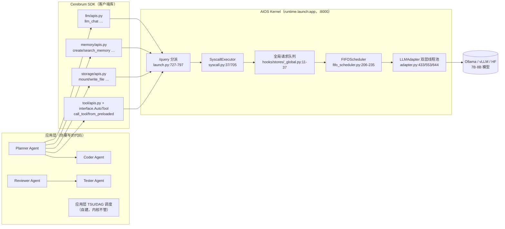

# doc/13 AIOS-Agent SDK（Cerebrum）使用指南

> 面向：要在 AIOS 内核上写四类协作智能体、并用 7B/8B 端侧模型跑出"串行 vs 并行"加速数据的参赛队。
> 依据：Cerebrum 仓库快照（`git clone https://github.com/agiresearch/Cerebrum`，HEAD `ab7e434`，PyPI 包名 `aios-agent-sdk` 0.0.3）+ `vendor/AIOS` 内核源码。
> **状态声明**：本机内核未启动（且本机 Python 3.13 不满足 SDK 的 `requires-python >=3.10,<3.12`），下文所有调用均为**源码核对**结论；标注【代码确认】的条目有 `文件:行号` 证据，标注【未实测】的条目是推理，第一次真机运行时请按 §11 清单逐项打勾。

---

## 0. 一页速览

| 问题 | 答案 |
|---|---|
| SDK 是什么 | `Cerebrum`，AIOS 官方 Agent SDK：提供 LLM / Memory / Storage / Tool 四类**远程调用函数**，全部通过 HTTP `/query` 打给 AIOS 内核 |
| 装什么 | `python=3.10/3.11` + `pip install -e .`（Cerebrum 仓库）；内核另装 `vendor/AIOS` |
| 核心是什么 | 5 个函数族 + 1 个 Agent 打包规范（`entry.py + config.json + meta_requirements.txt`），**没有**"多智能体编排"能力 |
| 最短可用程序 | `cerebrum.llm.apis.llm_chat(agent_name, messages, base_url, llms, user_id)` → `resp["response"]["response_message"]` |
| 返回值陷阱 | 类型注解写 `LLMResponse`，实际是 **dict**；必须 `["response"]["response_message"]` 两层取值 |
| 关键好处（对赛题） | 内核返回值自带 `waiting_times / turnaround_times / start_times / end_times`，**加速比的测量不用自己造** |
| 关键限制 | 内核调度器**不感知依赖**、SDK **无编排器**、没有全局并发上限 → DAG 与依赖必须写在应用层 |
| 不能做的事 | 别信 README 的验证命令 `from cerebrum.client import Cerebrum`——该模块在本快照中不存在 |

---

## 1. SDK 在 AIOS 中的位置



- 一次 `llm_chat` = 一次 `POST {kernel}/query`，`query_type="llm"`；内核把它变成一次 syscall 入队，由 FIFO 调度器攒批后交给 adapter 线程池并发调模型。【代码确认：`syscall.py:30-33`、`launch.py:727-797`、`fifo_scheduler.py:206-235`】
- 因此**并发发生在内核**，但"谁该等谁、哪些子任务能一起跑"在内核里完全不存在——这是赛题创新点（应用层 TSU）的落点。

### 1.1 包结构（读哪几个文件就够）

| 路径 | 行数 | 作用 | 优先级 |
|---|---|---|---|
| `cerebrum/llm/apis.py` | 594 | 5 个 LLM 调用函数 + `LLMQuery/LLMResponse` | P0 |
| `cerebrum/utils/communication.py` | 76 | `send_request()`：POST `/query`，返回原始 dict | P0 |
| `cerebrum/memory/apis.py` | 356 | 记忆增删改查 + 检索（user_id/共享策略） | P1 |
| `cerebrum/storage/apis.py` | 331 | 挂载/写文件/回滚/共享文件 | P1 |
| `cerebrum/tool/apis.py` + `tool/base.py` | 196/45 | 工具直调 + `BaseTool` 接口 | P1 |
| `cerebrum/interface/__init__.py` | 76 | `AutoTool.from_preloaded()`（AutoAgent/AutoLLM 已注释） | P1 |
| `cerebrum/manager/agent.py` | 626 | 打包/上传/下载/动态加载 Agent | P2 |
| `cerebrum/config/config_manager.py` | 86 | 单例配置 + `CEREBRUM_*` 环境变量 | P2（但要知道） |
| `example/agents/assistant_agent/agent.py` | 76 | **唯一正确可抄的 Agent 模板** | P0 |

总规模：243 个 py 文件 / 48,605 原始行 / 37,354 代码行（含 `benchmarks/` 的一堆 GAIA、OSWorld 数据脚本，别通读）。

---

## 2. 安装与启动（Linux 目标环境）

```bash
# ① 内核（AIOS）
git clone https://github.com/agiresearch/AIOS.git
cd AIOS
conda create -n aios python=3.11 -y && conda activate aios
pip install -r requirements.txt          # 里面已含 git+https://github.com/agiresearch/Cerebrum.git
cp aios/config/config.yaml.example aios/config/config.yaml
# 编辑 config.yaml：填 llms.models 与 memory/server 配置（见 §7）
python -m uvicorn runtime.launch:app --host 0.0.0.0 --port 8000

# ② SDK（Cerebrum，单独 clone 或随 requirements 自动装）
git clone https://github.com/agiresearch/Cerebrum.git
cd Cerebrum
conda create -n cerebrum-env python=3.11 -y && conda activate cerebrum-env
pip install -e .
# 可选：export CEREBRUM_KERNEL_URL=http://<内核IP>:8000
```

【代码确认】启动命令 `python -m uvicorn runtime.launch:app --port 8000` 来自 `vendor/AIOS/README.md:321`；内核 requirements 直接依赖 Cerebrum 的 git 仓库（`vendor/AIOS/requirements.txt`）；配置键见 `aios/config/config.yaml.example`。

> **坑**：`vendor/AIOS/install.sh:116` 写的 uvicorn 目标 `runtime.kernel:app` **不存在**（实际模块是 `runtime.launch`），照抄脚本会启动失败。
> **坑**：本机 Python 3.13 → `pip install -e .` 会因 `requires-python = ">=3.10,<3.12"` 被拒；比赛环境请固定 3.10/3.11。

---

## 3. 最小可用程序（20 行，先跑通再谈协作）

```python
# hello_sdk.py
from cerebrum.llm.apis import llm_chat
from cerebrum.config.config_manager import config

KERNEL = config.get_kernel_url()          # 默认 http://localhost:8000

resp = llm_chat(
    agent_name="planner",                  # ★ 必填，内核按 agent_name 记账/隔离上下文
    messages=[
        {"role": "system", "content": "你是任务规划器，只输出 JSON。"},
        {"role": "user",   "content": "把“团队任务看板”拆成 4 个可并行子任务。"},
    ],
    base_url=KERNEL,
    llms=[{"name": "qwen2.5:7b", "backend": "ollama"}],  # 不传则用内核 config.yaml 里的模型
    user_id="team-001",                    # 记忆共享/个性化用，可不传
)

text = resp["response"]["response_message"]   # ★ 两层取值，不是 resp.response_message
print(text)
print("内核排队等待(s):", resp.get("waiting_times"))
print("端到端周转(s):", resp.get("turnaround_times"))
```

【代码确认】`llm_chat` 签名 `(agent_name, messages, base_url=aios_kernel_url, llms=None, user_id=None)` 见 `cerebrum/llm/apis.py:221-226`；dotted 取值与"返回 dict 而非 pydantic 对象"由两处交叉印证：`utils/communication.py:58-76`（`return result` 是 `response.json()`），`tests/apis/llm/test_ollama.py:24`（`tool_response["response"].get("response_message","")`），内核侧返回结构见 `vendor/AIOS/aios/syscall/syscall.py:208-214`。

**为什么有两层**：内核 `/query` 返回的是 `{"response": <某 Response 的 dump>, "start_times": [...], "end_times": [...], "waiting_times": [...], "turnaround_times": [...]}`。第一层是调度元数据、第二层才是模型输出——顺手就把"每个子任务的排队时间"白拿了，这是赛题第 50 分（加速比）的关键观测面。

---

## 4. 四类 API 速查

### 4.1 LLM：`cerebrum.llm.apis`

| 函数 | 关键参数 | 用途 | 备注 |
|---|---|---|---|
| `list_available_llms()` | — | `GET {kernel}/core/llms/list`，看内核挂了哪些模型 | 先跑这个再写别的 |
| `llm_chat(agent_name, messages, base_url=None, llms=None, user_id=None)` | messages 为 OpenAI 风格 | 普通对话，返回 `action_type="chat"` | 最常用 |
| `llm_chat_with_json_output(agent_name, messages, base_url=None, llms=None, response_format=None)` | `response_format` 是 JSON Schema | 结构化输出（Planner 出 DAG 用它） | **没有** `user_id` 参数 |
| `llm_chat_with_tool_call_output(agent_name, messages, tools, base_url=None, llms=None)` | `tools` 必填 | 让模型产出 tool_calls | 供 `llm_call_tool` 接力 |
| `llm_call_tool(agent_name, messages, tools, base_url=None, llms=None)` | `tools` 必填 | 工具调用结果回填 | — |
| `llm_operate_file(agent_name, messages, tools=None, base_url=None, llms=None)` | `tools` 可选 | 文件类操作 | 少用 |

注意 `tools` 在 `llm_chat_with_tool_call_output` / `llm_call_tool` 中是**必填位置参数**（`llm/apis.py:372-378`、`:462-468`），漏传直接 `TypeError`。

`LLMQuery` 字段（`llm/apis.py:154-162`）：`llms`、`messages`、`tools`、`action_type ∈ {chat, chat_with_json_output, chat_with_tool_call_output, call_tool, operate_file}`、`temperature=1.0`、`max_new_tokens=1000`、`message_return_type ∈ {text,json}`、`response_format`、`user_id`。`LLMResponse` 字段：`response_message / tool_calls / finished / error / status_code`。

**Planner 出 DAG 的标准写法**：

```python
import json
from cerebrum.llm.apis import llm_chat_with_json_output

schema = {
    "type": "object",
    "properties": {
        "subtasks": {
            "type": "array",
            "items": {
                "type": "object",
                "properties": {
                    "id": {"type": "string"},
                    "role": {"type": "string", "enum": ["backend", "frontend", "qa", "docs"]},
                    "deps": {"type": "array", "items": {"type": "string"}},
                    "goal": {"type": "string"},
                },
                "required": ["id", "role", "deps", "goal"],
            },
        }
    },
    "required": ["subtasks"],
}

resp = llm_chat_with_json_output(
    agent_name="planner",
    messages=[{"role": "user", "content": "为“团队任务看板”生成 4 个可并行子任务（含依赖）。"}],
    response_format=schema,
    llms=[{"name": "qwen2.5:7b", "backend": "ollama"}],
)
dag = json.loads(resp["response"]["response_message"])   # 7B 不一定守 schema，必须二次校验
```

> 7B/8B 的现实：结构化输出失败率明显高于 GPT-4 级模型。**必须**在应用层加 `json.loads` 兜底 + 重试 1 次 + 缺字段就降级为固定模板 DAG；不要把"模型一定吐出合法 JSON"写进设计假设（对应 doc/08 §6 的"弱模型 function calling 无兜底"风险）。

### 4.2 Memory：`cerebrum.memory.apis`

| 函数 | 签名要点 |
|---|---|
| `create_memory(agent_name, content, metadata=None)` | 普通写入 |
| `create_agentic_memory(agent_name, content, metadata=None)` | 走 agentic 抽取路径 |
| `get_memory(agent_name, memory_id)` | 按 id 取 |
| `update_memory(agent_name, memory_id, content=None, metadata=None)` | 更新 |
| `delete_memory(agent_name, memory_id)` | 删除 |
| `search_memories(agent_name, query, k=5, base_url=None, *, user_id=None, sharing_policy=None)` | 语义检索；`sharing_policy ∈ {"shared","private"}` |

`MemoryQuery.operation_type ∈ {add_memory, get_memory, update_memory, remove_memory, retrieve_memory, add_agentic_memory, retrieve_memory_raw}`（`memory/apis.py:48`）。

**关键设计选择**：AIOS 提供两条记忆路线——
1. **内核托管**（推荐）：`config.yaml` 开 `memory.auto_extract: true` / `auto_inject: true`，Agent 只调 `llm_chat`，内核自动抽取与注入。官方 `assistant_agent` 就是这么写的，测试甚至断言它**不得**调 `create_memory`（`tests/agents/test_assistant_agent.py:109-131`）。
2. **Agent 显式管理**：自己 `create_memory/search_memories`，适合"Reviewer 要查 Coder 历史决策"这类跨角色检索。

> 对赛题：路线 1 省事但不可控；路线 2 才能演示"智能体间通过共享记忆协作"。提案建议**混合**：任务态用路线 2（可审计、能画时序图），闲聊态走路线 1。
> 【未实测】`memory` 类函数的返回值同样是 kernel 原样 dict，官方单测 mock 的形状是 `{"response_class": "memory", "search_results": [...], "success": true}`（`tests/agents/test_assistant_agent.py:175-179`）；形态与 `MemoryResponse` 注解不一致，取值前请 `print(resp)` 看一眼。

### 4.3 Storage：`cerebrum.storage.apis`

| 函数 | 说明 |
|---|---|
| `mount(agent_name, root_dir)` | 给 Agent 挂一个工作目录（先 mount 再写） |
| `write_file(agent_name, file_path, content)` | 写文件；内核侧有版本记录可回滚 |
| `create_file(agent_name, file_path, file_name=None)` / `create_dir(dir_path)` | 建空文件/目录 |
| `retrieve_file(agent_name, query_text, n, keywords=None)` | 语义检索已挂载文件（向量库） |
| `rollback_file(agent_name, file_path, n)` | 回滚到第 n 个版本 |
| `share_file(file_path)` | 共享文件 |

`operation_type` 分别是 `mount / retrieve / create_file / create_dir / write / rollback / share`。【代码确认：`storage/apis.py:9-35`】

> 对赛题：这是"多智能体协作产出物"的天然落点——Coder 写代码、Reviewer 读同一 `root_dir`、Tester 跑测试后把报告 `write_file`，全链路有版本、可回滚、可截图。注意**内核 storage 是共享根目录**，四个 Agent 必须用不同 `file_path` 前缀避免互相覆盖。

### 4.4 Tool：`cerebrum.tool.apis` + `interface.AutoTool`

```python
from cerebrum.interface import AutoTool

calc = AutoTool.from_preloaded("calculator/basic", local=False)  # 从 ToolHub 下载
print(calc.get_tool_call_format())      # OpenAI function-calling 格式的 schema
```

【代码确认】`interface/__init__.py:26-55`：`AutoTool.from_preloaded(tool_name, local=False)` 走 `ToolManager.download_tool` → `load_tool`，返回**工具实例**；`local=True` 读本地；`from_batch_preloaded([...])` 批量。ToolHub 默认 `https://app.aios.foundation`。

**自定义工具**：继承 `cerebrum.tool.base.BaseTool`（`tool/base.py:1-13`），实现 `run(params)` 与 `get_tool_call_format()`，放进 `cerebrum/tool/core/<你的目录>/` 并在 `tool/core/registry.py` 注册。

**MCP 工具**：`cerebrum/tool/mcp_tool/` 下有 `MCPClient.from_smithery(pkg_name, description)` 与 `MCPPool.add_mcp_client/start/stop`；`config.yaml` 的 `tool.mcp_server_script_path` 默认 `aios/tool/mcp_server.py`。

> **坑**：`ToolQuery` 在 SDK 里必填 `tool_calls`（`tool/apis.py:46-47`），但内核 `launch.py:774-778` 用 `ToolQuery(params=…, operation_type=…)` 构造——两侧字段不一致，**直接调 `call_tool()` 很可能 500**。【未实测】比赛里请走"LLM 产出 tool_calls → 内核执行"的路径，工具直调先用 curl 验一次。

---

## 5. Agent 工程化：三件套 + Manager + CLI

### 5.1 一个 Agent 目录长这样

```
my_agents/planner/
├── agent.py                 # 实现类
├── config.json              # 元信息 + 构建入口
└── meta_requirements.txt    # 该 Agent 的额外依赖（可空）
```

```json
{
  "name": "planner",
  "description": ["你是 Planner，负责把用户需求拆成带依赖的 DAG，并输出 JSON。"],
  "tools": ["calculator/basic"],
  "meta": {"author": "team-x", "version": "0.0.1", "license": "MIT"},
  "build": {"entry": "agent.py", "module": "PlannerAgent"}
}
```

```python
# agent.py
import os, json
from cerebrum.llm.apis import llm_chat
from cerebrum.config.config_manager import config

class PlannerAgent:
    def __init__(self, agent_name: str, llms: list | None = None):
        self.agent_name = agent_name
        self.llms = llms or [{"name": "qwen2.5:7b", "backend": "ollama"}]
        self.config = self.load_config()
        self.messages = []

    def load_config(self) -> dict:
        p = os.path.join(os.path.dirname(os.path.abspath(__file__)), "config.json")
        with open(p, "r", encoding="utf-8") as f:
            return json.load(f)

    def run(self, task_input: str) -> dict:
        system = "".join(self.config.get("description", []))
        self.messages = [{"role": "system", "content": system},
                         {"role": "user", "content": task_input}]
        resp = llm_chat(agent_name=self.agent_name, messages=self.messages,
                        base_url=config.get_kernel_url(), llms=self.llms)
        out = resp["response"]["response_message"] if resp else ""
        self.messages.append({"role": "assistant", "content": out})
        return {"agent_name": self.agent_name, "result": out}
```

【代码确认】这个类是 `cerebrum/example/agents/assistant_agent/agent.py:10-76` 的等价写法；`build.module` 填**类名**（示例 `{"build": {"entry": "agent.py", "module": "AssistantAgent"}}`，见 `tests/agents/test_assistant_agent.py:27`）。

### 5.2 加载、运行、打包

```python
from cerebrum.manager.agent import AgentManager

mgr = AgentManager("https://app.aios.foundation")
agent_class, config = mgr.load_agent(local=True, path="./my_agents/planner")
planner = agent_class(agent_name="planner")
print(planner.run("拆解团队任务看板需求"))

# 远程：先 download 再 load
# mgr.download_agent("team-x", "planner", "0.0.1")
# agent_class, config = mgr.load_agent("team-x", "planner", "0.0.1")
```

【代码确认】`load_agent` 定义于 `manager/agent.py:451`，签名 `(author='', name='', version=None, ..., local=..., path=...)`，返回 `(agent_class, config)`；实现会把 Agent 目录打包、解压到缓存、`importlib` 动态载入，并自动 `pip install meta_requirements`。`download_agent(author, name, version=None)` 见同一文件 `:103`。

CLI（装好 SDK 后可用的命令，`pyproject.toml:43-54`）：

```bash
list-available-llms                 # 内核挂了哪些模型
list-local-agents                   # 本地缓存里有哪些 Agent
list-agenthub-agents                # AgentHub 上有哪些
download-agent --agent_author team-x --agent_name planner --agent_version 0.0.1
run-agent --agent_path ./my_agents/planner --task_input "拆解团队任务看板需求" --mode local
run-agent --agent_author team-x --agent_name planner --agent_version 0.0.1 \
          --task_input "…" --mode remote --share-memory
```

> **坑**：`example/aios_demo.py` 与 `cerebrum/utils/run_agent.py` 都 `from cerebrum.client import Cerebrum`——**该模块不存在**；`utils/run_agent.py:40` 还留着 `breakpoint()`。别把这两个文件当模板。

---

## 6. 赛题骨架：四角色并行的最小实现

核心思想：**Agent 各自调 SDK（无状态、可并发），DAG 与并发控制写在应用层**。

```python
# orchestrator.py —— 应用层 TSU（Task Scheduling Unit）
import json, time
from concurrent.futures import ThreadPoolExecutor
from cerebrum.llm.apis import llm_chat
from cerebrum.config.config_manager import config

KERNEL = config.get_kernel_url()
LLMS = [{"name": "qwen2.5:7b", "backend": "ollama"}]

def call(role: str, prompt: str) -> dict:
    t0 = time.perf_counter()
    resp = llm_chat(agent_name=role, messages=[{"role": "user", "content": prompt}],
                    base_url=KERNEL, llms=LLMS)
    return {"role": role,
            "text": resp["response"]["response_message"],
            "wait": sum(resp.get("waiting_times") or []),
            "wall": time.perf_counter() - t0}

dag = {                                    # Planner 产出后由校验器补全/降级
    "backend": [],                          # 无依赖
    "frontend": [],                         # 无依赖
    "qa": ["backend", "frontend"],          # 依赖前两者
    "docs": ["backend"],                    # 依赖后端
}

def run_dag(dag, prompts):
    done, results, t_start = {}, {}, time.perf_counter()
    with ThreadPoolExecutor(max_workers=4) as pool:   # 并发上限＝DAG 宽度
        while len(done) < len(dag):
            ready = [n for n, deps in dag.items()
                     if n not in done and all(d in done for d in deps)]
            if not ready:
                raise RuntimeError("DAG 有环或依赖缺失")
            futs = {n: pool.submit(call, n, prompts[n]) for n in ready}
            for n, f in futs.items():
                done[n] = results[n] = f.result()
    return time.perf_counter() - t_start, results
```

对应赛题四条要求：
- 要求①（≥4 种 Agent）→ `backend/frontend/qa/docs` 四个角色，各自独立 `agent_name`；
- 要求②（≥4 子任务 + 自动分配）→ `dag` + `ready` 计算自然完成"分配到角色"；
- 要求③（≥3 对双向交互）→ 角色之间不共享 messages，靠"产出物落 storage + 下轮 prompt 引用"形成请求—反馈闭环（这是**必须自己实现**的部分，SDK 不提供）；
- 要求④（先后顺序与依赖）→ `all(d in done for d in deps)` 就是依赖约束；串行基线可用同一个 `dag` 但 `max_workers=1`。

> **加速比口径（与 doc/08 B 节一致）**：串行基线 = 同 DAG 顺序执行的总 wall-clock；并行 = 上面这个 `run_dag` 的 wall-clock；**同一台机器、同一模型、预热 ≥3 次、取中位数**。20% 时间下降 ⇔ 1.25× 加速（`1/0.8=1.25`），报告里两个数都要给。
> **别踩**：内核 `fifo_scheduler.py:70/98` 的 `batch_interval` 默认 1.0s——4 个请求几乎同时到达时会被攒成一批，串行基线和并行基线的"攒批时机"要一致，否则测出来是调度器抖动不是并行收益。

---

## 7. 模型怎么接：开发期云端 → 验收期端侧 7B/8B

> 现实节奏：**开发期用云端模型**（本机无 GPU 也能写代码、调 DAG），**验收期再租云 GPU 跑真端侧 7B**。
> 两份现成配置在 `configs/dev-cloud.yaml`（开发）与 `configs/edge-vllm.yaml`（验收），字段完全一致，切换只换文件。
> 完整的阶段划分、迁移检查清单与预算见 `doc/18` §5.5。

### 7.1 开发期：任何 OpenAI 兼容云端端点

AIOS 的 `vllm|sglang` 分支实现就是"`base_url` + `api_key` 的 OpenAI 客户端"（`aios/llm_core/adapter.py:243-252`），
所以 DashScope / DeepSeek / Moonshot / 自建网关**都填 `backend: "vllm"`**，不用为每家厂商改代码：

```yaml
llms:
  models:
    - name: "deepseek-chat"                                    # 或 qwen-plus
      backend: "vllm"                                           # ★ 不是 "openai"，见上
      hostname: "https://api.deepseek.com/v1"
      api_key: "sk-..."                                         # 建议用环境变量注入，别提交
  use_context_manager: false
```

注意事项（都是踩过的）：

- **并发上限**：云端限流比端侧严厉，`agent_factory.max_workers` 先设 16；4 角色并发 429 时降到 8 并加指数退避。
- **不要依赖原生 tool-call**：端侧 7B 的 function calling 不可靠，开发期就用 `llm_chat_with_json_output` + 本地 schema 校验（§4），迁移零改动。
- **云端数字只能标 `dev(cloud)`**：网络 RTT 会掩盖调度收益，**赛题加速比只用端侧数字**（见 `doc/18` §5.5 写法约束）。

### 7.2 验收期：端侧 7B，编辑内核配置

编辑**内核**的 `aios/config/config.yaml`（不是 SDK 的 `config.yaml`）：

```yaml
llms:
  models:
    - name: "qwen2.5:7b"                 # 或 llama3.1:8b / qwen3:8b
      backend: "ollama"
      hostname: "http://localhost:11434"
  use_context_manager: false             # ★ 必须 false，见 §9 坑 7

memory:
  provider: "in-house"                   # 端侧不要用 mem0 云
  auto_inject: false                     # 演示"协作"时关掉，避免记忆注入混淆归因
  write_barrier: { enabled: true, timeout_ms: 5000 }

storage: { root_dir: "root", use_vector_db: true }
agent_factory: { max_workers: 64 }       # 与并发度一起调（见 §9 坑 6）
server: { host: "localhost", port: 8000 }
```

vLLM 后端（吞吐更好，适合"并发 4 路"）：

```bash
vllm serve Qwen/Qwen2.5-7B-Instruct --port 8091 --max-model-len 8192
```

```yaml
    - name: "Qwen/Qwen2.5-7B-Instruct"
      backend: "vllm"
      hostname: "http://localhost:8091"
```

【代码确认】模型配置结构为 `llms.models[{name, backend, hostname}]`，Ollama/vLLM/HF 三档示例均在 `aios/config/config.yaml.example:14-55`；`use_context_manager` 见同文件 `:62`；`memory/storage/scheduler/agent_factory/server` 全部见 `:64-130`。

**单次调用临时换模型**：`llm_chat(..., llms=[{"name": "qwen2.5:7b", "backend": "ollama"}])`，不用改内核配置——做"7B vs 8B"对照实验时用这个，别重启内核。

---

## 8. 并发与性能观测点

| 观测项 | 从哪拿 | 用途 |
|---|---|---|
| 排队等待 `waiting_times` | 每次 `/query` 返回的列表 | 证明"并行时排队变长"→ 说明瓶颈在模型侧 |
| 周转 `turnaround_times` | 同上 | 单次调用端到端 |
| 端到端 wall-clock | 应用层 `time.perf_counter()` | 赛题加速比的**唯一**口径 |
| 内核线程池配置 | `config.yaml: agent_factory.max_workers`（默认 64） | 默认够 4 路并发，别盲目调大 |
| 内核日志 | `llms.log_mode: console` | 看是否真的并发（时间戳交叠） |

**并发上限**：内核 adapter 有外层/内层两级线程池（`adapter.py:553/644`），**没有全局并发上限**（`config_manager.py:232-243`）——意味着你可以从应用层直接开 4~8 路，但开太多会把 7B 模型压到 OOM 或排队雪崩。【未实测，需压测】

---

## 9. 十个坑（全部带源码证据）

| # | 坑 | 现象 | 证据 / 规避 |
|---|---|---|---|
| 1 | README 验证命令引用不存在的模块 | `ModuleNotFoundError: cerebrum.client` | `cerebrum/client.py` 不存在；改用 `python -c "from cerebrum.llm.apis import llm_chat; print(llm_chat)"` |
| 2 | 返回值是 dict 不是 pydantic | `AttributeError: 'dict' object has no attribute 'response_message'` | `communication.py:71-76`；用 `resp["response"]["response_message"]` |
| 3 | 示例 Agent 签名过期 | `calculator_agent` 报 unexpected keyword `model` | `example/agents/calculator_agent/agent.py` 用旧参数；抄 `assistant_agent` |
| 4 | 遗留调试断点 | 跑到 `cerebrum/utils/run_agent.py` 卡住 | 该文件 `:40` 有 `breakpoint()`；别用 CLI 之外的这条路 |
| 5 | tool 直调字段不一致 | `call_tool()` 500 / 422 | SDK `ToolQuery(tool_calls=…)` vs 内核 `ToolQuery(params=…)`（`launch.py:774-778`）；先 curl 验 |
| 6 | 内核不感知依赖 | 子任务顺序全乱/全挤在一起 | `syscall.py:185-186` 入队后 `join()`；依赖必须在应用层 DAG 里判（§6） |
| 7 | RR 调度器必崩 | `TypeError` | `rr_scheduler.py:180-181` 把单对象传进 `_execute_batch_syscalls`；`use_context_manager: false` 走 FIFO 即可 |
| 8 | 攒批 1 秒影响测量 | 串行/并行差异不稳定 | `fifo_scheduler.py:70/98` 默认 `batch_interval=1.0`；基线与实验同配置，或统一预热 |
| 9 | Python 版本墙 | `pip install` 直接拒绝 | `pyproject.toml:12` `>=3.10,<3.12`；用 3.10/3.11 |
| 10 | 配置只认内核那一份 | 改了 SDK 的 `config.yaml` 模型不生效 | 模型/provider 只能在内核 `aios/config/config.yaml` 配；SDK 那份只管 `kernel.base_url` 与 hub 地址 |

---

## 10. 排障速查

| 症状 | 先查什么 | 常见原因 |
|---|---|---|
| `requests.exceptions.ConnectionError` | `curl http://localhost:8000/core/llms/list` | 内核没起 / 端口不对 / `CEREBRUM_KERNEL_URL` 没设 |
| `500` + 堆栈指向 `syscall` | 内核日志 | 请求体缺字段（如 LLMQuery 没 messages）/ RR 调度器 bug |
| 模型名报错 `not found` | `list-available-llms` | 内核 `llms.models[].name` 与实际 Ollama 模型 tag 不一致 |
| 回答极慢且逐条串行 | 内核日志时间戳 | 攒批窗口 + 线程池被占满；降 batch 或减少并发 |
| tool 调用永远不执行 | 内核日志 | 弱模型没产出合法 tool_calls；加 few-shot 或工具描述 |
| 记忆检索为空 | `memory.provider` 与 embedder | `in-house` 需要向量库；mem0 需 embedder 可用 |

---

## 11. 首次真机自测清单（15 项）

- [ ] 1. `python -c "import cerebrum"` 成功（3.10/3.11 环境）
- [ ] 2. `curl {kernel}/core/llms/list` 返回配置里的模型
- [ ] 3. `list-available-llms` 与上一条一致
- [ ] 4. `llm_chat` 返回非空 `response_message`
- [ ] 5. 连续 2 次 `llm_chat` 带上历史 messages，模型记得上文
- [ ] 6. `llm_chat_with_json_output` 能按 schema 出 JSON（失败率记录在案）
- [ ] 7. `mount()` → `write_file()` → `retrieve_file()` 拿到刚写的文件
- [ ] 8. `rollback_file()` 能回退版本
- [ ] 9. `create_memory` + `search_memories(k=3)` 命中
- [ ] 10. `search_memories(user_id=..., sharing_policy="shared")` 跨 agent 可见
- [ ] 11. `AutoTool.from_preloaded("工具/名")` 能拿到实例（或明确失败信息）
- [ ] 12. 4 路并发 `llm_chat` 的 `waiting_times` 明显大于单路（证明真并发）
- [ ] 13. 串行 DAG 与并行 DAG 各跑 3 次，记录 wall-clock 中位数
- [ ] 14. 并行/串行 ≥1.25×（等价时间下降 ≥20%）
- [ ] 15. 全流程连续跑 3 次不崩（稳定性）

---

## 12. 证据边界

- 本指南的**函数签名、字段名、行号、配置键**均来自本文写作时的仓库快照（HEAD `ab7e434`），标【代码确认】。
- 标【未实测】的条目（memory/tool 返回 dict 形态、并发压测、tool 直调 500、`run-agent` CLI 能否跑通）未在真机验证；内核启动、模型推理、GPU 内存相关的行为需在比赛机器上按 §11 逐项确认。
- Cerebrum 迭代很快（PyPI 0.0.3，README 提及 2025-05 集成 LiteCUA）：**拿到机器后先 `git log -1` 记下 commit，再按本指南核对签名**，不要盲抄示例。

## 13. 与其他文档的关系

| 文档 | 关系 |
|---|---|
| doc/09-AIOS与OWL代码库调研与SDK实践.md | 代码库层面（内核结构、Workforce、实测路径）；本文是**用法层面** |
| doc/12-AIOS与OWL代码阅读指南.md | 读源码路线；本文是**写代码**路线 |
| doc/04-智能体操作系统内核与并发服务-精读.md | 内核调度/并发原理（FIFO、adapter、Autellix 对照） |
| doc/03-赛题对标与多智能体系统设计方案.md | 本文 §6 是 doc/03 架构的 SDK 级落地 |
| doc/08-评测基准与端侧推理加速-精读.md | §6 加速比口径与 doc/08 B 节一致 |

## 14. 更新记录

| 版本 | 日期 | 变更 |
|---|---|---|
| v1.0 | 2026-11-18 | 首版：基于 Cerebrum `ab7e434` 快照核对四类 API、Agent 三件套、内核配置、十个坑、赛题骨架与 15 项自测清单 |
| 2026-11-21 | v1.1：§7 改写为「开发期云端 → 验收期端侧」两阶段接法，新增 §7.1（OpenAI 兼容端点统一用 `backend: vllm`、并发上限、禁用原生 tool-call、云端数字标注规则），并指向 `configs/dev-cloud.yaml`、`configs/edge-vllm.yaml` 与 `doc/18` §5.5 |
