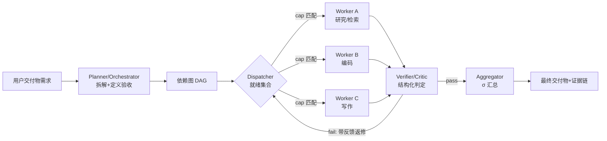

# 多智能体系统怎么做"分配—执行—汇总"：机制综述与角色分类

> **状态**：v1.0（2026-11-20）｜**读者**：参赛队全员，尤其负责架构与答辩的同学
> **一句话结论**：现有系统在"**执行**"上已经分化出成熟范式（串行对话 / 黑板消息池 / DAG 并行 / 异步 worker），但在"**分配**"和"**汇总**"上几乎全部停留在"**LLM 判一次 + 规则校验 + 失败兜底**"的水平：没有系统按能力做最优化分配，也没有系统对汇总结果做独立验收（verifier 多为同源模型自评）。
> **证据口径**：论文数字均回原文核对（见 §8）；代码结论全部给出 `vendor/...:行号`，以 `vendor/` 内 method C 快照为准；标【推测】的是推断而非实测。

---

## §0 一页速览

| 生命周期阶段 | 主流做法（按成熟度） | 代表系统 | 关键代码入口 |
|---|---|---|---|
| **分配** | ① 静态角色编制（写死在代码里）② 规划期一次性出 DAG ③ 运行时由 coordinator LLM 动态派发 | MetaGPT / ChatDev；LLMCompiler；camel Workforce、AgentVerse、DyLAN | `workforce.py:4042 _find_assignee`、`:4011` 依赖回填 |
| **执行** | ① 串行角色对话 ② 共享消息池/黑板 ③ 依赖就绪即并行的 DAG 引擎 ④ 常驻异步 worker | CAMEL、MetaGPT；AutoGen、AgentScope；LLMCompiler、agentflow、LangGraph；camel | `solver.py:35 NaiveSolver`、`_goal_pipeline.py`、`scheduler.ts:78` |
| **汇总** | ① 单点聚合 ② 层级 map-reduce ③ verifier 闭环（pass/fail 反馈）④ 投票/辩论 | MetaGPT、ChatDev；camel；AgentScope GoalPipeline；多解择优类 | `_goal_pipeline.py:300-375`、`workforce.py:4941` |
| **角色** | Orchestrator / Planner / Dispatcher / Worker / Critic / Aggregator / Retriever / Tool-Executor / Monitor | 见 §5 八类表 | — |

**六条硬结论（答辩可直接引用）**：

1. **"分配"有三种粒度**：角色级（谁扮演什么）、任务级（哪个节点派给谁）、消息级（下一个谁说话）。多数框架只做了**角色级**，AutoGen 只做了**消息级**，真正做**任务级 + 依赖门控**的只有 camel Workforce 和 LangGraph Pregel。
2. **"执行"的并行度不由框架决定，而由依赖图宽度决定**。串行对话类框架（CAMEL/MetaGPT/ChatDev）**没有任何一对并行**，其"多智能体"只增加串行轮次，因此**不可能**带来 wall-clock 加速。
3. **"汇总"是当前最薄弱的一环**：几乎都是"最后一个 agent 写一段总结"，没有结构化契约、没有独立验收；MAST 的 7 种失败模式里有 2 种（任务验证缺失、终止条件判断错误）直接源于汇总设计。
4. **验证闭环存在但很弱**：AgentScope 的 `GoalPipeline` 是目前唯一把"执行—验证—返修"写成通用组件的实现；但它仍是**同源模型自评**，且验证器只输出 `pass/fail/impossible` 三值，不可审计。
5. **成本与加速是硬耦合**：LLMCompiler 用 3.37×/6.73× 的 token 成本换 1.80×/3.74× 的延迟收益，WebShop 场景甚至**变慢**（10.72s vs ReAct 5.98s）——说明"并行"不是免费午餐，端侧 7B 上更危险。
6. **弱模型上角色分化会失效**：AgentBench 上 6B 模型 Overall=0.11、≤70B 均值 0.51、GPT-4=4.01；MetaGPT 用 33B 时"可执行性"只有 1.4（满分 4）。角色越多，每步的格式错误越会级联。

---

## §1 统一模型：把"分配—执行—汇总"形式化

一个多智能体任务可写成四元组：

```
Job = (T, E, A, σ)      T: 子任务集合 T_1..T_n
                        E ⊆ T×T 依赖边（T_j 需要 T_i 的输出）
                        A: 智能体集合，每个 a 有能力标签 cap(a)、状态 state(a)
                        σ: 汇总函数，把 {结果} 映射为最终交付物
分配  π: T → A          满足 cap(a) ⊇ needs(T_i)，且不违反 E 的偏序
执行  R = schedule(T, E, π)   产出一组 r_i 及时间戳
汇总  final = σ({(T_i, r_i)})
```



**三个环节各有一组"必须回答的问题"**：

| 环节 | 必须回答 | 现实中谁在回答 |
|---|---|---|
| 分配 | 凭什么把这个子任务给这个 agent？能力、负载还是 LLM 直觉？ | 多由 LLM 直觉（coordinator prompt）回答 |
| 执行 | 谁在等谁？等的是数据还是资源？ | 由消息池或 DAG 引擎隐式回答，很少显式建模 |
| 汇总 | 谁来判"做对了"？判据是结构化还是自然语言？ | 多为最后一个 agent 的自然语言总结 + 人工看 |

---

## §2 分配：任务怎么落到具体智能体头上

### 2.1 三条技术路线

**路线 A：静态角色编制（写死在编排代码里）**

MetaGPT 的 `Team` 是典型：`hire(roles)` 把角色注册进团队（`vendor/MetaGPT/metagpt/team.py:83`），`invest(budget)` 设预算（`:92`），`run(n_round=3)` 按**预定义 SOP 顺序**驱动（`:123`）。"分配"实际是"角色在 SOP 里的固定位置"——产品经理写完 PRD 就轮到架构师，没有运行时决策。

ChatDev 同理：chat chain 把开发流程切成设计/编码/评审/测试若干阶段，每个阶段固定两个角色对话，**任务→角色的映射是常量表**。

*适用*：流程稳定、重复度高的任务（如"给定想法生成一个软件骨架"）。
*代价*：角色与任务不匹配时没有任何纠错机会；任务变了要改代码。

**路线 B：规划期一次性出 DAG（分配=规划的一部分）**

LLMCompiler 的 planner 一次 LLM 调用吐出"任务 + 依赖 + 参数"的 DAG，task fetching unit 按**依赖就绪**并行取任务派给 executor。ReWOO 用 `#E` 标记数据依赖边，Planner/Worker/Solver 三段式。TDAG 则允许**动态改写后续子任务**——原始计划错了，后续节点可以换掉，这把级联失败率从 32.61% 压到 4.35%。

*适用*：子任务可预先枚举、依赖关系可静态确定（研究型问答、多源检索聚合）。
*代价*：规划本身要一次大 LLM 调用（成本 3.37×/6.73× 就是这么来的）；规划错了整条链都错，只有 TDAG 类方案能救。

**路线 C：运行时动态派发（分配=调度决策）**

camel Workforce 是开源实现里最完整的：`add_single_agent_worker`/`add_role_playing_worker` 建 worker 池（`workforce.py:3031/3094`），coordinator LLM 对一批任务给出 `{task_id, assignee_id}` 的指派（`_call_coordinator_for_assignment :3768`），再经 `_validate_assignments :3883` 校验（worker 是否存在、是否已满）、`_handle_task_assignment_fallbacks :3907` 兜底。依赖不是事后猜的，而是**从指派结果里回填**：`_update_task_dependencies_from_assignments :4011`，随后 `_post_ready_tasks :4397` 只放行"前驱全部完成"的任务。

AgentVerse 走"招聘"路线：`recruiter` agent 根据任务描述动态招募专家并组队，`decision` agent 决定循环是否继续，`executor` 干活，`evaluator` 打分——四类角色显式分工。DyLAN 则按"agent 重要度"动态组队并**提前停止**（省 11.3–66.2% API 调用），3 人小队效率 +52.9%/+67.8%。

AutoGen 的 GroupChat 是**消息级分配**：`GroupChatManager` 用 selector 决定"下一个谁说话"，没有显式任务对象，因此也无法表达依赖。AgentScope 的 MsgHub 只做广播，不承担分配。

*适用*：任务在执行中才暴露细节（探索型、开放型任务）。
*代价*：每次分配都是一次 LLM 调用，开销随时长线性增长；coordinator 的上下文会膨胀。

### 2.2 分配依据：现实中用了哪几把尺子

| 依据 | 含义 | 谁真的用了 | 证据 |
|---|---|---|---|
| 能力匹配 | agent 的能力标签覆盖任务需求 | camel（prompt 里列 worker 的 toolkits/skills）、AgentVerse（招聘） | `_get_single_agent_toolkit_info :3696`、`_get_single_agent_skill_names :3711` |
| 依赖就绪 | 前驱未完成不得派发 | camel、LLMCompiler、LangGraph | `all(dep_id in completed_tasks_info …)`、`_post_ready_tasks :4397` |
| 在飞负载 | 已有 N 个任务在手就不再派 | camel（`_increment_in_flight_tasks :1500`）、LLMCompiler（fetching unit 限额） | 同上 |
| 成本/预算 | token、时间、API 调用上限 | MetaGPT `invest`、DyLAN 提前停止、LLMCompiler（显式比较 3.37× 成本） | `team.py:92` |
| 失败恢复 | 失败后重建 worker/重分解/换人 | camel `_handle_failed_task :4642`、`_create_worker_node_for_task :4186`、`_decompose_task :1549` | 同上 |

**关键观察**：五把尺子里，"能力匹配"和"依赖就绪"是**硬约束**（错了会崩），"负载"和"成本"是**软优化**（错了只是慢），"失败恢复"是**唯一真正需要 LLM 判断**的部分。而多数框架恰恰把硬约束也交给 LLM——camel 虽校验依赖，但"哪个任务给谁"仍由 coordinator 一句话决定。

### 2.3 分配粒度的三级跳

| 粒度 | 单位 | 系统 | 能表达依赖吗 |
|---|---|---|---|
| 角色级 | 一个角色 = 一个固定分工 | MetaGPT、ChatDev | 只能靠 SOP 顺序隐含 |
| 任务级 | 一个子任务对象 | camel、LLMCompiler、LangGraph | ✅ 显式依赖边 |
| 消息级 | 一轮对话 | AutoGen GroupChat | ❌ 无法表达 |

**这条链解释了为什么"多智能体"常常不提速**：角色级分配下，所有交互都退化成"消息池里轮流说话"，而消息池是串行的。任务级分配（DAG）才是并行的前提。

---

## §3 执行：任务怎么真的跑起来

### 3.1 串行对话执行（最普遍，也最不提速）

- **CAMEL**：`AI User` 与 `AI Assistant` 双角色 inception prompting，一问一答直到任务完成。**没有任何并行**，所谓"多智能体"是"双人对话"。
- **MetaGPT**：角色内部 `react` 循环是串行的（`vendor/MetaGPT/metagpt/roles/role.py:454-470`），角色之间靠消息池顺序触发；`strategy/solver.py:35 NaiveSolver` 按拓扑序**逐个 await** 每个 action（`:35-42`）。它证明了"分工"能提升**质量**（含代码可执行性），但代价是 31255 token / 541s 量级的串行开销。
- **ChatDev**：chat chain 阶段串行，148s/22949 token 生成一个小软件；去掉角色分工后质量分从 0.3953 掉到 0.2212——**分工值钱，但时间不省**。

### 3.2 共享消息池 / 黑板

- **MetaGPT**：`publish_message` 把消息广播进共享池，订阅了该消息类型的角色被唤醒。这是最接近"数据依赖"的机制，但唤醒仍是**顺序的**（同一时刻只有一个角色在 react）。
- **AutoGen**：GroupChat 的 manager 选下一个发言者，`is_termination_msg` 判断结束。
- **AgentScope**：MsgHub 广播，`sequential`/`fanout` 两种 pipeline 组合方式，但并行需要显式用 `asyncio.gather` 类写法。

**黑板的价值**：解耦生产者与消费者，新增角色不改代码（MetaGPT 加一个 QA 角色即可）。
**黑板的代价**：消息池是全局共享的，**没有"只给需要的人"的机制**，上下文污染与 token 膨胀不可避免；且广播本身串行化了执行。

### 3.3 DAG 并行执行（真正的提速来源）

| 系统 | 并行机制 | 证据行号 | 实测加速 |
|---|---|---|---|
| **LLMCompiler** | planner 出 DAG + task fetching unit 依赖就绪即取 + 并行 executor | 论文 §3（无 vendored 源码） | HotpotQA **1.80×**、Movie Rec **3.74×**（8 路）；成本 3.37×/6.73× |
| **agentflow** | YAML `needs` → Kahn 分层 → 层内 `Promise.all` 并行 | `vendor/agentflow/src/scheduler.ts:78-135`、`src/engine.ts:253-254` | 无公开端到端数字（框架） |
| **LangGraph** | Pregel 超步：`_algo.py:470-486` 计算就绪节点、`_runner.py:485-495` 并行执行；并发上限 `_executor.py:143-148` + `_internal/_config.py:221` | 已核实 | 无公开数字（框架） |
| **AutoGen GraphFlow** | `DiGraphGroupChat` 支持有向图调度 | `_digraph_group_chat.py:412-425`，`:30` 标注 experimental | 实验特性，不建议生产 |
| **TDAG** | 动态改写后续子任务，级联失败 32.61% → **4.35%** | 论文 | 质量收益，非速度 |

**Amdahl 约束**：加速比上限 = 1/(s + (1-s)/n)，s 为串行占比。LLMCompiler 的 WebShop 反例（10.72s vs 5.98s）本质是 s 太大——planner 已占总延迟一半以上，并行只加速了剩下那一半。**端侧 7B 场景下 planner 推理更慢，s 更大，加速比更差**，这是本赛题必须实测而非宣称的地方。

### 3.4 常驻异步 worker

camel Workforce 把 worker 做成常驻协程：任务通过 `TaskChannel` 投递（`set_channel :3672`、`_listen_to_channel :5282`），worker 完成回投 `_get_returned_task :4362`，主循环 `_handle_completed_task :4941` 收结果。这让"依赖完成→立刻派发后继"成为可能（`_post_ready_tasks :4397`），也支持暂停/恢复/快照（`pause/resume/save_snapshot`）。

### 3.5 执行侧控制机制清单

| 机制 | 典型实现 | 缺失后果 |
|---|---|---|
| 最大轮次 | OWL `round_limit=15`（`enhanced_role_playing.py:481-494`）、AgentScope `max_iters` | 无限对话、烧 token |
| 终止判定 | AutoGen `is_termination_msg`、camel 全任务完成事件 | 无法判断"做完了" |
| 重试/返修 | AgentScope verifier 反馈重跑、camel `_apply_recovery_strategy :1828` | 一次失败全盘失败 |
| 超时/熔断 | LangGraph 并发上限、camel `_mark_task_permanently_failed :4926` | 单个慢任务拖死全队 |
| 隔离 | AIOS 每 syscall 独立线程 + 队列；camel 每 worker 独立 context | 上下文互相污染 |

### 3.6 一个反直觉的事实：AIOS 内核不提供任务级并行

AIOS 的并发是**请求级**的：`/query` 进来后 `syscall.start(); syscall.join()`（`vendor/AIOS/aios/syscall/syscall.py:185-186`）——调用线程**阻塞等这一个请求**完成；调度器只在 batch 维度上并发（FIFO `batch_interval` 默认 1.0s，`fifo_scheduler.py:70`）。内核不感知 DAG、不感知依赖（`scheduler/`、`syscall/` 对 `depend|DAG|topolog` 零命中）。

所以：**多智能体的"并行"必须由应用层（SDK/orchestrator）实现，AIOS 只负责把并发的 LLM 请求高效地喂给模型**。这也是 doc/03 §3.4.1 与 doc/11 G1 的结论来源。

---

## §4 汇总：结果怎么合成交付物

### 4.1 五种汇总形态

| 形态 | 机制 | 代表 | 优点 / 缺点 |
|---|---|---|---|
| 单点聚合 | 最后一个 agent 把上下文总结成答案 | MetaGPT、ChatDev、多数 demo | 简单 / 无契约、易丢细节 |
| 层级 map-reduce | 子任务结果 → 节点结果 → 全局结果 | camel（`_handle_completed_task :4941` 把子 result 挂到父 task）、LangGraph 归约节点 | 可扩展 / 中间层摘要会失真 |
| verifier 闭环 | 独立 agent 判定 pass/fail，fail 带反馈返修 | AgentScope `GoalPipeline` | 有质量闸门 / 同源自评、三值不可审计 |
| 投票/辩论 | 多份结果投票或互评选优 | 多解生成类（非主流框架内置） | 提升正确率 / 成本 ×N |
| 人类确认 | HITL 断点 | AgentScope `break_loop` for HITL、camel pause | 可靠 / 不可自动化 |

### 4.2 唯一把"验证"做成通用组件的实现：AgentScope GoalPipeline

`vendor/agentscope/src/agentscope/pipeline/_goal_pipeline.py` 的循环（`:300-375`）值得逐行看：

1. executor 执行 → 产出 `_ExecutionReport`（含"给 verifier 的验收说明"，`:22-31`）；
2. verifier 必须调用 `GenerateStructuredOutput` 产出 `_VerificationResult`，`result ∈ {pass, fail, impossible}`（`:34-40`）；
3. verifier 输出不合 schema → 重试预算 `_check_retry_budget`，并回灌 system-reminder 教它怎么填（`:311-336`）；
4. `pass`/`impossible` → 结束（`:337-348`）；
5. `fail` → 清空 verifier 上下文（`verifier_reset_context`，`:352-355`）→ 把 `message` 作为反馈塞回 executor 重做（`:361-369`）；
6. 超过 `max_iters` → 强制结束（`:356-359`）。

**它解决了"汇总无验收"的一半问题**（有结构化判据、有返修闭环），但**没有解决另一半**：verifier 与 executor 是同一模型家族，判据是自然语言转的结构化字段，**不可审计、不可复现**。本赛题若用此模式，必须补"判据带证据（文件行号/测试输出）"。

### 4.3 camel 的汇总：结果树 + 完成事件

- 任务完成 → `_handle_completed_task :4941`：把 `task.result` 写回，检查父任务依赖是否满足，触发 `_post_ready_tasks`；
- 全任务完成 → `Workforce` 返回根任务 result；pipeline 模式下 `_collect_pipeline_results :2758` 按 pipeline 结构拼接；
- **没有独立的"汇总 agent"**——汇总 = 结果树自然收敛。这意味着**中间结果的质量无人复核**。

### 4.4 MetaGPT / ChatDev 的汇总：角色即汇总器

MetaGPT 让 QA/CodeReview 角色消费共享池里的代码并产出评审意见，本质是"**用一个专职角色代替汇总函数**"。ChatDev 的 Reviewer→Tester 是同样思路。好处是汇总有"人格"和领域知识；坏处是它仍是自然语言，且与生产者共享同一上下文池（**容易被生产者的自述带偏**）。

### 4.5 汇总为什么经常出错

MAST 对 7 个开源 MAS 的失败标注（1642 条 trace）显示：**任务验证与终止判断类失败占 23.5%**（另两类：系统设计 44.2%、角色间错位 32.3%），7 个系统的失败率区间 **41%–86.7%**。汇总失真的三个具体来源：

1. **上下文丢失**：子任务结果以摘要形式进汇总，细节（数字、行号、失败重试记录）被丢掉；
2. **同源自评**：verifier 与 executor 同模型同 prompt 风格，系统性盲区一致；
3. **拼接不校验**：多份结果直接字符串拼接，不检查"两个子任务是否给了冲突的答案"。

**可用的三条判据**：① 结构化契约（JSON schema，字段缺一即失败）；② 证据可回溯（每个结论带 `file:line` 或测试输出）；③ 可复现（同一输入重跑得到同一判定）。

---

## §5 智能体都有哪些种类、各干什么

### 5.1 先分两层，避免概念混用

| 层 | 是什么 | 例子 |
|---|---|---|
| **系统级组件** | 不是"智能体"，是 OS 提供的服务 | AIOS：scheduler（FIFO/RR）、context、memory、storage、tool、syscall |
| **应用级角色** | 有 prompt、有工具、有输入输出的 agent | Planner、Coder、Reviewer… |

**答辩时不要说"AIOS 提供了 5 种智能体"**——AIOS 提供的是 5 类**系统调用服务**；智能体是 SDK 层用这些服务搭出来的。

### 5.2 应用级八类角色（覆盖面最广的分类）

| # | 角色 | 职责 | 输入 | 输出 | 典型失败模式 | 出现系统 |
|---|---|---|---|---|---|---|
| 1 | **Orchestrator / Manager** | 拆解总目标、定义验收、分派、裁决冲突 | 用户需求 + 团队能力清单 | 子任务列表 + 依赖 + 指派 | 拆解漏项、过度拆解（粒度太细） | camel coordinator、MetaGPT Team、ChatDev chain |
| 2 | **Planner** | 出可执行计划/DAG，不改代码 | 目标 + 约束 | DAG（任务、依赖、参数） | 计划不可执行、依赖写错 | LLMCompiler planner、ReWOO planner、TDAG |
| 3 | **Dispatcher / Router / Selector** | 决定"下一个谁上场"或"这个任务给谁" | 就绪任务 + agent 状态 | 指派/选择 | 选错人、死循环、忽略负载 | AutoGen GroupChatManager、camel `_find_assignee`、DyLAN selector |
| 4 | **Worker / Executor** | 真正干活（研究、编码、写作、分析） | 单个子任务 + 上下文 + 工具 | 子任务结果（结构化） | 幻觉、格式错、越界改别人的活 | MetaGPT Engineer、ChatDev Programmer、CAMEL Assistant |
| 5 | **Critic / Reviewer / Verifier** | 判定结果是否达标，给返修意见 | 结果 + 验收标准 | pass/fail/impossible + 具体问题 | 同源自评、只挑表面问题 | AgentScope verifier、MetaGPT QA/CodeReview、ChatDev Reviewer/Tester |
| 6 | **Aggregator / Summarizer** | 合并多份结果成最终交付物 | 全部子结果 | 最终答案/文档/代码 | 丢细节、拼接冲突、过度概括 | 各系统"最后一段总结"、LangGraph 归约节点 |
| 7 | **Retriever / Memory** | 检索与记忆注入（跨任务复用） | 查询 + 历史 | 相关片段/记忆 | 检索偏、注入污染上下文 | MemGPT、AIOS memory、MetaGPT 共享池 |
| 8 | **Tool / Code Executor** | 执行外部动作（跑代码、调 API、写文件） | 工具调用参数 | 执行结果/错误 | 沙箱逃逸、超时、副作用不可回滚 | AIOS storage/tool syscall、OWL code executor、ChatDev 运行测试 |
| 9* | **Monitor / Guardrail / HITL** | 监控预算、熔断、人工介入 | 运行时指标 | 中断/降级/人工确认 | 无（多数系统缺失） | camel pause/snapshot、AgentScope HITL、MAST 建议项 |

> \* 第 9 类在开源实现里最稀缺，也是 MAST 失败模式里"验证与终止"高发的原因之一。

### 5.3 各系统的角色配置实例

| 系统 | 角色配置 | 分配方式 | 汇总方式 |
|---|---|---|---|
| **MetaGPT** | PM / Architect / ProjectManager / Engineer / QA（5 类，SOP 固定） | 静态 SOP | QA 评审 + 消息池 |
| **ChatDev** | CEO / CTO / CPO / Programmer / Reviewer / Tester | 静态 chain | Reviewer→Tester |
| **CAMEL** | AI User / AI Assistant（2 个） | 无（对话） | 对话收敛 |
| **AgentVerse** | Recruiter / Decision / Executor / Evaluator | 动态招聘 | Evaluator |
| **camel Workforce** | Coordinator / TaskPlanner / Worker（可动态新建） | LLM 指派 + 校验 + 兜底 | 结果树收敛 |
| **AutoGen** | AssistantAgent / UserProxy / GroupChatManager | selector（消息级） | 最后一个发言者 |
| **AgentScope** | 任意 Agent + Executor/Verifier 由 GoalPipeline 编排 | 显式 pipeline | verifier 闭环 |
| **OWL** | Assistant / User / Worker（camel role-playing） | 轮次上限 15 | 对话收敛 |
| **AIOS** | 无角色（只提供内核服务） | — | — |

### 5.4 角色数量不是越多越好：三条量化证据

1. **能力上限**：AgentBench 上 6B 模型 Overall=0.11、≤70B 均值 0.51、GPT-4=4.01——**弱模型上"多角色"只是把格式错误传播得更广**；
2. **角色必需性**：ChatDev 去掉角色分工后质量 0.3953→0.2212（分工确实值钱），但 MetaGPT 用 33B 时"可执行性"仅 1.4；
3. **团队规模**：DyLAN 的 3 人小队比单人效率 +52.9%/+67.8%，再扩规模收益递减；MAST 显示角色错位类失败占 32.3%。

**结论**：端侧 7B 场景下，**4 个角色是合理上限**（Planner + 2~3 Worker + Verifier），超过就开始互相拖累。

### 5.5 最小可用组合（可直接用于本赛题）

```
Orchestrator(Planner+Dispatcher)  ← 1 个，负责拆解、分配、裁决
Worker × 3（按任务类型实例化）      ← 研究/编码/写作，可复用同一 SDK Agent 类
Verifier                           ← 1 个，结构化判定 + 证据要求
（Aggregator 由 Orchestrator 兼任） ← 避免额外一次 LLM 调用
```

这个组合满足赛题"≥4 种智能体 + ≥3 对双向交互"：Orchestrator↔Worker（派发/汇报）、Worker↔Verifier（提交/返修）、Worker↔Worker（依赖传递/接口对齐）、Orchestrator↔Verifier（验收策略协商）。

---

## §6 十二系统三环节对照表

| 系统 | 分配 | 执行 | 汇总 | 角色数 | 有并行吗 | 有定量加速吗 |
|---|---|---|---|---|---|---|
| AIOS | 无（内核只调度请求） | 请求级并发（FIFO，batch 1s） | 无 | 0（内核） | 仅 LLM 请求级 | 吞吐 2.1×（论文） |
| OWL | camel role-playing 固定双人 | 串行 | 对话收敛 | 2 | ❌ | ❌ |
| MetaGPT | 静态 SOP | 串行 react | QA + 消息池 | 5 | ❌ | ❌（质量收益） |
| ChatDev | 静态 chain | 串行 | Reviewer→Tester | 6 | ❌ | ❌ |
| CAMEL | 无 | 串行双人对话 | 对话收敛 | 2 | ❌ | ❌ |
| AutoGen | selector（消息级） | 消息池轮转（GraphFlow 实验性并行） | 最后发言者 | 3+ | 实验性 | ❌ |
| AgentVerse | 招聘 | 串行 | Evaluator | 4 | ❌ | ❌ |
| DyLAN | 动态组队 + 早停 | 串行 | 投票/早停 | 动态 | ❌ | 效率 +52.9% |
| LLMCompiler | planner DAG | ✅ 依赖就绪并行 | 拼接 | 2 类（planner/executor） | ✅ | **1.80×/3.74×** |
| agentflow | YAML needs | ✅ Kahn 层内并行 | 归约 | 框架 | ✅ | 无公开数字 |
| LangGraph | 图节点 | ✅ Pregel 超步并行 | 归约节点 | 框架 | ✅ | 无公开数字 |
| camel Workforce | coordinator 指派 + 依赖门控 | 常驻异步 worker | 结果树 | 3 类 | ✅（任务级） | ❌ |

**读法**：能并行的只有后四个（LLMCompiler/agentflow/LangGraph/camel），而其中**只有 LLMCompiler 公开了加速数字**——这就是本赛题"实测加速比"的机会窗口。

---

## §7 对本赛题的落地建议

1. **分配**：不要只靠 LLM 一句话。用"能力标签 + 依赖就绪"做硬约束（代码里先算 ready set），只在 ready set 内让 LLM 选人；把"关键路径优先"作为软排序（doc/11 G1）。
2. **执行**：DAG 在应用层（SDK/orchestrator）实现，用线程池/协程并发；AIOS 只当模型服务层。把 `batch_interval` 从 1.0s 调小（doc/09 已核实可配），否则每批多等 1 秒会吃掉并行收益。
3. **汇总**：子任务结果必须是结构化 JSON（含 `status`、`artifacts`、`evidence`），Aggregator 只做机械合并，**Verifier 独立判定且要求证据**（文件行号/测试输出），fail 时带反馈回退到具体子任务而非整链重跑。
4. **观测**：用内核白送的 `waiting_times`/`turnaround_times`（`syscall.py:208-214`）区分"排队等"与"真推理"，别把攒批延迟算成推理时间——这是防"伪加速"的关键。
5. **答辩话术**：不要说"我们首创依赖感知调度"（camel/LangGraph 已有），要说"我们在 AIOS 应用层实现关键路径优先的 TSU，并在 7B 端侧实测出串行 vs 并行的 wall-clock 差异"。

---

## §8 证据与文献映射

| 结论 | 证据 |
|---|---|
| camel 依赖门控与指派校验 | `vendor/camel/camel/societies/workforce/workforce.py:3768 /:3883 /:4011 /:4042 /:4397 /:4642 /:4941` |
| MetaGPT 串行 | `vendor/MetaGPT/metagpt/strategy/solver.py:35-42`、`roles/role.py:454-470`、`team.py:83/92/123` |
| AgentScope verifier 闭环 | `vendor/agentscope/src/agentscope/pipeline/_goal_pipeline.py:22-40 /:300-375` |
| LangGraph 并行 | `vendor/langgraph/libs/langgraph/langgraph/pregel/_algo.py:470-486`、`_runner.py:485-495`、`_executor.py:143-148` |
| agentflow Kahn 分层 | `vendor/agentflow/src/scheduler.ts:78-135`、`src/engine.ts:253-254` |
| AutoGen GraphFlow 实验性 | `vendor/autogen/python/packages/autogen-agentchat/src/autogen_agentchat/teams/_group_chat/_graph/_digraph_group_chat.py:412-425`（`:30` experimental） |
| AIOS 请求级并发 | `vendor/AIOS/aios/syscall/syscall.py:185-186`、`aios/scheduler/fifo_scheduler.py:70` |
| LLMCompiler 加速与成本 | arXiv:2312.04511（1.80×/3.74×、3.37×/6.73×、WebShop 10.72s vs 5.98s） |
| TDAG 级联失败 | arXiv:2402.10178（32.61% → 4.35%） |
| DyLAN 动态组队 | arXiv:2310.02170（+52.9%/+67.8%、早停省 11.3–66.2%） |
| MAST 失败模式 | arXiv:2503.13657（44.2/32.3/23.5、7 系统失败率 41–86.7%、1642 条 trace） |
| AgentBench 能力 | arXiv:2308.03688（6B=0.11、≤70B 均值 0.51、GPT-4=4.01） |
| ChatDev 角色消融 | arXiv:2307.07924（0.3953 → 0.2212） |
| MetaGPT 成本与可执行性 | arXiv:2308.00352（31255 token/541s、33B 可执行性 1.4） |

延伸阅读：doc/02（协作机制综述全文翻译）、doc/04（内核）、doc/05（框架）、doc/06（失败模式）、doc/07（分解规划）、doc/08（评测与加速）、doc/11（同类项目与创新空位）、doc/10（调研方法与写作规范）。

---

## §9 局限

1. 本综述的"代码结论"基于 `vendor/` 2026-11 快照，上游可能已变；
2. camel/agentflow/LangGraph 的并行**没有公开的端到端加速数字**，只能说"机制支持"，不能说"实测更快"；
3. 论文数字的测试环境（GPT-4 级模型、云 GPU）与端侧 7B 差异巨大，**不可直接外推**（doc/08 §B 有专门的外推风险分析）；
4. 角色分类是归纳而非标准，不同论文命名不同（如 Evaluator/Verifier/Critic 常混用）；
5. 未做"同一任务在 12 个框架上的横向量化对比"——这需要统一环境实测，超出本次综述范围，可作为下一步工作。

---

**变更记录**

| 版本 | 日期 | 变更 |
|---|---|---|
| v1.0 | 2026-11-20 | 初稿：分配/执行/汇总三环节机制、九类角色学、12 系统对照、赛题落地建议 |
