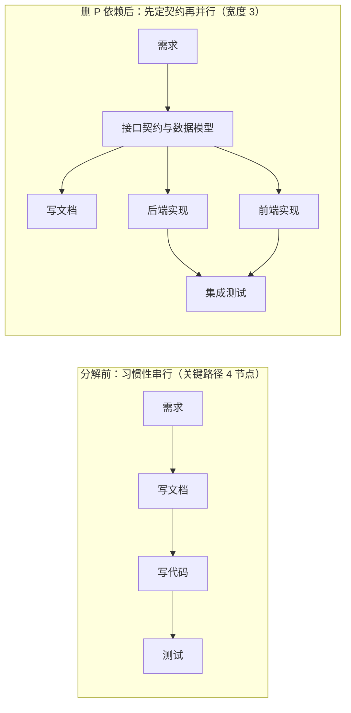

# 如何把任务分解为多个可并行的子任务：方法、判据与工程模板

> **状态**：v1.0（2026-11-20）｜**读者**：Planner 实现负责人、负责"≥4 并行子任务"这一条要求的同学
> **一句话结论**：分解不是为了"显得模块化"，而是为了**造出宽度**——只有子任务之间**没有信息依赖**、**失败可隔离**、**输出可合并**，并行才成立；否则拆得再细也只是把串行改成"更多次串行"。分解器的工作是**先证伪并行**（找出真依赖），再把剩下的部分最大化切片。
> **证据口径**：机制与数字回原文核对（见 §9）；代码结论带 `vendor/...:行号`；Prompt 模板可直接复制使用（§5）。

---

## §0 一页速览

| 问题 | 答案（本文结论） |
|---|---|
| 什么时候该拆？ | 任务含 ≥2 个**不同能力单元**（检索/计算/编码/写作/校验），且彼此无数据依赖 |
| 怎么判"能并行"？ | 五条独立性检验：数据、控制、资源、可合并、语义可切（§2） |
| 有哪几种拆法？ | 提示词驱动 / 计划-执行解耦 / 编译器式 DAG / 动态重分解 / 结构角色驱动 / 数据分片（§3） |
| 拆到什么粒度？ | 以"单次 LLM 调用能完成且产出可验收"为下界；以"合并成本 < 并行收益"为上界（§1.3） |
| 怎么保证不拆坏？ | 分解后跑四类校验：无环、覆盖、依赖闭合、冲突可合并（§6） |
| 端侧 7B 怎么办？ | 模板化分解 + 两阶段（先列步骤再补依赖）+ 节点数上限（≤8），禁止让 7B 自由发挥（§7） |

**六条硬结论**：

1. **并行的上限由关键路径决定，不由"智能体数量"决定**。子任务再多，只要关键路径那一条不变，加速比就上不去（Amdahl）。
2. **真依赖只有四类**：数据（D）、控制（C）、资源（R）、**人为偏好（P）**。前三是物理约束，**P 是唯一的"假依赖"**——绝大多数"必须按顺序"其实只是人的习惯，去掉 P 依赖是提升并行度最快的一招。
3. **"自包含"是可并行子任务的必要条件**：camel 的分解原则第一条明确要求"执行者不知道父任务、不知道其他子任务"（`vendor/camel/camel/societies/workforce/prompts.py:200-202`），否则并行执行会读到不存在的上下文。
4. **计划-执行解耦能省 token，但不能自己产生并行**：ReWOO 平均省 64% token、准确率 +4.4%，但它的 Worker 是顺序执行的——想并行必须再配合 DAG 调度。
5. **只有 LLMCompiler 类"编译器式"分解同时拿到了机制与数字**：HotpotQA 1.80×、Movie Rec 3.74×，代价 3.37×/6.73× token；WebShop 因 planner 占比过高反而变慢（10.72s vs 5.98s）。
6. **分解错误会级联**：TDAG 显示把"静态一次性分解"换成"动态重分解"后，级联失败从 32.61% 压到 4.35%；MAST 的 1642 条失败 trace 里，任务规格与验证类问题占 23.5%，大多在分解阶段埋下。

---

## §1 分解的本质：给调度器造"宽度"

### 1.1 时间账

一次多智能体任务的 wall-clock 可以粗写成：

```
T_total ≈ T_critical_path + T_serial_overhead
        = Σ(关键路径上每个子任务的执行时间) + (规划 + 排队 + 合并) 
加速比 S = T_serial / T_total ≤ 1 / (s + (1-s)/W)
```

其中 `s` 是必须串行的比例，`W` 是有效并行宽度。两个直接推论：

- **W 再大，s 不变则 S 有上界**（s=0.4 时上限 2.5×，s=0.5 时上限 2×）；
- **"≥20% 提速"⇔ T_total ≤ 0.8·T_serial**，更实用的算法是：**先测串行的每步耗时，再按关键路径重排**，不要先拆再算。

**本项目的账**（详见 doc/03 §5.5）：串行 10 个时间单位 → 关键路径 6 个单位，理论 1.67×；若把规划/合并压到 1 个单位，关键路径 5，得 2.0×。**"多拆一个能并行的节点"远不如"缩短关键路径上的那个慢节点"值钱。**

### 1.2 宽度从哪里来

| 宽度来源 | 做法 | 例子 |
|---|---|---|
| **任务并行** | 不同能力的子任务同时跑 | 检索文献 ∥ 写数据模型 ∥ 搭前端骨架 |
| **数据并行** | 同一操作作用于多个输入 | 10 篇论文分 5 组并行精读；5 个模块并行写码 |
| **流水线并行** | 不同阶段对不同数据同时处理 | 模块 A 在测试时，模块 B 在编码 |
| **投机并行** | 依赖不确定时先都跑，选一个 | 两种架构方案都先画原型 |

> 工程上性价比最高的是**数据并行**：不需要重新设计依赖，只把输入切片，且失败隔离天然成立。camel 的分解原则第 4 条把"Aggressive Parallelization"拆成"跨专业并行 + 同阶段内数据并行"两档（`prompts.py:212-216`），正是这个意思。

### 1.3 粒度权衡

| 粒度 | 症状 | 后果 |
|---|---|---|
| 太粗（1 个子任务包 3 件事） | 关键路径长、无宽度 | 没有并行收益 |
| 太细（每个函数一个节点） | 节点数 ≫ 并行宽度 | 调度/合并开销吃掉收益，上下文碎片化 |
| 合适 | 单次 LLM 调用可完成 + 产出可验收 + 合并成本低 | 宽度 ≈ 可用 agent 数 |

**经验下界**：一个子任务的 prompt 能在一次调用内写完（约 2–4K token），且产出能用一段 JSON/一个文件验收。
**经验上界**：节点数 ≤ 4×并行宽度；超过就说明在"为了拆而拆"。

---

## §2 可并行性的五条判据（分解前先证伪）

分解器最容易犯的错，是**把"看起来独立"当成"真的独立"**。对任意两个候选子任务 A、B，逐条检查：

### 2.1 数据独立（D 依赖）

- A 的输出是否被 B 读取？B 是否会改写 A 的产物？
- 判据：**没有 RAW（写后读）、WAR（读后写）、WAW（写后写）**。
- 典型违反：B 要"在 A 定的接口上"写代码 → 接口是 A 的输出 → A→B 有依赖（但可以只依赖"接口契约"，让 A 先出契约、B 与 A 的其余部分并行）。

### 2.2 控制独立（C 依赖）

- A 失败是否要求 B 回滚/重做？
- 典型违反：先建数据库再建表再灌数据——失败要整体回滚，不能并行。

### 2.3 资源独立（R 依赖）

- 是否争用同一份独占资源：同一个文件、同一个端口、同一个数据库、同一个浏览器实例、同一个模型配额？
- 典型违反：两个 agent 同时改 `src/app.py`（会互相覆盖）。解法不是串行，而是**划分写入范围**（一个改前端文件、一个改后端文件）。

### 2.4 输出可合并

- 是否存在确定的 `merge(输出A, 输出B)`？合并后是否可能冲突（同一字段两种取值）？
- 典型违反：两个 agent 各自写"最终总结"，合并时互相矛盾。解法：**先定 schema，各自填字段**，冲突字段交给 Verifier 裁决。

### 2.5 语义可切片

- 切片后信息是否丢失？跨片引用是否成为新的依赖？
- 典型违反：把一篇论文按段落切给 8 个 agent 各写摘要，导致"每段都懂、整体逻辑断裂"。解法：**按论证单元切**（背景/方法/实验/结论各一片），最后再用聚合 prompt 串逻辑。

### 2.6 依赖的四种类型与处理策略

| 类型 | 含义 | 能否并行 | 处理 |
|---|---|---|---|
| **D 数据依赖** | B 需要 A 的输出 | ❌ 除非先产出"契约/接口/骨架" | 拆出契约节点，让 A、B 在其后并行 |
| **C 控制依赖** | B 的失败要求 A 回滚 | ❌ | 合并为一个事务性子任务 |
| **R 资源依赖** | 争用同一独占资源 | ⚠️ 可改为"分区"后并行 | 划分写入范围/端口/文件 |
| **P 偏好依赖** | "习惯上先做 A" | ✅ **可以去掉** | 显式标注 `soft: true`，调度器忽略 |

**提升并行度最有效的操作，就是把 P 依赖从依赖图里删掉。** 实践中常见的 P 依赖："先写文档再写代码"（其实可以并行，只要接口先定）、"先评审再测试"（可以并行准备用例）、"先做后端再前端"（契约先定即可）。

---

## §3 五种分解策略（按机制分类，可混用）

### A. 提示词驱动：Plan-and-Solve（PS / PS+）

**机制**：在提问前插入"Let's first understand the problem and devise a plan to solve the problem. Then, let's carry out the plan…"（arXiv:2305.04091）。零样本/少样本都能触发"先规划后执行"，显著减少"漏步骤"类错误。

**优点**：实现成本极低，一个 prompt 就行。
**缺点**：**不产生并行**——它是"更完整的串行计划"，不是 DAG。
**用途**：作为其它策略的"第一层"，让模型先写出步骤，再让第二层把这些步骤转成 DAG。

### B. 计划-执行解耦：ReWOO

**机制**：Planner 一次写出带变量引用的计划 `#E1 = Wikipedia[...]`、`#E2 = LLM[..., context: #E1]`（arxiv:2305.18323），Worker 顺序执行并回填证据。

**收益**：平均省 **64% token**、准确率 **+4.4%**（因为不再每步重发完整上下文）。
**局限**：Worker 是**顺序**执行的；`#E` 表达的是数据依赖边，天然是 DAG 的雏形，但原论文没有并行调度。
**用途**：如果你只需要"少 token 的串行"，选它；要并行，把 `#E` 依赖图直接喂给调度器。

### C. 编译器式 DAG：LLMCompiler（最接近赛题要求）

**机制**：Function Calling Planner 一次 LLM 调用产出"DAG of tasks"——每个任务含 `thought / name / args / dependencies`；Task Fetching Unit 按依赖就绪并行取任务，交给 Executor 并行执行（arXiv:2312.04511）。

**数字**：HotpotQA **1.80×**、Movie Rec **3.74×**（8 路并行）；成本 **3.37×/6.73×**；WebShop 反变慢（10.72s vs ReAct 5.98s）。
**教训**：**planner 调用本身不能太贵**，否则 s 上升，加速被吃掉；端侧 7B 上 planner 更慢，必须用"模板化 planner + 短输出"。

**可复用的 planner 输出契约**（我们自己的字段版）：

```json
{
  "tasks": [
    {"id": "T1", "goal": "…", "deps": [],      "tools": ["retriever"],
     "output_schema": "src/api/schema.json",  "estimate": 2},
    {"id": "T2", "goal": "…", "deps": [],      "tools": ["coder"],
     "output_schema": "src/server/routes.py", "estimate": 3},
    {"id": "T3", "goal": "…", "deps": ["T1"],  "tools": ["coder"],
     "output_schema": "src/web/pages.jsx",    "estimate": 2},
    {"id": "T4", "goal": "…", "deps": [],      "tools": ["writer"],
     "output_schema": "README.md",            "estimate": 1}
  ],
  "merge": {"strategy": "by_schema", "conflict": "verifier_decides"},
  "acceptance": ["npm test 通过", "5 个接口返回 200", "关键路径 ≤ 6 单位"]
}
```

### D. 动态重分解：TDAG

**机制**：执行到某节点时，用"已完成子任务的结果 + 当前目标"重新调用分解器，改写**后继**子任务（arXiv:2402.10178）。

**数字**：CTF 类任务级联失败从 **32.61% → 4.35%**。
**代价**：每步都分解 → LLM 调用次数上升；需要"何时重分解"的触发条件（失败、结果不满足 schema、置信度低）。
**用途**：探索型任务（信息不全、早期错误会改变后续计划）。**不建议**在计划已确定的工程任务上全程使用。

### E. 结构/角色驱动：MetaGPT SOP、ChatDev chain、camel 规则

**机制**：不靠 LLM 自由分解，而是**预置流程模板**：MetaGPT 按"需求→设计→任务→编码→评审"的 SOP 分派角色（`vendor/MetaGPT/metagpt/team.py:83/92/123`），ChatDev 按 chat chain 阶段切分，camel 在 prompt 里给出 7 条分解原则（`vendor/camel/camel/societies/workforce/prompts.py:194-233`）。

**camel 的七条原则值得直接抄**（我们已翻译成中文规则，见 §5.1）：
① 先判复杂度，简单任务不拆；② 子任务必须**自包含**（不得用"上一步的结果"这类相对指代）；③ 每个子任务有**明确交付物与完成定义**；④ 保证**全流程完整**（别漏"提交/发送/部署"这类收尾步骤）；⑤ **激进并行**（跨专业 + 同阶段数据并行）；⑥ 粒度平衡；⑦ 有 skill 能端到端完成的任务不要拆（`prompts.py:223-232`）。

**优点**：7B 模型下最稳（不用它现场推理依赖）。
**缺点**：流程外的任务无法覆盖。

### F. 数据分片：Chain-of-Agents / Map-Reduce

**机制**：长输入按段切片，每片一个 worker 并行处理，再由 manager 逐层聚合（arXiv:2406.02818）；LangGraph 用 `Send` 做动态扇出（`vendor/langgraph/libs/langgraph/langgraph/types.py:748`）。

**适用**：长文档、多数据源、多模块代码这类"同构可分"的输入。
**注意**：切片边界要按**语义单元**（章节/模块/数据集行段），不要按固定字数硬切；聚合阶段要处理"跨片指代"（"该方法"指的是哪一片的哪个方法）。

### 策略选择表

| 任务特征 | 首选策略 | 次选 |
|---|---|---|
| 流程固定、角色清晰（软件外包型） | E 结构驱动 | A 提示词 |
| 子任务可预先枚举、依赖明确 | C 编译器式 DAG | B ReWOO |
| 输入同构、体量大 | F 数据分片 | C |
| 探索型、信息逐步暴露 | D 动态重分解 | A |
| 7B 端侧、预算紧 | E + 模板化 C | A |

---

## §4 实操 SOP：七步把任务拆成可并行子任务

### 第 1 步：写清交付物与验收（DoD）

先写"最终要交什么"（文件/接口/测试通过/演示视频），再写"怎么算做对"。**没有 DoD 的任务不可分解**——因为你不知道每一个子任务该交什么。

### 第 2 步：列"信息依赖"清单（先不画图）

逐条问：这个子任务的**输入**从哪来？
- 来自用户需求 → 根节点
- 来自某个子任务的输出 → 有 D 依赖
- 来自"约定"（接口契约、schema、目录结构）→ **不是依赖**，是前置契约

**这一步的产出是一张"输入→来源"表**，它比直接画 DAG 更能暴露隐藏依赖。

### 第 3 步：切成"能力单元"

按**能力**而不是按**文件**切：检索、计算、编码（后端/前端/数据）、写作、校验、部署。
- 同一个能力单元内的多个实例 → 数据并行（可拆）
- 不同能力单元 → 任务并行（可并行，若数据独立）

### 第 4 步：画依赖边，删掉 P 依赖

对每条边标注类型 `D/C/R/P`。**所有 P 边默认删除**，只在有明确理由时保留（例如"必须由人类先确认预算"）。
产出：带类型标注的 DAG。

**删 P 依赖的效果**（本项目形态的示例）：



左图里"先文档后代码"是 P 依赖（删掉）、"代码后测试"里只有"测试要跑在实现上"是真 D 依赖（保留）；右图把"契约"抽成独立节点后，文档/后端/前端三者同时就绪，关键路径从 4 降到 3，且宽度从 1 升到 3。

### 第 5 步：分片与分桶

对每个"可并行"节点，决定拆不拆：
- 输入是多份独立材料 → 按材料拆；
- 输入是长文档 → 按语义单元拆；
- 输入是单份且强耦合 → **不拆**，改为"前置契约 + 后续并行"。

### 第 6 步：估时与算账（Amdahl 预算）

| 节点 | 估时（单位） | 依赖 |
|---|---|---|
| T1 需求与接口契约 | 1 | — |
| T2 数据模型 | 2 | T1 |
| T3 后端 API | 3 | T1 |
| T4 前端页面 | 3 | T1 |
| T5 测试与文档 | 2 | T2,T3,T4 |
| T6 集成与演示 | 1 | T5 |

关键路径 = T1→T2/T3/T4→T5→T6 ≈ 1+3+2+1 = 7 单位；串行 = 12 单位 → **理论 1.71×**。
若把 T5 拆成"后端测试 ∥ 前端测试"（各 1），关键路径 6 → **2.0×**。
**这就是"分解如何直接换来加速比"的算法。**

### 第 7 步：定义合并函数与校验

- 合并：`merge` 是"按 schema 拼装"还是"LLM 总结"？冲突谁裁决？
- 校验：无环、覆盖全部 DoD、依赖闭合、无资源冲突（见 §6）。

---

## §5 可直接复制的 Prompt 模板

### 5.1 分解器（Planner）系统提示

```text
你是任务分解器。把用户任务拆成"可并行执行"的子任务 DAG，只输出 JSON。

硬性规则：
1. 先判复杂度：若单次调用可完成且产出可验收，输出 1 个任务，不要拆。
2. 自包含：每个子任务的 description 必须让执行者在不看父任务、不看其他子任务的情况下也能完成。
   禁止出现"上一步的结果""上面提到的文档""第一个任务"等相对指代；需要的输入用 deps 表达。
3. 交付物：每个子任务必须写清 output（文件路径/JSON schema/验收标准）。
4. 完整覆盖：所有子任务合起来必须完成原任务，禁止遗漏收尾步骤（提交、部署、写文档、汇报）。
5. 激进并行：
   a) 不同能力的阶段拆成独立子任务；
   b) 同一阶段内对多份输入（多文档/多模块/多数据集）按份拆成并行子任务；
   c) 不要把可以并行的事情写成串行。
6. 依赖标注：每条依赖标 dep_type ∈ {D 数据, C 控制, R 资源}。
   若只是"习惯上先做"，标 P 并加 "soft": true —— 软依赖不阻塞调度。
7. 粒度：单子任务应能在一次 LLM 调用内完成；任务总数 ≤ 8。
8. 合并：给出 merge 策略（by_schema / concat / llm_summarize）与冲突裁决方式。

输出 JSON：
{"tasks":[{"id":"T1","goal":"...","description":"...","deps":[],
           "deps_detail":[{"on":"T0","type":"D"}],
           "tools":["retriever"],"output":"...","estimate":2}],
 "merge":{...}, "acceptance":[...], "risks":[...]}
```

### 5.2 自检提示（让同一个模型复查自己的 DAG）

```text
检查下面这个任务 DAG，逐项回答（有问题只说问题）：
1. 有无环？
2. 有无子任务缺少 output/验收标准？
3. 有无"相对指代"（上一步/前面/该文档）？→ 必须改成 deps + 显式输入
4. 有无本可并行却被写成串行的节点？→ 列出并说明能否删边
5. 有无遗漏的收尾步骤（部署/提交/文档/汇报）？
6. 关键路径是哪条？宽度是多少？理论加速比多少？
7. 是否有两个子任务会写同一个文件/抢同一个端口？
```

### 5.3 分片提示（数据并行）

```text
把输入按下述语义边界切片，每片必须能独立处理：
- 文档：按章节/论证单元（背景、方法、实验、结论），不按字数硬切
- 代码：按模块/文件，接口契约单独作为前置节点
- 数据集：按行段或类别，片间不共享样本
输出：[{"shard_id":"S1","range":"...","instruction":"..."}]
```

---

## §6 校验与度量：怎么知道拆对了

### 6.1 四类校验（脚本可做前三条）

| 校验 | 规则 | 失败后果 |
|---|---|---|
| **无环** | DAG 拓扑排序可完成 | 调度器死锁 |
| **覆盖** | 每个 DoD 条目至少被一个子任务的 output 覆盖 | 做完了但不满足需求 |
| **依赖闭合** | 每条 deps 指向已存在的 id；所有输入都有来源 | 执行时缺输入 |
| **冲突** | 两个并行节点的写入路径/端口/资源不相交 | 结果互相覆盖 |

### 6.2 三个度量

1. **有效宽度 W** = 最大同时就绪节点数（不是任务总数）；
2. **理论加速** = `T_serial / T_critical_path`；
3. **实测加速** = 同任务串行跑一遍的 wall-clock ÷ 并行跑的 wall-clock（必须同硬件、同模型、预热 ≥3 次、取中位数，口径见 doc/08 §B）。

**宽化测试**：固定任务，把并行宽度从 1 拉到 4、8，画"加速比–宽度"曲线。若曲线很快饱和，说明 s 太大（关键路径没优化）；若曲线不升反降，说明合并/调度开销过大。

### 6.3 四种典型分解失败

| 失败 | 表现 | 根因 | 修法 |
|---|---|---|---|
| 欠分解 | 加速比 < 1.2×，只有一个节点就绪 | 关键路径过长 | 按 §4 第 6 步找关键路径上的慢节点拆开 |
| 过度分解 | 节点 20+，合并耗时占比高 | 粒度太细、上下文碎片化 | 合并同能力相邻节点，节点上限 8 |
| 伪依赖 | 明明能并行，调度器在等 | 把 P 依赖当 D 依赖 | 逐边标类型，删 soft 边 |
| 合并冲突 | 两节点给出矛盾结论 | 无 schema、无裁决者 | 先定 schema，冲突交给 Verifier |

---

## §7 端侧 7B 的额外约束

7B 模型做 planner 有三个硬伤：**格式不稳定**（JSON 出错）、**依赖推理弱**（把 P 当 D，或漏依赖）、**长输出衰减**（节点超过 10 个后质量骤降）。对策：

1. **模板化**：不让它自由生成 DAG，而是"填表"——给固定 JSON schema + 1 个 few-shot 例子（§5.1 可直接用）；
2. **两阶段**：第一步只让它列步骤（纯文本，5 条以内）；第二步让规则/代码补依赖（同能力不依赖、按契约建边），LLM 只做"依赖合法性"判断；
3. **节点上限 ≤8**，超过就分两轮分解（先粗后细）；
4. **校验拦截**：模型输出先过 §6.1 的脚本校验，不通过就重试一次，再不过就回退到模板分解；
5. **不要让它自己估计耗时**（7B 估时基本不可信），耗时用历史实测或默认值。

> 依据：AgentBench 上 6B 模型 Overall=0.11、≤70B 均值 0.51（doc/08）；MetaGPT 用 33B 时可执行性仅 1.4/4（doc/05）。**弱模型的价值在"执行单步"，不在"做全局规划"。**

---

## §8 落到本赛题：团队任务看板的分解示例

**总目标**：做一个"团队任务看板"全栈 Web 应用（需求文档 + 前后端 + 测试 + 演示）。

| id | 子任务 | 能力 | deps | 产出 | 估时 |
|---|---|---|---|---|---|
| T1 | 写 API 契约与数据模型 | 设计 | — | `docs/api.yaml`、`schema.sql` | 1 |
| T2 | 后端：任务 CRUD + 看板列 | 编码 | T1(D) | `server/` 可跑 | 3 |
| T3 | 前端：看板页面 + 拖拽 | 编码 | T1(D，仅契约) | `web/` 可跑 | 3 |
| T4 | 测试用例（后端 API + 前端交互） | 测试 | T1(D) | `tests/` | 2 |
| T5 | 部署脚本与 README | 运维/写作 | T1 | `deploy/`、`README.md` | 1 |
| T6 | 集成验证与演示脚本 | 校验 | T2,T3,T4,T5 | 测试通过 + 演示 | 1 |

- **并行**：T2、T3、T4、T5 四个节点在 T1 之后**同时就绪**（满足"≥4 个可并行子任务"）；
- **关键路径**：T1→T2→T6 = 5 单位；串行 11 单位 → **理论 2.2×**；保守按"实测有 20–40% 损耗"估，落在 1.6–1.8×，仍超过 20% 门槛；
- **注意**：T3 只依赖 T1 的**契约**，不依赖 T2 的实现——这是"拆契约节点"带来的并行度提升，也是答辩时可讲的细节；
- **验收**：`npm test` 通过 + 5 个接口 200 + 拖拽可用 + 关键路径实测 ≤ 6 单位。

**与其它文档的衔接**：分解方法 → 本文；DAG 调度与 TSU → doc/07；加速比基准协议 → doc/08 §B；角色与三环节机制 → doc/14；整体设计 → doc/03 §5–§6。

---

## §9 证据与文献映射

| 结论 | 证据 |
|---|---|
| camel 的 7 条分解原则（自包含、交付物、完整覆盖、激进并行、粒度、依赖、skill 豁免） | `vendor/camel/camel/societies/workforce/prompts.py:194-233` |
| camel Task 模型（`subtasks`、`dependencies`、`assigned_worker_id`、`state`） | `vendor/camel/camel/tasks/task.py:216-276`（deps 在 `:272`） |
| camel 从指派结果回填依赖、仅依赖满足才派发 | `workforce.py:4011`、`:4397` |
| LangGraph 动态扇出 `Send` | `vendor/langgraph/libs/langgraph/langgraph/types.py:748` |
| MetaGPT 按 SOP 分工、串行执行 | `vendor/MetaGPT/metagpt/team.py:83/92/123`、`strategy/solver.py:35-42` |
| Plan-and-Solve：先规划后求解 | arXiv:2305.04091 |
| ReWOO：计划-执行解耦、`#E` 依赖引用、省 64% token / +4.4% | arXiv:2305.18323 |
| LLMCompiler：planner 出 DAG + task fetching unit 并行；1.80×/3.74×、3.37×/6.73×、WebShop 反变慢 | arXiv:2312.04511 |
| TDAG：动态重分解，级联失败 32.61% → 4.35% | arXiv:2402.10178 |
| Chain-of-Agents：长上下文分片 + 逐层聚合 | arXiv:2406.02818 |
| AutoAgents：按子任务生成团队 | arXiv:2309.17288 |
| MAST：失败分类与实证（任务验证类 23.5%，失败率 41–86.7%） | arXiv:2503.13657 |
| AgentBench 能力上界（6B=0.11、≤70B=0.51、GPT-4=4.01） | arXiv:2308.03688 |

延伸：doc/07（分解与并行的论文精读）、doc/14（分配—执行—汇总机制）、doc/08 §B（加速比测量口径）、doc/03 §5（本项目 DAG 与 Amdahl 计算）。

---

## §10 局限

1. "五条判据"是工程归纳，不是形式化定理——大规模系统仍可能出现"判据通过但语义耦合"的情况；
2. §5 的 prompt 模板在 7B 上**未实测**（本机无推理环境），需要接入模型后按 §7 的三招调参；
3. 理论加速按"每节点估时"计算，估时本身有误差；最终以 wall-clock 实测为准（doc/08 §B 的三种伪加速已给出排除方法）；
4. 分解质量与任务类型强相关：软件工程类适合结构驱动，研究类适合动态重分解，本文未给出跨类型的统一最优解。

---

**变更记录**

| 版本 | 日期 | 变更 |
|---|---|---|
| v1.0 | 2026-11-20 | 初稿：可并行性五判据、五种分解策略、七步 SOP、三个可复制 Prompt、四类校验、端侧约束与赛题示例 |
