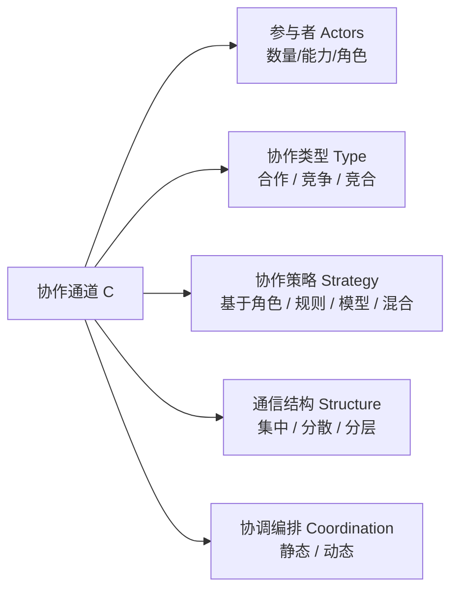
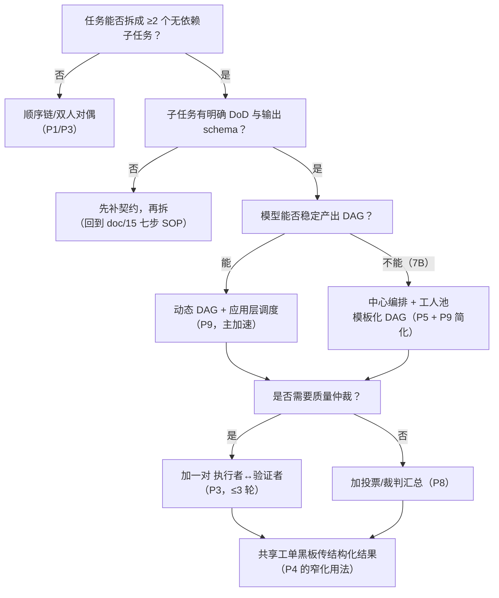

# 多智能体协作模式研究报告

> 版本 v1.0 ｜ 2026-11-20 ｜ 作者：lead
>
> **研究方法**：以 `doc/02`（arXiv:2501.06322 综述全译）的五维框架为骨架，用 `doc/05`（五个协作框架精读）、`doc/06`（失败模式与拓扑）、`doc/14`（分配/执行/汇总）的实测数据做证据，并在 `vendor/` 的 12 个真实仓库中逐条核对了机制所在的行号。凡"论文宣称"与"代码已实现"不同处均分开标注；未亲手运行的绝对数字一律标明出处。
>
> **一句话结论**：协作模式不是"选一个最先进的"，而是**在「质量控制点」与「通信成本」之间做匹配**——模式决定了谁有权否决、谁必须等待、消息走几条链路，而这三件事直接决定 7B 端侧能否在 20% 提速的前提下还答对。

---

## 0. 一页速览

### 0.1 十条硬结论

| # | 结论 | 依据 |
|---|---|---|
| 1 | 协作模式的四元组是 **类型（合作/竞争/竞合）× 结构（集中/分散/分层）× 策略（角色/规则/模型）× 协调（静态/动态）**，任一模式都可用这四维定位 | 2501.06322 §5（`doc/02` §5） |
| 2 | **静态协调（顺序链、SOP 流水线）保证可控但几乎不产生并行**；动态协调（DAG、动态组队）才能加速，代价是额外的规划调用与失败面 | 综述表 5；`doc/07` |
| 3 | 真正被实测出端到端加速的协作模式只有**图式动态 DAG** 一类：LLMCompiler HotpotQA **1.80×**、Movie Recommendation **3.74×**（8 路并行） | LLMCompiler 原文；`doc/07` §3.5 |
| 4 | **星型（中心编排）在 7B 端侧是性价比最高的结构**：只有中心 agent 需要长上下文与全局推理，工人可短上下文、可复用、可并行 | camel Workforce、AgentScope TeamPipeline 源码 |
| 5 | **分层结构的价值是"隔离上下文"而非"加速"**：DyLAN 两阶段组队 + 早停省 **11.3–66.2%** API 调用，效率 **+52.9%/+67.8%**（3 人队） | DyLAN 原文；`doc/06` |
| 6 | **辩论（多智能体 debate）在 7B 上基本不划算**：成本 ×N、轮数不可控，而弱模型的"分歧"多是同一错误的复读；竞争设计不当甚至会被"强提示单智能体"反超 | 综述 §5.2 对 [128] 的提醒；`doc/05` |
| 7 | **"汇总"是最容易被低估的环节**：五类汇总（拼接/投票/裁判/层级归纳/状态机）里，只有**带一致性校验的裁判式汇总**能拦住矛盾结论 | `doc/14` §3 |
| 8 | 三个"必须显式设计"的协作契约：**终止条件**（否则无限对话）、**上下文边界**（否则窗口爆炸）、**失败回传路径**（否则静默丢任务） | MAST 失败分类；`doc/06` §2 |
| 9 | 三种最致命失败都与模式选择直接相关：**角色不匹配/任务分配错位（32.3%）**、**验证缺失（23.5%）**、**系统设计缺陷（44.2%）** | MAST；`doc/06` |
| 10 | 对本赛题：推荐 **"契约前置 + 中心编排 + 动态 DAG 并行 + 结构化 verifier 闭环 + 共享工单黑板"** 的五件套混合模式，避免辩论/自由群聊/纯 handoff | 见 §7 |

### 0.2 最该记住的一张表（模式 → 加速潜力 → 质量风险）

| 模式 | 并行潜力 | 加速证据 | 主要质量风险 | 7B 适配 |
|---|---|---|---|---|
| 顺序链 / SOP 流水线 | 无 | 无（纯串行） | 上游错误级联 | ★★★★★ |
| 双人对偶（执行者↔验证者） | 无（1 对 1） | 无 | 验证者被同化 | ★★★★★ |
| 共享黑板 / 群聊广播 | 低（发言串行） | 无 | 话题漂移、上下文爆炸 | ★★☆ |
| 中心编排（管理者-工人） | 中高 | 无直接数字，靠并发派发 | 单点瓶颈 | ★★★★ |
| 分层（团队优化→求解） | 中 | DyLAN 效率 +52.9%/+67.8% | 层间信息丢失 | ★★★☆ |
| 辩论 / 裁判 | 中（并行辩论） | 事实性提升，无时间数字 | 成本 ×N、趋同 | ★★ |
| 投票 / 集成 | 高（天然并行） | LLM-Blender 式排序提升质量 | 需要可比输出 | ★★★ |
| 图式动态 DAG | **最高** | LLMCompiler 1.80×/3.74× | 规划错误、合并冲突 | ★★☆（需模板约束） |
| 交接 / handoff | 低 | 无 | 依赖丢失、循环移交 | ★★★ |

---

## 1. 协作模式的四维坐标系

### 1.1 五维框架（综述给出的官方语言）

arXiv:2501.06322 把多智能体协作通道 $\mathcal{C}$ 拆成可独立选择的设计维度（`doc/02` §5）：



- **类型**：合作（共享目标，如 MetaGPT、CAMEL、AutoGen）、竞争（博弈/对抗，如 LLMARENA、CompeteAI）、竞合（同时有合作通道与竞争通道，如辩论中的"两方 + 裁判"）。
- **策略**：基于角色（MetaGPT/ChatDev 预置产品经理-程序员-测试）、基于规则（if-else 调度）、基于模型（LLM 充当规划者/选择者）、混合。
- **结构**：集中式（星型，一个 hub）、分散式（P2P）、分层（按层组织）。
- **协调**：静态（启动前固定通道顺序）、动态（运行时按输入/中间结果生成或调整通道）。

> **关键洞察**：综述特别强调"**最优通信结构并非固定不变，而会随任务与智能体组成变化**"（[24,146,151]）。这句话是整份报告的出发点——不存在万能模式，只有匹配关系。

### 1.2 四种通信范式 ↔ 四种拓扑

综述引用 [146] 给出一个极好用的对照表，工程上可直接当"消息怎么走"的选型表：

| 通信范式 | 拓扑 | 消息流向 | 适合什么 |
|---|---|---|---|
| memory（记忆共享） | **bus 总线** | 所有 agent 读写同一块共享状态 | 共享工单、共享文件、看板 |
| report（汇报） | **star 星型** | 工人 → 中心 → 工人 | 管理者-工人式编排（最常用） |
| relay（中继接力） | **ring 环型** | A→B→C→A 流水传递 | 顺序加工、多轮修订 |
| debate（辩论） | **tree 树型** | 多方陈述 → 上级裁判 | 需要质量仲裁、存在分歧 |

### 1.3 三种控制流（本报告的归纳）

把上述维度压成工程上真正要选的三种控制流：

1. **预定义控制流**：谁在什么时候说话是写死的（顺序链、SOP、round-robin 群聊）。
2. **中心决策控制流**：由中心 agent 决定下一位/下一批工作（camel Workforce、AutoGen SelectorGroupChat、AgentScope TeamPipeline）。
3. **数据驱动控制流**：控制流由 DAG/依赖图在运行时计算（LLMCompiler、LangGraph Pregel、agentflow）。

**加速只能来自第 3 类，或第 2 类中"一次派发多个无依赖工人"。**

---

## 2. 十种协作模式逐个拆解

以下每种模式给：**结构 → 机制 → 优点 → 代价 → 代码/论文证据 → 7B 与赛题适配**。

### P1 顺序链（Sequential Chaining）

- **结构**：ring / 线性。
- **机制**：$y_{i+1} = y_i \,\|\, x_i \,\|\, x_{collab}$，前序输出拼进后继输入（综述 [23] 的原始公式）。三个 LLM 分别做领域专家 A、领域专家 B、总结者，在大学理科多选题上优于单智能体 CoT。
- **优点**：实现最简、调试最容易、上下文天然收敛。
- **代价**：**零并行**；上游幻觉逐级放大；链条越长延迟线性增长。
- **证据**：综述 §5.5.1 顺序链 [23]、MapCoder [60]（recall→planning→code→debug 四段固定顺序）、MACRec [131]、文学翻译 [133]（初译—审校—润色）。
- **7B**：★★★★★ 最稳；**赛题**：只能当基线，拿不到 20% 提速，但**非常适合做"串行基线"对照组**。

### P2 角色 SOP 流水线（Role-based SOP）

- **结构**：ring + 角色分工。
- **机制**：把软件开发的组织流程固化为一串角色交接：产品经理→架构师→项目经理→工程师→QA。MetaGPT 用 SOP 编码"标准作业程序"，ChatDev 用"Chat Chain"把每个阶段再拆成"提议-评审"对。
- **优点**：流程合理，产物形态完整（文档、设计、代码、测试），团队协作的"组织感"强。
- **代价**：仍是**串行**；角色越多、交接损耗越大。
- **证据（数字）**：MetaGPT 在 HumanEval/SoftwareDev 上可执行率 85.9%/87.7%（`doc/05` §3）；ChatDev 去掉角色机制后质量分从 **0.3953 → 0.2212**（`doc/05`）——角色不是装饰，是质量来源。
- **代码**：`vendor/MetaGPT/metagpt/roles/role.py:429`（`_publish_message` → 环境黑板）；`vendor/MetaGPT/metagpt/team.py:83/92/102/123`（hire/invest/run_project/run）。
- **7B**：★★★★★（角色提示要短）；**赛题**：适合"文档/测试/部署"这类有明确工序的子链，**不要用它承载需要并行的主干**。

### P3 双人对偶（执行者 ↔ 验证者）

- **结构**：ring（严格 1 对 1 往返）。
- **机制**：一个 agent 产出，另一个 agent 按**结构化标准**判定 pass/fail，fail 则带反馈重启执行者，直到 pass 或超轮数。
- **优点**：**质量闭环最便宜的实现**——只多一次调用，却能把"没人检查"的系统性缺口补上；判定标准可写成 JSON schema，7B 也能胜任。
- **代价**：多一轮延迟；验证者若与执行者共享上下文会被"同化"（倾向于批准）。
- **证据（代码，已核实）**：
  - AgentScope `_goal_pipeline.py`：verifier 返回 `Literal["pass","fail","impossible"]`（`:34-40`）；输出不合 schema 时用 retry budget + system-reminder 回灌（`:311-336`）；`fail` 且 `verifier_reset_context` 时**清空验证者上下文**（`:352-355`）——这正是"防同化"的实现；超过 `max_iters` 强制结束（`:356-359`）；反馈 `message` 回灌执行者重做（`:361-369`）。
  - CAMEL `role_playing.py:36`（RolePlaying 类）/`:548`（init_chat）/`:631`（step）：AI User ↔ AI Assistant 双人循环。
  - OWL 的 `enhanced_role_playing.py:481-494` 只有 **1 对** user↔assistant 闭环（round_limit=15），说明"OWL 式任务"本质上就是 P3 的放大版。
- **7B**：★★★★★（首选质量保险）；**赛题**：**必选**，是最容易讲清楚、也最容易实现"≥3 对双向交互"的模式之一。

### P4 共享黑板 / 群聊广播（Blackboard / Group Chat）

- **结构**：bus（黑板）或 star（群聊主持人广播）。
- **机制**：所有 agent 往同一消息池写，订阅者按需读；或由一个主持人按顺序/选择器点名发言，消息广播给所有人。
- **优点**：解耦——发送者不必知道接收者；新增角色不改主流程；天然支持"抢单"式协作。
- **代价**：**群聊本质串行**（同一时刻只有一人发言）；上下文随轮数线性膨胀；容易话题漂移、重复发言。
- **证据（代码，已核实）**：
  - MetaGPT 共享消息池：`vendor/MetaGPT/metagpt/base/base_env.py:37` 定义 `publish_message`（`:175` 公开 API），角色 `role.py:429` 调用——"谁需要谁读"，是数据依赖最现成的载体。
  - AutoGen 群聊四件套：`vendor/autogen/python/packages/autogen-agentchat/src/autogen_agentchat/teams/_group_chat/` 下 `_round_robin_group_chat.py`（轮流）、`_selector_group_chat.py`（LLM 选下一位，`_select_speaker :232`，`max_selector_attempts` 防死循环）、`_swarm_group_chat.py`（交接）、`_base_group_chat_manager.py`（公共骨架）。
- **7B**：★★☆（发言选择容易乱）；**赛题**：**用"共享工单/看板"当黑板，但不要用自由群聊做决策**——黑板只传结构化结果（JSON），不传自然语言长对话。

### P5 中心编排 + 工人池（Manager–Worker / Star）

- **结构**：star。
- **机制**：中心 agent 持有全局状态与计划，工人只拿"任务描述 + 输入片段"返回结构化结果；中心决定派发、重试、合并。
- **优点**：**端侧最优结构**——只有中心需要长上下文/全局推理，工人短上下文可并行、可复用同一模型；失败隔离清晰（一个工人挂掉只影响一个子任务）。
- **代价**：中心是单点瓶颈与单点故障；中心一次只看得到工人摘要，容易丢失细节。
- **证据（代码，已核实）**：
  - camel Workforce：`_decompose_task :1549` / `_analyze_task :1645` 拆任务，`_update_task_dependencies_from_assignments :4011` 建依赖，`_find_assignee :4042-4101` 派发（`coordinator_agent.reset() :4088` 防上下文污染），`_post_ready_tasks :4397` 只投递前驱全完成的节点，`_handle_failed_task :4642` / `_handle_completed_task :4941` 处理回流。
  - AgentScope TeamPipeline（`pipeline/_team_pipeline.py:111-129`）：leader 通过唯一工具 `TeamAssign` 派活；**同一轮内多个工人的任务并发执行**，但同一工人的多次派活串行；**工人之间不说话，结果只回给 leader**，leader 只见摘要不见中间步骤。这段 docstring 是"星型 + 上下文隔离"最干净的定义。
- **7B**：★★★★；**赛题**：**必选主干**。中心 = Planner/Orchestrator，工人 = Coder/Tester/Writer，正好满足"自动分配"要求。

### P6 分层（Hierarchical / Two-stage）

- **结构**：tree，层内/相邻层通信。
- **机制**：高层规划、低层执行；或先"组队"（挑人）再"求解"（干活）。
- **优点**：把"选谁干"与"怎么干"分离，降低单次决策复杂度；天然对应"团队优化"。
- **代价**：层间信息压缩有损；层数一多延迟叠加；底层 agent 看不到全局目标易跑偏。
- **证据**：
  - AgentVerse [24] 氢储能站选址案例：高层规划决策、低层收集执行（综述 §5.4.3）。
  - **DyLAN [81] 两阶段**：Team Optimization（无监督选贡献最大的 agent）→ Task Solving（小团队求解），中间用 LLM ranker 动态停用低贡献者、**提前停止**；实测 3 人队效率 **+52.9%/+67.8%**、省 **11.3–66.2%** API 调用（`doc/06`）。
  - 综述表 4：分层瓶颈低、资源分配高效，但复杂度与延迟高。
- **7B**：★★★☆；**赛题**：可用"Planner（高层）→ 三个专业工人（低层）"两层，**不要再加第三层**。

### P7 辩论 / 对抗 / 评审（Debate, Critique, Adversarial）

- **结构**：tree（多方 → 裁判）或 ring（正反方交替）。
- **机制**：多个实例给出答案并互相批评 N 轮，或"生成者 ↔ 批评者"循环，最后由裁判/投票收敛。
- **优点**：对**事实性与推理**有可复现提升；能暴露单个 agent 的盲点；评审模式适合代码/文档质量门。
- **代价**：成本 ×N；**弱模型上分歧多为同质错误**（7B 的两个实例往往错得一样）；轮数/终止条件难设，容易无限对话。
- **证据**：
  - 综述 §5.2：MAD 辩论（[41,77,140]）提升事实性；LEGO [54] Explainer/Critic；但 **[128] 提醒竞争设计不当会被"强提示单智能体"反超**。
  - ChatDev 的"提议-评审"对作为阶段内质量门（`doc/05`）。
  - 反例：Chain-of-Agents 的"无通信并行"在**有依赖任务**上崩到 27.96/33.66，而顺序协作 58.25（`doc/06`）——说明"并行 + 无仲裁"比串行更糟。
- **7B**：★★（**不推荐**做主模式）；**赛题**：可以保留**一对**"Coder ↔ Reviewer"作为质量门，但要**限 1–2 轮 + 结构化判定**，不要开放式辩论。

### P8 投票 / 集成（Voting / Ensemble）

- **结构**：star（收集）→ 汇总。
- **机制**：同一问题多路独立求解，按多数票/排序/加权融合；或按贡献度剪枝后取优。
- **优点**：**天然并行**、实现简单、对随机性敏感的任务（分类/抽取/短答）稳定提升。
- **代价**：成本 ×N；**开放式生成难以投票**（无法比较两段代码谁对）；需要可比较的输出格式。
- **证据**：LLM-Blender [64] 用 pairwise ranking 合并 top 响应（综述 §5.4.1）；DyLAN 用 ranker 剪枝 + 早停（同 P6）。
- **7B**：★★★；**赛题**：适合"同一子任务多方案择优"（如生成 3 个接口实现选 1），不适合当主架构。

### P9 图式动态 DAG（Graph-based Orchestration）

- **结构**：任意 DAG（可含 fan-out/fan-in）。
- **机制**：Planner 一次产出带依赖边的任务图；调度器在"前驱全部完成"时立即触发后继，无依赖节点并行；最后由汇总节点 fan-in。
- **优点**：**唯一被实测出显著端到端加速的模式**；并行度随任务自然伸缩；依赖显式化，便于校验与可视化（答辩友好）。
- **代价**：**规划质量决定一切**（7B 规划易错）；合并冲突需要仲裁；调度器本身要写对（拓扑排序/无环校验/异常传播）。
- **证据（数字）**：LLMCompiler HotpotQA **1.80×**、Movie Recommendation **3.74×**（8 路），代价 3.37×/6.73× token；WebShop 因 planner 占延迟一半以上而**反变慢**（10.72s vs ReAct 5.98s）（`doc/07` §3.5，已回原文核对）。
- **证据（代码）**：LangGraph Pregel 的 superstep 调度与 `Send` 动态分发（`vendor/langgraph/libs/langgraph/langgraph/types.py:748`）、并发上限 `_executor.py:143-148` + `_internal/_config.py:221`；agentflow 的 `src/scheduler.ts` Kahn 分层 + 层内并行；AutoGen GraphFlow 仍是实验特性（`_digraph_group_chat.py:30` 标注 experimental）。
- **7B**：★★☆（需模板 + 规则校验兜底，见 `doc/15` §5）；**赛题**：**必选加速引擎**，且要靠"应用层 TSU"实现（AIOS 内核不感知依赖，见 `doc/09`/`doc/04`）。

### P10 交接 / 移交（Handoff）

- **结构**：ring/state machine。
- **机制**：当前 agent 通过一次"工具调用"把控制权交给下一个 agent，后者接管对话；典型如客服分流。
- **优点**：极其轻量（无中心、无黑板）、权限边界清晰、适合"按领域转接"。
- **代价**：**不携带依赖图**，长流程容易丢失全局目标；可能来回移交形成循环；无内建并行。
- **证据（代码，已核实）**：OpenAI Swarm `vendor/swarm/swarm/core.py`：`active_agent` 状态机（`:149` 初始化、`:221` 工具调用返回新 agent 即切换、`:257` 主循环 `while len(history)-init_len < max_turns and active_agent`）；AutoGen `_swarm_group_chat.py` 同构。
- **7B**：★★★；**赛题**：**不建议**做主干（拿不到并行与依赖），可作为"人工介入/升级"通道。

### P11 自组织群体（Swarm / Emergent）

- **结构**：分散 P2P，涌现式。
- **机制**：不预设流程，靠局部规则 + 大量 agent 交互涌现分工（生成式智能体社会、SOA 靠增加 agent 数量扩展代码生成）。
- **优点**：可扩展、能出现意外的好解。
- **代价**：**不可预测、不可复现、几乎无法保证完成时间**——与赛题"总时间减少 20% + 正确完成"直接冲突。
- **证据**：综述 §5.4.2（[24,59,99,146,151]）与社会行为涌现 [18,41,105,132]。
- **7B**：★；**赛题**：**明确不采用**（可作为"为什么不选"的答辩素材）。

---

## 3. 模式横向对比（一张总表）

| 模式 | 拓扑 | 并行度 | 通信成本 | 可控性 | 加速证据 | 失败主因 | 赛题取舍 |
|---|---|---|---|---|---|---|---|
| P1 顺序链 | ring | 1 | 低 | 极高 | 无 | 级联错误 | 仅作基线 |
| P2 角色 SOP | ring | 1 | 中 | 高 | 无 | 交接损耗 | 子链使用 |
| P3 双人对偶 | ring | 1 | 低 | 高 | 无（质量↑） | 验证者同化 | **必选质量门** |
| P4 黑板/群聊 | bus/star | 低 | **高** | 中 | 无 | 话题漂移 | 只传结构化结果 |
| P5 中心编排 | star | 中高 | 中 | 高 | 靠并发派发 | 中心瓶颈 | **主干** |
| P6 分层 | tree | 中 | 中 | 中高 | DyLAN +52.9% | 层间有损 | 两层即可 |
| P7 辩论/评审 | tree/ring | 中 | **高** | 低 | 事实性↑ | 成本、趋同 | 限 1–2 轮 |
| P8 投票/集成 | star | 高 | 中 | 中 | 质量↑ | 不可比输出 | 局部使用 |
| P9 动态 DAG | DAG | **最高** | 中 | 中 | **1.80×/3.74×** | 规划错误 | **加速引擎** |
| P10 交接 | ring | 1 | 低 | 中 | 无 | 依赖丢失 | 仅人工介入 |
| P11 自组织 | P2P | 高 | **极高** | **极低** | 无 | 不可复现 | 不采用 |

---

## 4. 通信契约：模式落地时真正要写的东西

### 4.1 消息类型（建议直接采用 FIPA-ACL 的简化五元组）

| 类型 | 语义 | 谁发 | 典型载荷 |
|---|---|---|---|
| `request` | 请你做这件事 | 中心 → 工人 | task_id、目标、输入引用、DoD、deadline |
| `inform` | 我做完了/进展 | 工人 → 中心 | task_id、产物引用、自评、耗时 |
| `critique` | 这里不合格，原因是… | 验证者 → 执行者 | 规则 ID、证据位置、严重级 |
| `commit` | 我接受这个任务 | 工人 → 中心 | task_id、承诺的动作序列 |
| `cancel` | 终止/放弃 | 任一方 | 原因、是否可重试 |

**工程要点**：所有载荷用 JSON，**产物用"引用"（文件路径/ID）而不是把全文塞进消息**——这是 7B 端侧控制上下文成本的第一手段。

### 4.2 三个必须显式定义的契约

1. **终止条件**：`max_rounds`（建议 ≤ 3 轮评审）+ `max_iters`（AgentScope 式硬上限）+ 明确成功判据（schema 校验通过）。
2. **上下文边界**：工人拿到的上下文 = 任务描述 + 必要输入引用 + 输出 schema；**不给全局历史**（AgentScope TeamPipeline 的原文即"leader only ever sees the summary"）。
3. **失败回传路径**：失败必须带回 `(task_id, 错误类型, 证据, 是否可重试)`；无回传 = 任务静默丢失，这是 MAST "任务验证缺失（23.5%）"的根源。

### 4.3 汇总的五种形态（对应 `doc/14` §3）

| 形态 | 适用 | 风险 |
|---|---|---|
| 拼接（concat） | 相互独立的产出 | 重复、冲突无人管 |
| 投票 | 同构短答案 | 开放式输出不可比 |
| 裁判（judge） | 有对错标准 | 裁判自身错误 |
| 层级归纳（reduce） | 大量同构子结果 | 细节丢失 |
| 状态机合并 | 有依赖的增量产物 | 状态爆炸 |

**建议**：主流程用"**裁判式汇总 + schema 校验**"（双保险），仅在纯数据收集分支用拼接。

---

## 5. 模式选择决策树



**判据顺序**：① 可并行性（最硬）→ ② 契约完备度 → ③ 模型规划能力 → ④ 质量仲裁需求 → ⑤ 黑板/汇总形态。

---

## 6. 失败模式与协作模式的对应关系（MAST 三分类，`doc/06`）

MAST 把 1642 条失败轨迹归为三类，占比 **44.2% / 32.3% / 23.5%**（7 个开源 MAS 失败率 41–86.7%）：

| MAST 类别 | 典型表现 | 哪些模式天然规避 | 哪些模式放大 |
|---|---|---|---|
| **系统设计缺陷（44.2%）** | 流程不完整、终止条件缺失、角色冗余 | P2（SOP 有完整工序）、P5（中心持有全局计划） | P4 自由群聊、P11 自组织 |
| **智能体间错位（32.3%）** | 任务分配错人、信息不同步、依赖未满足 | P5（中心派发 + 依赖门控）、P9（依赖显式化） | P10 交接（依赖丢失）、P6 多层（层间有损） |
| **任务验证缺失（23.5%）** | 没人检查、验证标准模糊、验证者被同化 | **P3（结构化 verifier + 清空上下文）** | 无验证的 P8 投票 |

**结论**：**P3 + P5 + P9 的组合恰好覆盖 MAST 三类失败**——这是本报告最重要的工程结论，也是赛题架构选择的直接依据。

---

## 7. 对本赛题的落地建议

### 7.1 推荐的五件套混合模式

```
共享工单黑板（P4 窄化：只放结构化 task JSON）
        ↑ 读/写
中心编排 Planner（P5：拆解、派发、依赖门控、重试）
        ↓ 派发（fan-out 并行）
工人池 Coder / Tester / DocWriter（短上下文，各自输出 JSON）
        ↓ 产物引用
Verifier 对偶（P3：schema + 规则校验，fail 带反馈重做 ≤2 轮）
        ↓
裁判式汇总（P8 窄化：一致性校验 + 最终报告）
```

- **满足赛题要求①**（≥4 种可协作智能体）：Planner / Coder / Tester / DocWriter / Verifier 五类。
- **满足②**（≥4 个可并行子任务自动分配）：Planner 一次出 DAG（模板化，见 `doc/15` §5.1），应用层 TSU 按 `ready = deps ⊆ done` 并发派发。
- **满足③**（≥3 对双向交互）：Planner↔Coder（派发/回传）、Coder↔Verifier（提交/驳回）、Tester↔Coder（失败用例/修复）、Planner↔Tester（计划调整）——**四对**，且每对都有 request/response 语义。
- **满足④**（先后顺序与依赖约束）：DAG 边 + 拓扑校验 + 依赖门控（camel `_update_task_dependencies_from_assignments` 同款思想，但调度在应用层）。

### 7.2 明确不采用的模式及理由（答辩素材）

| 不采用 | 理由（可引用证据） |
|---|---|
| 自由群聊（AutoGen GroupChat 式） | 发言串行、上下文膨胀、MAST 系统设计缺陷 44.2% 高发 |
| 多智能体辩论 | 7B 上成本 ×N 且同质错误，可能被强提示单智能体反超 [128] |
| 纯 handoff（Swarm 式） | 无依赖图、无并行，拿不到 20% 提速 |
| 自组织群体 | 不可复现、无法承诺完成时间 |
| 依赖 AIOS 内核做调度 | 内核不感知 DAG（`syscall.py:185-186` 同步 join；`doc/04`/`doc/09`） |

### 7.3 答辩可能被追问的三点

1. **"你们这和 camel Workforce 有什么区别？"** → camel 有依赖门控（`workforce.py:4011/4491`），但①调度在内核之外的独立框架，未与 AIOS 内核协同；②无关键路径优先级；③无 7B 串并行实测。我们的创新是"**位置（AIOS 应用层）+ 策略（关键路径优先 + 宽度受控）+ 证据（7B 实测加速比）**"三点组合（同 `doc/11` §6 / `doc/03` §3.4.2）。
2. **"加速从哪来？"** → 三来源：无依赖节点真并发、上下文隔离减少重复 prefill（vLLM/SGLang 前缀缓存，`doc/08`）、少等待（内核攒批 1s 与调度分离）。**不是**"AIOS 内核更快"。
3. **"怎么证明不是伪加速？"** → wall-clock 口径 + 预热 ≥3 次 + 同一模型同一硬件 + 报告关键路径分解（`doc/08` B 节）。

---

## 8. 端侧 7B 的五条模式级约束

1. **模式要少**：只保留 3 种（中心编排、双人对偶、结构化黑板），每多一种就多一处 7B 判断点。
2. **角色要少而短**：角色提示 ≤ 200 字；ChatDev 去掉角色的退化（0.3953→0.2212）说明角色有价值，但 7B 撑不起长人格设定。
3. **对话要短**：单次交互 ≤ 4 轮；上下文里只放"任务 + 输入引用 + schema"。
4. **判定要结构化**：verifier 输出必须是 JSON（`{"result":"fail","rule":"R3","evidence":"..."}`），否则 7B 的判定不可解析。
5. **兜底要硬编码**：DAG 校验、依赖门控、重试计数、终止条件全部用代码实现，**不要把控制流交给 7B 判断**。

依据：AgentBench 6B Overall=0.11、≤70B 均值 0.51、GPT-4=4.01（`doc/08`）；MetaGPT 用 33B 时可执行性仅 1.4（`doc/05`）。

---

## 9. 证据映射表

| 论断 | 出处 |
|---|---|
| 五维框架、三类结构、表 4/表 5、四种通信范式 | `doc/02` §5（2501.06322） |
| MetaGPT 85.9/87.7、ChatDev 0.3953→0.2212、五框架全串行 | `doc/05` |
| DyLAN +52.9%/+67.8%、早停 11.3–66.2%；CoA 无通信 27.96/33.66 vs 58.25 | `doc/06` |
| MAST 44.2/32.3/23.5、7 MAS 失败率 41–86.7% | `doc/06` §2 |
| LLMCompiler 1.80×/3.74×、WebShop 反变慢 | `doc/07` §3.5 |
| AgentBench 4.01/0.51/0.11 | `doc/08` |
| 分配三路线、执行四范式、汇总五形态 | `doc/14` |
| 依赖门控、AgentScope 双 pipeline、Swarm handoff、AutoGen 群聊 | `vendor/camel/.../workforce.py`、`vendor/agentscope/src/agentscope/pipeline/`、`vendor/swarm/swarm/core.py`、`vendor/autogen/.../teams/_group_chat/` |
| 拆解方法与模板 | `doc/15` |

---

## 10. 局限与后续

1. **未在本机跑通多智能体实验**：所有加速数字来自论文复述（已回原文核对），不是本机实测；本机结论仅限"代码机制属实"。
2. **模式分类是本报告的工程归纳**，与综述的五维框架互补而非替代；命名沿用了业界常见叫法，不同论文用词可能不同。
3. **7B 上的模式效果无一手证据**：约束来自 AgentBench/MetaGPT 的弱模型数据外推，需在赛题环境实测验证（建议先跑"串行 vs 中心编排并行"的最小对照）。
4. **竞争/竞合模式研究不足**：本报告只覆盖到辩论与评审，未深入市场/拍卖/博弈类机制（综述 §5.2 有，但与本赛题相关性低）。
5. 待补：把 §7.1 五件套落成 `src/orchestrator.py` 原型并在 Ollama 上跑通一个 4 节点看板任务。

---

## 11. 更新记录

| 日期 | 变更 |
|---|---|
| 2026-11-20 | v1.0 初版：四维坐标系、11 种模式拆解、横向对比、通信契约、选择决策树、MAST 映射、赛题五件套、7B 五约束、证据映射 |
